# APCR-DVA — Content Review Session 1

_AWS Certified Developer – Associate · AWS Partner Certification Readiness_

Converted from `02 - APCR-DVA - Content Review Session 1.pptx`. Each slide is shown as a rendered image followed by its speaker notes.

---

## Slide 1 — Reminders: _(hidden)_

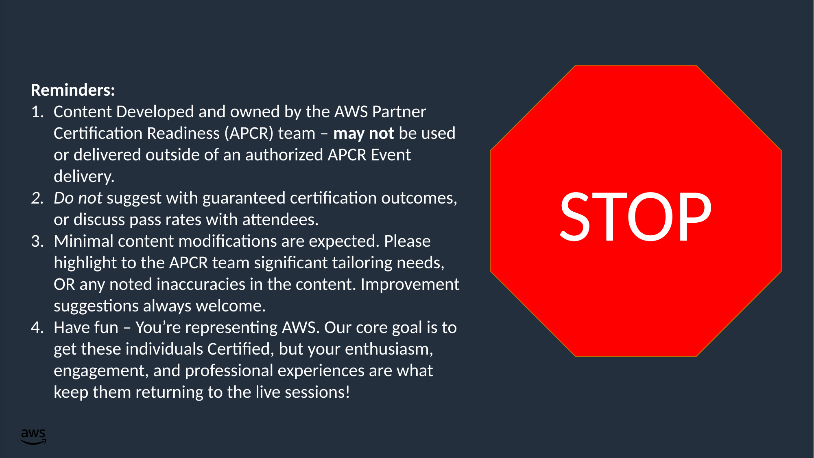

### Notes

FACILITATOR: This slide is hidden on purpose. Confirm it stays hidden, or delete it, before you export a PDF or share the deck with a partner.

The content is APCR-team owned and is licensed only for delivery inside an authorized event. If a partner asks for the deck, point them to the official event materials rather than forwarding this file.

Nothing here is presented to the room. Advance straight past it into the title slide.

---

## Slide 2 — STOP -- read before presenting the Customer Case slides: _(hidden)_

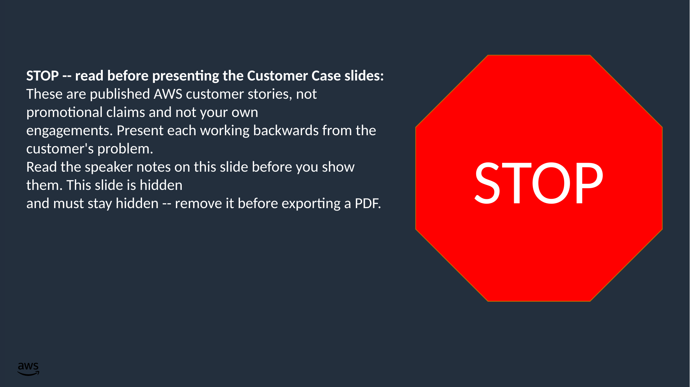

### Notes

WHY THESE SLIDES EXIST: two Customer Case slides ground the session in real customers with real problems. They are NOT promotional. Each works backwards from the customer's challenge, which is why the title is the problem and not the result.

YOU MAY: name the customer exactly as AWS's published page names it; state any figure that appears on that page; describe the services the page names; and point people at the SOURCE link on the slide. Everything on these slides is verified word for word against the published case study.

YOU MAY NOT: add a figure, a service, or an architectural detail that is not on the page. Do not infer how the customer built something. Do not say or imply that an attendee's own customer will get the same result. Do not present these as your own work, and do not use customer logos.

WHY THE RULES ARE THIS TIGHT: a published case study has already been through the customer's own legal and marketing approval, and that approval covers presentations. Anything added on top of it has been approved by nobody, so an added detail is the one thing that turns an approved reference into a problem.

IF A LINK IS DEAD, DROP THE SLIDE. Customer consent can be withdrawn, and AWS then removes the page. A case-study URL that stops working may mean permission lapsed rather than a broken link, so do not present it from a cached copy or an older deck. Tell the APCR team instead.

ON SPEAKING FOR AWS: present these as AWS's published customer stories, not as an AWS position you are announcing and not as your own findings. If someone asks a question the page does not answer, the honest answer is that the case study does not say, and you can follow up.

---

## Slide 3 — Content Review — Session 1

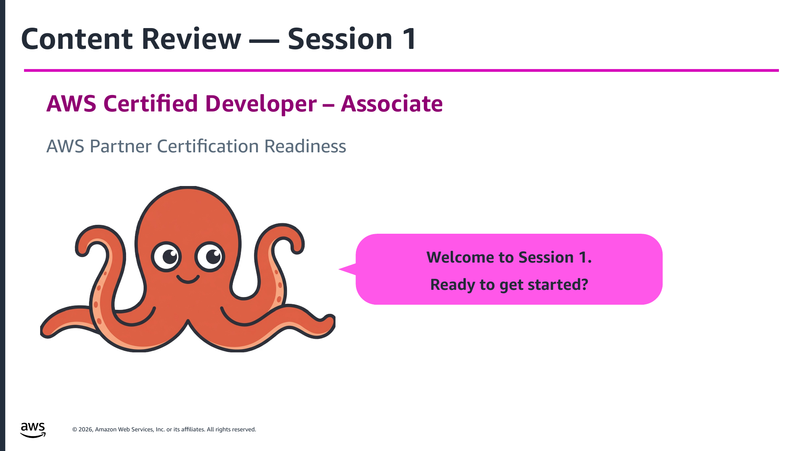

### Notes

FACILITATOR: The opening slide for the first content-review session. Welcome the room, introduce yourself briefly, and set the frame: this is a working session, not a lecture, and everyone here already holds Cloud Practitioner.

Say what the next two hours look like -- roughly half is a fast re-grounding in the week-one services, and half is exam-strategy practice on live questions.

Keep this short. The energy you set here carries into the whole session.

---

## Slide 4 — Event check-in

### Notes

FACILITATOR: A quick pulse check before the content starts. Ask how the first week has gone -- who has started the digital training, who feels behind, what got in the way.

Expect a few people to have fallen behind; that is normal this early. Be encouraging and share a little of your own study experience so the room relaxes and talks.

Keep it to two or three minutes, then move into the weekly summary.

---

## Slide 5 — Event Overview

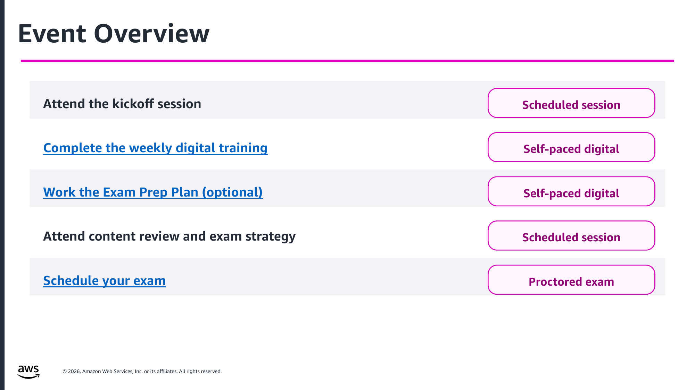

### Notes

WHAT'S HERE: The five things that make up the event, and the modality of each. Walk the room across the rows so everyone knows what is a live session and what is self-paced.

Say the cadence out loud, because the rows do not show it. Grounded in the program guide's Detailed Program Overview: the kickoff happens in week 1 and nothing else, and booking the exam is a week 2 task. Only the weekly digital training and the content review session repeat every week. This is the thing attendees get wrong -- some wait for a second kickoff, and some leave the booking to the end and then do not book at all.

The weekly digital training is the Developer Associate Learning Plan, with weekly expectations reviewed live and listed in the event guide. The optional Exam Prep Plan adds domain-based review and practice tests, and AWS Cloud Quest: Serverless Developer gives hands-on lab practice; both need a Skill Builder subscription. The content review and exam strategy sessions are where an AWS expert walks the key services and reviews sample questions live.

FACILITATOR: Close by pointing at the last row -- scheduling the exam is theirs to own, and encouraging them to book it early keeps the momentum going.

---

## Slide 6 — Week 1 digital training

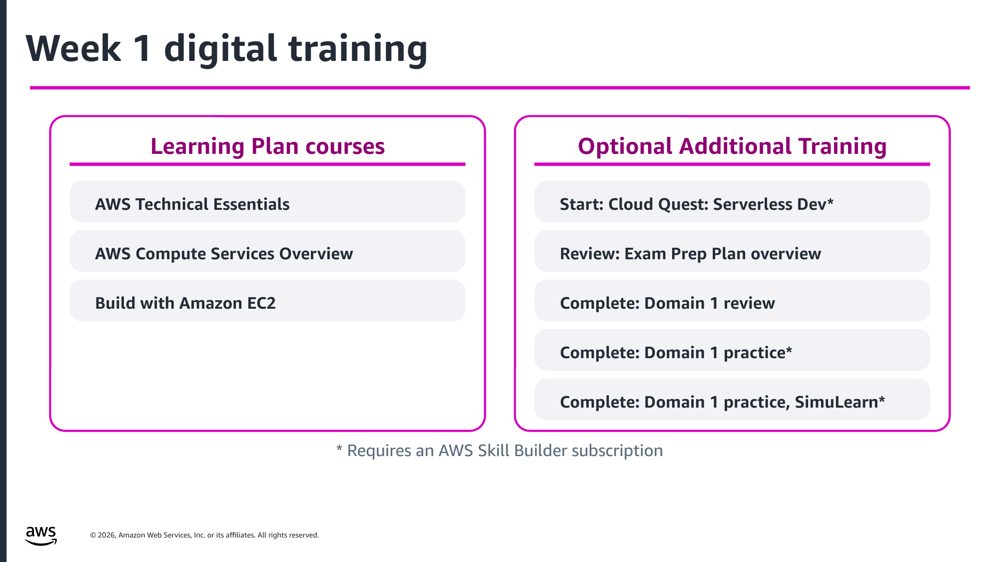

### Notes

WHAT'S HERE: This week's training checklist. The left card is the free Learning Plan; the right card is the optional Exam Prep Plan a subscriber can add.

FACILITATOR: Use this as a check-in. Ask how people are doing with the material and relate it to your own experience studying for the exam -- which modules stood out, what your key takeaways were. Expect some to have fallen behind; show empathy and encourage them to keep at it.

The Exam Prep Plan is the subscription-based, cert-aligned companion plan. Remind the room of the value of Cloud Quest -- the lab practice in particular -- and check whether anyone has tried the labs yet.

Note: the item names beginning "Domain 1" are the actual Exam Prep Plan module names in Skill Builder, so learners can find them; they are navigation, not exam-coverage claims. Keep any talk of exam weighting out of this slide.

---

## Slide 7 — Optional: AWS Skill Builder subscription

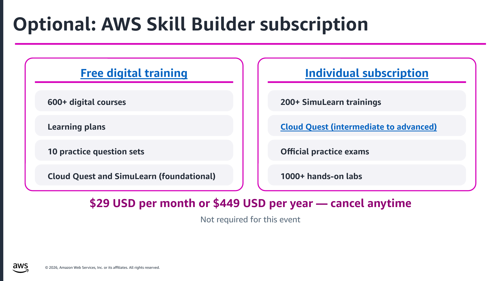

### Notes

WHAT'S HERE: A comparison of what the free Skill Builder tier includes against what an individual subscription adds. The subscription is optional and is not required to take part in this event.

FACILITATOR: Frame the subscription around the labs and practice exams -- the hands-on practice and official practice questions are what most people find worth it when preparing for an Associate exam. Point the room at the Developer Associate Exam Prep Plan they can access during the event, and recommend Cloud Quest for extra lab work.

Verify before delivery: the feature counts and the $29 per month / $449 per year pricing are carried from the source logistics slide and can change. The Skill Builder pricing page does not render for automated checking, so confirm the current numbers on skillbuilder.aws before you state them to the room, and speak to the free tier if you are unsure.

The free tier already covers a great deal, so nobody should feel they must pay to succeed here.

---

## Slide 8 — Where does the workload run?

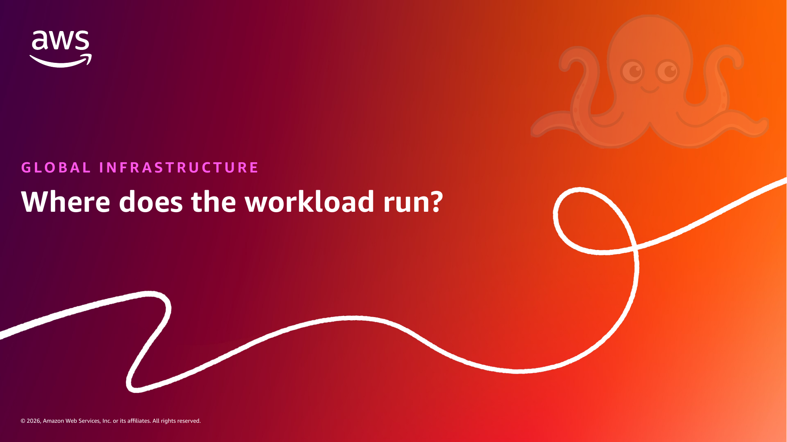

### Notes

WHAT'S HERE: The section opener. Put the question to the room and let two or three people answer before advancing -- most will say "the cloud", which is exactly the vagueness the next three slides fix. This audience already holds Cloud Practitioner, so treat it as a fast re-grounding, not a first lecture.

EXAM RELEVANCE: Regions, Availability Zones, and edge locations are the vocabulary every later networking, resilience, and deployment answer is built on. Getting the hierarchy precise now pays off across the whole exam.

PARTNER CONTEXT: "Where does our data live?" is the first question a customer's security or compliance stakeholder asks. A vague answer here costs trust, so this section exists to make the answer precise.

EXAM MAPPING: Domain 3 (define the AWS global infrastructure).

REFERENCE: https://docs.aws.amazon.com/whitepapers/latest/aws-overview/global-infrastructure.html

---

## Slide 9 — A Region is an isolated geographic choice

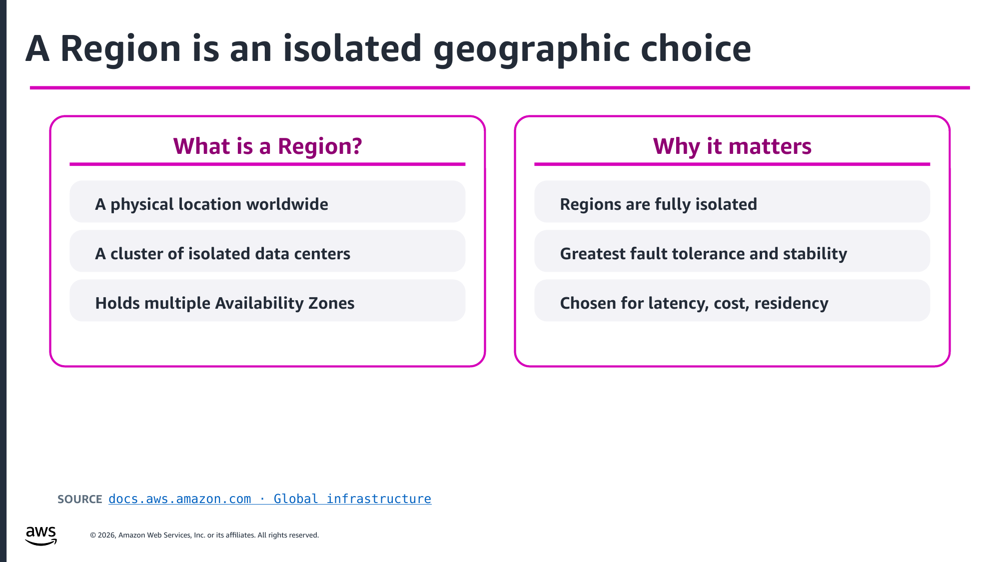

### Notes

WHAT'S HERE: A Region is a separate geographic area that contains multiple, isolated, physically separate Availability Zones. The recap for a Cloud Practitioner holder: Regions are independent of one another, and resources are not automatically copied between them -- you choose a Region and your workload lives there until you decide otherwise.

EXAM RELEVANCE: Know that Regions are isolated from each other and that nothing replicates across them by default. A scenario about data that must stay in one country, or about surviving a regional event, is testing this distinction.

PARTNER CONTEXT: Region selection is usually the first design decision you make with a customer and one of the hardest to reverse. Ask early whether their data is allowed to leave a particular country -- the answer can eliminate options before any architecture work begins.

EXAM MAPPING: Domain 3.

REFERENCE: https://docs.aws.amazon.com/whitepapers/latest/aws-overview/global-infrastructure.html

---

## Slide 10 — Availability Zones survive a data center loss

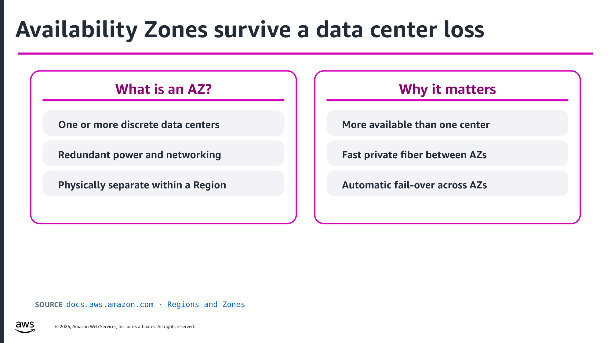

### Notes

WHAT'S HERE: An Availability Zone is one or more discrete data centers with independent power, cooling, and networking, inside a Region. Zones sit far enough apart to fail independently and close enough for low-latency replication over private fiber. Running across two Zones is the standard answer to a single-Zone failure.

EXAM RELEVANCE: If a question describes surviving the loss of a single data center, the answer usually involves multiple Availability Zones -- not multiple Regions. Keep that boundary sharp: multi-AZ protects against a facility failure; multi-Region protects against a regional event and costs considerably more.

PARTNER CONTEXT: This is the distinction customers get wrong most often. Being precise about which one a stated requirement actually needs is a real piece of advisory value, and it often changes the cost of the proposal.

EXAM MAPPING: Domain 3.

REFERENCE: https://docs.aws.amazon.com/AWSEC2/latest/UserGuide/using-regions-availability-zones.html

---

## Slide 11 — Edge locations sit between users and Regions

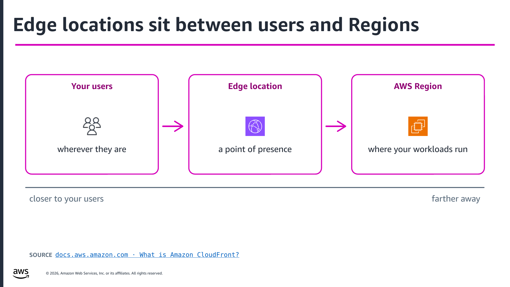

### Notes

WHAT'S HERE: three places, drawn on one axis, and the axis is the lesson. Your users sit on the left, an edge location in the middle, an AWS Region on the right. Read it left to right and the distance is the point.

Point at the middle card first. An edge location is a point of presence -- it is AWS infrastructure that sits nearer your users than any Region does. Nothing runs there in the sense that your application runs in a Region; it is there to be close.

The Region on the right is where your workloads actually run, which is why it carries the compute icon. It is farther away, and that distance is what the edge location exists to shorten.

EXAM RELEVANCE: the vocabulary to hold is that a Region is where you deploy and an edge location is where content is served from. A scenario about reducing latency for users far from your Region is pointing at the edge.

PARTNER CONTEXT: a customer with users on another continent feels this before they can name it. The picture is usually enough to move the conversation from "the app is slow" to "the app is far away", which are different problems with different answers.

Verified against https://docs.aws.amazon.com/AmazonCloudFront/latest/DeveloperGuide/Introduction.html

EXAM MAPPING: Domain 3.

---

## Slide 12 — How do we serve content fast?

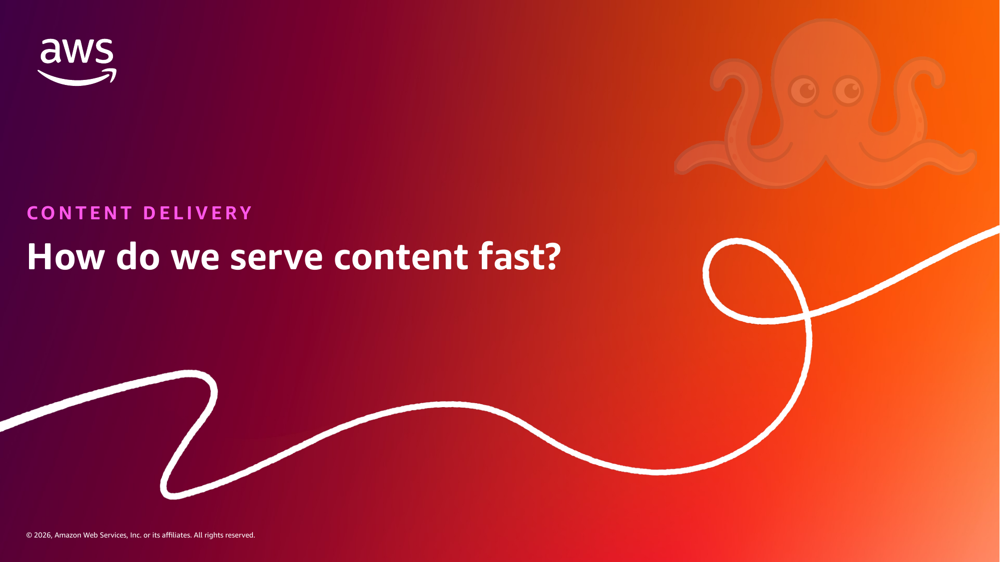

### Notes

WHAT'S HERE: The section opener for content delivery. Ask the room how they would make a website feel fast for a user on the other side of the world, and how they would then keep a paid video or a private document from being shared freely. Those two questions frame the whole section: a delivery layer, then an access-control layer on top of it.

EXAM RELEVANCE: Content delivery scenarios are common on the exam, and they almost always resolve to Amazon CloudFront. Pair that with the mechanisms for handing out temporary, controlled access, and you cover both halves of a very testable topic.

PARTNER CONTEXT: "The app feels slow overseas" and "how do we share this file without making it public" are two of the most frequent customer asks. Both have clean, well-understood AWS answers, which makes this an easy section to add value in.

EXAM MAPPING: Domain 3; Domain 2 (presigned URLs).

REFERENCE: https://docs.aws.amazon.com/AmazonCloudFront/latest/DeveloperGuide/Introduction.html

---

## Slide 13 — CloudFront caches step outward from the viewer

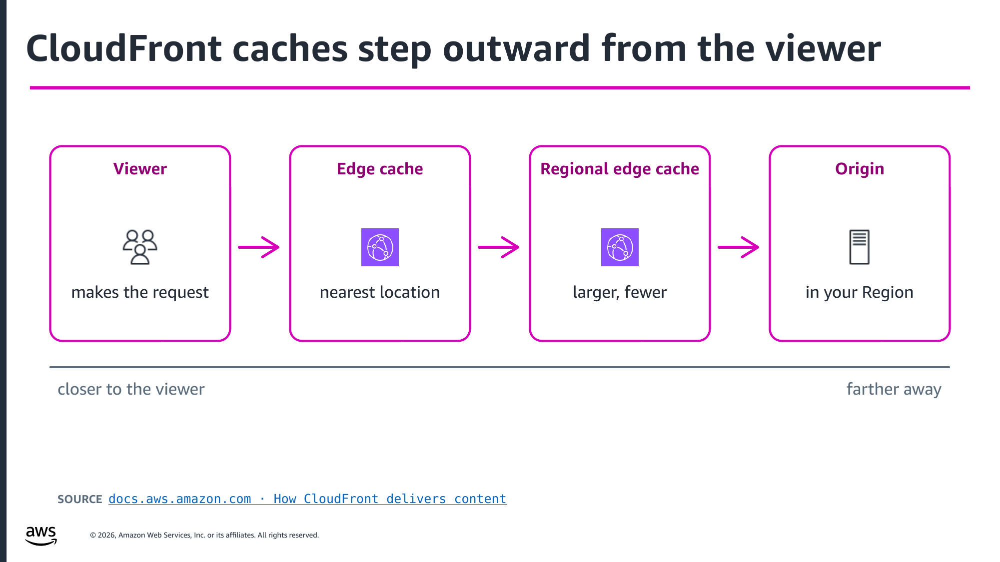

### Notes

WHAT'S HERE: the same axis as before, with the cache tiers filled in. Viewer, edge cache, regional edge cache, origin -- and each step outward is farther from the person waiting.

Walk it outward. The viewer's request reaches the nearest edge cache first. If that cache does not have the object, the request goes to a regional edge cache, which is larger and there are fewer of them. Only if that misses too does the request reach your origin.

Say why the middle tier exists. A regional edge cache holds more, for longer, so an object that has fallen out of a small edge cache can often still be served without troubling the origin at all.

Note that both cache tiers carry the CloudFront icon, because both are CloudFront. The origin is yours -- that is the boundary this picture draws.

EXAM RELEVANCE: the tested idea is that a miss at one tier does not go straight to the origin. A scenario describing origin load dropping after a caching change is describing this hierarchy.

PARTNER CONTEXT: a customer worried about origin capacity during a launch is asking a caching question, and the tiers are what let you answer it without resizing anything.

Verified against https://docs.aws.amazon.com/AmazonCloudFront/latest/DeveloperGuide/HowCloudFrontWorks.html

EXAM MAPPING: Domain 3.

REFERENCE: https://docs.aws.amazon.com/AmazonCloudFront/latest/DeveloperGuide/Introduction.html

---

## Slide 14 — CloudFront speeds static and dynamic content

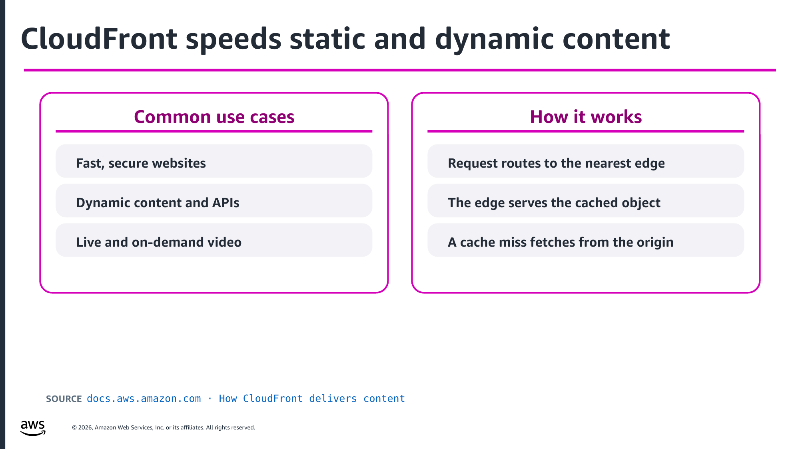

### Notes

WHAT'S HERE: CloudFront speeds up both static and dynamic content. A viewer request is routed to the edge location that can serve it with the lowest latency. If the object is already cached there, the edge returns it immediately; if it is not, the edge fetches it from the origin, such as an Amazon S3 bucket or an HTTP server, caches it, and serves it. Subsequent viewers near that edge get the cached copy.

EXAM RELEVANCE: Know the request path -- viewer to edge, edge to origin only on a cache miss. A question about accelerating APIs or streaming video, not just static files, is testing that CloudFront handles dynamic content too, which learners often forget.

PARTNER CONTEXT: When a customer weighs whether CloudFront is worth it for a mostly dynamic application, the answer is usually yes -- it still terminates connections close to the user and can cache dynamic responses selectively. It is worth correcting the "CDNs are only for images" assumption.

EXAM MAPPING: Domain 3.

REFERENCE: https://docs.aws.amazon.com/AmazonCloudFront/latest/DeveloperGuide/HowCloudFrontWorks.html

---

## Slide 15 — Regional edge caches hold the long tail

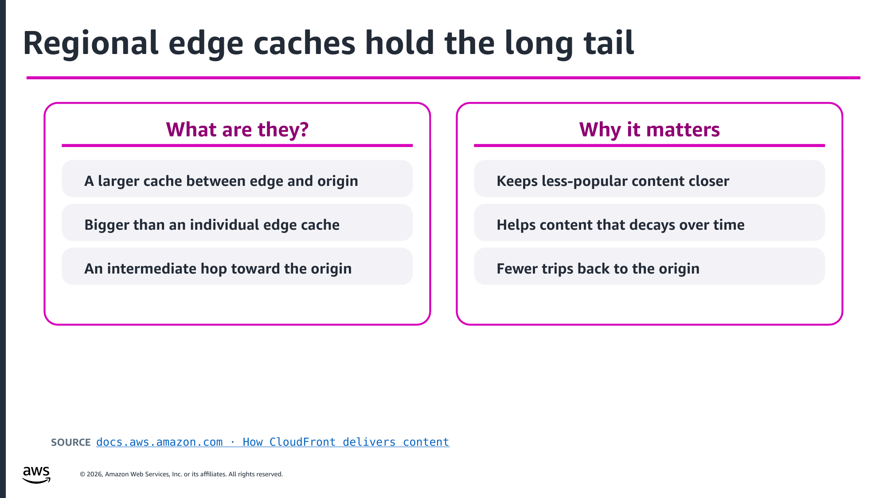

### Notes

WHAT'S HERE: Regional edge caches sit between the edge locations and your origin, and they are larger than an individual edge cache. When content is not requested often enough to stay in an edge location, it can still live in a regional edge cache, so a viewer request checks the edge first, then the regional edge cache, and only reaches the origin if neither has it. This keeps more of your content closer to viewers.

EXAM RELEVANCE: The useful distinction is popularity-driven: edge locations hold the hottest content, regional edge caches hold content whose popularity has faded but is still requested. A scenario about user-generated media or catalogs that cool off over time is pointing at this layer.

PARTNER CONTEXT: This is a detail worth raising when a customer worries that a large, long-tail content library will constantly hit the origin. The regional edge cache absorbs much of that, which can lower origin load and cost without any change to how they publish content.

EXAM MAPPING: Domain 3.

REFERENCE: https://docs.aws.amazon.com/AmazonCloudFront/latest/DeveloperGuide/HowCloudFrontWorks.html

---

## Slide 16 — Presigned URLs grant temporary private access

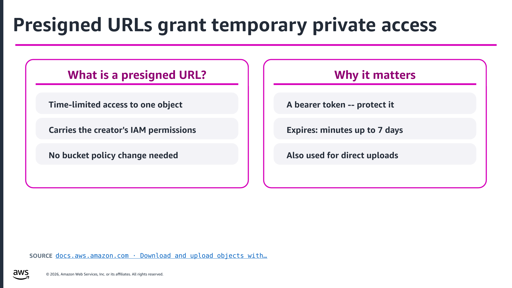

### Notes

WHAT'S HERE: A presigned URL grants time-limited access to a single Amazon S3 object without changing the bucket policy. The person who generates the URL signs it with their own credentials, so the URL can only do what that IAM principal is allowed to do -- and anyone holding the URL can use it until it expires, which is why it is best thought of as a bearer token. The same mechanism works for uploads, letting an outside party put a specific object into a bucket without any AWS credentials of their own.

EXAM RELEVANCE: Watch for expiry behavior. A presigned URL is valid for the shorter of its configured lifetime and the life of the credentials that signed it, so a URL signed with a temporary role session expires when that session does, even if a longer time was requested. Console-generated URLs last up to twelve hours; ones made with the CLI or an SDK can last up to seven days.

PARTNER CONTEXT: When a customer needs to share a private file or accept a direct upload without handing out credentials or making a bucket public, presigned URLs are the clean answer. At the delivery layer, CloudFront signed URLs and signed cookies do the same job for content served through the CDN -- worth naming so the customer picks the right layer.

EXAM MAPPING: Domain 2 (presigned URLs).

REFERENCE: https://docs.aws.amazon.com/AmazonS3/latest/userguide/using-presigned-url.html  ·  CloudFront signed URLs: https://docs.aws.amazon.com/AmazonCloudFront/latest/DeveloperGuide/PrivateContent.html

---

## Slide 17 — What do we build applications on?

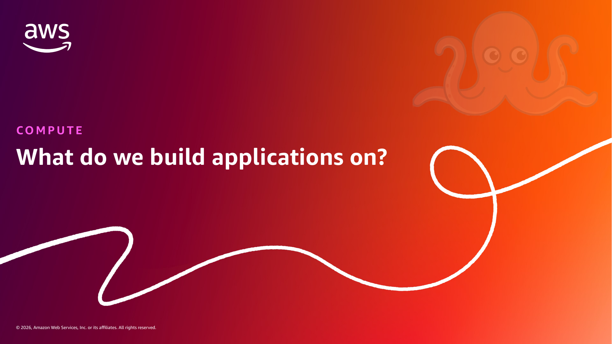

### Notes

WHAT'S HERE: The section opener for compute. Put the question to the room and let a few answers land before advancing. Most will name Amazon EC2, which is the right instinct and also the chance to widen the picture: there is a spectrum from a raw virtual server you manage entirely, through containers, to functions where you manage nothing but the code. This audience already holds Cloud Practitioner, so treat it as a fast re-grounding rather than a first lecture.

EXAM RELEVANCE: Choosing the right compute model for a described workload is a recurring question. The examiner rewards matching the level of control a scenario asks for to the service that provides exactly that much and no more.

PARTNER CONTEXT: "Should this run on EC2, containers, or serverless?" is one of the most common early design conversations with a customer. Framing it as a spectrum of how much you want to manage keeps the discussion concrete instead of religious.

EXAM MAPPING: Domain 1 (select the appropriate compute for the workload).

REFERENCE: https://docs.aws.amazon.com/whitepapers/latest/aws-overview/compute-services.html

---

## Slide 18 — Pick the compute model by how much you manage

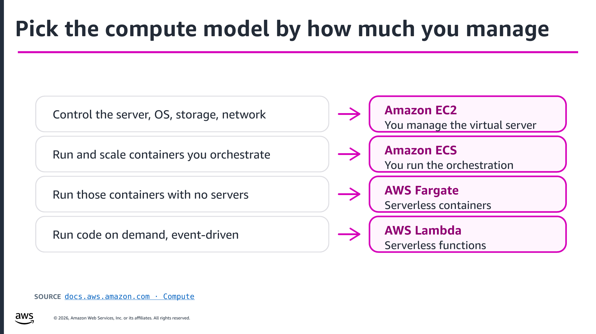

### Notes

WHAT'S HERE: AWS offers a spectrum of compute. Amazon EC2 gives you a full virtual server, so you control the operating system, storage, networking, and scaling. Amazon ECS runs and scales containers whose orchestration you manage. AWS Fargate runs those same containers with no servers for you to provision or patch. AWS Lambda runs your code on demand in response to events, with nothing to manage but the function. The one-line frame for a Cloud Practitioner holder: the less you want to manage, the further right on this list you move.

EXAM RELEVANCE: The distinction the exam leans on is how much the customer wants to manage versus how much they want AWS to manage. A scenario that stresses full OS control points to EC2; one that stresses no server management and short-lived, event-driven work points to Lambda; containers sit between, with Fargate removing the servers.

PARTNER CONTEXT: Reaching for the most managed option that still meets the requirement usually lowers a customer's operational burden and cost. The useful advisory move is to ask what they genuinely need to control before defaulting to EC2 out of habit.

EXAM MAPPING: Domain 1. Service pages: Amazon EC2 (https://docs.aws.amazon.com/AWSEC2/latest/UserGuide/concepts.html), Amazon ECS (https://docs.aws.amazon.com/AmazonECS/latest/developerguide/Welcome.html), AWS Fargate (https://docs.aws.amazon.com/AmazonECS/latest/developerguide/AWS_Fargate.html), AWS Lambda (https://docs.aws.amazon.com/lambda/latest/dg/welcome.html).

REFERENCE: https://docs.aws.amazon.com/whitepapers/latest/aws-overview/compute-services.html

---

## Slide 19 — An AMI is the template an instance launches from

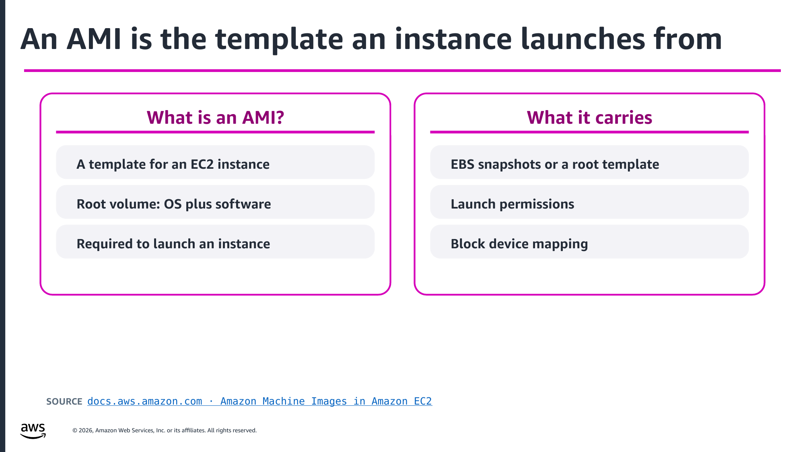

### Notes

WHAT'S HERE: An Amazon Machine Image is the template an EC2 instance is launched from. It contains a root volume image -- the operating system, and any application server and software you have baked in -- along with launch permissions that control which accounts may use it, and a block device mapping that specifies the volumes attached at launch. You must specify an AMI every time you launch an instance, and you can launch as many instances as you like from one AMI. You can also create your own AMI by customizing an instance and saving that configuration.

EXAM RELEVANCE: The testable idea is that the AMI captures the starting state of an instance. A scenario about launching many identical, pre-configured servers quickly is describing a custom AMI, so instances come up ready rather than being configured one by one after boot.

PARTNER CONTEXT: A customer who bakes their dependencies into a custom AMI gets faster, more consistent launches and less configuration drift across a fleet. It is a small practice that pays off directly in Auto Scaling, where new instances must come up ready without manual steps.

EXAM MAPPING: Domain 1; Domain 3 (immutable deployment images).

REFERENCE: https://docs.aws.amazon.com/AWSEC2/latest/UserGuide/AMIs.html

---

## Slide 20 — EC2 works with four kinds of storage

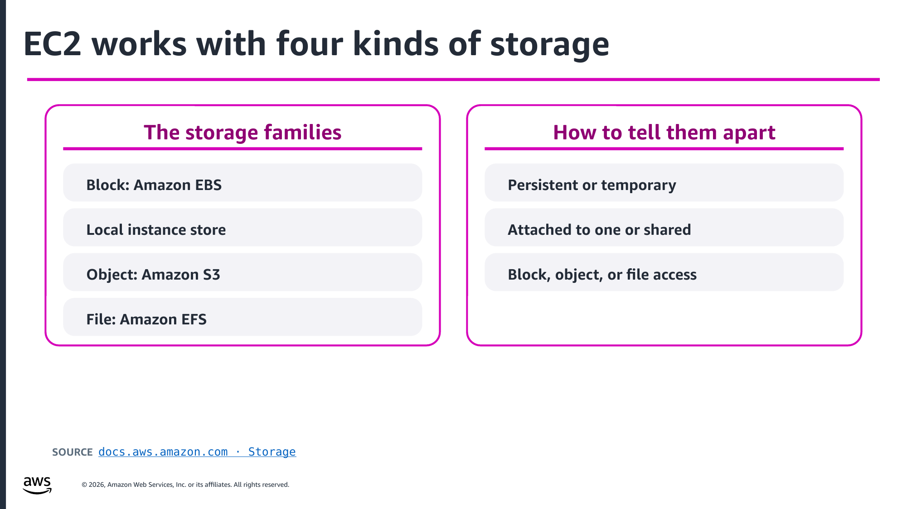

### Notes

WHAT'S HERE: An EC2 instance can work with four different kinds of storage, and each answers a different need. Amazon EBS provides persistent block volumes attached to a single instance. The local instance store provides temporary block storage physically attached to the host, which is fast but lost when the instance stops. Amazon S3 provides durable object storage reached over an API. Amazon EFS provides a shared file system many instances can mount at once. The recap for a Cloud Practitioner holder is to sort any storage question by three questions: does the data need to persist, is it attached to one instance or shared, and is the access pattern block, object, or file.

EXAM RELEVANCE: The examiner tests whether you match the storage type to the requirement. The strongest signals are persistence -- does the data survive the instance stopping -- and sharing -- does one instance need it or many. Those two questions resolve most storage scenarios before you consider anything else.

PARTNER CONTEXT: Customers often reach for the storage they know rather than the one that fits. Walking through persistence and sharing first turns a vague preference into a defensible choice and frequently changes the cost of the design.

EXAM MAPPING: Domain 1 (select appropriate storage for the workload).

REFERENCE: https://docs.aws.amazon.com/whitepapers/latest/aws-overview/storage-services.html

---

## Slide 21 — Match the storage to how the data is used

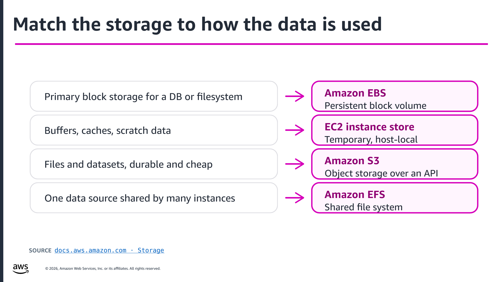

### Notes

WHAT'S HERE: This is the same four storage services, chosen by how the data is used. Amazon Elastic Block Store (Amazon EBS) is persistent block storage, well suited to the primary storage for a database or a file system where you need fine-grained, low-latency access to raw block storage. The EC2 instance store is temporary storage for data that changes constantly, such as buffers, caches, and scratch data, and it is lost when the instance stops. Amazon S3 is reliable, inexpensive object storage for files and datasets accessed over an API. Amazon EFS is a shared file system designed to give many instances parallel access to a common data source.

EXAM RELEVANCE: The two decisive questions are persistence and sharing. Persistent and attached to one instance points to EBS; temporary and host-local points to the instance store; durable, cheap, and reached over an API points to S3; shared across many instances at once points to EFS. A scenario that mentions data surviving a stop, or many instances reading the same files, is testing exactly this.

PARTNER CONTEXT: The instance store catches customers out most often, because its speed is attractive until they learn the data does not survive a stop. Being explicit that instance-store data is ephemeral avoids a painful surprise and steers durable needs to EBS or S3.

EXAM MAPPING: Domain 1. Service pages: Amazon EBS (https://docs.aws.amazon.com/ebs/latest/userguide/what-is-ebs.html), EC2 instance store (https://docs.aws.amazon.com/AWSEC2/latest/UserGuide/InstanceStorage.html), Amazon S3 storage classes (https://docs.aws.amazon.com/AmazonS3/latest/userguide/storage-class-intro.html), Amazon EFS (https://docs.aws.amazon.com/efs/latest/ug/whatisefs.html).

REFERENCE: https://docs.aws.amazon.com/whitepapers/latest/aws-overview/storage-services.html

---

## Slide 22 — Auto Scaling adds instances, it does not enlarge one

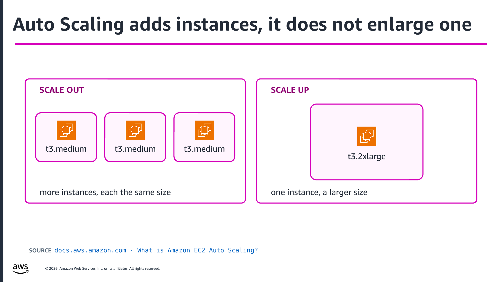

### Notes

WHAT'S HERE: the same distinction drawn as count versus size. On the left, three instances of the identical type. On the right, one instance of a larger type. Both panels are the same size on purpose, so the only difference the eye finds is what changed inside them.

Say which one Auto Scaling does. It adds and removes instances -- the left panel. It does not resize a running instance, which is why the right panel is a different operation entirely and generally means replacing the instance.

The instance icon is deliberately identical in both panels. Only the card grows, because what changes when you scale up is the amount of capacity, not the service.

EXAM RELEVANCE: horizontal and vertical are the vocabulary to hold. A scenario describing capacity that follows demand automatically points at adding instances; one describing a single machine that has run out of memory points at changing its type.

PARTNER CONTEXT: a customer whose workload cannot be split across instances gets a different answer from one whose workload can, and that constraint decides the conversation before cost does.

Verified against https://docs.aws.amazon.com/autoscaling/ec2/userguide/what-is-amazon-ec2-auto-scaling.html

EXAM MAPPING: Domain 1; Domain 4 (cost and performance efficiency).

---

## Slide 23 — AWS Auto Scaling scales the whole application

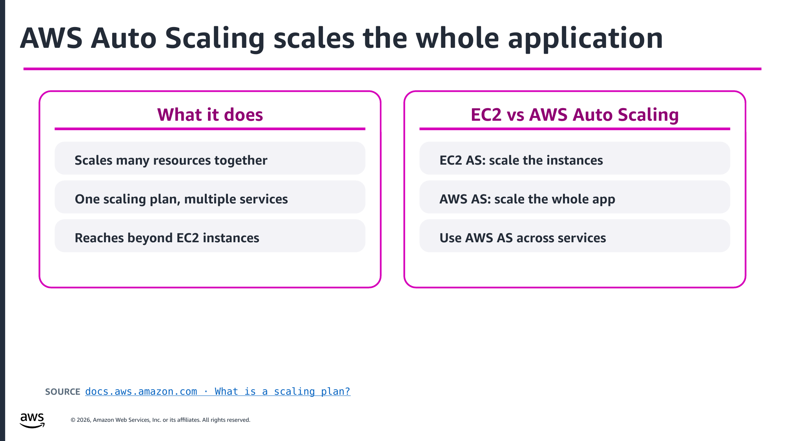

### Notes

WHAT'S HERE: AWS Auto Scaling is a helper that sits above EC2 Auto Scaling. Where EC2 Auto Scaling adjusts a group of EC2 instances, AWS Auto Scaling coordinates scaling for multiple resources across multiple services from a single scaling plan -- for example EC2 instances together with the supporting resources an application depends on. When an application's needs grow, AWS Auto Scaling can grow the related services alongside the instances so the whole application scales together rather than just one tier.

EXAM RELEVANCE: The useful distinction is scope. Use EC2 Auto Scaling to scale a fleet of instances; use AWS Auto Scaling to manage scaling for several resources across services at once. A scenario about keeping an entire application's tiers in step, not just its web servers, is pointing at AWS Auto Scaling.

PARTNER CONTEXT: When a customer scales the compute tier but a downstream resource becomes the new bottleneck, a single scaling plan across the dependent services is a cleaner answer than wiring each one up separately. It is worth raising once the first EC2 Auto Scaling group is in place.

EXAM MAPPING: Domain 1; Domain 4 (performance efficiency).

REFERENCE: https://docs.aws.amazon.com/autoscaling/plans/userguide/what-is-a-scaling-plan.html

---

## Slide 24 — A load balancer spreads traffic across targets

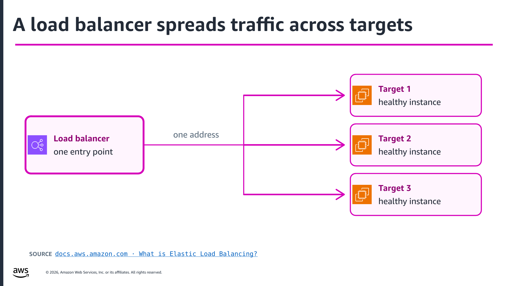

### Notes

WHAT'S HERE: one address on the left, three targets on the right, and traffic arriving at the address being spread across them. The load balancer is the single entry point -- that is what the heavier border is saying.

Point at the fan. Each target gets its own arrow, and each arrow arrives at the middle of its target rather than at a corner, because the balancer treats them as peers.

Say what "healthy" is doing on those cards. The balancer sends traffic only to targets that are passing their health checks, so a target that stops responding simply stops receiving requests. Nothing about the address the client uses changes.

EXAM RELEVANCE: the distinction worth holding is between the entry point and the capacity behind it. A scenario describing one instance failing without an outage is describing health checks plus more than one target.

PARTNER CONTEXT: a customer who has one instance behind a DNS name has no way to take that instance out of service. Introducing the balancer is what makes routine maintenance stop being an outage.

Verified against https://docs.aws.amazon.com/elasticloadbalancing/latest/userguide/what-is-load-balancing.html

EXAM MAPPING: Domain 1; Domain 4 (reliability and availability).

---

## Slide 25 — Working backwards: the network could not keep up

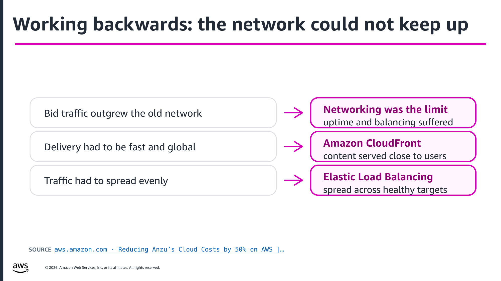

### Notes

WHAT'S HERE: A published AWS case study, so the figures are Anzu's and AWS's rather than ours. Anzu is an in-game advertising company whose solution serves ads to tens of millions of users a day. Read the rows left to right: this is working backwards from the customer's problem.

THE SETUP: at that scale, networking, load balancing, and availability on Anzu's previous provider became the limit. After repeated events in one year, it migrated to AWS and rebuilt the delivery path for its programmatic advertising.

THE DECISION: Anzu delivers ad content through Amazon CloudFront and distributes incoming traffic with Elastic Load Balancing across healthy targets in multiple Availability Zones. Those two services are what this part of the session covers, and they are the pieces to recognize on the slide.

EXAM RELEVANCE: the phrasing to notice is content delivered close to the user and traffic spread across healthy targets. A scenario about global latency points at a content delivery network; a scenario about spreading traffic and routing around a failed target points at a load balancer.

UNDER THE HOOD (say if asked): Anzu runs its bidders and scanners on Amazon EKS with Amazon EC2 Spot Instances and a cluster autoscaler, taking spare capacity at up to a 90 percent discount. EKS and EC2 are covered elsewhere in Session 1.

IF THEY ASK ABOUT RESULTS: the page reports a 30 percent increase in bid request capacity, a 20 percent reduction in ad auction latency, a 50 percent reduction in monthly cloud costs, and 40 percent fewer servers, with the migration completed in 90 days.

PARTNER CONTEXT: when a customer says the application feels slow or fragile under load from many regions, this is the cheapest first place to look -- content delivery and load balancing -- before anyone proposes re-architecting the compute layer.

EXAM MAPPING: Domain 3 (content delivery); Domain 4 (reliability).

ON DELIVERY: the SOURCE link is the published case study. Put it on screen and say plainly that this is the customer we are discussing. Tell the room these pages reward their own time afterwards -- not as exam preparation, but to see the services working together for a real customer.

REFERENCE: https://aws.amazon.com/solutions/case-studies/anzu-case-study/

---

## Slide 26 — How do we run it anywhere?

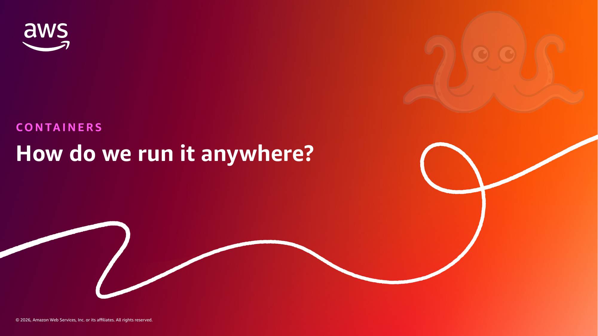

### Notes

WHAT'S HERE: The section opener for containers. Ask the room what problem a container solves before naming a single AWS service. The answer to land is consistency: a container bundles the application with everything it needs to run, so it behaves the same on a laptop, in a test account, and in production. Once that is agreed, the AWS question becomes narrower and more useful -- who runs and scales the containers, and how much of that do you want to manage yourself. This audience already holds Cloud Practitioner, so treat it as fast re-grounding rather than a first lecture.

EXAM RELEVANCE: The three container services in this section -- Amazon ECS, Amazon EKS, and AWS Fargate -- are frequently offered together as answer choices. The distinction that resolves most questions is orchestration model and how much you manage: ECS is the AWS-native orchestrator, EKS is managed Kubernetes, and Fargate removes the servers under either one.

PARTNER CONTEXT: "We want to containerize but do not want to run a cluster" is a common customer position, and it usually points at Fargate. Framing the section as a spectrum of how much the customer manages keeps the ECS-versus-EKS conversation from becoming a preference argument.

EXAM MAPPING: Domain 1 (select appropriate compute); Domain 3 (deploy containerized applications).

REFERENCE: https://docs.aws.amazon.com/AmazonECS/latest/developerguide/Welcome.html

---

## Slide 27 — Amazon ECS runs and scales your containers for you

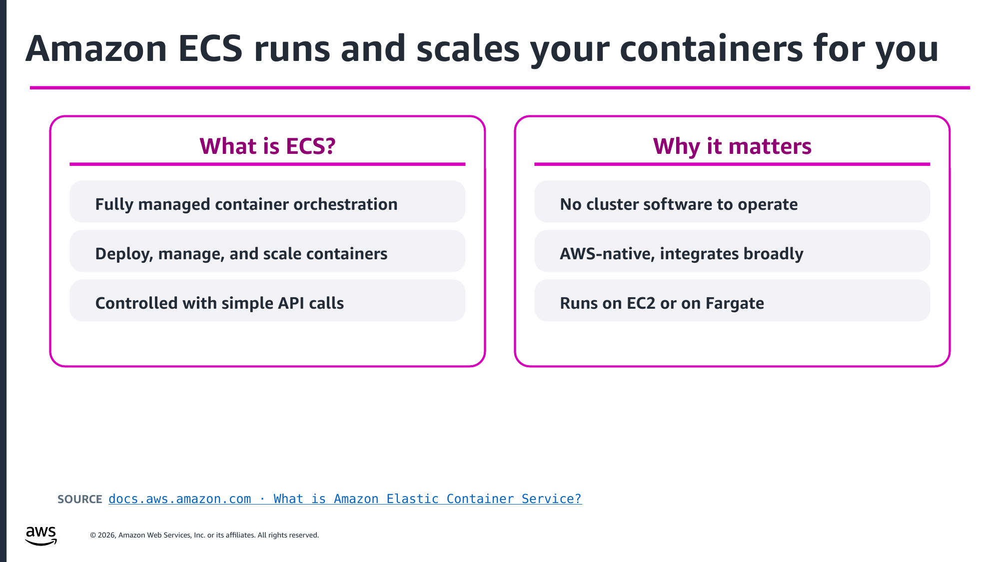

### Notes

WHAT'S HERE: Amazon Elastic Container Service is a fully managed container orchestration service that helps you deploy, manage, and scale containerized applications. With ECS you do not have to operate your own cluster management or configuration systems, and you do not have to worry about scaling that management infrastructure yourself. You launch and stop container-based applications with simple API calls, and ECS handles placing and keeping the containers running. For a Cloud Practitioner holder, the one-line recap is that ECS is the AWS-native way to run containers without standing up your own orchestrator.

EXAM RELEVANCE: The testable idea is that ECS removes the operational work of running an orchestrator. A scenario that stresses an AWS-native container service, deep integration with other AWS services, and not wanting to manage Kubernetes is pointing at ECS. Remember that ECS chooses where the containers run -- on EC2 instances you manage, or on Fargate with no servers.

PARTNER CONTEXT: For a customer new to containers on AWS and not already invested in Kubernetes, ECS is usually the lower-friction starting point because it is native and there is less to learn and operate. It is worth asking whether they have an existing Kubernetes practice before defaulting either way.

EXAM MAPPING: Domain 1; Domain 3.

REFERENCE: https://docs.aws.amazon.com/AmazonECS/latest/developerguide/Welcome.html

---

## Slide 28 — Amazon EKS runs managed Kubernetes for you

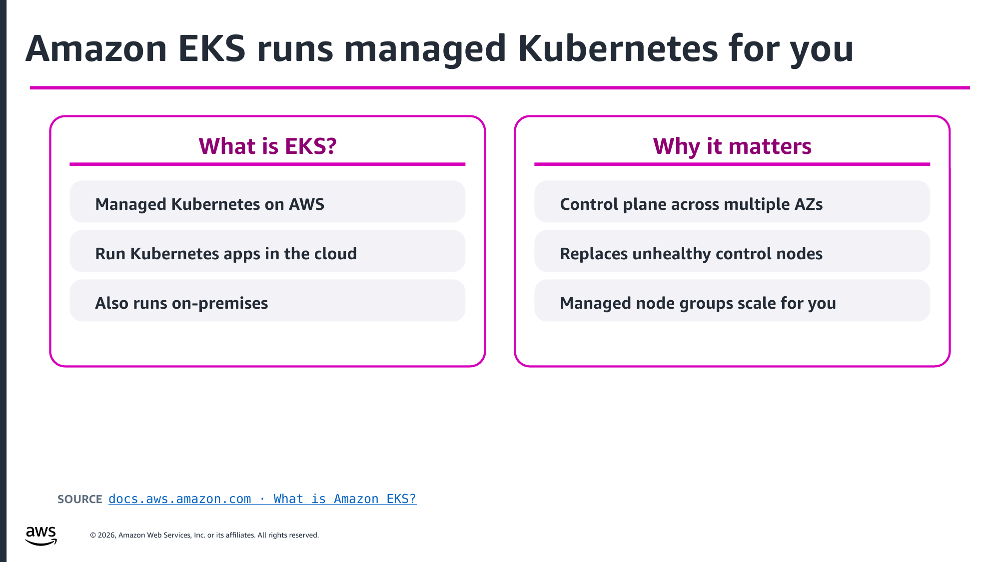

### Notes

WHAT'S HERE: Amazon Elastic Kubernetes Service gives you the flexibility to start, run, and scale Kubernetes applications in the AWS Cloud or on-premises. EKS runs the Kubernetes control plane across multiple Availability Zones, automatically detects and replaces unhealthy control plane nodes, and provides on-demand, zero-downtime upgrades and patching. With EKS managed node groups you do not have to separately provision the compute capacity that scales your Kubernetes applications. The one-line recap for a Cloud Practitioner holder: EKS is Kubernetes with AWS running the hard parts of the control plane.

EXAM RELEVANCE: The distinction that matters is that EKS is the choice when a customer specifically wants Kubernetes -- its APIs, its ecosystem, or an existing Kubernetes practice they want to bring to AWS. A scenario that names Kubernetes, or portability between on-premises and the cloud, is pointing at EKS rather than ECS.

PARTNER CONTEXT: A customer with an existing Kubernetes investment gets to keep their tooling and skills on EKS, which is often the deciding factor over ECS. If they have no such investment, raise whether the added Kubernetes surface is worth it before recommending EKS by default.

EXAM MAPPING: Domain 1; Domain 3.

REFERENCE: https://docs.aws.amazon.com/eks/latest/userguide/what-is-eks.html

---

## Slide 29 — AWS Fargate runs those containers with no servers

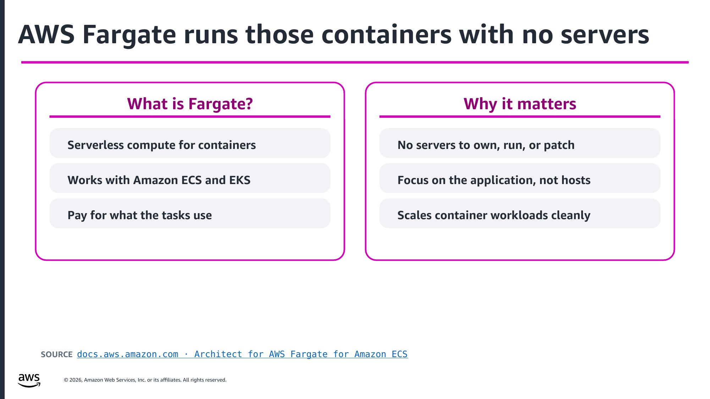

### Notes

WHAT'S HERE: AWS Fargate is a serverless, pay-as-you-go compute engine that lets you run containers without managing servers. It is not a third orchestrator; it is a launch mode that works with both Amazon ECS and Amazon EKS, running and scaling your containerized workloads without you provisioning, patching, or right-sizing any EC2 hosts. Fargate removes the need to own, run, and manage the lifecycle of the compute infrastructure, so the team focuses on building the application and its microservices. The one-line recap for a Cloud Practitioner holder: Fargate is how ECS or EKS runs your containers when you do not want servers at all.

EXAM RELEVANCE: The pairing to hold is that Fargate sits underneath ECS or EKS as the no-servers option, and it is chosen when a scenario stresses removing infrastructure management rather than a particular orchestrator. A question that offers ECS, EKS, and Fargate together is usually testing whether you know Fargate is the serverless way to run the other two.

PARTNER CONTEXT: When a customer wants containers but has no appetite to run a fleet of EC2 hosts, Fargate is the clean answer and it pairs with whichever orchestrator they chose. The trade to name honestly is that the convenience has a per-task cost model, so a steady, high-utilization workload is worth comparing against EC2 launch type.

EXAM MAPPING: Domain 1; Domain 3.

REFERENCE: https://docs.aws.amazon.com/AmazonECS/latest/developerguide/AWS_Fargate.html

---

## Slide 30 — Amazon ECR stores the container images you run

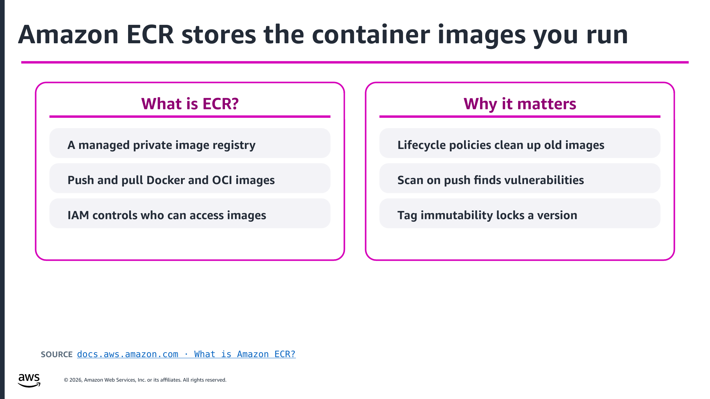

### Notes

WHAT'S HERE: Amazon Elastic Container Registry is a fully managed container image registry that is secure, scalable, and reliable. You build a container image from a Dockerfile, push it to a private ECR repository, and then Amazon ECS, Amazon EKS, or AWS Fargate pulls that image to run it -- so ECR is the store that sits between building an image and running it. Access to private repositories is controlled with AWS IAM, and you can push, pull, and manage Docker and Open Container Initiative images with your preferred CLI. The one-line recap for a Cloud Practitioner holder: the container services you just saw run images, and ECR is where those images live.

EXAM RELEVANCE: A few ECR capabilities recur. Lifecycle policies define rules that clean up unused images so a repository does not grow without bound. Image scanning can be set to scan on push, so each new image is checked for known software vulnerabilities as it arrives. Tag immutability prevents a tag such as a release version from being overwritten, which keeps a deployed version from silently changing. A scenario about where container images are stored, or about automatically removing old images, is pointing at ECR.

PARTNER CONTEXT: When a customer moves containers to AWS, ECR is the natural place to keep their images close to the services that run them, with IAM instead of a separately managed registry credential. Scan-on-push and tag immutability are two low-effort settings worth raising early, because they add supply-chain safety before a pipeline is built rather than after.

EXAM MAPPING: Domain 3 (container images -- build, tag, lifecycle) (deploy containerized applications) / 3.3.2.

REFERENCE: https://docs.aws.amazon.com/AmazonECR/latest/userguide/what-is-ecr.html

---

## Slide 31 — Working backwards: server farms ran nonstop

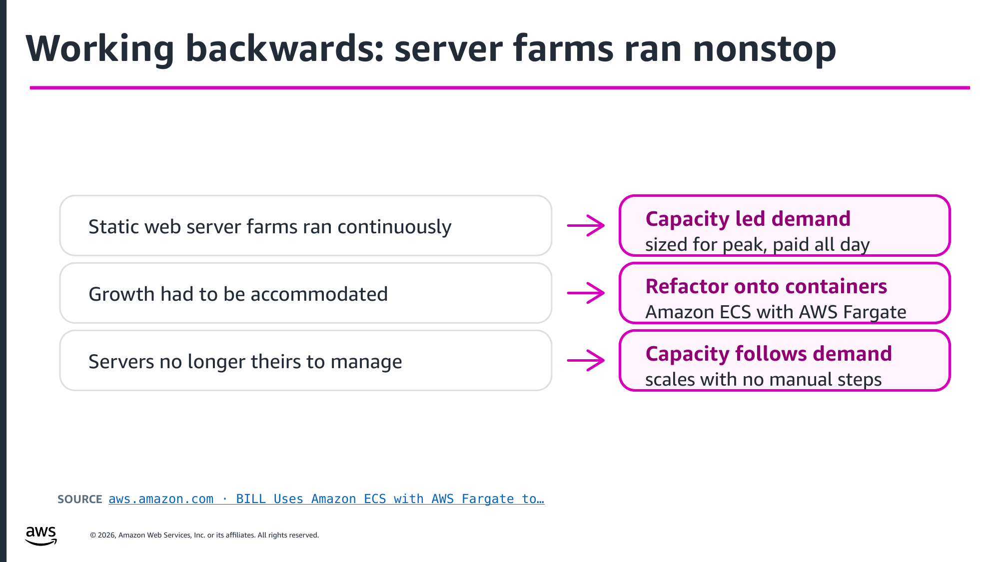

### Notes

WHAT'S HERE: A published AWS case study, so every figure here is BILL's and AWS's rather than ours. BILL is a financial operations platform for small and midsize businesses. Read the rows left to right and you are working backwards from the customer's problem.

THE SETUP: BILL previously ran static web server farms continuously -- capacity sized for peak and paid for around the clock. To grow more flexibly, it moved to the cloud and began refactoring its core applications.

THE DECISION: BILL migrated those applications to Amazon ECS with AWS Fargate. Fargate is a serverless compute engine for containers, so developers stopped sizing and patching servers and let capacity follow demand rather than lead it.

EXAM RELEVANCE: this is the compute and container material made real. The point is not that containers beat servers everywhere; a serverless container platform fit a workload that had to scale with traffic. A workload characteristic points at a service.

IF THEY ASK ABOUT RESULTS: the page reports the front end handling around 150,000 to 200,000 requests per minute with scaling, and running interruption-tolerant tasks on AWS Fargate Spot at up to a 70 percent discount.

ALSO ON THE PAGE: BILL now spins up new environments in a few weeks rather than a couple of months. State these figures if asked; do not lead with them, and do not imply another customer will see the same.

PARTNER CONTEXT: the row a developer reacts to is the last one -- new environments in weeks instead of months. Cost gets a nod in a business case, but shipping faster is what changes what a team will commit to.

EXAM MAPPING: Domain 1 (containers and compute); Domain 3 (deploy).

ON DELIVERY: the SOURCE link is the published case study. Put it on screen and say plainly that this is the customer we are discussing. Tell the room these pages reward their own time afterwards -- not as exam preparation, but to see the services working together for a real customer.

REFERENCE: https://aws.amazon.com/solutions/case-studies/bill-ecs-case-study/

---

## Slide 32 — What network do we build inside?

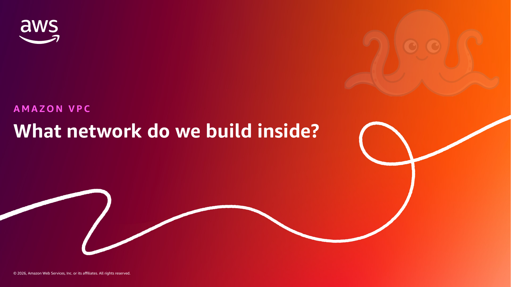

### Notes

WHAT'S HERE: The section opener for networking. Before naming a feature, agree on the question a virtual private cloud answers -- where do our resources actually live, and who can reach them. An Amazon VPC is your own logically isolated section of the AWS Cloud, a virtual network you define and control. This audience already holds Cloud Practitioner, so treat it as fast re-grounding: the VPC is the private network your compute and databases sit inside, isolated from other customers by default.

EXAM RELEVANCE: Networking questions in this session are less about drawing a topology and more about which control does which job -- a VPC provides the isolated network, subnets place resources across Availability Zones, and security groups and network ACLs filter the traffic. Framing the whole block as layers of control makes the later security-group-versus-network-ACL question much easier to answer.

PARTNER CONTEXT: Customers moving from on-premises often ask how AWS keeps their environment separate from everyone else's. The VPC is the honest answer, and it connects back to their existing network through a VPN or AWS Direct Connect, so it is familiar ground rather than a wholly new concept.

EXAM MAPPING: Domain 2 (security); Domain 1 (development). Section divider -- no single service claim.

REFERENCE: https://docs.aws.amazon.com/vpc/latest/userguide/what-is-amazon-vpc.html

---

## Slide 33 — A VPC contains your subnets

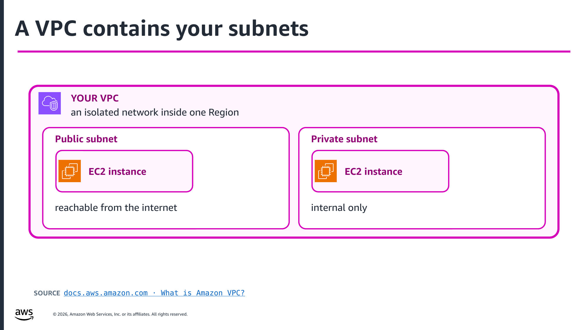

### Notes

WHAT'S HERE: containment, drawn rather than described. The outer boundary is your VPC. Inside it are two subnets, and inside each subnet is an instance. Nothing on this slide says "contains" -- the geometry says it.

Point at the nesting from the outside in. The VPC is an isolated network inside one Region. A subnet is a slice of that network. An instance lives in exactly one subnet, which means it lives in exactly one VPC.

The difference between the two subnets is reachability, not size. The public subnet can be reached from the internet; the private one cannot. Both are inside the same VPC and both are yours.

EXAM RELEVANCE: the vocabulary is the exam-relevant part -- VPC, subnet, instance, in that order of containment. A scenario asking where a resource can be reached from is a subnet question before it is anything else.

PARTNER CONTEXT: "where does my thing actually live" is the hardest question at this level, and a picture answers it faster than a paragraph. Once a customer can see the nesting, security group and route table conversations get much shorter.

Verified against https://docs.aws.amazon.com/vpc/latest/userguide/what-is-amazon-vpc.html

EXAM MAPPING: Domain 2 (security); Domain 1 (development).

---

## Slide 34 — Some AWS services sit outside your VPC

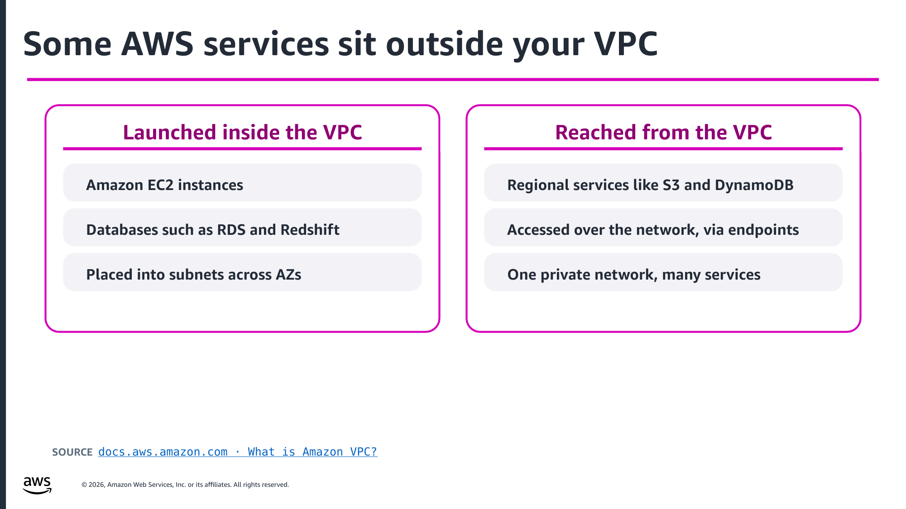

### Notes

WHAT'S HERE: This slide answers a question that trips people up early: does everything sit inside the VPC? Resources such as Amazon EC2 instances and databases like Amazon RDS and Amazon Redshift are launched into your VPC's subnets, so they get private addresses inside your network. Other services -- Amazon S3 and Amazon DynamoDB are the usual examples -- are regional services that live outside any single VPC and are reached over the network. The recap for a Cloud Practitioner holder is that the VPC is where your own compute and databases live, and it is also the private vantage point from which you reach the wider set of AWS services.

EXAM RELEVANCE: The distinction to carry forward is between resources you place inside a subnet and services you connect to. That difference is exactly what makes VPC endpoints matter a few slides from now: they are how a VPC reaches services like S3 and DynamoDB privately rather than over the public internet. A scenario that mixes "in my VPC" resources with regional services is testing whether you know the line between the two.

PARTNER CONTEXT: When a customer assumes every AWS service must be dragged inside their VPC, this is the correction that saves them effort -- the network is where their instances and databases belong, and managed regional services are reached from it, cleanly and privately when needed.

EXAM MAPPING: Domain 1 (development); Domain 2 (security).

REFERENCE: https://docs.aws.amazon.com/vpc/latest/userguide/what-is-amazon-vpc.html

---

## Slide 35 — Two firewalls, at two different boundaries

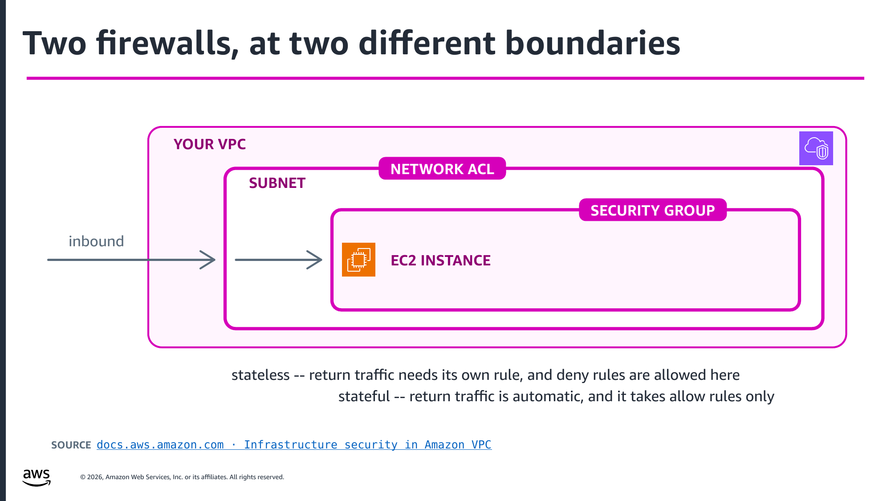

### Notes

WHAT'S HERE: one picture instead of two lists. Point at the bars, not the boxes -- each bar sits on the edge it actually guards. The network ACL bar is on the subnet's edge, the security group bar is on the instance's edge, and the instance sits inside the subnet, which sits inside the VPC.

Walk the arrow. Inbound traffic meets the network ACL first, because it reaches the subnet before it reaches any instance. Then it meets the security group. That order is the thing a comparison table cannot show, and it is why the two are not interchangeable.

Say the two mechanical differences out loud. A security group is stateful, so return traffic for an allowed request comes back automatically and you write allow rules only. A network ACL is stateless, so the return direction needs its own rule, and it accepts deny rules as well as allow.

EXAM RELEVANCE: the tested distinction is WHERE each one attaches, not what each one is called. A question describing traffic blocked for every instance in a subnet is pointing at the network ACL; one describing traffic blocked for a single instance is pointing at the security group.

PARTNER CONTEXT: a customer reporting that one instance is unreachable while its neighbours are fine has a security group question. A customer reporting a whole tier unreachable has a subnet-level question. The picture tells you which layer to open first.

Verified against https://docs.aws.amazon.com/vpc/latest/userguide/vpc-security-groups.html and https://docs.aws.amazon.com/vpc/latest/userguide/vpc-network-acls.html

EXAM MAPPING: Domain 2 (security).

---

## Slide 36 — A network ACL is a stateless firewall on the subnet

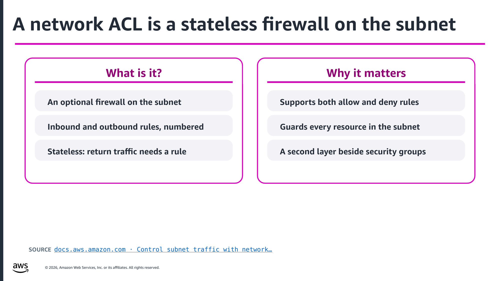

### Notes

WHAT'S HERE: A network access control list is an optional layer of security for your VPC that acts as a firewall controlling traffic in and out of one or more subnets. Where a security group sits on the resource, a network ACL sits on the subnet boundary, so it applies to everything in that subnet. It evaluates numbered rules in order, and unlike a security group it is stateless -- return traffic is not automatically allowed, so you write rules for both directions. The recap for a Cloud Practitioner holder is that the network ACL is the perimeter firewall at the subnet edge.

EXAM RELEVANCE: The contrast with the previous slide is the whole point. A network ACL is stateless and supports both allow and deny rules, evaluated in numbered order until one matches. So a scenario that needs an explicit deny -- for example blocking a specific address range -- points at a network ACL, because a security group cannot deny. Keeping stateful-versus-stateless and allow-only-versus-allow-and-deny straight answers most of these questions.

PARTNER CONTEXT: When a customer wants a broad guardrail across a whole subnet, or specifically needs to block something, the network ACL is the tool, and it complements rather than replaces their security groups. Presenting the two together as resource-level and subnet-level layers keeps the conversation from turning into an either-or choice.

EXAM MAPPING: Domain 2 (security).

REFERENCE: https://docs.aws.amazon.com/vpc/latest/userguide/vpc-network-acls.html

---

## Slide 37 — Security groups can reference each other

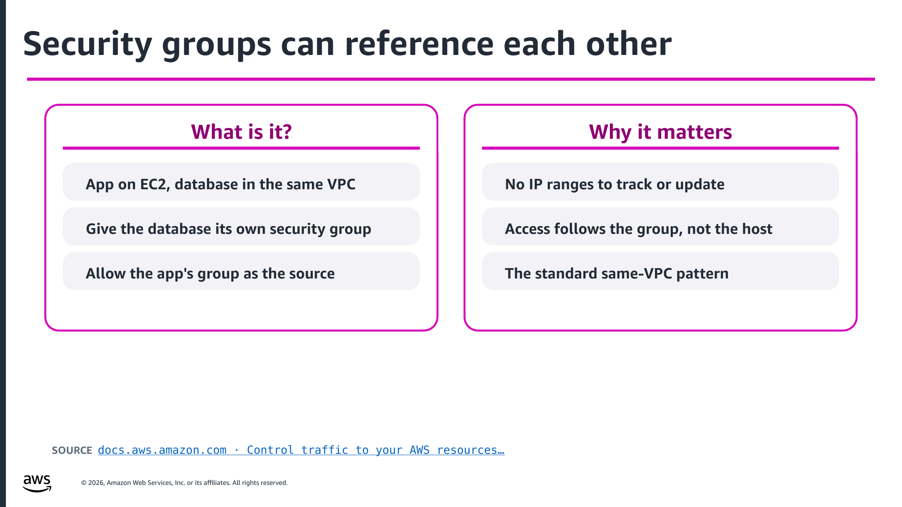

### Notes

WHAT'S HERE: A common use of a database instance in a VPC is to share data with an application server running on an EC2 instance in the same VPC. The simplest way to manage that access is to create a security group for the database and, in its inbound rule, allow the application server's security group as the source rather than a range of IP addresses. The recap for a Cloud Practitioner holder is that security groups can reference each other, so access is expressed in terms of roles -- the app tier reaches the database tier -- rather than in terms of addresses.

EXAM RELEVANCE: The testable idea is referencing a security group as the source in another security group's rule. Because the rule names a group rather than an address, it keeps working as instances are added, removed, or replaced -- there is nothing to renumber. A scenario about letting an application tier reach a database tier in the same VPC, without hardcoding IP addresses, is pointing at this pattern.

PARTNER CONTEXT: For a customer, referencing groups instead of addresses is what makes a tiered application maintainable -- the rule survives Auto Scaling replacing instances, which ties directly back to the scaling and load-balancing conversation earlier in this session.

EXAM MAPPING: Domain 2 (security).

REFERENCE: https://docs.aws.amazon.com/vpc/latest/userguide/vpc-security-groups.html

---

## Slide 38 — A VPC endpoint keeps traffic on the AWS network

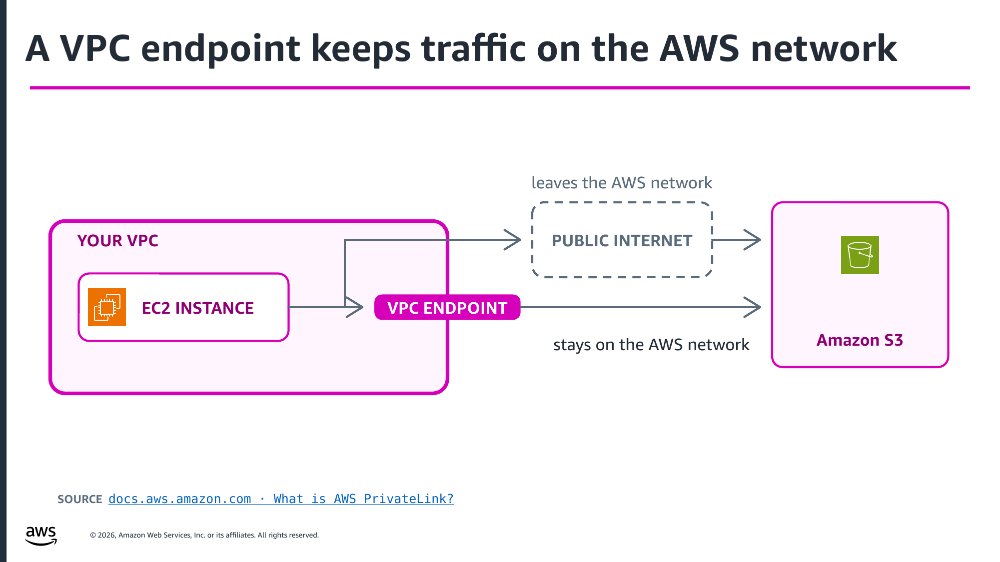

### Notes

WHAT'S HERE: two paths to the same destination, and the difference is whether the traffic ever leaves the AWS network. Point at the dashed box first -- that is the public internet, and it is drawn dashed because it is not a resource you own or control.

Follow the upper path. It leaves the VPC, crosses the internet, and arrives at Amazon S3. The data gets there, but it has travelled somewhere you do not administer.

Now the lower path. It goes through a VPC endpoint sitting on the VPC's own boundary and reaches the same service without touching the dashed box at all. That is the whole idea: same destination, private route.

EXAM RELEVANCE: the tested distinction is the ROUTE, not the permission. A scenario that says traffic to an AWS service must not traverse the public internet is describing an endpoint, and it is a networking answer rather than an IAM one.

PARTNER CONTEXT: a customer under a data-handling obligation often cannot accept a public path even when the traffic is encrypted, because the requirement is about the route rather than the confidentiality. The endpoint is what lets you say the traffic stayed inside.

Verified against https://docs.aws.amazon.com/vpc/latest/privatelink/what-is-privatelink.html

EXAM MAPPING: Domain 2 (security); forward pointer to task 2.3 (Session 5, AI service security -- skippable for the current live exam).

---

## Slide 39 — How do we route users to our app?

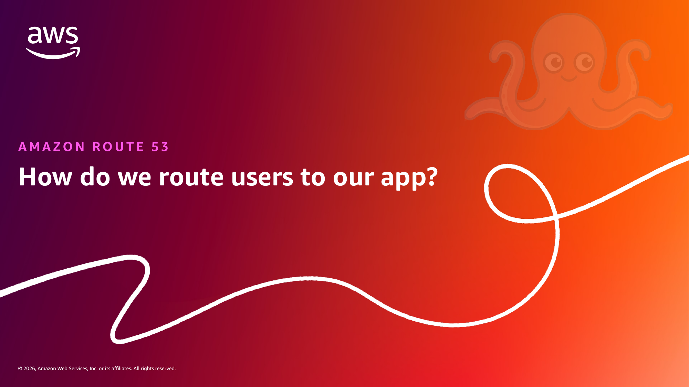

### Notes

WHAT'S HERE: The section opener for DNS. Ask the room how a user's browser actually finds the application once it is deployed behind a load balancer and a scaled fleet. The answer is the Domain Name System, and on AWS that service is Amazon Route 53. It connects user requests to infrastructure running in AWS and is a highly available and scalable cloud DNS web service. This audience holds Cloud Practitioner, so this is fast re-grounding: Route 53 is the front-of-the-front-door that translates a name into the right endpoint.

EXAM RELEVANCE: Route 53 shows up in scenarios about directing users to the right place -- routing by latency, by geography, or by the health of an endpoint -- and as part of high-availability designs where it fails traffic over from an unhealthy target to a healthy one. Recognizing it as the DNS layer that sits in front of load balancers and other resources is usually enough to place it correctly.

PARTNER CONTEXT: For a customer, Route 53 is where global routing decisions and failover behavior are expressed, so it is the natural next conversation after load balancing and Auto Scaling -- those keep a Region healthy, and Route 53 decides which endpoint a user reaches in the first place.

EXAM MAPPING: Domain 1 (development); Domain 4 (reliability and availability). Section divider -- no single service claim.

REFERENCE: https://docs.aws.amazon.com/Route53/latest/DeveloperGuide/Welcome.html

---

## Slide 40 — Route 53 directs users to the right endpoint

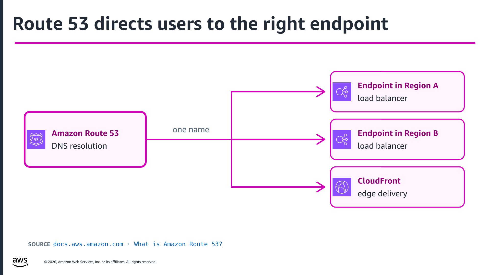

### Notes

WHAT'S HERE: one name on the left, three possible endpoints on the right, and Route 53 choosing between them. The heavier border marks the thing doing the deciding.

Say what a resolution actually returns. A client asks for your domain name and gets back an address. Which address it gets is the decision Route 53 makes, and the three cards are the candidates it can choose from.

Point out that the candidates are not all the same kind of thing -- two are load balancers in different Regions, one is a CloudFront distribution. Route 53 does not care; it answers with whichever endpoint its records point at.

The client only ever knows the name. That is why this sits in front of everything else: the endpoint can change without anything changing for the person typing the address.

EXAM RELEVANCE: the distinction to hold is between resolving a name and balancing traffic. Route 53 answers the question "which address"; a load balancer answers "which target". A scenario spanning Regions is usually the first of those.

PARTNER CONTEXT: a customer who wants to move traffic between Regions without touching client configuration is describing DNS. Being clear that the name is the stable part is what makes the rest of the design negotiable.

Verified against https://docs.aws.amazon.com/Route53/latest/DeveloperGuide/Welcome.html

EXAM MAPPING: Domain 1 (development); Domain 4 (reliability and availability).

---

## Slide 41 — Who can do what in AWS?

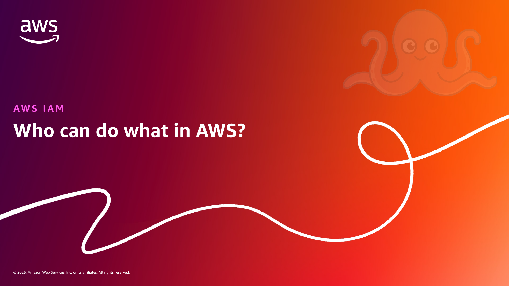

### Notes

WHAT'S HERE: The section opener for identity and access. Before any feature, agree on the question IAM answers -- who is allowed to take which action, on which resource, under which conditions. AWS Identity and Access Management is the service that lets you manage that access centrally across all of AWS. This audience already holds Cloud Practitioner, so treat it as fast re-grounding: IAM is where identities live and where permissions are granted, and it is the control plane behind almost every security decision in the cloud.

EXAM RELEVANCE: Security is a large share of this exam, and most of it runs through IAM. The block ahead builds up in layers -- users and groups are the identities, roles grant temporary permissions, the Security Token Service issues the short-lived credentials, and policies express what is actually allowed. Holding that structure in mind is what makes an individual policy or role question easy rather than fiddly.

PARTNER CONTEXT: Customers moving to AWS often ask how to give their teams and applications exactly the access they need and nothing more. IAM is the honest answer, and least-privilege is the principle that keeps that access tight. It is familiar ground for anyone who has managed users and permissions before, now expressed as policies.

EXAM MAPPING: Domain 2 (security). Section divider -- no single service claim.

REFERENCE: https://docs.aws.amazon.com/IAM/latest/UserGuide/introduction.html

---

## Slide 42 — IAM decides who can access what, and how

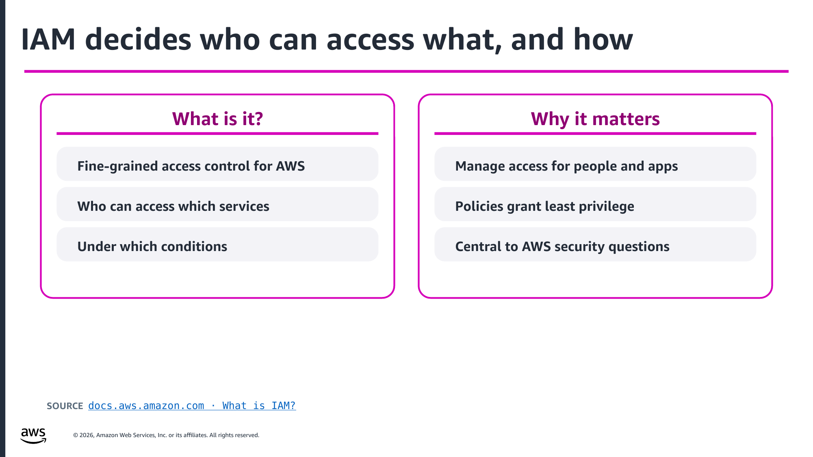

### Notes

WHAT'S HERE: AWS Identity and Access Management provides fine-grained access control across all of AWS. With IAM you specify who -- which person or application -- can access which services and resources, and under which conditions. The mechanism that expresses all of that is the IAM policy: policies let you manage permissions for your workforce and your systems so that each identity has least-privileged access. The one-line recap for a Cloud Practitioner holder is that IAM is the front door to every AWS action, and a policy is the written rule that opens or closes it.

EXAM RELEVANCE: The idea to carry is that permission questions come down to a policy attached to an identity or a resource. When a scenario asks whether an action will succeed, or how to grant only the access that is required, it is pointing at IAM and at the principle of least privilege. Recognizing the who / what / under-which-conditions shape of an IAM decision is most of the work.

PARTNER CONTEXT: For a customer, IAM is where they translate their organizational structure into access -- teams, applications, and services each get exactly the permissions their job needs. Framing it as least privilege from the start avoids the far more painful conversation about over-broad access later.

EXAM MAPPING: Domain 2 (security).

REFERENCE: https://docs.aws.amazon.com/IAM/latest/UserGuide/introduction.html

---

## Slide 43 — A group applies permissions to many users

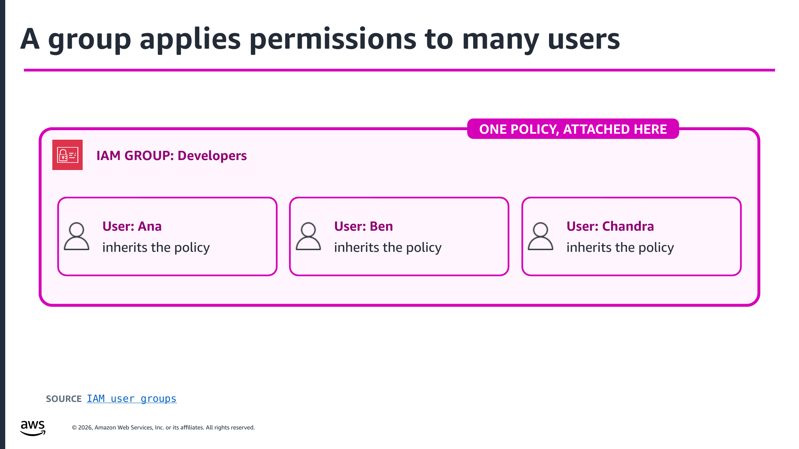

### Notes

WHAT'S HERE: a group holding three users, with one policy attached to the group rather than to any of them. Point at the chip on the boundary first -- its position is the whole lesson.

Say what that buys you. The permissions are written once, on the group. Every user inside receives them, so adding a fourth developer is adding them to the group, not writing a fourth policy.

And the reverse, which is the part that matters operationally. Removing someone's access means removing them from the group. You are not hunting through per-user permissions hoping you found all of them.

Note that the users are drawn inside the group deliberately. Membership is what carries the permissions, so a user outside the boundary has none of them.

EXAM RELEVANCE: the tested idea is that policies attach to the group and users inherit through membership. A scenario about granting the same access to several people points at a group rather than at repeated per-user grants.

PARTNER CONTEXT: a customer managing permissions user by user will eventually have a leaver whose access was missed. Groups turn that from a search problem into a membership change.

Verified against https://docs.aws.amazon.com/IAM/latest/UserGuide/id_groups.html

EXAM MAPPING: Domain 2 (security).

REFERENCE: https://docs.aws.amazon.com/IAM/latest/UserGuide/id.html

---

## Slide 44 — A role grants temporary permissions

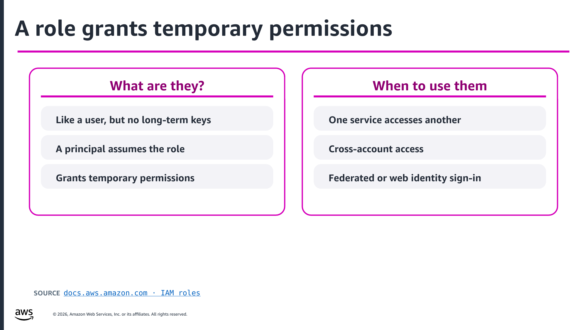

### Notes

WHAT'S HERE: An IAM role has the same makeup as an IAM user -- it carries permissions -- but with one crucial difference: a role has no long-term credentials associated with it. Instead, a principal (a user, a service, or an authenticated identity) assumes the role and inherits its permissions for a limited time. Roles cover four common scenarios: one AWS service accessing another, one AWS account accessing another, a third-party web identity such as Google or Amazon Cognito needing access, and authentication through SAML 2.0 federation. The recap for a Cloud Practitioner holder is that a role is a set of permissions you step into temporarily, rather than an identity you log in as.

EXAM RELEVANCE: The idea to hold is temporary access with no stored keys. A scenario where an EC2 instance or a Lambda function needs to call another AWS service, or where access must be granted across accounts or to a federated identity, is pointing at a role rather than a user. The absence of long-term credentials is the property that makes roles the secure choice.

PARTNER CONTEXT: For a customer, roles are how an application gets AWS permissions without anyone embedding an access key in code -- the workload assumes a role and receives short-lived credentials automatically. That is usually the single biggest security improvement available to a team still using static keys.

EXAM MAPPING: Domain 2 (security); Domain 1 (development).

REFERENCE: https://docs.aws.amazon.com/IAM/latest/UserGuide/id_roles.html

---

## Slide 45 — STS hands out temporary credentials in order

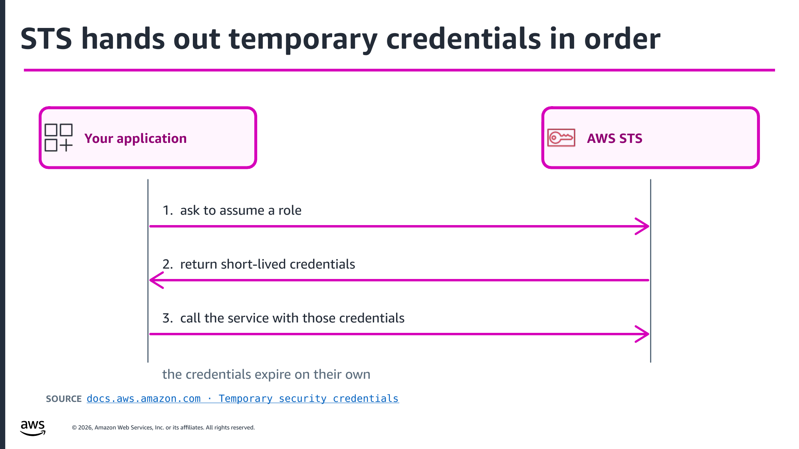

### Notes

WHAT'S HERE: an exchange between two parties, read top to bottom, so the ORDER is visible in a way a description cannot make it. Your application is on the left, AWS STS on the right, and time runs downward.

Walk the three steps. The application asks to assume a role. STS returns credentials that are short-lived. The application then calls the service using those credentials -- not using anything long-lived it was holding beforehand.

The line at the bottom is the point of the whole pattern. The credentials expire on their own, so there is nothing to rotate and nothing to leak permanently. That is the difference from a long-term key.

Notice the application carries a generic icon, not a service icon. It is your code -- the only AWS resource in this exchange is STS itself.

EXAM RELEVANCE: the sequence is what gets tested. A scenario describing code that needs access without embedded credentials is describing a role and this exchange.

PARTNER CONTEXT: a customer with access keys in a configuration file has a problem they usually cannot see. This picture is often enough to show why a role is not extra work but less of it.

Verified against https://docs.aws.amazon.com/IAM/latest/UserGuide/id_credentials_temp.html

EXAM MAPPING: Domain 2 (security).

---

## Slide 46 — Identity policies and resource policies differ

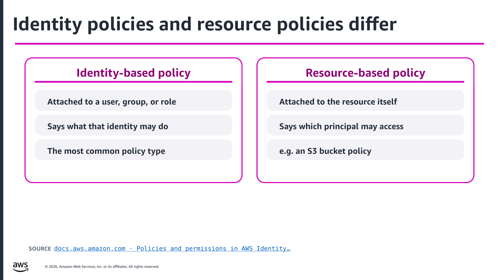

### Notes

WHAT'S HERE: There are two vantage points for a policy. An identity-based policy is attached to a user, group, or role and describes what that identity is permitted to do. A resource-based policy is attached to the resource -- an S3 bucket is the classic example -- and describes who, meaning which principal, is allowed to access that resource. The principals a resource-based policy can name include accounts, IAM users, federated users, IAM roles, assumed-role sessions, and AWS services. The recap for a Cloud Practitioner holder is that the same permission can be expressed from the identity's side or the resource's side, and knowing which side you are reading is half of interpreting a policy.

EXAM RELEVANCE: This distinction matters most in cross-account access, which is very commonly set up with an S3 bucket policy naming a principal in another account. A scenario that grants access from the resource's perspective, or that mixes an identity policy with a bucket policy, is testing whether you can tell the two apart. You do not need to author these policies for the exam, but you must be able to interpret them.

PARTNER CONTEXT: For a customer, the resource-based policy is often the cleanest way to share a specific bucket or queue with another account or service without minting new identities. Reading both sides correctly is what keeps a sharing arrangement secure rather than accidentally open.

EXAM MAPPING: Domain 2 (security).

REFERENCE: https://docs.aws.amazon.com/IAM/latest/UserGuide/access_policies.html

---

## Slide 47 — Read a policy statement one element at a time

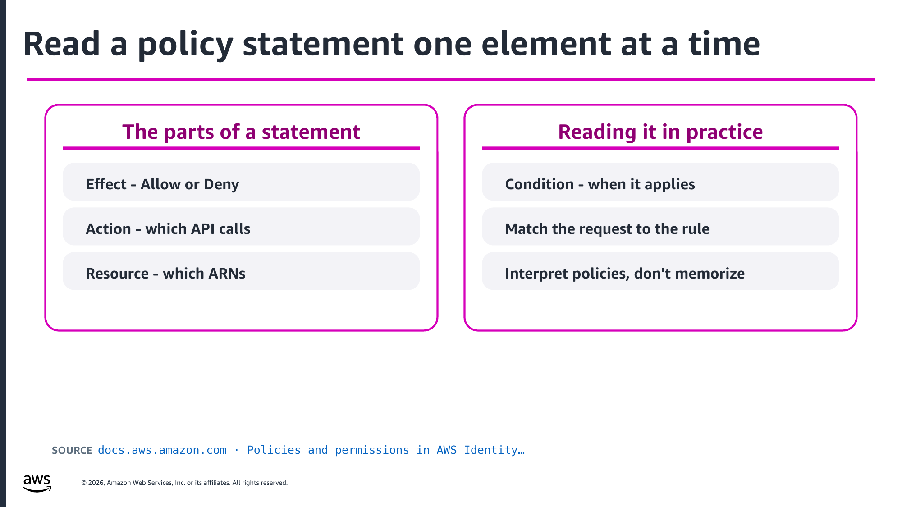

### Notes

WHAT'S HERE: A policy is easiest to read one element at a time. The Effect is either Allow or Deny. The Action lists the API calls the statement covers. The Resource names the Amazon Resource Names the statement applies to. The optional Condition narrows when the statement takes effect. To interpret a policy, you take a specific request -- this principal, this action, this resource -- and check it against the statement's elements to see whether it matches. The recap for a Cloud Practitioner holder is that a policy is not a wall of syntax to memorize; it is four familiar questions asked in order.

EXAM RELEVANCE: Expect to be handed a policy and asked what it allows or denies. Working element by element -- effect, then action, then resource, then any condition -- turns that from a guessing game into a checklist. The exam tests interpretation rather than authoring, so speed comes from reading the structure fluently, not from remembering exact strings.

PARTNER CONTEXT: For a customer, the same element-by-element habit is what makes a policy review productive -- everyone in the room can walk the effect, actions, resources, and conditions together and agree on what a statement actually grants before it ships.

EXAM MAPPING: Domain 2 (security).

REFERENCE: https://docs.aws.amazon.com/IAM/latest/UserGuide/access_policies.html

---

## Slide 48 — Conditions can grant access when tags match

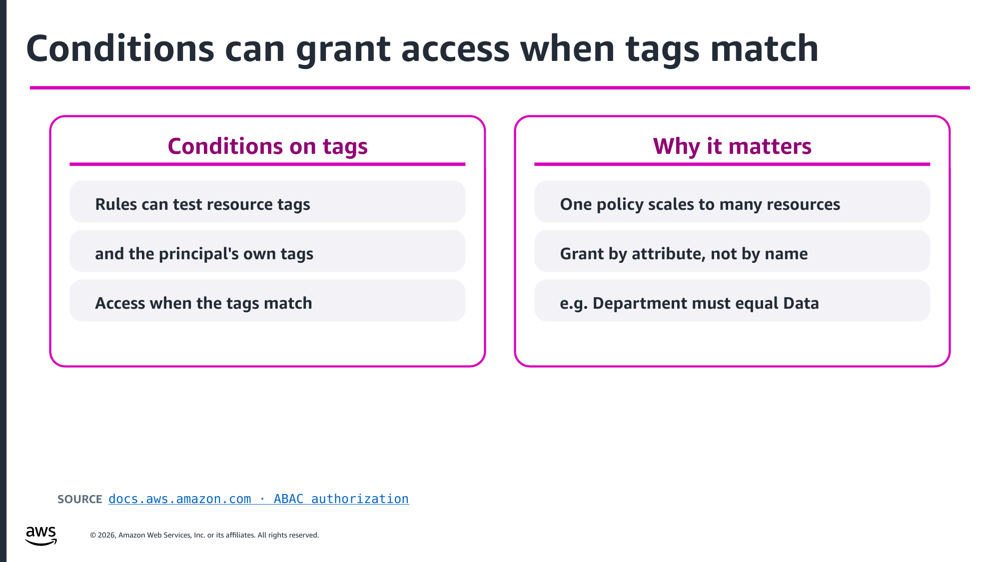

### Notes

WHAT'S HERE: A condition can compare tags rather than list resources by name. This is attribute-based access control: you write a policy whose condition tests the tags on the resource and the tags on the principal making the request, and access is granted only when they match. In the worked example, an EC2 instance must carry the tag Project set to DataAnalytics, and in addition the IAM principal -- the user or role making the request -- must carry the tag Department set to Data. The recap for a Cloud Practitioner holder is that conditions let a single policy say "match on these attributes" instead of enumerating every resource.

EXAM RELEVANCE: The testable idea is that one attribute-based policy can cover many resources, because it grants by tag rather than by explicit name. A scenario where access should follow a project or team tag, or where you want a policy that keeps working as new resources are created, is pointing at attribute-based access control and the Condition element. Watch for the requirement that BOTH the resource and the principal carry the matching tag.

PARTNER CONTEXT: For a customer with many resources and teams, attribute-based access control is what keeps the number of policies from exploding -- they tag resources and identities consistently, and one policy expresses the rule for all of them. It scales far better than writing a new policy for each new resource.

EXAM MAPPING: Domain 2 (security).

REFERENCE: https://docs.aws.amazon.com/IAM/latest/UserGuide/introduction_attribute-based-access-control.html

---

## Slide 49 — When flow logs stop, suspect the role

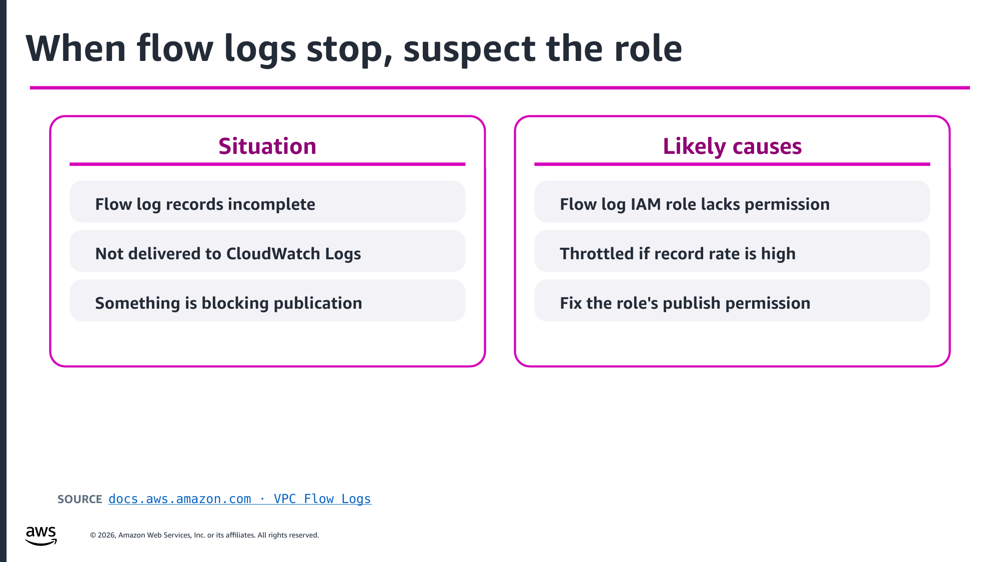

### Notes

WHAT'S HERE: This is a worked troubleshooting example that ties the whole IAM block to a real symptom. The situation: your VPC Flow Logs records are incomplete or are no longer being published, and there appears to be a problem delivering them to the CloudWatch Logs log group. The most common cause is an access error -- the IAM role for your flow log does not have sufficient permission to publish flow log records to the destination. A second cause is rate limiting: if the record rate for a network interface is higher than allowed in a given timeframe, publication is throttled. The recap for a Cloud Practitioner holder is that a delivery failure like this is usually an IAM permissions problem before it is anything exotic.

EXAM RELEVANCE: The pattern to recognize is that a service acting on your behalf -- here, flow logs writing to CloudWatch Logs -- needs a role with permission to do so, and a missing or insufficient permission shows up as data that never arrives. A scenario describing logs or records that stop appearing is often pointing at the delivery role's permissions rather than at the source service being broken.

PARTNER CONTEXT: For a customer, this is the everyday face of least privilege -- the fix is to grant the flow log role exactly the permission it needs to publish, no more. It is a good closing example because it connects roles, permissions, and a concrete operational outcome the customer can see in their own account.

EXAM MAPPING: Domain 2 (security); Domain 4 (monitoring and troubleshooting).

REFERENCE: https://docs.aws.amazon.com/vpc/latest/userguide/flow-logs.html

---

## Slide 50 — Let's break down what you learned

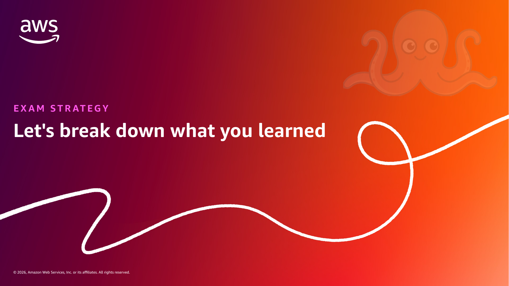

### Notes

FACILITATOR: The pivot from content review into the exam-strategy half of the session. Reset the room's mode: the goal now is not to learn new services but to practice reading a question and choosing well under time.

Explain the rhythm of what follows -- read the question, find the key phrases, reveal the answer, then talk through why the right choice wins and why the others do not.

Encourage people to commit to an answer before the reveal; the practice is worth far more when they have made a choice first.

---

## Slide 51 — Question 1: Session state across instances

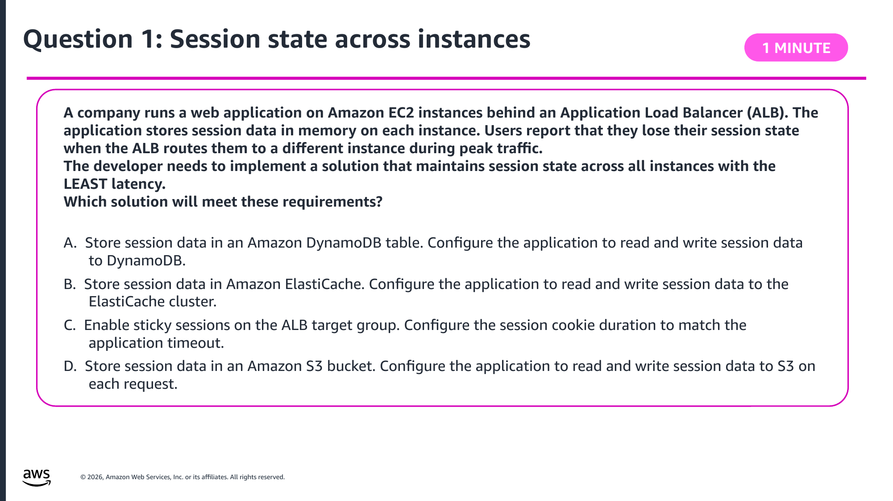

### Question

A company runs a web application on Amazon EC2 instances behind an Application Load Balancer (ALB). The application stores session data in memory on each instance. Users report that they lose their session state when the ALB routes them to a different instance during peak traffic.
The developer needs to implement a solution that maintains session state across all instances with the LEAST latency.
Which solution will meet these requirements?

A.  Store session data in an Amazon DynamoDB table. Configure the application to read and write session data to DynamoDB.
B.  Store session data in Amazon ElastiCache. Configure the application to read and write session data to the ElastiCache cluster.
C.  Enable sticky sessions on the ALB target group. Configure the session cookie duration to match the application timeout.
D.  Store session data in an Amazon S3 bucket. Configure the application to read and write session data to S3 on each request.

### Notes

WHAT'S HERE: put question 1 on screen and give the room about 90 seconds to read it in silence and commit to an answer before anyone speaks aloud. That is close to the pace the exam demands, so this rehearses timing as much as content.

Do not reveal or hint at the answer on this beat. The silent read is what makes the key-phrases beat and the reveal land -- if you talk through it now, both lose their effect.

EXAM RELEVANCE: Domain 1: Development with AWS Services. Difficulty: Medium. Watch the room: if most people have answered by 90 seconds, move on; if they are still reading, give another 20 seconds rather than rushing the discussion that follows.

PARTNER CONTEXT: A customer scaling a stateful web app hits this the moment a second instance appears and sessions start dropping. Moving session state to a shared in-memory store is the fix you propose before it becomes an outage, not after.

EXAM MAPPING: Domain 1: Development with AWS Services.

---

## Slide 52 — Question 1: Session state across instances

### Question

A company runs a web application on Amazon EC2 instances behind an Application Load Balancer (ALB). The application stores session data in memory on each instance. Users report that they lose their session state when the ALB routes them to a different instance during peak traffic.
The developer needs to implement a solution that maintains session state across all instances with the LEAST latency.
Which solution will meet these requirements?

A.  Store session data in an Amazon DynamoDB table. Configure the application to read and write session data to DynamoDB.
B.  Store session data in Amazon ElastiCache. Configure the application to read and write session data to the ElastiCache cluster.
C.  Enable sticky sessions on the ALB target group. Configure the session cookie duration to match the application timeout.
D.  Store session data in an Amazon S3 bucket. Configure the application to read and write session data to S3 on each request.

### Notes

KEY PHRASES: walk the question, do not answer it yet. The phrase that decides it is “maintains session state across all instances with the LEAST latency”, and it tells you: A shared external store optimized for speed points to an in-memory cache.

WHAT'S HERE: the same question with the timer removed. This beat teaches HOW to read a scenario question -- find the requirement, then find the words that separate options that all look plausible on a first pass.

EXAM RELEVANCE: Domain 1: Development with AWS Services. Difficulty: Medium. Ask the room which words they underlined before you show them the tell, so they practise finding it rather than being handed it.

PARTNER CONTEXT: A customer scaling a stateful web app hits this the moment a second instance appears and sessions start dropping. Moving session state to a shared in-memory store is the fix you propose before it becomes an outage, not after.

EXAM MAPPING: Domain 1: Development with AWS Services.

---

## Slide 53 — Question 1: Session state across instances

### Question

A company runs a web application on Amazon EC2 instances behind an Application Load Balancer (ALB). The application stores session data in memory on each instance. Users report that they lose their session state when the ALB routes them to a different instance during peak traffic.
The developer needs to implement a solution that maintains session state across all instances with the LEAST latency.
Which solution will meet these requirements?

A.  Store session data in an Amazon DynamoDB table. Configure the application to read and write session data to DynamoDB.
B.  Store session data in Amazon ElastiCache. Configure the application to read and write session data to the ElastiCache cluster.  [CORRECT]
C.  Enable sticky sessions on the ALB target group. Configure the session cookie duration to match the application timeout.
D.  Store session data in an Amazon S3 bucket. Configure the application to read and write session data to S3 on each request.

### Notes

ANSWER OVERVIEW: the answer is B. An in-memory store all instances share, at submillisecond latency.

A. Store session data in an Amazon DynamoDB table. Configure the application to read and write session data to DynamoDB. — Incorrect — DynamoDB can store session data durably. However, DynamoDB has higher read latency compared to an in-memory data store. For session management where latency is critical, an in-memory store is more appropriate.

B. Store session data in Amazon ElastiCache. Configure the application to read and write session data to the ElastiCache cluster. — Correct — ElastiCache provides an in-memory data store that enables sub-millisecond latency for session data. All instances can access the shared session store. This decouples session state from individual instances and provides the lowest latency option for session management.

C. Enable sticky sessions on the ALB target group. Configure the session cookie duration to match the application timeout. — Incorrect — Sticky sessions bind a user to a specific instance. This does not maintain state across instances. If the bound instance becomes unhealthy or is terminated during scaling events, the session is still lost. This approach does not meet the requirement to maintain session state across all instances.

D. Store session data in an Amazon S3 bucket. Configure the application to read and write session data to S3 on each request. — Incorrect — Amazon S3 is a durable object store but has higher latency compared to an in-memory data store. S3 is not designed for frequent small read/write operations typical of session management. The per-request latency would not meet the requirement for least latency.

EXAM RELEVANCE: Domain 1: Development with AWS Services. Difficulty: Medium.

SOURCE: https://docs.aws.amazon.com/AmazonElastiCache/latest/dg/elasticache-use-cases.html

---

## Slide 54 — Question 1: Session state across instances

### Notes

WHAT'S HERE: the elimination, made visible. B wins because an in-memory store all instances share, at submillisecond latency. The other three are ruled out for one reason each: A — DynamoDB is shared and durable, but slower than memory; C — Sticky sessions still lose state when an instance fails; D — S3 per request adds the most latency of any option. Read the tell strip aloud -- pairing a phrase with what it signals is the transferable skill, not memorizing the service name.

EXAM RELEVANCE: Domain 1: Development with AWS Services. Difficulty: Medium. The pattern to teach: a scenario question rarely offers three absurd options. It offers one that matches the requirement exactly and others that match a nearby requirement. Here the discriminator is “maintains session state across all instances with the LEAST latency”, which points at A shared external store optimized for speed points to an in-memory cache. Encourage the room to name the phrase before naming the service.

PARTNER CONTEXT: A customer scaling a stateful web app hits this the moment a second instance appears and sessions start dropping. Moving session state to a shared in-memory store is the fix you propose before it becomes an outage, not after.

SOURCE: https://docs.aws.amazon.com/AmazonElastiCache/latest/dg/elasticache-use-cases.html

---

## Slide 55 — Question 2: Private service-to-service on ECS

### Question

A company deploys containerized microservices on Amazon ECS with the AWS Fargate launch type. The services call one another through internal APIs. A security review requires that all traffic between the services stay inside the VPC and never traverse the public internet.
The developer must configure the services so that they can reach each other privately.
Which solution will meet these requirements?

A.  Deploy the tasks in public subnets with public IP addresses, and restrict the security groups to the service ports.
B.  Deploy the tasks in private subnets, and place an internet-facing Application Load Balancer in the public subnets.
C.  Deploy the tasks in private subnets, and place an internal Application Load Balancer in the same private subnets.
D.  Deploy the tasks in public subnets, and route the traffic between the services through a NAT gateway.

### Notes

WHAT'S HERE: put question 2 on screen and give the room about 90 seconds to read it in silence and commit to an answer before anyone speaks aloud. That is close to the pace the exam demands, so this rehearses timing as much as content.

Do not reveal or hint at the answer on this beat. The silent read is what makes the key-phrases beat and the reveal land -- if you talk through it now, both lose their effect.

EXAM RELEVANCE: Domain 1: Development with AWS Services. Difficulty: Medium. Watch the room: if most people have answered by 90 seconds, move on; if they are still reading, give another 20 seconds rather than rushing the discussion that follows.

PARTNER CONTEXT: A customer breaking a monolith into microservices may need to show their security team that internal calls never leave the VPC. An internal Application Load Balancer resolves only to private addresses, so each service reaches its peers through a private DNS name and no public endpoint is involved.

EXAM MAPPING: Domain 1: Development with AWS Services.

---

## Slide 56 — Question 2: Private service-to-service on ECS

### Question

A company deploys containerized microservices on Amazon ECS with the AWS Fargate launch type. The services call one another through internal APIs. A security review requires that all traffic between the services stay inside the VPC and never traverse the public internet.
The developer must configure the services so that they can reach each other privately.
Which solution will meet these requirements?

A.  Deploy the tasks in public subnets with public IP addresses, and restrict the security groups to the service ports.
B.  Deploy the tasks in private subnets, and place an internet-facing Application Load Balancer in the public subnets.
C.  Deploy the tasks in private subnets, and place an internal Application Load Balancer in the same private subnets.
D.  Deploy the tasks in public subnets, and route the traffic between the services through a NAT gateway.

### Notes

KEY PHRASES: walk the question, do not answer it yet. The phrase that decides it is “stay inside the VPC and never traverse the public internet”, and it tells you: “inside the VPC” rules out anything internet-facing and points to an internal load balancer sitting in the private subnets.

WHAT'S HERE: the same question with the timer removed. This beat teaches HOW to read a scenario question -- find the requirement, then find the words that separate options that all look plausible on a first pass.

EXAM RELEVANCE: Domain 1: Development with AWS Services. Difficulty: Medium. Ask the room which words they underlined before you show them the tell, so they practise finding it rather than being handed it.

PARTNER CONTEXT: A customer breaking a monolith into microservices may need to show their security team that internal calls never leave the VPC. An internal Application Load Balancer resolves only to private addresses, so each service reaches its peers through a private DNS name and no public endpoint is involved.

EXAM MAPPING: Domain 1: Development with AWS Services.

---

## Slide 57 — Question 2: Private service-to-service on ECS

### Question

A company deploys containerized microservices on Amazon ECS with the AWS Fargate launch type. The services call one another through internal APIs. A security review requires that all traffic between the services stay inside the VPC and never traverse the public internet.
The developer must configure the services so that they can reach each other privately.
Which solution will meet these requirements?

A.  Deploy the tasks in public subnets with public IP addresses, and restrict the security groups to the service ports.
B.  Deploy the tasks in private subnets, and place an internet-facing Application Load Balancer in the public subnets.
C.  Deploy the tasks in private subnets, and place an internal Application Load Balancer in the same private subnets.  [CORRECT]
D.  Deploy the tasks in public subnets, and route the traffic between the services through a NAT gateway.

### Notes

ANSWER OVERVIEW: the answer is C. Tasks in private subnets behind an internal Application Load Balancer keep the traffic inside the VPC.

A. Deploy the tasks in public subnets with public IP addresses, and restrict the security groups to the service ports. — Incorrect — Assigning public IP addresses places the task network interfaces in a public subnet, so traffic between the services leaves through the internet gateway. Security groups restrict which sources may connect, but they do not keep the traffic inside the VPC.

B. Deploy the tasks in private subnets, and place an internet-facing Application Load Balancer in the public subnets. — Incorrect — An internet-facing load balancer is created in public subnets and resolves to public IP addresses, so a call from one service to another would leave the VPC and come back through the internet gateway. The tasks are private but the path between them is not.

C. Deploy the tasks in private subnets, and place an internal Application Load Balancer in the same private subnets. — Correct — An internal Application Load Balancer resolves only to private IP addresses, so it can be reached solely from inside the VPC. With the tasks in private subnets using awsvpc network mode, each service calls the internal load balancer's private DNS name and the traffic never leaves the VPC, which satisfies the security review.

D. Deploy the tasks in public subnets, and route the traffic between the services through a NAT gateway. — Incorrect — A NAT gateway provides outbound internet access for resources in private subnets and cannot accept inbound connections, so it cannot carry traffic from one service to another. Tasks in public subnets do not send traffic through a NAT gateway either.

EXAM RELEVANCE: Domain 1: Development with AWS Services. Difficulty: Medium.

SOURCE: https://docs.aws.amazon.com/elasticloadbalancing/latest/application/application-load-balancers.html

---

## Slide 58 — Question 2: Private service-to-service on ECS

### Notes

WHAT'S HERE: the elimination, made visible. C wins because an internal load balancer resolves only to private addresses, so the call never leaves the VPC. The other three are ruled out for one reason each: A — Public IPs put the task traffic on the public internet; B — An internet-facing load balancer resolves to public IPs; D — A NAT gateway is outbound only, not service to service. Read the tell strip aloud -- pairing a phrase with what it signals is the transferable skill, not memorizing the service name.

EXAM RELEVANCE: Domain 1: Development with AWS Services. Difficulty: Medium. The pattern to teach: a scenario question rarely offers three absurd options. It offers one that matches the requirement exactly and others that match a nearby requirement. Here the discriminator is “stay inside the VPC and never traverse the public internet”, and the word that does the work is “internal” -- an internet-facing load balancer is still a load balancer, and still wrong. Encourage the room to name the phrase before naming the service.

PARTNER CONTEXT: A customer breaking a monolith into microservices may need to show their security team that internal calls never leave the VPC. An internal Application Load Balancer resolves only to private addresses, so each service reaches its peers through a private DNS name and no public endpoint is involved.

SOURCE: https://docs.aws.amazon.com/elasticloadbalancing/latest/application/application-load-balancers.html

---

## Slide 59 — Question 3: Least privilege for EC2

### Question

A company manages access to its AWS resources by using IAM roles. A developer is building a new microservice that runs on Amazon EC2 instances. The microservice must read objects from an Amazon S3 bucket and write messages to an Amazon SQS queue. The developer must follow the principle of least privilege.
Which approach should the developer use to grant the microservice the required permissions?

A.  Create an IAM user with an access key and secret key. Attach policies that allow s3:GetObject and sqs:SendMessage. Store the credentials in the application configuration file.
B.  Create an IAM role with a policy that allows s3:GetObject on the specific bucket ARN and sqs:SendMessage on the specific queue ARN. Attach the role to the EC2 instance profile.
C.  Create an IAM role with the AmazonS3FullAccess and AmazonSQSFullAccess managed policies. Attach the role to the EC2 instance profile.
D.  Create an IAM role with a policy that allows s3:* and sqs:* actions. Add a condition key to restrict access to the current AWS Region only.

### Notes

WHAT'S HERE: put question 3 on screen and give the room about 90 seconds to read it in silence and commit to an answer before anyone speaks aloud. That is close to the pace the exam demands, so this rehearses timing as much as content.

Do not reveal or hint at the answer on this beat. The silent read is what makes the key-phrases beat and the reveal land -- if you talk through it now, both lose their effect.

EXAM RELEVANCE: Domain 2: Security. Difficulty: Easy. Watch the room: if most people have answered by 90 seconds, move on; if they are still reading, give another 20 seconds rather than rushing the discussion that follows.

PARTNER CONTEXT: Customers reach for an IAM user with static keys out of habit. The value you add is showing that an instance-profile role removes the credential to manage entirely, and can be narrowed to just the two ARNs the microservice actually touches.

EXAM MAPPING: Domain 2: Security.

---

## Slide 60 — Question 3: Least privilege for EC2

### Question

A company manages access to its AWS resources by using IAM roles. A developer is building a new microservice that runs on Amazon EC2 instances. The microservice must read objects from an Amazon S3 bucket and write messages to an Amazon SQS queue. The developer must follow the principle of least privilege.
Which approach should the developer use to grant the microservice the required permissions?

A.  Create an IAM user with an access key and secret key. Attach policies that allow s3:GetObject and sqs:SendMessage. Store the credentials in the application configuration file.
B.  Create an IAM role with a policy that allows s3:GetObject on the specific bucket ARN and sqs:SendMessage on the specific queue ARN. Attach the role to the EC2 instance profile.
C.  Create an IAM role with the AmazonS3FullAccess and AmazonSQSFullAccess managed policies. Attach the role to the EC2 instance profile.
D.  Create an IAM role with a policy that allows s3:* and sqs:* actions. Add a condition key to restrict access to the current AWS Region only.

### Notes

KEY PHRASES: walk the question, do not answer it yet. The phrase that decides it is “must follow the principle of least privilege”, and it tells you: Least privilege means only these actions on these exact resources.

WHAT'S HERE: the same question with the timer removed. This beat teaches HOW to read a scenario question -- find the requirement, then find the words that separate options that all look plausible on a first pass.

EXAM RELEVANCE: Domain 2: Security. Difficulty: Easy. Ask the room which words they underlined before you show them the tell, so they practise finding it rather than being handed it.

PARTNER CONTEXT: Customers reach for an IAM user with static keys out of habit. The value you add is showing that an instance-profile role removes the credential to manage entirely, and can be narrowed to just the two ARNs the microservice actually touches.

EXAM MAPPING: Domain 2: Security.

---

## Slide 61 — Question 3: Least privilege for EC2

### Question

A company manages access to its AWS resources by using IAM roles. A developer is building a new microservice that runs on Amazon EC2 instances. The microservice must read objects from an Amazon S3 bucket and write messages to an Amazon SQS queue. The developer must follow the principle of least privilege.
Which approach should the developer use to grant the microservice the required permissions?

A.  Create an IAM user with an access key and secret key. Attach policies that allow s3:GetObject and sqs:SendMessage. Store the credentials in the application configuration file.
B.  Create an IAM role with a policy that allows s3:GetObject on the specific bucket ARN and sqs:SendMessage on the specific queue ARN. Attach the role to the EC2 instance profile.  [CORRECT]
C.  Create an IAM role with the AmazonS3FullAccess and AmazonSQSFullAccess managed policies. Attach the role to the EC2 instance profile.
D.  Create an IAM role with a policy that allows s3:* and sqs:* actions. Add a condition key to restrict access to the current AWS Region only.

### Notes

ANSWER OVERVIEW: the answer is B. A role scoped to the exact bucket and queue ARNs, via an instance profile.

A. Create an IAM user with an access key and secret key. Attach policies that allow s3:GetObject and sqs:SendMessage. Store the credentials in the application configuration file. — Incorrect — Storing long-term credentials in application configuration files is a security risk. If the file is compromised or accidentally committed to source control, the credentials are exposed. IAM roles with instance profiles are the recommended approach for EC2-based applications.

B. Create an IAM role with a policy that allows s3:GetObject on the specific bucket ARN and sqs:SendMessage on the specific queue ARN. Attach the role to the EC2 instance profile. — Correct — An IAM role attached to an instance profile provides temporary credentials that are automatically rotated. Scoping the policy to specific resource ARNs follows least privilege. The application can use the AWS SDK to assume the role credentials without storing long-term keys.

C. Create an IAM role with the AmazonS3FullAccess and AmazonSQSFullAccess managed policies. Attach the role to the EC2 instance profile. — Incorrect — Using FullAccess managed policies grants permissions far beyond what the microservice needs. This violates the principle of least privilege. The microservice only needs s3:GetObject and sqs:SendMessage on specific resources, not full access to all S3 and SQS operations across the account.

D. Create an IAM role with a policy that allows s3:* and sqs:* actions. Add a condition key to restrict access to the current AWS Region only. — Incorrect — Allowing all S3 and SQS actions (s3:* and sqs:*) is overly permissive even with a Region restriction. Least privilege requires specifying only the exact actions needed (s3:GetObject and sqs:SendMessage) and scoping to specific resource ARNs.

EXAM RELEVANCE: Domain 2: Security. Difficulty: Easy.

SOURCE: https://docs.aws.amazon.com/IAM/latest/UserGuide/id_roles_use_switch-role-ec2.html

---

## Slide 62 — Question 3: Least privilege for EC2

### Notes

WHAT'S HERE: the elimination, made visible. B wins because a role scoped to the exact bucket and queue ARNs, via an instance profile. The other three are ruled out for one reason each: A — Long-lived access keys in a file are not least privilege; C — Full-access managed policies grant far more than needed; D — Wildcards on every action stay over-broad despite the Region. Read the tell strip aloud -- pairing a phrase with what it signals is the transferable skill, not memorizing the service name.

EXAM RELEVANCE: Domain 2: Security. Difficulty: Easy. The pattern to teach: a scenario question rarely offers three absurd options. It offers one that matches the requirement exactly and others that match a nearby requirement. Here the discriminator is “must follow the principle of least privilege”, which points at Least privilege means only these actions on these exact resources. Encourage the room to name the phrase before naming the service.

PARTNER CONTEXT: Customers reach for an IAM user with static keys out of habit. The value you add is showing that an instance-profile role removes the credential to manage entirely, and can be narrowed to just the two ARNs the microservice actually touches.

SOURCE: https://docs.aws.amazon.com/IAM/latest/UserGuide/id_roles_use_switch-role-ec2.html

---

## Slide 63 — Question 4: Instances replaced too early

### Question

A company uses Amazon EC2 Auto Scaling to manage its fleet of web servers. The developer notices that newly launched instances take 3 minutes to complete application initialization before they can serve traffic. During scale-out events, the ALB health checks mark the new instances as unhealthy and terminate them before initialization completes.
The developer needs to prevent premature termination of instances during initialization.
Which solution will meet this requirement?

A.  Increase the ALB health check interval to 5 minutes.
B.  Configure a health check grace period on the Auto Scaling group that exceeds the application initialization time.
C.  Set the deregistration delay on the target group to 5 minutes.
D.  Add a lifecycle hook to the Auto Scaling group that pauses the instance in a Pending:Wait state indefinitely.

### Notes

WHAT'S HERE: put question 4 on screen and give the room about 90 seconds to read it in silence and commit to an answer before anyone speaks aloud. That is close to the pace the exam demands, so this rehearses timing as much as content.

Do not reveal or hint at the answer on this beat. The silent read is what makes the key-phrases beat and the reveal land -- if you talk through it now, both lose their effect.

EXAM RELEVANCE: Domain 1: Development with AWS Services. Difficulty: Medium. Watch the room: if most people have answered by 90 seconds, move on; if they are still reading, give another 20 seconds rather than rushing the discussion that follows.

PARTNER CONTEXT: When a customer's scale-out keeps thrashing, the fix is rarely more capacity. It is telling Auto Scaling how long the application takes to warm up, so a healthy instance is not killed mid-boot and replaced by another that dies the same way.

EXAM MAPPING: Domain 1: Development with AWS Services.

---

## Slide 64 — Question 4: Instances replaced too early

### Question

A company uses Amazon EC2 Auto Scaling to manage its fleet of web servers. The developer notices that newly launched instances take 3 minutes to complete application initialization before they can serve traffic. During scale-out events, the ALB health checks mark the new instances as unhealthy and terminate them before initialization completes.
The developer needs to prevent premature termination of instances during initialization.
Which solution will meet this requirement?

A.  Increase the ALB health check interval to 5 minutes.
B.  Configure a health check grace period on the Auto Scaling group that exceeds the application initialization time.
C.  Set the deregistration delay on the target group to 5 minutes.
D.  Add a lifecycle hook to the Auto Scaling group that pauses the instance in a Pending:Wait state indefinitely.

### Notes

KEY PHRASES: walk the question, do not answer it yet. The phrase that decides it is “terminate them before initialization completes”, and it tells you: Give an instance time to warm up before health checks count → grace period.

WHAT'S HERE: the same question with the timer removed. This beat teaches HOW to read a scenario question -- find the requirement, then find the words that separate options that all look plausible on a first pass.

EXAM RELEVANCE: Domain 1: Development with AWS Services. Difficulty: Medium. Ask the room which words they underlined before you show them the tell, so they practise finding it rather than being handed it.

PARTNER CONTEXT: When a customer's scale-out keeps thrashing, the fix is rarely more capacity. It is telling Auto Scaling how long the application takes to warm up, so a healthy instance is not killed mid-boot and replaced by another that dies the same way.

EXAM MAPPING: Domain 1: Development with AWS Services.

---

## Slide 65 — Question 4: Instances replaced too early

### Question

A company uses Amazon EC2 Auto Scaling to manage its fleet of web servers. The developer notices that newly launched instances take 3 minutes to complete application initialization before they can serve traffic. During scale-out events, the ALB health checks mark the new instances as unhealthy and terminate them before initialization completes.
The developer needs to prevent premature termination of instances during initialization.
Which solution will meet this requirement?

A.  Increase the ALB health check interval to 5 minutes.
B.  Configure a health check grace period on the Auto Scaling group that exceeds the application initialization time.  [CORRECT]
C.  Set the deregistration delay on the target group to 5 minutes.
D.  Add a lifecycle hook to the Auto Scaling group that pauses the instance in a Pending:Wait state indefinitely.

### Notes

ANSWER OVERVIEW: the answer is B. A grace period longer than start-up lets checks wait before counting.

A. Increase the ALB health check interval to 5 minutes. — Incorrect — Increasing the health check interval changes how often the ALB checks instance health. However, the instance could still fail multiple consecutive checks during the 3-minute initialization period and be deregistered. The health check interval alone does not account for initialization time.

B. Configure a health check grace period on the Auto Scaling group that exceeds the application initialization time. — Correct — The health check grace period tells Auto Scaling to wait a specified duration before checking the health status of a newly launched instance. Setting this value to longer than the 3-minute initialization time prevents Auto Scaling from terminating instances that are still starting up. During the grace period, the instance is not terminated regardless of health check status.

C. Set the deregistration delay on the target group to 5 minutes. — Incorrect — The deregistration delay controls how long the load balancer waits before completing deregistration of an instance being removed. It applies to instances being removed from the target group, not instances being added. This setting does not prevent premature termination during initialization.

D. Add a lifecycle hook to the Auto Scaling group that pauses the instance in a Pending:Wait state indefinitely. — Incorrect — A lifecycle hook can pause an instance before it enters service. However, configuring it to wait indefinitely requires manual intervention to complete the lifecycle action. This does not automatically transition the instance to InService after initialization and creates operational overhead.

EXAM RELEVANCE: Domain 1: Development with AWS Services. Difficulty: Medium.

SOURCE: https://docs.aws.amazon.com/autoscaling/ec2/userguide/health-checks-overview.html

---

## Slide 66 — Question 4: Instances replaced too early

### Notes

WHAT'S HERE: the elimination, made visible. B wins because a grace period longer than start-up lets checks wait before counting. The other three are ruled out for one reason each: A — A longer check interval slows detection; checks still start too early; C — Deregistration delay drains connections, it does not delay checks; D — An indefinite Pending:Wait pause stops instances ever serving. Read the tell strip aloud -- pairing a phrase with what it signals is the transferable skill, not memorizing the service name.

EXAM RELEVANCE: Domain 1: Development with AWS Services. Difficulty: Medium. The pattern to teach: a scenario question rarely offers three absurd options. It offers one that matches the requirement exactly and others that match a nearby requirement. Here the discriminator is “terminate them before initialization completes”, which points at Give an instance time to warm up before health checks count → grace period. Encourage the room to name the phrase before naming the service.

PARTNER CONTEXT: When a customer's scale-out keeps thrashing, the fix is rarely more capacity. It is telling Auto Scaling how long the application takes to warm up, so a healthy instance is not killed mid-boot and replaced by another that dies the same way.

SOURCE: https://docs.aws.amazon.com/autoscaling/ec2/userguide/health-checks-overview.html

---

## Slide 67 — Question 5: Is it DNS, the network, or the backend?

### Question

A company runs a multi-tier application with a frontend hosted on Amazon CloudFront and a backend API on Amazon API Gateway. The application uses Amazon Route 53 for DNS resolution. Users in a specific geographic region report intermittent connectivity issues.
The developer needs to determine whether the connectivity issues are related to DNS resolution, network connectivity, or the application backend.
Which AWS service should the developer use to identify the source of the connectivity issues?

A.  Use Amazon CloudWatch Logs Insights to query API Gateway access logs for the affected Region.
B.  Use AWS X-Ray to trace requests from CloudFront through API Gateway.
C.  Use Route 53 health checks to monitor the endpoint and analyze the health check results by Region.
D.  Use AWS CloudTrail to review API calls made to Route 53 and CloudFront.

### Notes

WHAT'S HERE: put question 5 on screen and give the room about 90 seconds to read it in silence and commit to an answer before anyone speaks aloud. That is close to the pace the exam demands, so this rehearses timing as much as content.

Do not reveal or hint at the answer on this beat. The silent read is what makes the key-phrases beat and the reveal land -- if you talk through it now, both lose their effect.

EXAM RELEVANCE: Domain 4: Troubleshooting and Optimization. Difficulty: Medium. Watch the room: if most people have answered by 90 seconds, move on; if they are still reading, give another 20 seconds rather than rushing the discussion that follows.

PARTNER CONTEXT: A customer reporting “the site is down for our Frankfurt office” needs the problem localized before anyone touches code. Regional health checks tell you quickly whether the endpoint is even reachable from there, separating a network or DNS problem from a backend one.

EXAM MAPPING: Domain 4: Troubleshooting and Optimization.

---

## Slide 68 — Question 5: Is it DNS, the network, or the backend?

### Question

A company runs a multi-tier application with a frontend hosted on Amazon CloudFront and a backend API on Amazon API Gateway. The application uses Amazon Route 53 for DNS resolution. Users in a specific geographic region report intermittent connectivity issues.
The developer needs to determine whether the connectivity issues are related to DNS resolution, network connectivity, or the application backend.
Which AWS service should the developer use to identify the source of the connectivity issues?

A.  Use Amazon CloudWatch Logs Insights to query API Gateway access logs for the affected Region.
B.  Use AWS X-Ray to trace requests from CloudFront through API Gateway.
C.  Use Route 53 health checks to monitor the endpoint and analyze the health check results by Region.
D.  Use AWS CloudTrail to review API calls made to Route 53 and CloudFront.

### Notes

KEY PHRASES: walk the question, do not answer it yet. The phrase that decides it is “determine whether ... DNS resolution, network connectivity, or the application”, and it tells you: Testing reachability from many Regions points to Route 53 health checks.

WHAT'S HERE: the same question with the timer removed. This beat teaches HOW to read a scenario question -- find the requirement, then find the words that separate options that all look plausible on a first pass.

EXAM RELEVANCE: Domain 4: Troubleshooting and Optimization. Difficulty: Medium. Ask the room which words they underlined before you show them the tell, so they practise finding it rather than being handed it.

PARTNER CONTEXT: A customer reporting “the site is down for our Frankfurt office” needs the problem localized before anyone touches code. Regional health checks tell you quickly whether the endpoint is even reachable from there, separating a network or DNS problem from a backend one.

EXAM MAPPING: Domain 4: Troubleshooting and Optimization.

---

## Slide 69 — Question 5: Is it DNS, the network, or the backend?

### Question

A company runs a multi-tier application with a frontend hosted on Amazon CloudFront and a backend API on Amazon API Gateway. The application uses Amazon Route 53 for DNS resolution. Users in a specific geographic region report intermittent connectivity issues.
The developer needs to determine whether the connectivity issues are related to DNS resolution, network connectivity, or the application backend.
Which AWS service should the developer use to identify the source of the connectivity issues?

A.  Use Amazon CloudWatch Logs Insights to query API Gateway access logs for the affected Region.
B.  Use AWS X-Ray to trace requests from CloudFront through API Gateway.
C.  Use Route 53 health checks to monitor the endpoint and analyze the health check results by Region.  [CORRECT]
D.  Use AWS CloudTrail to review API calls made to Route 53 and CloudFront.

### Notes

ANSWER OVERVIEW: the answer is C. Route 53 health checks isolate endpoint reachability by Region.

A. Use Amazon CloudWatch Logs Insights to query API Gateway access logs for the affected Region. — Incorrect — CloudWatch Logs Insights can analyze API Gateway logs. However, this only shows requests that successfully reached API Gateway. It cannot identify DNS resolution failures or network connectivity issues that prevent requests from reaching the API.

B. Use AWS X-Ray to trace requests from CloudFront through API Gateway. — Incorrect — X-Ray traces requests within the application after they reach AWS services. X-Ray cannot diagnose DNS resolution failures or network connectivity issues between end users and AWS edge locations. It only traces requests that successfully reach instrumented services.

C. Use Route 53 health checks to monitor the endpoint and analyze the health check results by Region. — Correct — Route 53 health checks monitor endpoints from multiple geographic locations. The health check results show which regions experience failures and can distinguish between DNS, TCP connection, and HTTP response issues. This provides visibility into whether the problem is DNS resolution, network connectivity, or the application itself.

D. Use AWS CloudTrail to review API calls made to Route 53 and CloudFront. — Incorrect — CloudTrail records AWS API management calls (such as creating or modifying resources). It does not record end-user data plane requests like DNS queries or content delivery. CloudTrail cannot diagnose connectivity issues experienced by end users.

EXAM RELEVANCE: Domain 4: Troubleshooting and Optimization. Difficulty: Medium.

SOURCE: https://docs.aws.amazon.com/Route53/latest/DeveloperGuide/dns-failover.html

---

## Slide 70 — Question 5: Is it DNS, the network, or the backend?

### Notes

WHAT'S HERE: the elimination, made visible. C wins because route 53 health checks isolate endpoint reachability by Region. The other three are ruled out for one reason each: A — Logs Insights shows backend logs only, not DNS or the network; B — X-Ray traces the backend path, not regional reachability; D — CloudTrail records API calls, not live connectivity. Read the tell strip aloud -- pairing a phrase with what it signals is the transferable skill, not memorizing the service name.

EXAM RELEVANCE: Domain 4: Troubleshooting and Optimization. Difficulty: Medium. The pattern to teach: a scenario question rarely offers three absurd options. It offers one that matches the requirement exactly and others that match a nearby requirement. Here the discriminator is “determine whether ... DNS resolution, network connectivity, or the application”, which points at Testing reachability from many Regions points to Route 53 health checks. Encourage the room to name the phrase before naming the service.

PARTNER CONTEXT: A customer reporting “the site is down for our Frankfurt office” needs the problem localized before anyone touches code. Regional health checks tell you quickly whether the endpoint is even reachable from there, separating a network or DNS problem from a backend one.

SOURCE: https://docs.aws.amazon.com/Route53/latest/DeveloperGuide/dns-failover.html

---

## Slide 71 — Coming up: Week 2 digital training

### Notes

WHAT'S HERE: A preview of next week's training so people can get a head start whenever they are ready. The left card is the free Learning Plan; the right is the optional Exam Prep Plan.

FACILITATOR: Keep this light -- it is a look ahead, not an assignment for today. Note that week two shifts toward databases and the serverless mindset, which builds directly on this week's compute and networking foundations.

Encourage anyone who is ahead to start early, and reassure anyone still catching up on week one that the sessions build gradually.

Note: the "Domain 2" item names are the actual Exam Prep Plan module names in Skill Builder, so learners can locate them; they are navigation, not exam-coverage claims.

---

## Slide 72 — Q&A time

### Notes

FACILITATOR: Open the floor. Invite questions on anything from this week's services to study logistics and exam scheduling.

If the room is quiet, prime it with a question of your own -- ask which service felt least clear this week, or how people are finding the practice questions.

Keep answers short and point to the relevant documentation or the exam prep resources where a deeper follow-up is warranted.

---

## Slide 73 — Thank you for joining!

### Notes

FACILITATOR: Close warmly. Thank the room for their time and their engagement, and remind them of the two things that keep momentum: finish this week's training and make a start on next week's preview.

Restate when the next session is and encourage anyone who has not yet scheduled their exam to plan a target date.

End on encouragement -- they are building real, job-relevant skills, and steady weekly progress is what gets them exam-ready.

---

## Slide 74 — Appendix -- DVA-C02 reference

### Notes

APPENDIX: divider. This block is self-study reference for anyone who plans to sit DVA-C02 rather than C03. It is not taught in the session -- point the room at it and move on. The three appendix slides sit together at the end of the deck by design.

WHAT'S HERE: The session decks are built for DVA-C03. This appendix collects what a C02 candidate needs that the C03 body does not spell out: how the exam guide's weightings shifted, what C03 added for this week's topics, and which main-body slides a C02 candidate can skip.

EXAM RELEVANCE: DVA-C02 is the live exam today; DVA-C03 is the version this course trains toward. The two overlap heavily in Session 1's foundational material, so most of the deck serves both.

REFERENCE: The C02 figures come from the DVA-C02 exam guide; the C03 figures come from the September 2026 certification updates blog. Both are linked from the delta slides that follow. EXAM MAPPING: DVA-C02 to DVA-C03 comparison.

---

## Slide 75 — How C02 and C03 differ for this week

### Notes

APPENDIX: week-1 delta table. Walk the left column first: the four domain weightings barely move between C02 and C03. Development eases from 32% to 30%, Security holds at 26%, Testing and Deployment eases from 24% to 22%, and Troubleshooting and Optimization rises from 18% to 22% -- the largest single shift.

WHAT'S HERE: Domain 3 is also renamed -- C02 called it Deployment, C03 calls it Testing and Deployment. The right column is this week's only documented content change: AWS Fargate joins the in-scope service list at C03. Amazon ECR, Amazon ECS and Amazon EKS were already in scope for C02, so only the Fargate slide is new ground.

EXAM RELEVANCE: Week 1 is the lightest delta of the five sessions. The foundational compute, networking, and identity arc is effectively unchanged between the two exam versions, so a C02 candidate can follow almost all of Session 1 as-is.

REFERENCE: C02 weightings and domains are from the DVA-C02 exam guide at docs.aws.amazon.com/aws-certification/latest/developer-associate-02/; the C03 figures and the AWS Fargate addition are from the September 2026 certification updates blog linked on this slide. EXAM MAPPING: Domain 1 through Domain 4 weightings, plus the C03 AWS Fargate addition.

---

## Slide 76 — What a DVA-C02 candidate needs here

### Notes

APPENDIX: C02 reference. For a candidate sitting C02 rather than C03, this slide covers the Session 1 body. The left column names the one slide built for C03: the AWS Fargate slide. Amazon ECR, Amazon ECS and Amazon EKS are all in the published C02 in-scope list, so a C02 candidate studies those; only the Fargate slide can be skipped.

WHAT'S HERE: The right column is the reassuring one. Nothing taught in Session 1 is needed only for C02, so a C02 candidate can follow the session as-is apart from the Fargate slide.

EXAM RELEVANCE: One service a C02 candidate does need, AWS AppSync, is in the published DVA-C02 in-scope list and is taught in Sessions 3 and 5 rather than here.

REFERENCE: Grounded in the public DVA-C02 exam guide and the September 2026 certification updates blog. EXAM MAPPING: DVA-C02 versus DVA-C03 scope for Session 1.

---
