# APCR-DVA — Content Review Session 2

_AWS Certified Developer – Associate · AWS Partner Certification Readiness_

Converted from `03 - APCR-DVA - Content Review Session 2.pptx`. Each slide is shown as a rendered image followed by its speaker notes.

---

## Slide 1 — Reminders: _(hidden)_

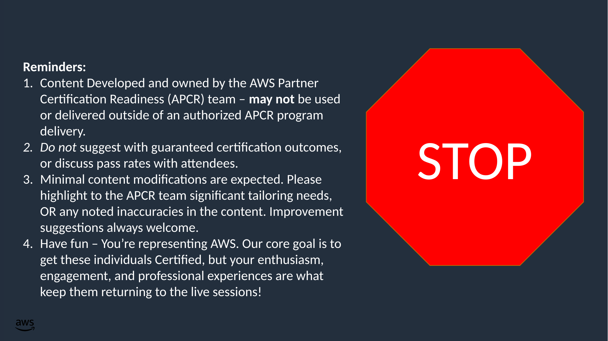

### Notes

FACILITATOR: This slide is hidden on purpose. Confirm it stays hidden, or delete it, before you export a PDF or share the deck with a partner.

The content is APCR-team owned and is licensed only for delivery inside an authorized event. If a partner asks for the deck, point them to the official event materials rather than forwarding this file.

Nothing here is presented to the room. Advance straight past it into the title slide.

---

## Slide 2 — INSTRUCTOR GUIDANCE _(hidden)_

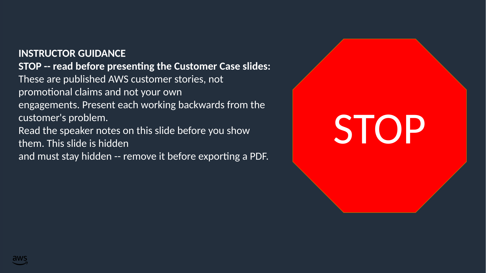

### Notes

WHY THESE SLIDES EXIST: two Customer Case slides ground the session in real customers with real problems. They are NOT promotional. Each works backwards from the customer's challenge, which is why the title is the problem and not the result.

YOU MAY: name the customer exactly as AWS's published page names it; state any figure that appears on that page; describe the services the page names; and point people at the SOURCE link on the slide. Everything on these slides is verified word for word against the published case study.

YOU MAY NOT: add a figure, a service, or an architectural detail that is not on the page. Do not infer how the customer built something. Do not say or imply that an attendee's own customer will get the same result. Do not present these as your own work, and do not use customer logos.

WHY THE RULES ARE THIS TIGHT: a published case study has already been through the customer's own legal and marketing approval, and that approval covers presentations. Anything added on top of it has been approved by nobody, so an added detail is the one thing that turns an approved reference into a problem.

IF A LINK IS DEAD, DROP THE SLIDE. Customer consent can be withdrawn, and AWS then removes the page. A case-study URL that stops working may mean permission lapsed rather than a broken link, so do not present it from a cached copy or an older deck. Tell the APCR team instead.

ON SPEAKING FOR AWS: present these as AWS's published customer stories, not as an AWS position you are announcing and not as your own findings. If someone asks a question the page does not answer, the honest answer is that the case study does not say, and you can follow up.

---

## Slide 3 — Content Review — Session 2

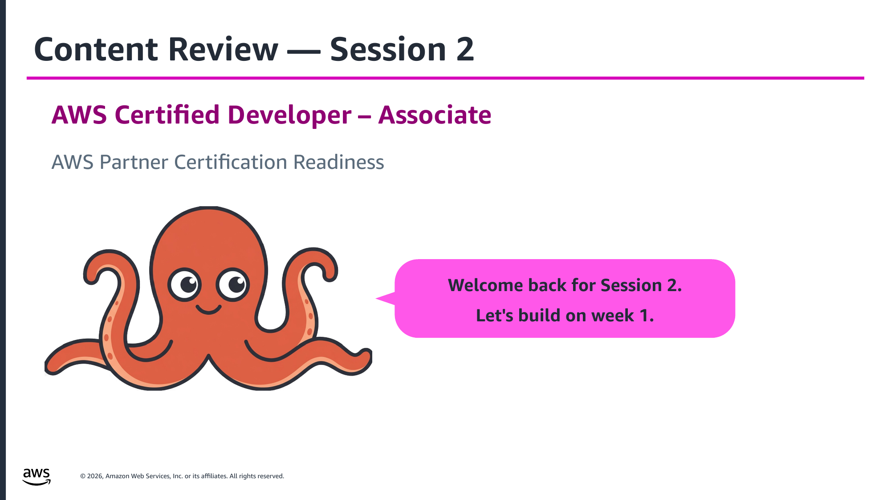

### Notes

FACILITATOR: The opening slide for the second content-review session. Welcome the room back and set the frame: this week goes deeper into developing with core AWS services – compute, databases, and the messaging that ties them together.

Say what the next two hours look like -- roughly half is a fast re-grounding in the week-two services, and half is exam-strategy practice on live questions.

Keep this short. Everyone here already holds Cloud Practitioner and has a week of study behind them; pitch it as a working session, not a lecture.

---

## Slide 4 — Event check-in

### Notes

FACILITATOR: A quick pulse check before the content starts. Ask how week one landed -- who finished the digital training, who feels behind, and what got in the way.

Some people will have fallen behind, and that is normal. Be encouraging and share a little of your own study experience so the room relaxes and talks.

Keep it to two or three minutes, then move into the week-two curriculum.

---

## Slide 5 — Week 2 digital training

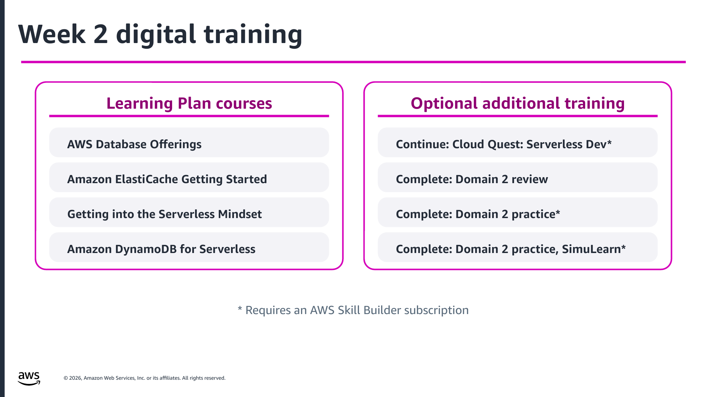

### Notes

WHAT'S HERE: This week's training checklist. The left card is the free Learning Plan; the right card is the optional Exam Prep Plan a subscriber can add.

FACILITATOR: Use this as a check-in. Ask how people are doing with the material and relate it to your own experience studying for the exam -- which modules stood out, what your key takeaways were. Week two shifts toward databases and the serverless mindset, which builds directly on week one's compute and networking foundations.

The Exam Prep Plan is the subscription-based, cert-aligned companion plan. Remind the room of the value of Cloud Quest -- the lab practice in particular -- and check whether anyone has tried the labs yet.

Note: the item names beginning "Domain 2" are the actual Exam Prep Plan module names in Skill Builder, so learners can find them; they are navigation, not exam-coverage claims. Keep any talk of exam weighting out of this slide.

---

## Slide 6 — Optional: AWS Skill Builder subscription

### Notes

WHAT'S HERE: A comparison of what the free Skill Builder tier includes against what an individual subscription adds. The subscription is optional and is not required to take part in this event.

FACILITATOR: Frame the subscription around the labs and practice exams -- the hands-on practice and official practice questions are what most people find worth it when preparing for an Associate exam. Point the room at the Developer Associate Exam Prep Plan they can access during the event and recommend Cloud Quest for extra lab work.

Verify before delivery: the feature counts and the $29 per month / $449 per year pricing are carried from the source logistics slide and can change. The Skill Builder pricing page does not render for automated checking, so confirm the current numbers on skillbuilder.aws before you state them to the room and speak to the free tier if you are unsure.

The free tier already covers a great deal, so nobody should feel they must pay to succeed here.

---

## Slide 7 — Today's focus: Development with AWS Services

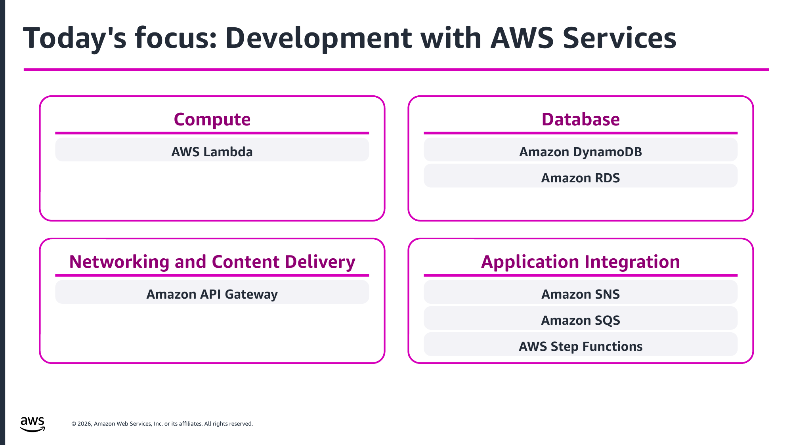

### Notes

WHAT'S HERE: The services this session works through, grouped by the role they play. Compute is Lambda; the data tier is DynamoDB and RDS; API Gateway fronts the requests; and the application-integration set -- SNS, SQS, and Step Functions -- is how the pieces are decoupled and coordinated.

FACILITATOR: Use this as a one-slide map of the session. Point out that most of the time goes on the development block -- API Gateway, Lambda, DynamoDB, and Step Functions -- with a shorter database-offerings segment and a decoupling-and-messaging segment after it.

Set the expectation that everyone here has seen these services at Cloud Practitioner depth; the job today is to go one level deeper into how a developer actually builds with them and where the exam tends to probe.

Then move into the first section, Development with AWS Services.

---

## Slide 8 — Your five weeks at a glance

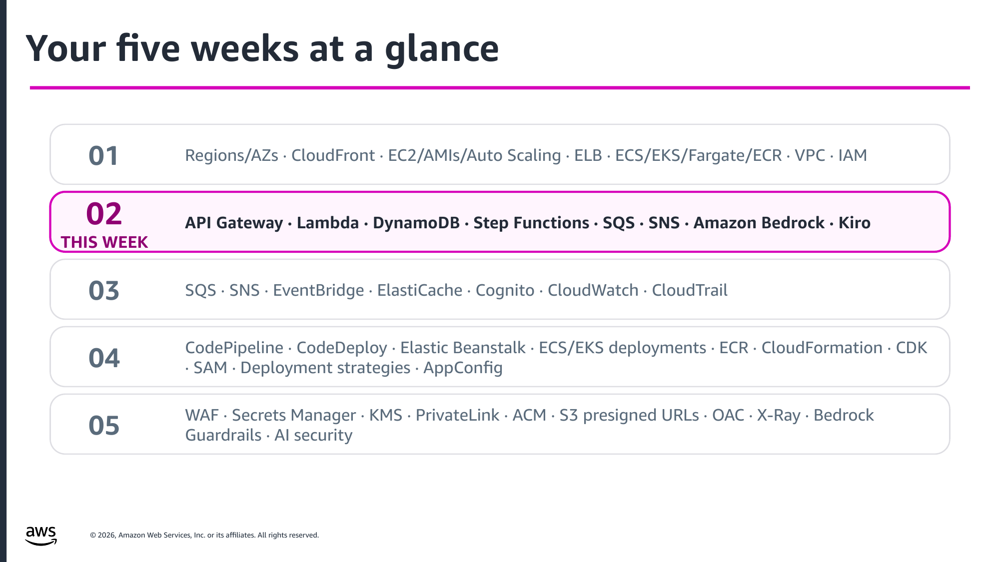

### Notes

WHAT'S HERE: A map of the whole five-week event, one row per week, with this week highlighted. Use it near the top of the session so the room can see where week 2 sits in the arc and what is still to come.

FACILITATOR: Point at the highlighted row. Week 2 is the developing-with-core-services week -- API Gateway, Lambda, DynamoDB, Step Functions, and the messaging services that decouple them, plus the AI services added this cycle, Amazon Bedrock and Kiro. Note how it builds on week 1's compute and networking foundations and sets up the deployment and security weeks that follow.

Keep it brief -- this is orientation, not content. The same map appears in every session with the current week moving, so returning attendees will recognize it at a glance. Then move into today's focus.

---

## Slide 9 — How do you build on AWS?

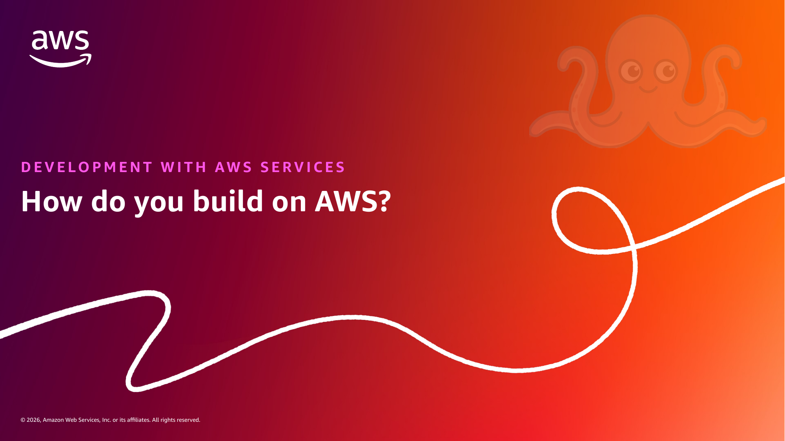

### Notes

WHAT'S HERE: The section opener. Put the question to the room and take a couple of answers before moving on. This audience already holds Cloud Practitioner, so treat the next slides as a fast re-grounding in how a developer actually builds -- not a first lecture. The block ahead is the largest of the session: API Gateway and Lambda first, then DynamoDB, then Step Functions.

EXAM RELEVANCE: Development with AWS services is the largest domain on this exam. The services in this section are the ones most answers are built on -- how requests arrive, where the code runs, and how the pieces are wired together.

PARTNER CONTEXT: When a customer asks a Partner to "build a small service," this is the toolkit that keeps it cheap to run and quick to ship -- managed compute and a managed front door rather than servers to patch.

EXAM MAPPING: Domain 1, Development with AWS Services (and).

REFERENCE: https://docs.aws.amazon.com/lambda/latest/dg/welcome.html

---

## Slide 10 — Two ways to run your code on AWS

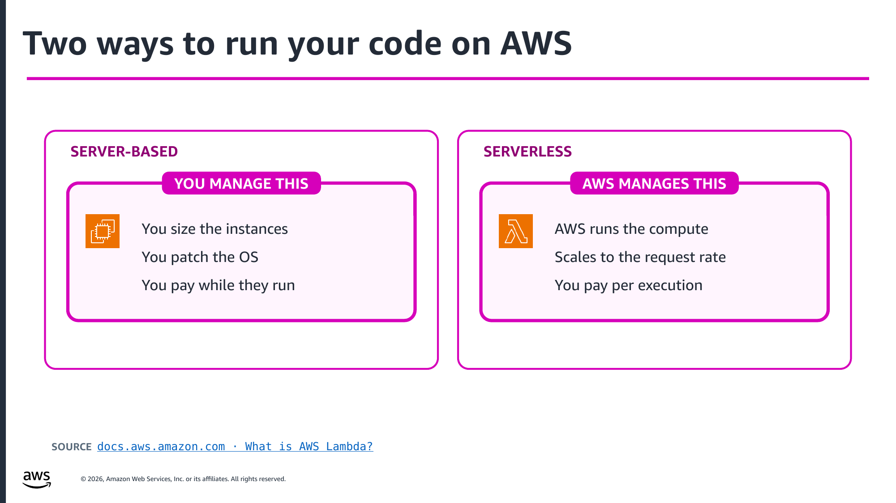

### Notes

WHAT'S HERE: the same application delivered two ways, and the difference is drawn as a boundary rather than described. Point at the chip on each inner box first -- that chip says who is responsible for everything inside it.

On the left you size the instances, patch the operating system, and pay while they are running whether or not a request arrives. On the right AWS runs the compute, it scales to the request rate, and you are billed for execution.

Both panels are the same size on purpose. The only difference the eye finds is where the responsibility boundary sits, which is the actual distinction between the two models.

EXAM RELEVANCE: A scenario stressing no servers to manage, automatic scaling, or paying only when code runs is pointing at serverless. One needing a long-running process, a specific operating system, or control of the instance points back at EC2.

PARTNER CONTEXT: For a customer with spiky or low-volume traffic, serverless removes a class of operational work they were often not staffed for. For steady high-utilization workloads the economics can favor provisioned compute, which is worth checking before recommending either.

EXAM MAPPING: Domain 1.

REFERENCE: https://docs.aws.amazon.com/lambda/latest/dg/welcome.html

---

## Slide 11 — Customers reach your service through an API

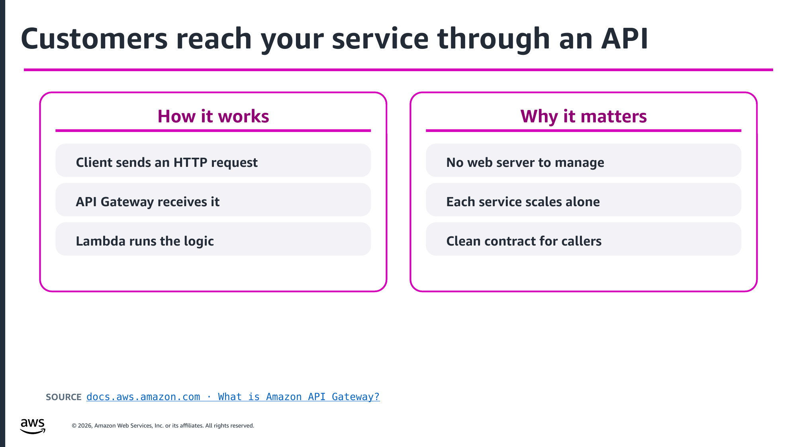

### Notes

WHAT'S HERE: The core serverless request pattern. A client makes an HTTP call; Amazon API Gateway accepts it and passes it to an AWS Lambda function that holds the business logic; the function does its work and returns a response back through the gateway. There is no web server in the path that you own or scale.

EXAM RELEVANCE: This API-Gateway-fronts-Lambda shape is the reference architecture behind many Development questions. Recognize it when a scenario describes exposing microservices over HTTP without managing servers.

PARTNER CONTEXT: Fronting each capability with its own API gives a customer a stable contract they can hand to other teams or Partners, while letting each piece scale and deploy independently -- a common first step when breaking up a monolith.

EXAM MAPPING: Domain 1 (choose synchronous and asynchronous patterns).

REFERENCE: https://docs.aws.amazon.com/apigateway/latest/developerguide/welcome.html

---

## Slide 12 — API Gateway is the front door for your APIs

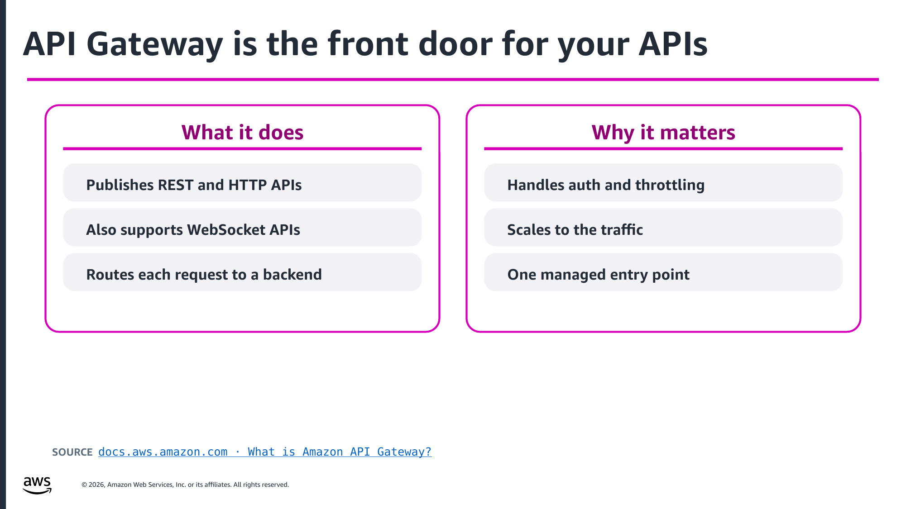

### Notes

WHAT'S HERE: Amazon API Gateway is a managed service for creating, publishing, securing, and monitoring APIs at scale. A REST API is built from resources (the paths) and methods (the HTTP verbs on them), each wired to a backend such as a Lambda function or an AWS service. The gateway is the single managed entry point in front of that backend.

EXAM RELEVANCE: Know what the gateway owns rather than your code -- request routing, authorization, throttling, and request and response transformation. When a question asks where to enforce a rate limit or validate a request before it reaches Lambda, this is the layer.

PARTNER CONTEXT: A customer worried about a backend being overwhelmed can often get protection at the gateway -- throttling and validation -- without touching application code, which is a fast, low-risk change to propose.

EXAM MAPPING: Domain 1 (create, extend, and maintain APIs).

REFERENCE: https://docs.aws.amazon.com/apigateway/latest/developerguide/welcome.html

---

## Slide 13 — The endpoint type decides where your API lives

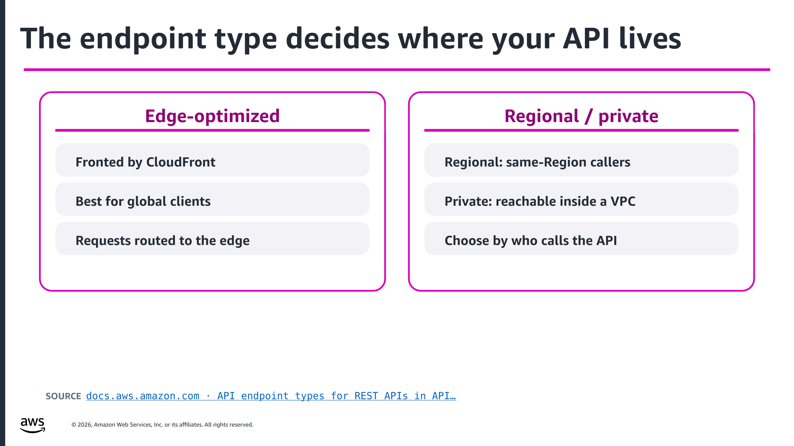

### Notes

WHAT'S HERE: The endpoint type is the kind of endpoint API Gateway creates for a REST API. Edge-optimized routes callers through the Amazon CloudFront network and suits geographically spread clients. Regional serves callers in the same Region and lets you put your own content delivery in front if you want. Private makes the API reachable only from inside a virtual private cloud through an interface VPC endpoint.

EXAM RELEVANCE: Match the type to who calls the API. Globally distributed users point at edge-optimized; callers in one Region point at regional; an API that must never be reachable from the public internet points at private.

PARTNER CONTEXT: For an internal service a customer does not want exposed publicly, a private endpoint keeps the traffic inside their network -- often the deciding factor for a security or compliance stakeholder.

EXAM MAPPING: Domain 1 (create, extend, and maintain APIs).

REFERENCE: https://docs.aws.amazon.com/apigateway/latest/developerguide/api-gateway-api-endpoint-types.html

---

## Slide 14 — Stages let one API serve many environments

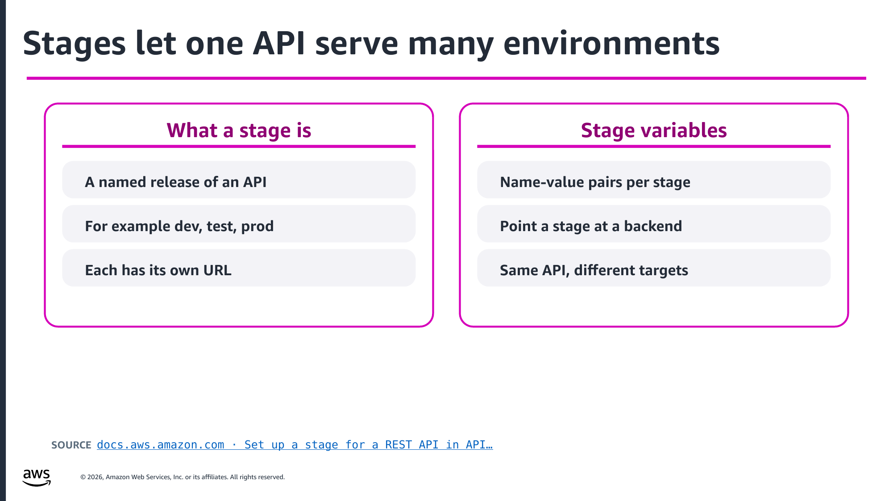

### Notes

WHAT'S HERE: A stage is a named deployment of an API -- alpha, beta, production, and so on -- and each stage has its own invoke URL. Stage variables are name-value pairs attached to a stage; you reference them in the integration so the same API definition can point a development stage at a development backend and a production stage at a production backend without changing the API itself.

EXAM RELEVANCE: When a scenario needs the same API to talk to different backend endpoints per environment, or to promote a version without redeploying everything, stages and stage variables are the mechanism. Note that API Gateway stages and custom domain names are exercised under the deployment domain of the current exam.

PARTNER CONTEXT: Stages give a customer a clean promotion path from test to production behind one API, which reduces the risk of a change that was only ever tried against the wrong backend.

EXAM MAPPING: Domain 1; API Gateway stages and custom domains are tested under Domain 3 at C03.

REFERENCE: https://docs.aws.amazon.com/apigateway/latest/developerguide/set-up-stages.html

---

## Slide 15 — Lambda runs your code without servers

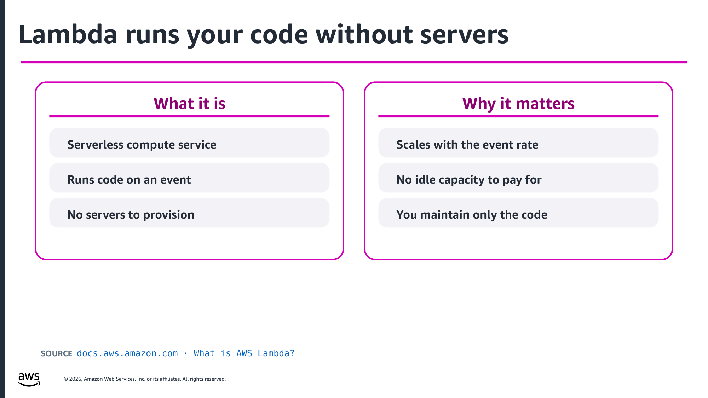

### Notes

WHAT'S HERE: AWS Lambda is a serverless compute service that runs your code in response to an event and manages the underlying compute for you. You upload a function; Lambda runs it when something invokes it, scales the number of concurrent executions to match the incoming events, and charges for the compute the function actually uses.

EXAM RELEVANCE: Lambda is the compute that most Development answers assume. Know that scaling is automatic and per-event, that there is no server to size or patch, and that you are billed on execution rather than on uptime.

PARTNER CONTEXT: For event-driven or bursty work -- processing an upload, reacting to a queue, backing an API -- Lambda lets a customer ship the logic and nothing else, which is often the difference between a small team shipping a service and not.

EXAM MAPPING: Domain 1 (configure and integrate Lambda functions).

REFERENCE: https://docs.aws.amazon.com/lambda/latest/dg/welcome.html

---

## Slide 16 — Serverless services combine into a whole app

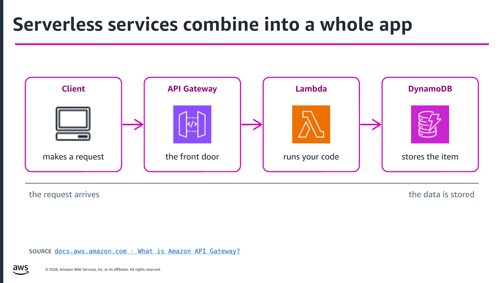

### Notes

WHAT'S HERE: One request, all the way through. Read it left to right -- the client calls the API, API Gateway receives it, Lambda runs the code, DynamoDB stores the result. Four services, and not one server in the picture.

Point at each boundary as you go. API Gateway is the front door, so it handles the HTTP concerns. Lambda is where your code actually runs. DynamoDB is where the item lands.

The axis underneath is doing real work: it says the ordering is the lesson. A learner who has only seen these services named separately has no picture of how they connect, and this is that picture.

EXAM RELEVANCE: Most Development answers are built on this path, so knowing which service owns which concern is what makes a scenario readable. A question about request validation or throttling is at the front door; one about execution time or memory is at the function.

PARTNER CONTEXT: This is the shape of nearly every small service a customer asks a Partner to build, and it is quick to ship because none of the four needs capacity planning.

EXAM MAPPING: Domain 1 and.

REFERENCE: https://docs.aws.amazon.com/apigateway/latest/developerguide/welcome.html

---

## Slide 17 — A few concepts describe every Lambda function

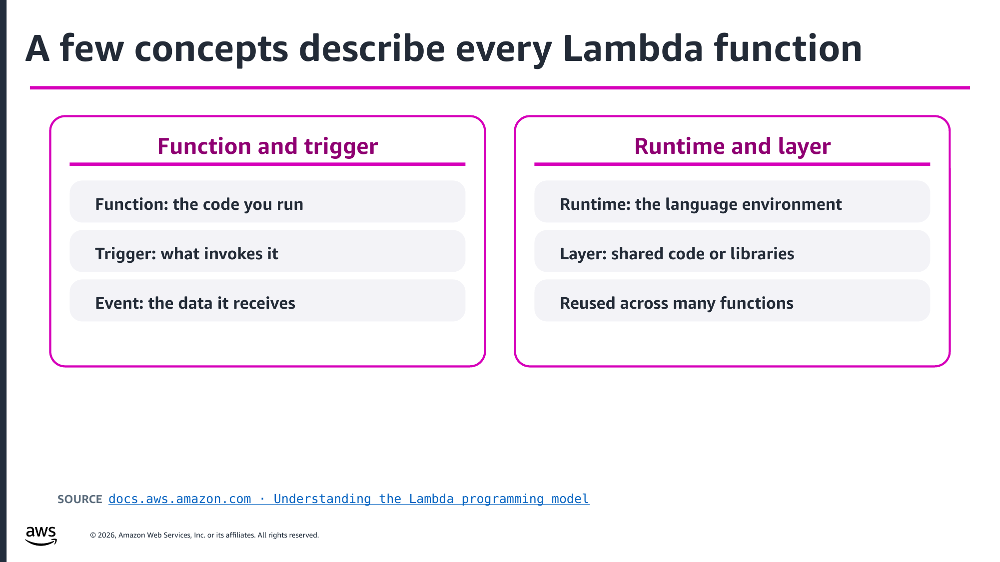

### Notes

WHAT'S HERE: The vocabulary every Lambda answer uses. A function is the resource you invoke to run your code. A trigger is the resource or configuration that invokes it. An event is the JSON document the trigger passes in. A runtime is the language-specific environment the code runs in. A layer is a .zip archive of libraries or shared code that several functions can reuse instead of bundling it each time.

EXAM RELEVANCE: These terms recur throughout the exam, so keep them precise -- especially the difference between a trigger (what causes the invocation) and the event (the data delivered) and the role of a layer in sharing dependencies.

PARTNER CONTEXT: Layers are an easy win to point out -- a customer with the same dependencies across many functions can pull them into a layer and shrink every deployment package, which speeds up their releases.

EXAM MAPPING: Domain 1 (configure functions with variables and dependencies).

REFERENCE: https://docs.aws.amazon.com/lambda/latest/dg/foundation-progmodel.html

---

## Slide 18 — The handler is where your event arrives

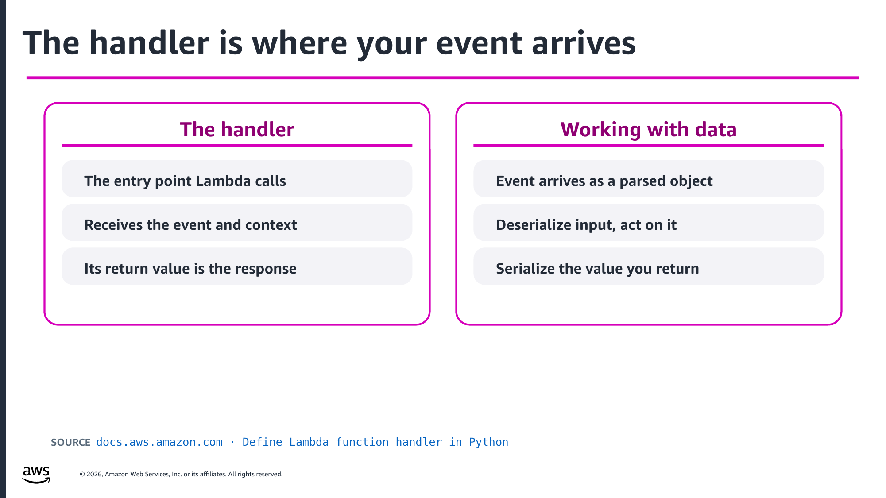

### Notes

WHAT'S HERE: The runtime reads the handler name, passes each invocation event to the handler, and the handler's return value becomes the response. This is also where serializing and deserializing data lives, day to day: the runtime hands the handler the event already parsed into a language object, your code reads the fields it needs, and whatever the handler returns is serialized back into the response for the caller. When you call another AWS service through the SDK you do the same in reverse -- build a request object and read a structured response.

EXAM RELEVANCE: Know that the handler is the function's entry point and that the shape of the event depends on what triggered it. Serializing and deserializing data to integrate application code with AWS services is a Development skill on this exam, so be comfortable reading an event and shaping a return value.

PARTNER CONTEXT: Most first Lambda bugs a customer hits are shape mismatches -- reading a field that is not in the event, or returning something the caller cannot parse. Pointing at the handler contract early saves a lot of that.

EXAM MAPPING: Domain 1 (handler and runtime) and (serialize and deserialize data).

REFERENCE: https://docs.aws.amazon.com/lambda/latest/dg/python-handler.html

---

## Slide 19 — Sync waits for the result; async hands it off

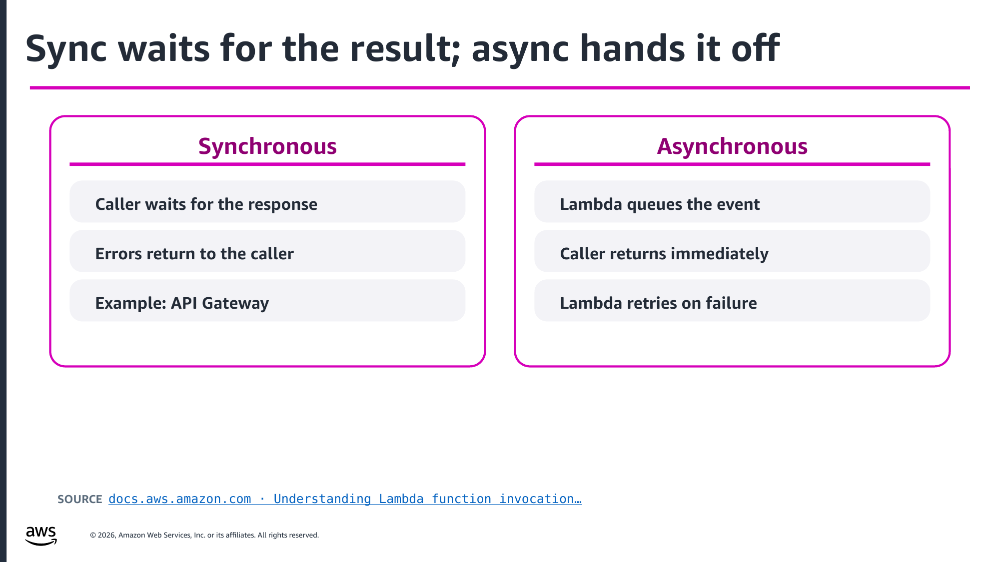

### Notes

WHAT'S HERE: Lambda can be invoked synchronously or asynchronously, and the trigger decides which. With a synchronous invocation the caller waits for the function to finish and gets the result or the error directly -- API Gateway calls Lambda this way. With an asynchronous invocation Lambda puts the event on an internal queue, returns to the caller straight away, and runs the function in the background, retrying automatically if it fails.

EXAM RELEVANCE: This distinction drives error handling. Synchronous callers see failures immediately and own the retry. Asynchronous invocations are retried by Lambda and should send events that still fail to a dead-letter queue or an on-failure destination, so keep that boundary sharp in a troubleshooting scenario.

PARTNER CONTEXT: When a customer reports "the request timed out but the work still happened," it is usually a synchronous caller in front of slow work that should have been asynchronous -- a design conversation worth having.

EXAM MAPPING: Domain 1 (choose synchronous and asynchronous patterns).

REFERENCE: https://docs.aws.amazon.com/lambda/latest/dg/lambda-invocation.html

---

## Slide 20 — Three models decide how Lambda is invoked

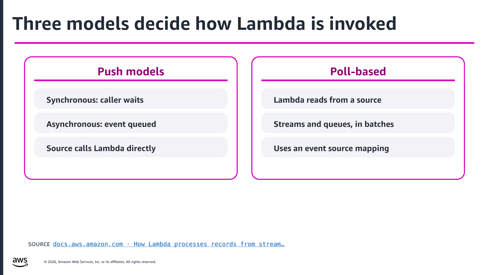

### Notes

WHAT'S HERE: There are three ways a function gets invoked. Synchronous push, where a source like API Gateway calls and waits. Asynchronous push, where a source like Amazon S3 or Amazon SNS hands Lambda an event and does not wait. And poll-based, where Lambda itself reads records in batches from a stream or queue -- Amazon Kinesis, Amazon DynamoDB Streams, or Amazon SQS -- using an event source mapping that Lambda manages on your behalf.

EXAM RELEVANCE: Know that stream and queue sources are poll-based and configured with an event source mapping, not by the source pushing to Lambda. A question about processing records from a queue or a stream in batches is testing this model.

PARTNER CONTEXT: When a customer needs to process a firehose of records, the poll-based model with an event source mapping lets Lambda pull at its own pace and in batches, which is usually cheaper and steadier than trying to push each record.

EXAM MAPPING: Domain 1 (integrate Lambda by using event source mappings).

REFERENCE: https://docs.aws.amazon.com/lambda/latest/dg/invocation-eventsourcemapping.html

---

## Slide 21 — Memory is the main lever for Lambda performance

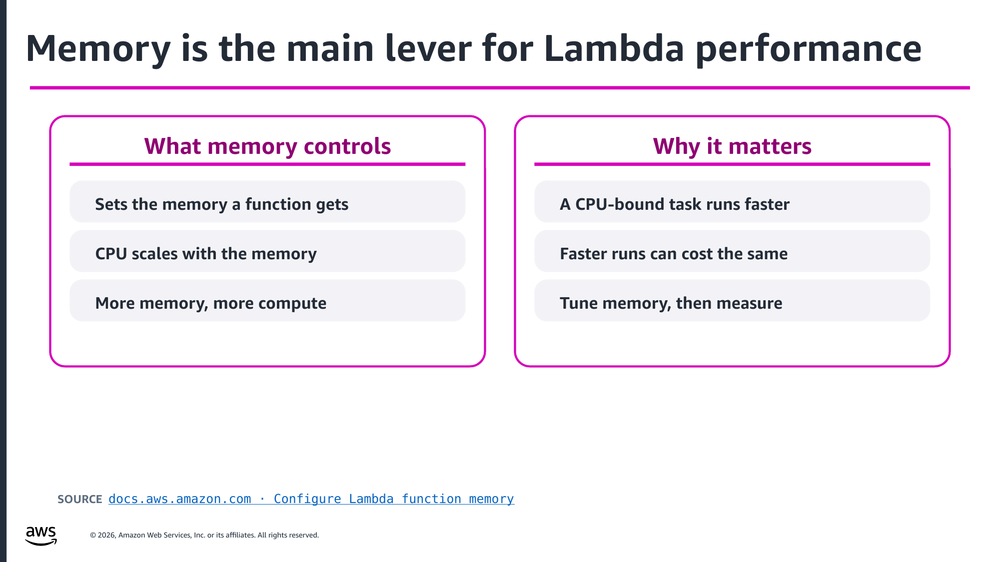

### Notes

WHAT'S HERE: Memory is the principal setting a Lambda developer uses to control performance. The amount of memory you assign also determines the amount of virtual CPU the function receives -- they scale together, so adding memory gives a function proportionally more processing power. For a compute-bound function, raising memory can cut the run time enough that the cost per invocation barely changes.

EXAM RELEVANCE: If a scenario describes a function that is slow because it is doing heavy computation, increasing memory is the lever, because it also raises CPU. Keep this straight from the case where the function is slow for another reason -- more memory only helps when the work is actually compute-bound.

PARTNER CONTEXT: The practical advice is to tune memory against a representative workload and measure, rather than guessing -- the fastest setting and the cheapest setting are often close together, and only measurement finds them.

EXAM MAPPING: Domain 4 (optimize memory and compute power).

REFERENCE: https://docs.aws.amazon.com/lambda/latest/dg/configuration-memory.html

---

## Slide 22 — Timeouts stop a function that runs too long

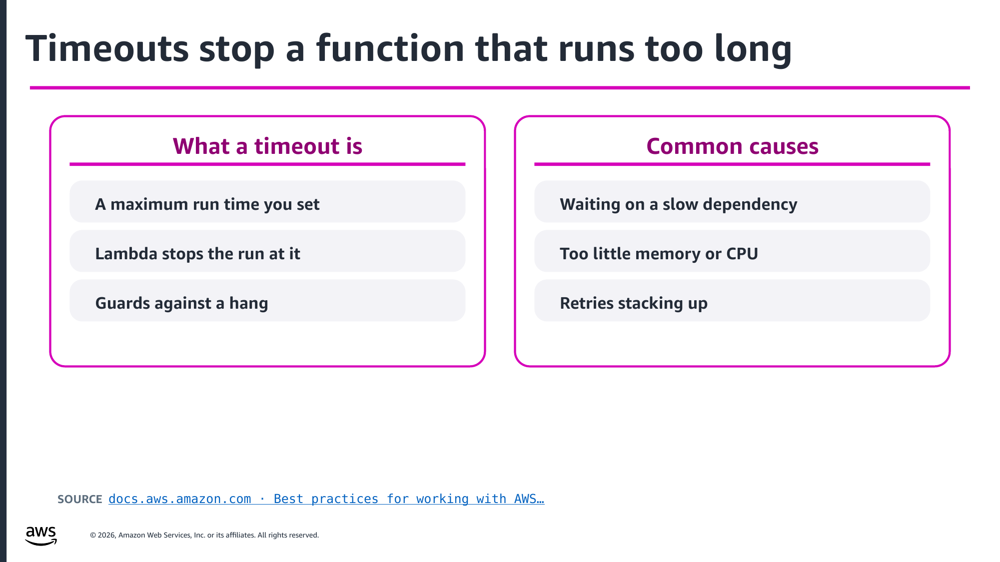

### Notes

WHAT'S HERE: A function timeout is the maximum time you allow an invocation to run before Lambda stops it. It is a safety limit, not a target -- set it high enough for normal work but low enough that a stuck invocation does not run on and cost money. Common reasons a function hits its timeout are waiting on a slow downstream call, having too little memory and therefore too little CPU for the work, or retries piling up against a dependency.

EXAM RELEVANCE: Match the symptom to the cause. A function that times out waiting on a network call needs a fix in the dependency path or the timeout budget; one that times out under heavy computation may just need more memory. Do not reach for the same fix for every timeout.

PARTNER CONTEXT: Setting a realistic timeout is a small change that stops a runaway function from quietly running up cost, which customers appreciate finding before the bill does.

EXAM MAPPING: Domain 1 (handle event lifecycles and errors); Domain 4.

REFERENCE: https://docs.aws.amazon.com/lambda/latest/dg/best-practices.html

---

## Slide 23 — An upload can trigger Lambda in real time

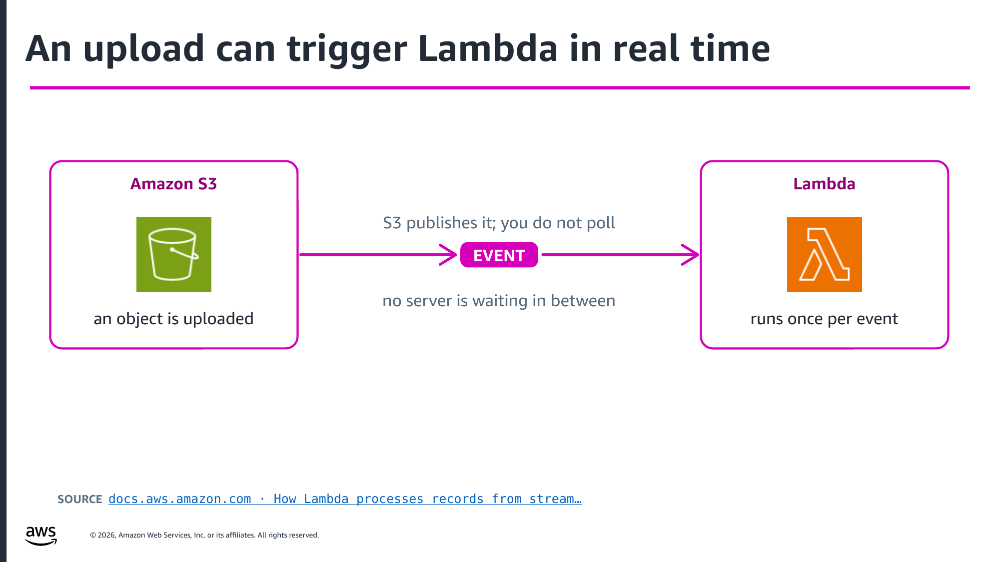

### Notes

WHAT'S HERE: An upload on the left, a function on the right, and the thing between them is the part a learner cannot see -- the event. It is drawn on the wire deliberately, because "S3 triggers Lambda" hides the mechanism.

Say what does the work. S3 publishes the event; nothing is polling and no server is waiting in between. The function runs once per event and then goes away.

That is what makes the pattern cheap. Between uploads there is nothing running, so there is nothing to pay for and nothing to scale down.

EXAM RELEVANCE: The tested idea is that the source publishes and the function is invoked -- not that something checks on a schedule. A scenario describing processing that should start as soon as a file lands is describing this.

PARTNER CONTEXT: A customer running a cron job every five minutes to look for new files is usually describing this pattern without knowing it exists, and the change removes both the delay and the idle cost.

EXAM MAPPING: Domain 1.

REFERENCE: https://docs.aws.amazon.com/lambda/latest/dg/invocation-eventsourcemapping.html

---

## Slide 24 — DynamoDB is a serverless NoSQL database

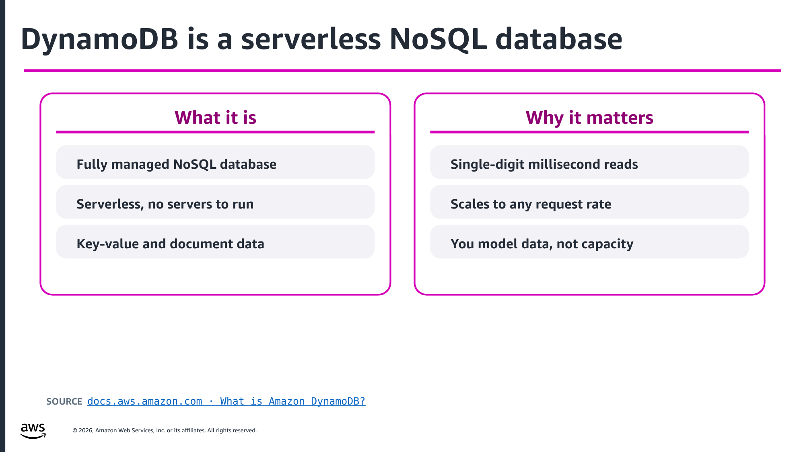

### Notes

WHAT'S HERE: Amazon DynamoDB is a fully managed, serverless, key-value and document NoSQL database built to run high-performance applications at any scale. AWS runs the infrastructure -- there is nothing to provision, patch, or cluster -- and the service is designed to deliver consistent single-digit millisecond performance as a table grows.

EXAM RELEVANCE: Recognize DynamoDB as the default serverless data store for the exam's serverless patterns. When a scenario needs a fast, horizontally scaling store with a flexible schema and no database servers to manage, this is the answer, in contrast to a relational engine on Amazon RDS.

PARTNER CONTEXT: For a customer whose access patterns are simple lookups at high volume, DynamoDB removes the capacity-planning and patching work a self-managed database would demand -- often the reason a small team can run a large workload.

EXAM MAPPING: Domain 1 (use purpose-built data stores in application development).

REFERENCE: https://docs.aws.amazon.com/amazondynamodb/latest/developerguide/Introduction.html

---

## Slide 25 — A table holds items, and items hold attributes

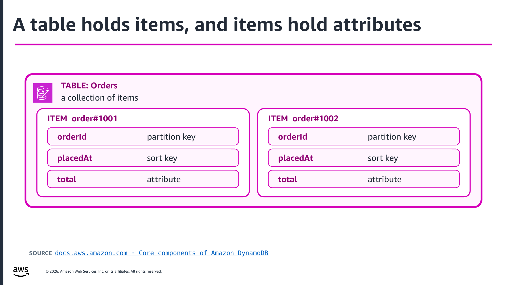

### Notes

WHAT'S HERE: Three levels of containment, drawn by nesting. The outer boundary is a table. Inside it are items. Inside each item are attributes. Nothing on the slide says "contains" -- the geometry says it.

Point at the two items and note they are not required to carry the same attributes. That is the difference from a relational row, and it is the single most useful thing to land here.

The attribute rows are deliberately not filled with realistic data. The structure is the lesson, and realistic values would bury it.

Name the two keys as you point at them: the partition key decides where the item lives, and the sort key orders items that share a partition key.

EXAM RELEVANCE: The vocabulary is what gets tested -- table, item, attribute, partition key, sort key. A scenario about retrieving one specific item is a primary-key question.

PARTNER CONTEXT: A customer coming from a relational background usually models a DynamoDB table like a table of rows. Seeing that items in one table can differ is what starts the access-pattern conversation.

EXAM MAPPING: Domain 1.

Verified against https://docs.aws.amazon.com/amazondynamodb/latest/developerguide/HowItWorks.CoreComponents.html

---

## Slide 26 — Secondary indexes query beyond the primary key

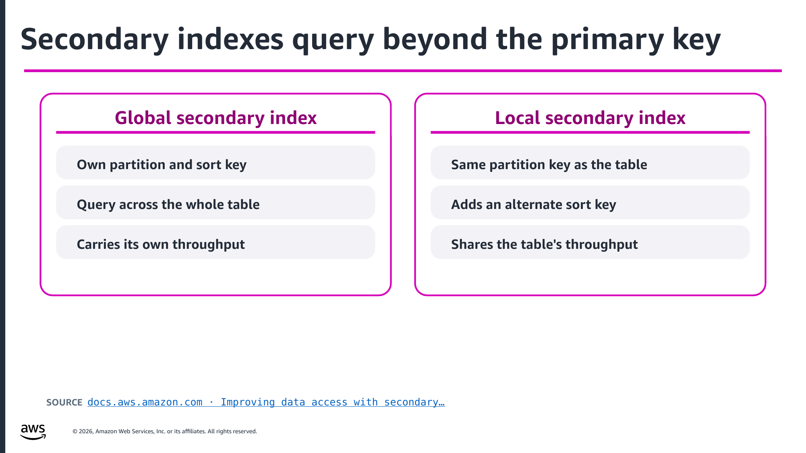

### Notes

WHAT'S HERE: A secondary index lets you query a table by an attribute other than its primary key. A global secondary index (GSI) has a partition key and optional sort key that can differ from the table's, and it spans all the data. A local secondary index (LSI) keeps the table's partition key but adds a different sort key. A GSI is provisioned with its own read and write capacity; an LSI draws on the table's capacity.

EXAM RELEVANCE: Match the index to the query. A need to query by a completely different attribute points at a GSI; a need for an alternate sort order within the same partition points at an LSI. Remember that a GSI has independent throughput -- in provisioned mode you set its capacity separately, and if a global secondary index is under-provisioned its throttling can also affect writes to the base table (see the Global Secondary Indexes guide, docs.aws.amazon.com/amazondynamodb/latest/developerguide/GSI.html). That behavior underpins a common troubleshooting scenario.

PARTNER CONTEXT: When a customer reports that adding an index "made writes start failing," an under-provisioned GSI is a frequent cause worth checking, because its capacity is separate from the table's and easy to overlook.

EXAM MAPPING: Domain 1 (design secondary indexes for a data store).

REFERENCE: https://docs.aws.amazon.com/amazondynamodb/latest/developerguide/SecondaryIndexes.html

---

## Slide 27 — Streams capture every change as it happens

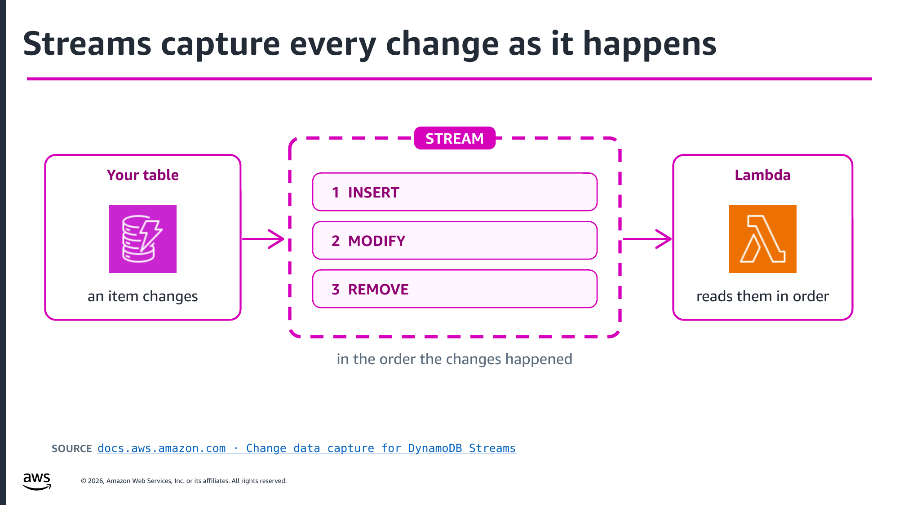

### Notes

WHAT'S HERE: The stream drawn as what it is -- an ordered sequence. Three change records, numbered, in the order the changes happened, feeding one consumer.

Point at the numbers. That ordering is the guarantee, and it is why a stream is different from simply being told "something changed". A consumer can process the changes in the sequence they occurred.

The stream is drawn dashed because it is not a resource you provision separately -- you enable it on the table and it is managed for you.

Say what the record contains: the item-level change, so a consumer can act on it without going back to read the table.

EXAM RELEVANCE: A scenario describing work that must happen after a write -- updating an aggregate, sending a notification, keeping a search index current -- is describing a stream plus a function.

PARTNER CONTEXT: A customer polling a table for changes is spending money on reads that find nothing. A stream turns polling into being told.

EXAM MAPPING: Domain 1.

REFERENCE: https://docs.aws.amazon.com/amazondynamodb/latest/developerguide/Streams.html

---

## Slide 28 — TTL expires stale items for you

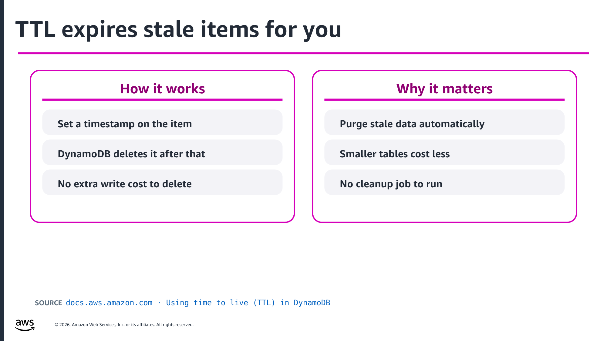

### Notes

WHAT'S HERE: Time to Live (TTL) lets you set a per-item timestamp attribute that marks when an item is no longer needed. Shortly after that time passes, DynamoDB deletes the item automatically, and those TTL deletions do not consume write throughput. You choose which attribute holds the expiry time when you enable TTL on the table.

EXAM RELEVANCE: TTL is the built-in answer for data with a natural lifespan -- sessions, tokens, short-lived events. When a scenario asks how to expire records without running a scheduled cleanup or paying for the deletes, TTL is the mechanism. Know that expiry is approximate, not to-the-second.

PARTNER CONTEXT: For a customer whose table keeps growing with data they only need briefly, enabling TTL both controls storage cost and removes a batch cleanup job they would otherwise have to build and operate.

EXAM MAPPING: Domain 1 (manage the data lifecycle in a data store).

REFERENCE: https://docs.aws.amazon.com/amazondynamodb/latest/developerguide/TTL.html

---

## Slide 29 — Capacity mode sets how you pay for throughput

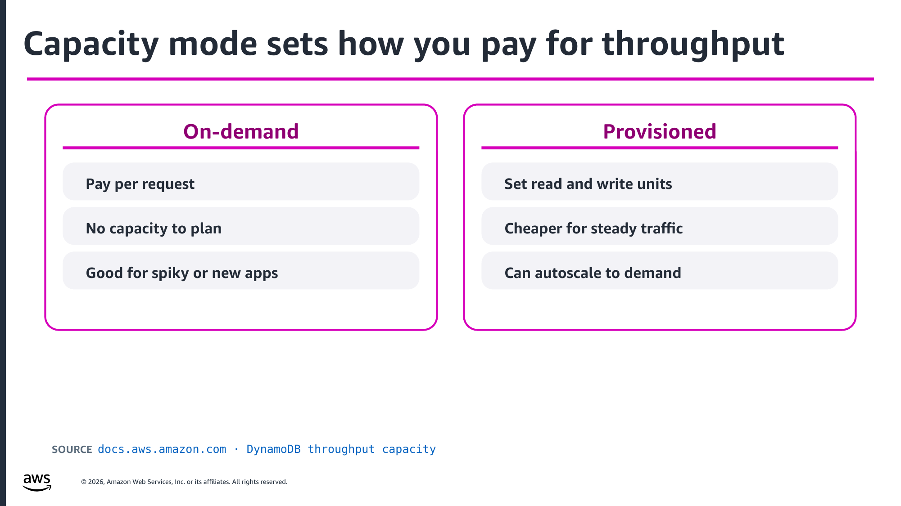

### Notes

WHAT'S HERE: The read/write capacity mode controls how you are charged for throughput and how you manage it. On-demand mode charges per request and requires no capacity planning, so it scales up and down with traffic on its own. Provisioned mode has you specify read capacity units and write capacity units; it is more economical for predictable traffic and can be paired with auto scaling to track demand.

EXAM RELEVANCE: Match the mode to the traffic shape. Unknown or spiky workloads and brand-new tables point at on-demand; consistent, forecastable traffic points at provisioned, often with auto scaling. A cost-optimization scenario for steady load usually favors provisioned.

PARTNER CONTEXT: A customer launching something new rarely knows its traffic, so on-demand avoids both over-provisioning and throttling on day one; once the pattern is clear, moving steady workloads to provisioned can lower the bill.

EXAM MAPPING: Domain 1 (choose a throughput mode for a data store).

REFERENCE: https://docs.aws.amazon.com/amazondynamodb/latest/developerguide/HowItWorks.ReadWriteCapacityMode.html

---

## Slide 30 — Keep large objects in S3, a pointer in DynamoDB

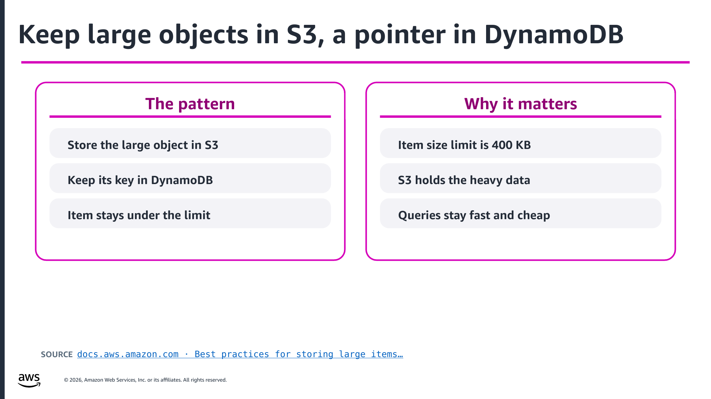

### Notes

WHAT'S HERE: DynamoDB limits the size of each item to 400 KB. When an application needs to store more than that -- a large document, an image, a long body of text -- the recommended pattern is to put the large value in Amazon S3 and store only the object key, or a pointer, as an attribute in the DynamoDB item. The item stays small and the heavy data lives in S3.

EXAM RELEVANCE: When a scenario describes items that exceed the DynamoDB size limit, the answer is to offload the large attribute to S3 and keep a reference in the table, not to redesign around the limit. Keeping items small also keeps reads cheaper, because you pay for the data you read.

PARTNER CONTEXT: For a customer storing rich content alongside structured records, this split keeps the database fast and inexpensive while S3 carries the bulk cheaply -- a pattern that also simplifies serving those large objects directly later.

EXAM MAPPING: Domain 1 (use data stores together for large objects).

REFERENCE: https://docs.aws.amazon.com/amazondynamodb/latest/developerguide/bp-use-s3-too.html

---

## Slide 31 — Step Functions orchestrates multi-step work

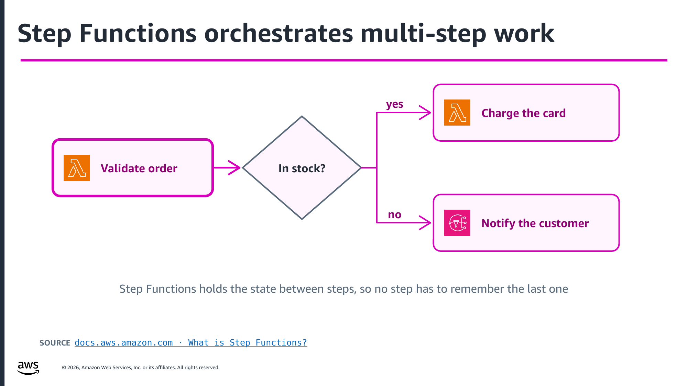

### Notes

WHAT'S HERE: A workflow with a real decision in it. The first step validates the order, the diamond asks a question, and the two answers go different ways.

Point at the diamond and note the conditions sit ON the branches, not inside it. The state itself holds the rule set; each branch carries the answer that takes you down it.

The line underneath is the point of the service. Step Functions holds the state between steps, so no step has to remember what the last one did or hand context along by hand.

Contrast that with wiring these functions together yourself, where every step needs to know about the next one and a failure halfway through leaves you guessing where it stopped.

EXAM RELEVANCE: A scenario describing multiple steps with branching, retries, or a need to see where a process failed is pointing at orchestration rather than at more application code.

PARTNER CONTEXT: A customer whose multi-step process fails silently in the middle usually has the logic spread across functions with no shared state. Visible state is often the whole value.

EXAM MAPPING: Domain 1.

REFERENCE: https://docs.aws.amazon.com/step-functions/latest/dg/welcome.html

---

## Slide 32 — Managed services combine into one serverless app

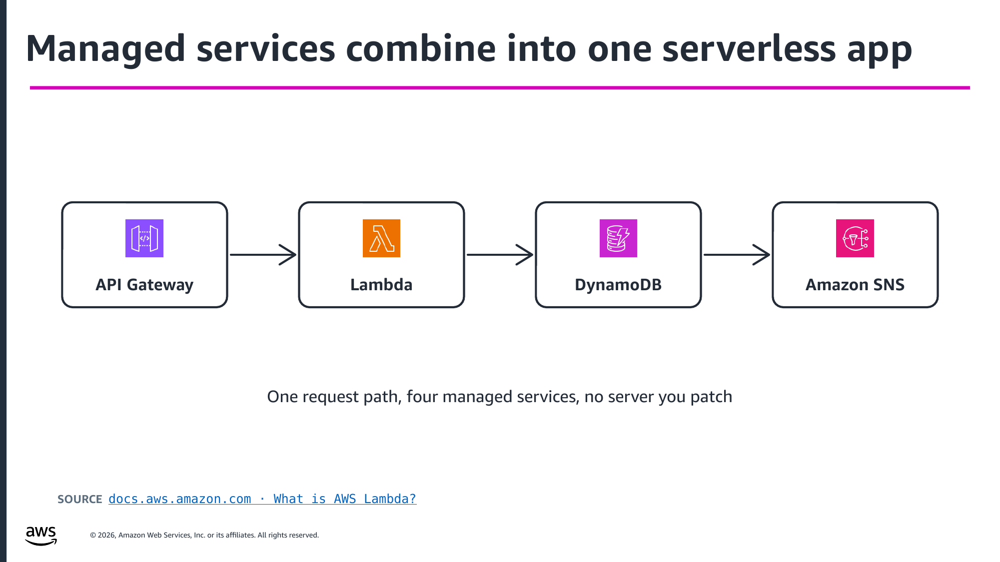

### Notes

ARCHDIAGRAM: This slide is an AWS architecture diagram and follows AWS's own icon and type rules rather than the APCR devices -- icons at the fixed size, plain black labels, 2pt connectors. The APCR ramp stays on the chrome.

WHAT'S HERE: The section, assembled. Everything taught separately over the last block, drawn as one request path so the room can see the shape they have been building toward.

Walk it once, naming each service and what it owns: the front door, the code, the data, the notification. Then note what is absent from the picture -- there is no server, no operating system, and no capacity decision anywhere in it.

This is the payoff slide for the section. Do not teach anything new here; the value is recognition.

EXAM RELEVANCE: Scenarios in this domain are usually a fragment of this diagram. Being able to place a question on it -- which box is this asking about -- is most of the work of answering it.

PARTNER CONTEXT: This is a shape a Partner can quote from memory when a customer asks what a small serverless service looks like, and every box in it is managed.

EXAM MAPPING: Domain 1 through 1.4.

REFERENCE: https://docs.aws.amazon.com/lambda/latest/dg/welcome.html

---

## Slide 33 — Which database fits the job?

### Notes

WHAT'S HERE: The section opener. Put the question to the room -- most applications need a data store, and the right one depends on the shape of the data and how it is queried. This audience already holds Cloud Practitioner, so treat the next two slides as a fast re-grounding: the managed relational and non-relational families first, then how DynamoDB differs from a relational engine.

EXAM RELEVANCE: The exam expects a developer to pick a purpose-built data store for the access pattern rather than defaulting to one engine for everything. Knowing which managed service fits relational, document, in-memory, and key-value needs is what this short section checks.

PARTNER CONTEXT: For a customer weighing a database choice, the useful move is to start from the access pattern and the data shape, not from a favorite engine -- a managed service then removes the administration work whichever family they land on.

EXAM MAPPING: Domain 1 (choose a purpose-built data store for the workload).

REFERENCE: https://docs.aws.amazon.com/AmazonRDS/latest/UserGuide/Welcome.html

---

## Slide 34 — AWS runs the database so you do not have to

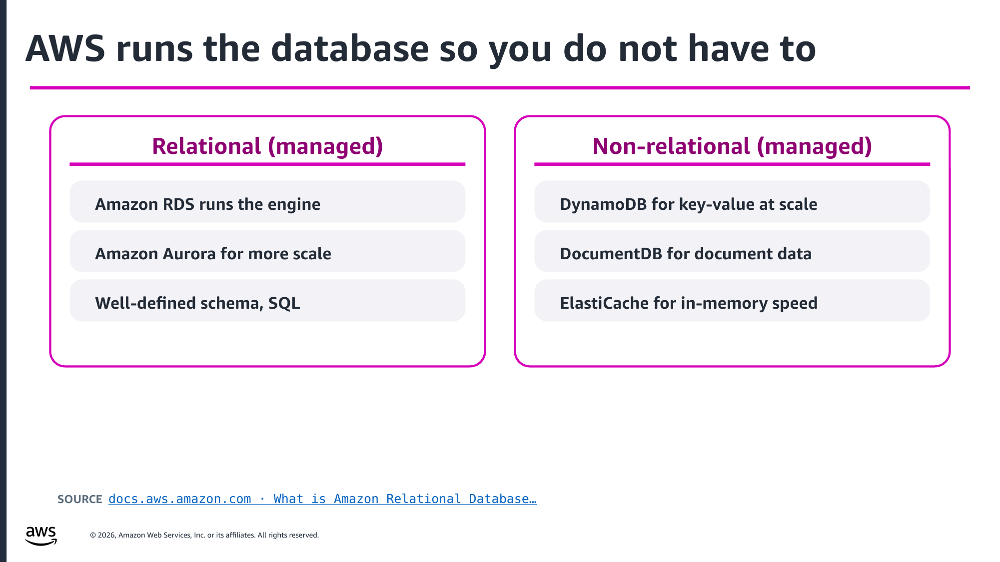

### Notes

WHAT'S HERE: AWS offers managed databases across two broad families. Relational: Amazon RDS runs common engines -- MySQL, PostgreSQL, MariaDB, Oracle, SQL Server -- and Amazon Aurora is a MySQL- and PostgreSQL-compatible engine built for higher performance and availability. Non-relational: Amazon DynamoDB for key-value and document workloads at scale, Amazon DocumentDB for MongoDB-compatible document data, and Amazon ElastiCache for in-memory caching. In every case AWS handles provisioning, patching, backups, and availability.

EXAM RELEVANCE: Match the family to the need. A well-defined schema with joins and ad hoc queries points at RDS or Aurora; a flexible schema with high request rates points at DynamoDB; MongoDB-style documents point at DocumentDB; a cache or session store points at ElastiCache. Aurora is the answer when a scenario wants a relational engine with more throughput and read scaling than standard RDS. AWS states Aurora delivers up to five times the throughput of standard MySQL and three times that of standard PostgreSQL (docs.aws.amazon.com/AmazonRDS/latest/AuroraUserGuide/CHAP_AuroraOverview.html).

PARTNER CONTEXT: For a customer self-managing a database on servers, moving to the matching managed service usually lets the same team keep its skills while handing the administration to AWS -- a common first step that frees people for application work.

EXAM MAPPING: Domain 1 (select relational and non-relational data stores).

REFERENCE: https://docs.aws.amazon.com/AmazonRDS/latest/UserGuide/Welcome.html

---

## Slide 35 — DynamoDB and relational fit different workloads

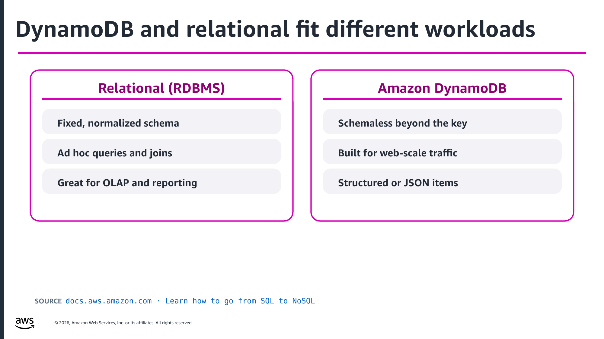

### Notes

WHAT'S HERE: A table is the fundamental structure in both a relational database and DynamoDB, but the models diverge from there. A relational database uses a well-defined schema with data normalized into tables, rows, and columns and relationships defined across them; it suits ad hoc queries, data warehousing, and online analytical processing. DynamoDB is schemaless -- every table needs a primary key to identify each item, but there are no constraints on the other attributes -- and it is built for web-scale applications such as social networks, gaming, media sharing, and Internet of Things, managing structured or semi-structured data including JSON documents.

EXAM RELEVANCE: When a scenario stresses flexible schema, very high request rates, or simple key-based access at scale, the answer leans DynamoDB. When it stresses complex joins, ad hoc reporting, or a normalized schema with strong relationships, it leans relational. Recognizing which model a workload wants is the point of the contrast.

PARTNER CONTEXT: For a customer deciding between the two, the honest guide is the access pattern: a known set of lookups at high volume favors DynamoDB, while unpredictable analytical queries across related data favor a relational engine. Choosing by data shape rather than familiarity avoids a costly re-platforming later.

EXAM MAPPING: Domain 1 (contrast data models and choose a store).

REFERENCE: https://docs.aws.amazon.com/amazondynamodb/latest/developerguide/SQLtoNoSQL.html

---

## Slide 36 — Why decouple with messaging?

### Notes

WHAT'S HERE: The section opener. Put the question to the room -- when one component calls another directly, a slow or failed consumer stalls the producer. A message service sits between them so each side runs, scales, and fails on its own. This audience already holds Cloud Practitioner, so treat the next few slides as a fast re-grounding: a queue for point-to-point work with Amazon SQS, then a topic for one-to-many delivery with Amazon SNS, and the fanout pattern that combines them.

EXAM RELEVANCE: The exam expects a developer to reach for asynchronous, decoupled designs -- a queue to absorb bursts and retry safely, a topic to notify many subscribers -- rather than tight synchronous calls between services. Recognizing when to decouple, and with which service, is what this section checks.

PARTNER CONTEXT: For a customer whose components fail together under load, introducing a queue or a topic is often the cheapest resilience win -- the producer keeps accepting work while consumers catch up, and no single slow step brings down the whole request path.

EXAM MAPPING: Domain 1 (develop event-driven and decoupled solutions).

REFERENCE: https://docs.aws.amazon.com/AWSSimpleQueueService/latest/SQSDeveloperGuide/welcome.html

---

## Slide 37 — A queue lets producers and consumers run apart

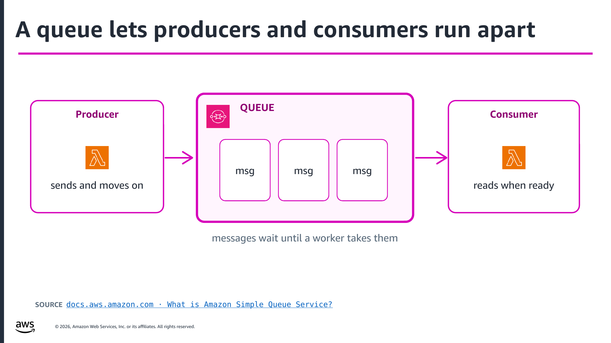

### Notes

WHAT'S HERE: A producer, a queue holding messages, and a consumer. The queue is drawn as a container with things waiting in it, because the waiting IS the mechanism.

Say what the producer does after sending: it moves on. It does not wait for the consumer, and it does not need to know whether the consumer is even running right now.

That is what decoupling buys. If the consumer is slow, or restarting, or scaled down to nothing, the messages wait rather than being lost.

Point at the single arrow out of the queue. One worker takes each message -- that is the part that separates a queue from a topic, and the next slides build on it.

EXAM RELEVANCE: A scenario describing work that must not be lost when a downstream component is unavailable, or traffic that arrives faster than it can be processed, is describing a queue.

PARTNER CONTEXT: A customer whose checkout fails when a downstream service is down usually has a synchronous call where a queue belongs. The buffer is what turns an outage into a delay.

EXAM MAPPING: Domain 1.

REFERENCE: https://docs.aws.amazon.com/AWSSimpleQueueService/latest/SQSDeveloperGuide/welcome.html

---

## Slide 38 — Working backwards: a huge spike was coming

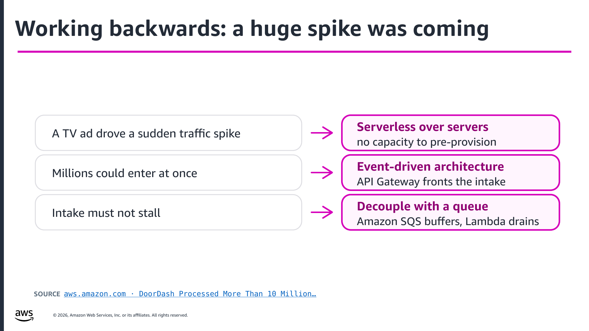

### Notes

WHAT'S HERE: A published AWS case study, so every figure here is DoorDash's and AWS's rather than ours. DoorDash is a local commerce platform. Read the rows left to right and you are working backwards from the customer's problem.

THE SETUP: DoorDash ran a national TV ad inviting more than 100 million viewers to enter a sweepstakes by typing a code on a microsite. A sudden, enormous spike of entries was coming, and the site had to stay fast and reliable throughout.

THE DECISION: With its agency Wildlife, DoorDash built an event-driven architecture on serverless services. Amazon API Gateway fronts the intake, Amazon Simple Queue Service decouples submission processing, and AWS Lambda drains the queue behind it, so no servers are sized for peak.

EXAM RELEVANCE: This is the messaging and compute material made real. A sudden spike that must not overwhelm the workers behind it points at a queue between the front door and the processing. The queue absorbs the burst and the consumers work at their own pace.

IF THEY ASK ABOUT RESULTS: The page reports processing more than 10 million entries in five hours with virtually no downtime, with the API replicated across three Regions for redundancy.

PARTNER CONTEXT: When a customer expects a traffic surge from a campaign or launch, this is the pattern to reach for first -- put a managed queue between intake and processing before anyone proposes a bigger fleet of servers.

EXAM MAPPING: Domain 1 (event-driven architecture, decoupling with Amazon SQS).

ON DELIVERY: The SOURCE link is the published case study. Put it on screen and say plainly that this is the customer we are discussing. Tell the room these pages reward their own time afterwards -- not as exam preparation, but to see the services working together for a real customer.

REFERENCE: https://aws.amazon.com/solutions/case-studies/doordash-serverless-case-study/

---

## Slide 39 — A topic pushes one message to many subscribers

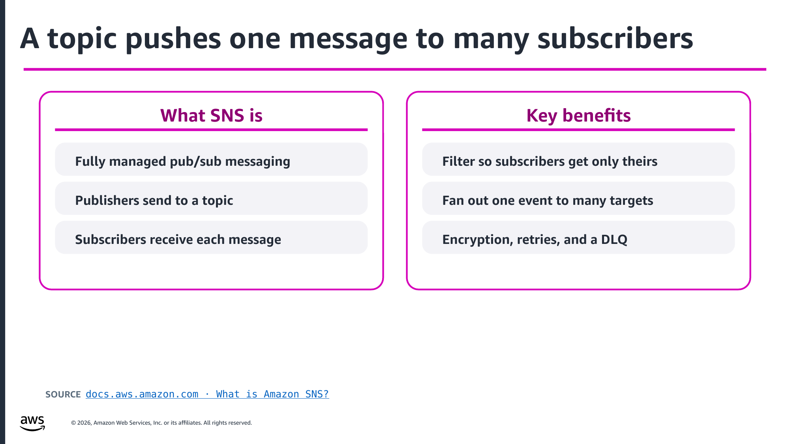

### Notes

WHAT'S HERE: Amazon Simple Notification Service (SNS) is a fully managed publish/subscribe messaging service. A publisher sends a message once to a topic, and SNS delivers a copy to every subscriber of that topic. Subscribers fall into two groups: application-to-application endpoints such as Amazon SQS queues, AWS Lambda functions, HTTP/S endpoints, and Amazon Data Firehose delivery streams; and application-to-person endpoints such as SMS text messages, mobile push, and email. Because delivery is push based, subscribers are notified as soon as the message is published.

EXAM RELEVANCE: The benefits map to recognizable exam cues. Message filtering means a subscriber receives only the messages that match its filter policy, so you do not fan out everything to everyone. Message batching lets a publisher send up to ten messages in one API request. FIFO topics add strict ordering and deduplication when order matters. Encryption, delivery retries, and a dead-letter queue cover security and durability. When a scenario needs one event to reach several independent consumers, the answer is a topic, not a queue.

PARTNER CONTEXT: For a customer wiring up notifications, a topic keeps the publisher unaware of who is listening -- new subscribers are added without touching the code that publishes, which is what lets an event-driven design grow without rework.

EXAM MAPPING: Domain 1 (develop code using publish/subscribe messaging).

REFERENCE: https://docs.aws.amazon.com/sns/latest/dg/welcome.html

---

## Slide 40 — One publish fans out to many parallel consumers

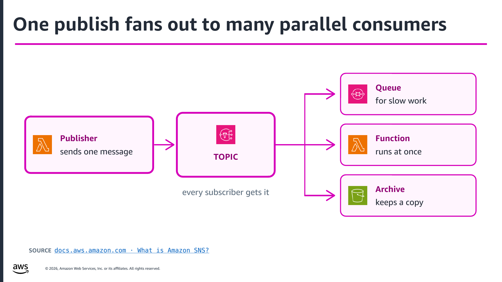

### Notes

WHAT'S HERE: One message published once, arriving at three different places at the same time. The publisher does not know who the subscribers are.

Point at the three arrows leaving the bus. They are parallel on purpose -- no subscriber is first and none waits for another. Each gets its own copy.

Note the subscribers are different kinds of thing: a queue, a function, and a store. The publisher does not care, and adding a fourth changes nothing about the code that publishes.

That is the value. A new consumer is a subscription, not a change to the producer.

EXAM RELEVANCE: A scenario where one event must reach several independent consumers is pointing at a topic. If it must reach exactly one worker, it is a queue.

PARTNER CONTEXT: A customer who has to modify their producer every time a new system needs the same event is describing the problem a topic solves.

EXAM MAPPING: Domain 1.

REFERENCE: https://docs.aws.amazon.com/sns/latest/dg/welcome.html

---

## Slide 41 — A queue delivers to one worker, a topic to many

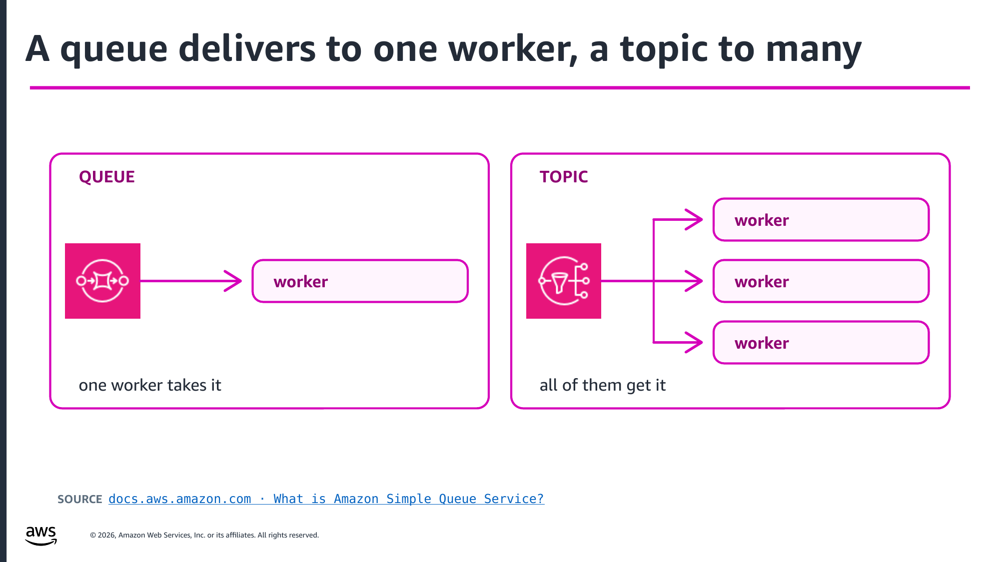

### Notes

WHAT'S HERE: The distinction that gets confused most often in this section, drawn so the geometry carries it. Both panels are the same size, so the only difference the eye finds is how many arrows leave the middle.

On the left, one worker takes each message. On the right, every subscriber gets its own copy of the same message.

Say the choosing question out loud: does this message need to be handled once, or does it need to reach several places? That question, not the service names, is what a scenario is really asking.

Worth adding that the two combine -- a topic can deliver into queues, which is how you get fan-out and buffering at the same time.

EXAM RELEVANCE: The words to hold are one consumer versus many. A scenario mentioning several independent systems reacting to the same event is a topic; one describing work items processed once is a queue.

PARTNER CONTEXT: A customer who wants both durability and fan-out often ends up with a topic in front of queues, and it helps to name that combination rather than presenting the two as alternatives.

EXAM MAPPING: Domain 1.

REFERENCE: https://docs.aws.amazon.com/AWSSimpleQueueService/latest/SQSDeveloperGuide/welcome.html

---

## Slide 42 — Where does AI fit into your app?

### Notes

WHAT'S HERE: The section opener. Two AWS building blocks now belong in a developer's kit, for two different jobs. Amazon Bedrock puts a foundation model behind a single managed API so your application can generate text, answer questions, or hold a conversation. Kiro is an agentic development environment that turns your intent into working code. This audience already holds Cloud Practitioner, so treat the next few slides as a fast grounding in what each one is and when to reach for it.

EXAM RELEVANCE: The exam now expects a developer to integrate a managed AI service into an application rather than train or host a model, and to recognize AI-assisted development tools. Knowing which service does which job -- inference for your app versus assistance while you build -- is what this short section sets up.

PARTNER CONTEXT: For a customer who wants generative AI in a product without standing up model infrastructure, a managed service is the practical route: the model is operated for them, and the team writes application code against an API.

EXAM MAPPING: Domain 1 (integrate managed AI services and use AI-assisted development tools).

REFERENCE: https://docs.aws.amazon.com/bedrock/latest/userguide/what-is-bedrock.html

---

## Slide 43 — One API reaches many foundation models

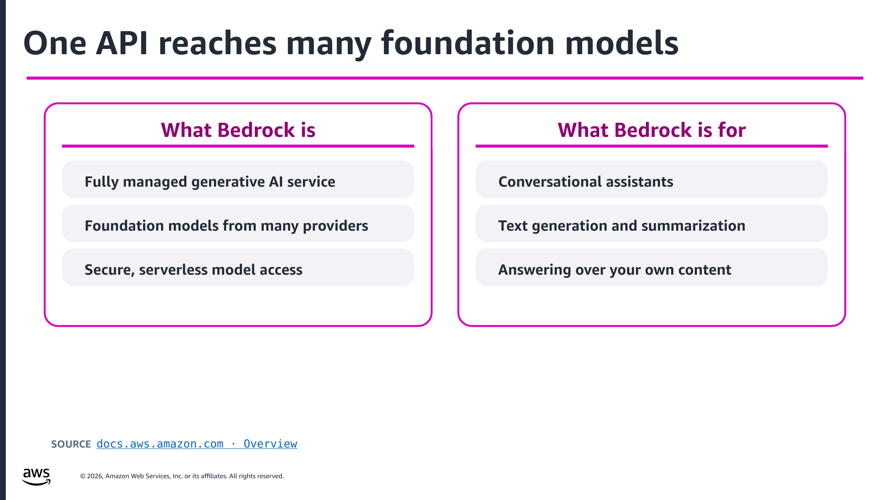

### Notes

WHAT'S HERE: Amazon Bedrock is a fully managed service that provides secure, enterprise-grade access to high-performing foundation models from leading AI companies, so you can build and scale generative AI applications. You do not train, host, or patch a model. You choose one of many available foundation models and call it from your application, and AWS runs the model behind the service. Because it is serverless, there is no inference infrastructure for your team to provision or scale.

EXAM RELEVANCE: Recognize Bedrock as the managed path to generative AI inference. Typical developer scenarios are a conversational assistant that answers customer questions, generating or summarizing text, and answering over a company's own documents by supplying that content with the prompt. When a scenario asks how to add generative AI to an application without managing model infrastructure, Bedrock is the answer. Model choice is a configuration decision, not a rebuild, because every model is reached through the same service.

PARTNER CONTEXT: For a customer weighing a build-your-own model against a managed service, Bedrock lets the team ship an AI feature in application code and defer the cost and operational burden of hosting a model, which is usually where a first generative AI project stalls.

EXAM MAPPING: Domain 1 (integrate a managed AI service into an application).

REFERENCE: https://docs.aws.amazon.com/bedrock/latest/userguide/what-is-bedrock.html

---

## Slide 44 — Call a foundation model with one request

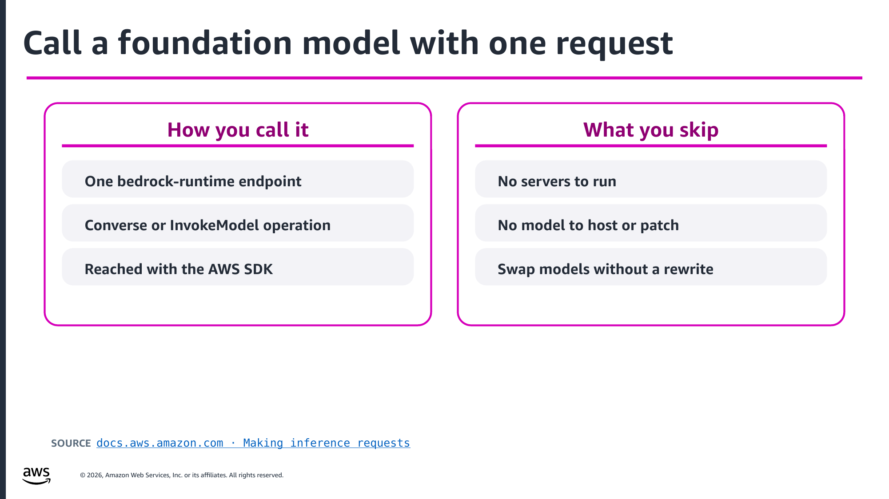

### Notes

WHAT'S HERE: Using Bedrock from code is a single request. Your application calls the bedrock-runtime endpoint through the AWS SDK, passing a model identifier and the prompt, and receives the model's response. Two operations cover most work: Converse, which takes a structured list of messages and is the straightforward choice for a chat-style exchange, and InvokeModel, which sends a model-specific request body when you need finer control. Both are ordinary SDK calls, so the same application code reaches any supported model by changing the model identifier.

EXAM RELEVANCE: This is the shape behind the week's Bedrock question. A chatbot is an application that calls Converse on the bedrock-runtime endpoint with the conversation so far and returns the model's reply -- there is no server to stand up and no model to deploy. Expect to recognize that the integration is an SDK call against a managed endpoint, that the model is selected by identifier, and that moving to a different model does not change the surrounding application code.

PARTNER CONTEXT: For a customer prototyping a generative AI feature, the one-request pattern means the first working version is a small amount of application code against an existing endpoint, so the team can test a use case before committing to a model or a design.

EXAM MAPPING: Domain 1 (invoke a managed AI service using the AWS SDK).

REFERENCE: https://docs.aws.amazon.com/bedrock/latest/userguide/inference.html

---

## Slide 45 — Working backwards: scale service, not cost

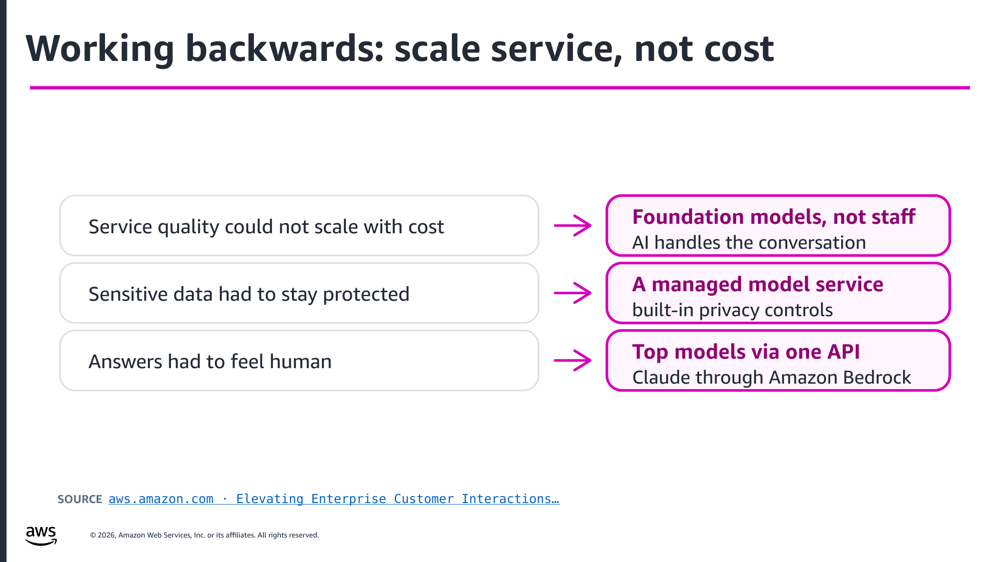

### Notes

WHAT'S HERE: A published AWS case study, so the figures are ASAPP's and AWS's rather than ours. ASAPP builds AI for customer service. Read the rows left to right: this is working backwards from the customer's problem.

THE SETUP: ASAPP wanted its GenerativeAgent platform to hold natural, human-like conversations while protecting customers' personal data. Its own privacy layer slowed responses and limited how good the answers could be.

THE DECISION: ASAPP moved to Amazon Bedrock, a fully managed service that offers a choice of high-performing foundation models through one API. Using Anthropic's Claude in Amazon Bedrock, it relies on built-in data-privacy controls rather than a homegrown layer.

EXAM RELEVANCE: This is the Amazon Bedrock material made real. An application that needs to call a foundation model without running its own model infrastructure points at one managed runtime API. The model choice is a configuration detail, not a rebuild.

IF THEY ASK ABOUT RESULTS: The page reports reducing call escalation by up to 40 percent and automating more than 90 percent of contact center interactions over voice or chat.

PARTNER CONTEXT: When a customer wants to add generative AI to an existing application, the first move is usually a managed model service reached through one API, rather than a bespoke model stack the team then has to operate.

EXAM MAPPING: Domain 1 (integrating a managed AI service, Amazon Bedrock).

ON DELIVERY: The SOURCE link is the published case study. Put it on screen and say plainly that this is the customer we are discussing. Tell the room these pages reward their own time afterwards -- not as exam preparation, but to see the services working together for a real customer.

REFERENCE: https://aws.amazon.com/solutions/case-studies/asapp-case-study/

---

## Slide 46 — Kiro is one agent across your tools

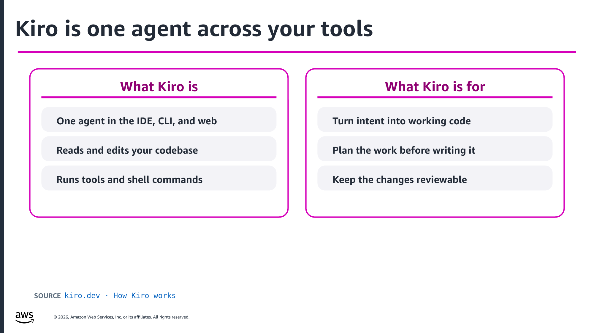

### Notes

WHAT'S HERE: Kiro is one agent, available everywhere you work -- the same agent is reached from an IDE, a command-line interface, and the web. It reads and edits the files in your project, runs tools and shell commands on your behalf, and works through a task rather than only answering a question. The point of an agentic development environment is that it takes an instruction, plans an approach, makes the changes, and shows you the result, so you review and steer the work instead of typing every edit yourself.

EXAM RELEVANCE: The exam now recognizes AI-assisted development tools as part of a developer's workflow. Know Kiro as an agent that operates on your actual codebase -- planning, editing files, and running commands -- rather than a chat window that only returns text. That distinction, between an assistant that changes your project and one that merely describes a change, is the useful one to hold. How you direct that agent is the subject of the next slide.

PARTNER CONTEXT: For a customer adopting AI-assisted development, the value is a consistent agent across tools: the same project rules and the same behavior whether a developer works in the editor or the terminal, so a team is not learning a different assistant per surface.

EXAM MAPPING: Domain 1 (use AI-assisted development tools).

REFERENCE: https://kiro.dev/docs/how-kiro-works/

---

## Slide 47 — Guide Kiro with specs, steering, and hooks

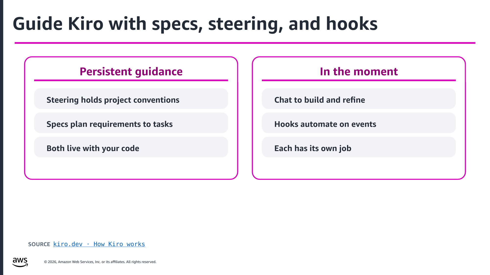

### Notes

WHAT'S HERE: Kiro gives you four distinct ways to direct the agent, and telling them apart is exactly what the week's Kiro question checks. Steering is persistent project context and conventions -- markdown files under .kiro/steering/ that the agent follows in every interaction, so you state a standard once instead of repeating it (kiro.dev/docs/steering/). A spec is a structured workflow for a feature or bug fix that produces three files, requirements then design then tasks, and tracks the work through those phases (kiro.dev/docs/specs/). Chat is the conversational way you build and refine in the moment. Hooks are event-driven automation around the agent loop, running an action when something happens rather than when you ask (kiro.dev/docs/hooks/).

EXAM RELEVANCE: Match the mechanism to what a scenario needs. A rule the agent should always follow is steering. A larger piece of work that should be planned into requirements, design, and tracked tasks is a spec. An ad hoc request you make as you go is chat. An action that should fire automatically on an event is a hook. The trap is treating them as interchangeable -- a standing convention is not a chat message, and a planned multi-step feature is a spec rather than a single prompt.

PARTNER CONTEXT: For a customer standardizing how a team uses an AI agent, steering committed with the repository gives everyone the same conventions, while specs make larger changes reviewable in phases -- which is what makes agent-assisted work auditable rather than ad hoc.

EXAM MAPPING: Domain 1 (use AI-assisted development tools: specs, steering, chat, and hooks).

REFERENCE: https://kiro.dev/docs/how-kiro-works/

---

## Slide 48 — Break down what you've learned

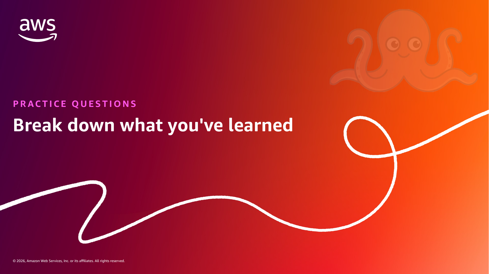

### Notes

FACILITATOR: This marks the shift from teaching to practice. The next questions apply this week's compute, data, and messaging services to exam-style scenarios.

Frame it as a low-stakes checkpoint -- the goal is to surface which services still feel unclear, not to score anyone. Encourage the room to read each stem carefully before looking at the choices.

Remind everyone that the four-beat rhythm -- read, find the key phrases, reveal, then walk through why -- is a study technique they can reuse on their own practice sets.

---

## Slide 49 — Question 1: Orders dropped under peak load

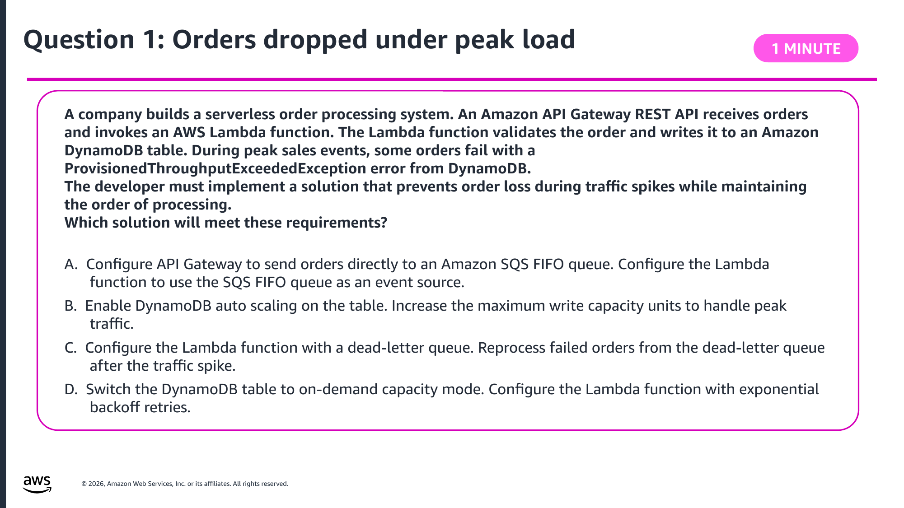

### Question

A company builds a serverless order processing system. An Amazon API Gateway REST API receives orders and invokes an AWS Lambda function. The Lambda function validates the order and writes it to an Amazon DynamoDB table. During peak sales events, some orders fail with a ProvisionedThroughputExceededException error from DynamoDB.
The developer must implement a solution that prevents order loss during traffic spikes while maintaining the order of processing.
Which solution will meet these requirements?

A.  Configure API Gateway to send orders directly to an Amazon SQS FIFO queue. Configure the Lambda function to use the SQS FIFO queue as an event source.
B.  Enable DynamoDB auto scaling on the table. Increase the maximum write capacity units to handle peak traffic.
C.  Configure the Lambda function with a dead-letter queue. Reprocess failed orders from the dead-letter queue after the traffic spike.
D.  Switch the DynamoDB table to on-demand capacity mode. Configure the Lambda function with exponential backoff retries.

### Notes

WHAT'S HERE: Put question 1 on screen and give the room about 90 seconds to read it in silence and commit to an answer before anyone speaks aloud. That is close to the pace the exam demands, so this rehearses timing as much as content.

Do not reveal or hint at the answer on this beat. The silent read is what makes the key-phrases beat and the reveal land -- if you talk through it now, both lose their effect.

EXAM RELEVANCE: Domain 1: Development with AWS Services. Difficulty: Medium. Watch the room: if most people have answered by 90 seconds, move on; if they are still reading, give another 20 seconds rather than rushing the discussion that follows.

PARTNER CONTEXT: A customer running flash sales loses orders the moment DynamoDB throttles. Putting a FIFO queue between the API and the function means a spike waits in line instead of erroring, and the message group ID keeps each customer's orders in the sequence they arrived.

EXAM MAPPING: Domain 1: Development with AWS Services.

---

## Slide 50 — Question 1: Orders dropped under peak load

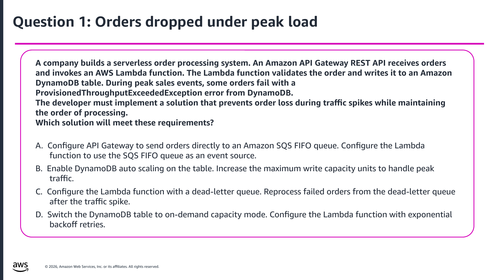

### Question

A company builds a serverless order processing system. An Amazon API Gateway REST API receives orders and invokes an AWS Lambda function. The Lambda function validates the order and writes it to an Amazon DynamoDB table. During peak sales events, some orders fail with a ProvisionedThroughputExceededException error from DynamoDB.
The developer must implement a solution that prevents order loss during traffic spikes while maintaining the order of processing.
Which solution will meet these requirements?

A.  Configure API Gateway to send orders directly to an Amazon SQS FIFO queue. Configure the Lambda function to use the SQS FIFO queue as an event source.
B.  Enable DynamoDB auto scaling on the table. Increase the maximum write capacity units to handle peak traffic.
C.  Configure the Lambda function with a dead-letter queue. Reprocess failed orders from the dead-letter queue after the traffic spike.
D.  Switch the DynamoDB table to on-demand capacity mode. Configure the Lambda function with exponential backoff retries.

### Notes

KEY PHRASES: Walk the question, do not answer it yet. The phrase that decides it is “prevents order loss during traffic spikes while maintaining the order of processing”, and it tells you: Buffer a spike AND keep order points to an SQS FIFO queue as the event source.

WHAT'S HERE: The same question with the timer removed. This beat teaches HOW to read a scenario question -- find the requirement, then find the words that separate options that all look plausible on a first pass.

EXAM RELEVANCE: Domain 1: Development with AWS Services. Difficulty: Medium. Ask the room which words they underlined before you show them the tell, so they practise finding it rather than being handed it.

PARTNER CONTEXT: A customer running flash sales loses orders the moment DynamoDB throttles. Putting a FIFO queue between the API and the function means a spike waits in line instead of erroring, and the message group ID keeps each customer's orders in the sequence they arrived.

EXAM MAPPING: Domain 1: Development with AWS Services.

---

## Slide 51 — Question 1: Orders dropped under peak load

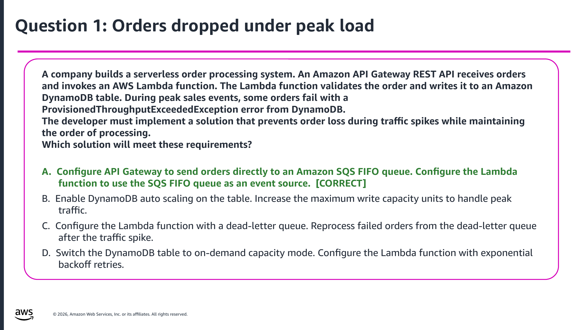

### Question

A company builds a serverless order processing system. An Amazon API Gateway REST API receives orders and invokes an AWS Lambda function. The Lambda function validates the order and writes it to an Amazon DynamoDB table. During peak sales events, some orders fail with a ProvisionedThroughputExceededException error from DynamoDB.
The developer must implement a solution that prevents order loss during traffic spikes while maintaining the order of processing.
Which solution will meet these requirements?

A.  Configure API Gateway to send orders directly to an Amazon SQS FIFO queue. Configure the Lambda function to use the SQS FIFO queue as an event source.  [CORRECT]
B.  Enable DynamoDB auto scaling on the table. Increase the maximum write capacity units to handle peak traffic.
C.  Configure the Lambda function with a dead-letter queue. Reprocess failed orders from the dead-letter queue after the traffic spike.
D.  Switch the DynamoDB table to on-demand capacity mode. Configure the Lambda function with exponential backoff retries.

### Notes

ANSWER OVERVIEW: The answer is A. A FIFO queue absorbs the spike and preserves order per group.

A. Configure API Gateway to send orders directly to an Amazon SQS FIFO queue. Configure the Lambda function to use the SQS FIFO queue as an event source. — Correct — A FIFO queue placed between API Gateway and Lambda decouples ingestion from processing. If DynamoDB throttles, messages stay in the queue and are retried instead of being lost. Ordering is guaranteed per message group ID rather than per queue. Every message sent to a FIFO queue carries a group ID, order is preserved only within a group, and Lambda scales its concurrency per group, so the group ID is the design decision that delivers the ordering requirement. FIFO deduplication is bounded by a 5-minute interval, so exactly-once handling applies within that window rather than indefinitely.

B. Enable DynamoDB auto scaling on the table. Increase the maximum write capacity units to handle peak traffic. — Incorrect — DynamoDB auto scaling adjusts capacity based on utilization. However, auto scaling reacts to sustained traffic changes and can take several minutes to scale up. During sudden traffic spikes, throttling can still occur before scaling takes effect. This does not guarantee zero order loss during bursts.

C. Configure the Lambda function with a dead-letter queue. Reprocess failed orders from the dead-letter queue after the traffic spike. — Incorrect — A dead-letter queue captures failed invocations from asynchronous Lambda invocations. API Gateway synchronously invokes Lambda for REST API requests. Failed DynamoDB writes within the function code would need application-level error handling. Additionally, reprocessing after the spike does not maintain order of processing.

D. Switch the DynamoDB table to on-demand capacity mode. Configure the Lambda function with exponential backoff retries. — Incorrect — On-demand capacity mode handles unpredictable traffic. However, on-demand tables still have an initial throughput that ramps up gradually for new tables. Exponential backoff helps but does not guarantee order of processing because concurrent Lambda invocations can complete their retries in different orders.

EXAM RELEVANCE: Domain 1: Development with AWS Services. Difficulty: Medium.

REFERENCE: https://docs.aws.amazon.com/AWSSimpleQueueService/latest/SQSDeveloperGuide/FIFO-queues.html

---

## Slide 52 — Question 1: Orders dropped under peak load

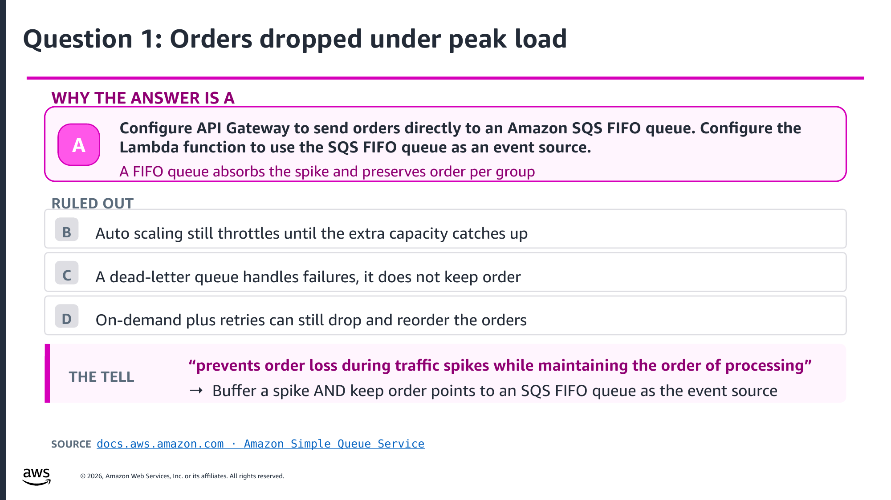

### Notes

WHAT'S HERE: The elimination, made visible. A wins because a FIFO queue absorbs the spike and preserves order per group. The other three are ruled out for one reason each: B — Auto scaling still throttles until the extra capacity catches up; C — A dead-letter queue handles failures, it does not keep order; D — On-demand plus retries can still drop and reorder the orders. Read the tell strip aloud -- pairing a phrase with what it signals is the transferable skill, not memorizing the service name.

EXAM RELEVANCE: Domain 1: Development with AWS Services. Difficulty: Medium. The pattern to teach: a scenario question rarely offers three absurd options. It offers one that matches the requirement exactly and others that match a nearby requirement. Here the discriminator is “prevents order loss during traffic spikes while maintaining the order of processing”, which points at Buffer a spike AND keep order points to an SQS FIFO queue as the event source. Encourage the room to name the phrase before naming the service.

PARTNER CONTEXT: A customer running flash sales loses orders the moment DynamoDB throttles. Putting a FIFO queue between the API and the function means a spike waits in line instead of erroring, and the message group ID keeps each customer's orders in the sequence they arrived.

REFERENCE: https://docs.aws.amazon.com/AWSSimpleQueueService/latest/SQSDeveloperGuide/FIFO-queues.html

---

## Slide 53 — Question 2: Ground a chatbot in your own docs

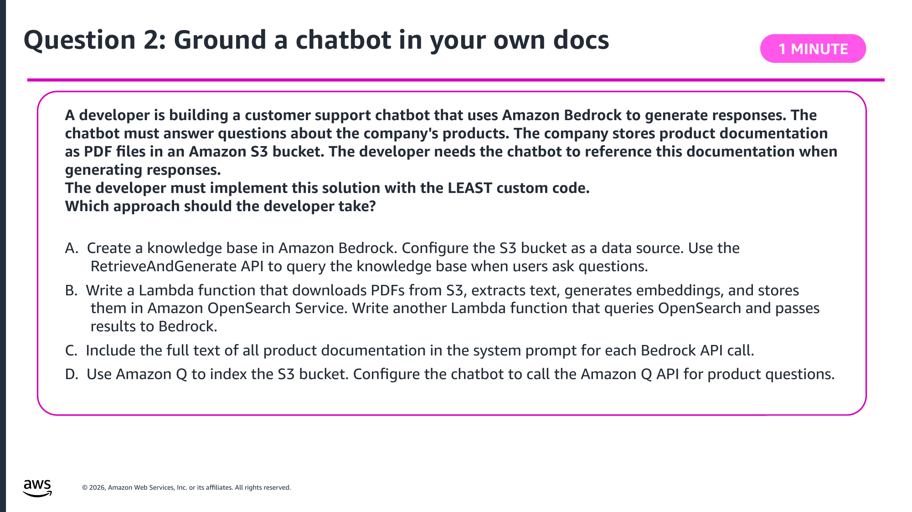

### Question

A developer is building a customer support chatbot that uses Amazon Bedrock to generate responses. The chatbot must answer questions about the company's products. The company stores product documentation as PDF files in an Amazon S3 bucket. The developer needs the chatbot to reference this documentation when generating responses.
The developer must implement this solution with the LEAST custom code.
Which approach should the developer take?

A.  Create a knowledge base in Amazon Bedrock. Configure the S3 bucket as a data source. Use the RetrieveAndGenerate API to query the knowledge base when users ask questions.
B.  Write a Lambda function that downloads PDFs from S3, extracts text, generates embeddings, and stores them in Amazon OpenSearch Service. Write another Lambda function that queries OpenSearch and passes results to Bedrock.
C.  Include the full text of all product documentation in the system prompt for each Bedrock API call.
D.  Use Amazon Q to index the S3 bucket. Configure the chatbot to call the Amazon Q API for product questions.

### Notes

WHAT'S HERE: Put question 2 on screen and give the room about 90 seconds to read it in silence and commit to an answer before anyone speaks aloud. That is close to the pace the exam demands, so this rehearses timing as much as content.

Do not reveal or hint at the answer on this beat. The silent read is what makes the key-phrases beat and the reveal land -- if you talk through it now, both lose their effect.

EXAM RELEVANCE: Domain 1: Development with AWS Services. Difficulty: Medium. Watch the room: if most people have answered by 90 seconds, move on; if they are still reading, give another 20 seconds rather than rushing the discussion that follows.

PARTNER CONTEXT: A customer wants a support bot grounded in their own product PDFs, not generic answers. A knowledge base points Bedrock straight at the S3 bucket and the RetrieveAndGenerate call does retrieval and response in one step, so the win you show is how little code sits between their documents and a grounded reply.

EXAM MAPPING: Domain 1: Development with AWS Services.

---

## Slide 54 — Question 2: Ground a chatbot in your own docs

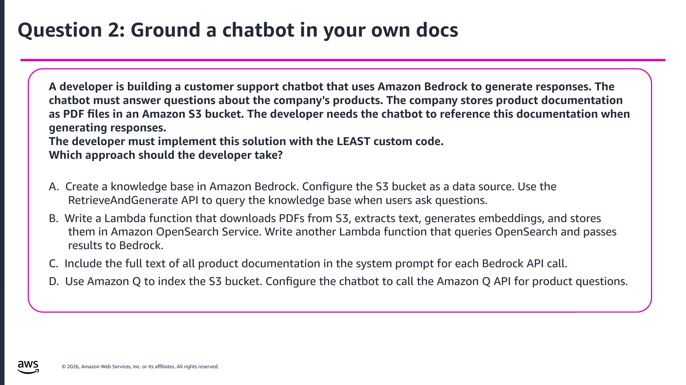

### Question

A developer is building a customer support chatbot that uses Amazon Bedrock to generate responses. The chatbot must answer questions about the company's products. The company stores product documentation as PDF files in an Amazon S3 bucket. The developer needs the chatbot to reference this documentation when generating responses.
The developer must implement this solution with the LEAST custom code.
Which approach should the developer take?

A.  Create a knowledge base in Amazon Bedrock. Configure the S3 bucket as a data source. Use the RetrieveAndGenerate API to query the knowledge base when users ask questions.
B.  Write a Lambda function that downloads PDFs from S3, extracts text, generates embeddings, and stores them in Amazon OpenSearch Service. Write another Lambda function that queries OpenSearch and passes results to Bedrock.
C.  Include the full text of all product documentation in the system prompt for each Bedrock API call.
D.  Use Amazon Q to index the S3 bucket. Configure the chatbot to call the Amazon Q API for product questions.

### Notes

KEY PHRASES: Walk the question, do not answer it yet. The phrase that decides it is “reference this documentation when generating responses ... LEAST custom code”, and it tells you: Least code plus your own documents points to a Bedrock knowledge base.

WHAT'S HERE: The same question with the timer removed. This beat teaches HOW to read a scenario question -- find the requirement, then find the words that separate options that all look plausible on a first pass.

EXAM RELEVANCE: Domain 1: Development with AWS Services. Difficulty: Medium. Ask the room which words they underlined before you show them the tell, so they practise finding it rather than being handed it.

PARTNER CONTEXT: A customer wants a support bot grounded in their own product PDFs, not generic answers. A knowledge base points Bedrock straight at the S3 bucket and the RetrieveAndGenerate call does retrieval and response in one step, so the win you show is how little code sits between their documents and a grounded reply.

EXAM MAPPING: Domain 1: Development with AWS Services.

---

## Slide 55 — Question 2: Ground a chatbot in your own docs

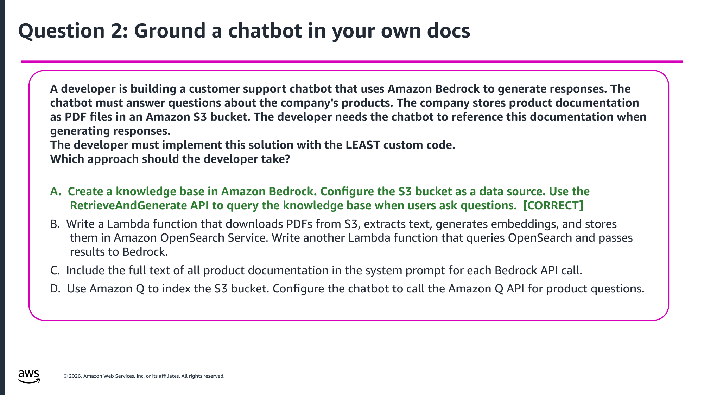

### Question

A developer is building a customer support chatbot that uses Amazon Bedrock to generate responses. The chatbot must answer questions about the company's products. The company stores product documentation as PDF files in an Amazon S3 bucket. The developer needs the chatbot to reference this documentation when generating responses.
The developer must implement this solution with the LEAST custom code.
Which approach should the developer take?

A.  Create a knowledge base in Amazon Bedrock. Configure the S3 bucket as a data source. Use the RetrieveAndGenerate API to query the knowledge base when users ask questions.  [CORRECT]
B.  Write a Lambda function that downloads PDFs from S3, extracts text, generates embeddings, and stores them in Amazon OpenSearch Service. Write another Lambda function that queries OpenSearch and passes results to Bedrock.
C.  Include the full text of all product documentation in the system prompt for each Bedrock API call.
D.  Use Amazon Q to index the S3 bucket. Configure the chatbot to call the Amazon Q API for product questions.

### Notes

ANSWER OVERVIEW: The answer is A. A Bedrock Knowledge Base indexes S3 and answers in one API call.

A. Create a knowledge base in Amazon Bedrock. Configure the S3 bucket as a data source. Use the RetrieveAndGenerate API to query the knowledge base when users ask questions. — Correct — Amazon Bedrock Knowledge Bases connects foundation models to company data sources. Configuring S3 as a data source allows Bedrock to automatically index the documents. The RetrieveAndGenerate API handles retrieval and response generation in a single call with minimal custom code required.

B. Write a Lambda function that downloads PDFs from S3, extracts text, generates embeddings, and stores them in Amazon OpenSearch Service. Write another Lambda function that queries OpenSearch and passes results to Bedrock. — Incorrect — This approach requires significant custom code to handle document parsing, embedding generation, vector storage, and retrieval orchestration. Amazon Bedrock Knowledge Bases provides this functionality as a managed service, eliminating the need for custom embedding and retrieval code.

C. Include the full text of all product documentation in the system prompt for each Bedrock API call. — Incorrect — Foundation models have context window limits. Including all product documentation in every prompt is impractical for large document sets and would exceed token limits. This approach also increases cost per request and does not scale as documentation grows.

D. Use Amazon Q to index the S3 bucket. Configure the chatbot to call the Amazon Q API for product questions. — Incorrect — Amazon Q is designed for enterprise knowledge search and developer assistance. For building a custom chatbot application that generates responses using company documentation with a foundation model, Amazon Bedrock Knowledge Bases is the appropriate service. Amazon Q does not provide the same level of control over response generation.

EXAM RELEVANCE: Domain 1: Development with AWS Services. Difficulty: Medium.

REFERENCE: https://docs.aws.amazon.com/bedrock/latest/userguide/knowledge-base.html

---

## Slide 56 — Question 2: Ground a chatbot in your own docs

### Notes

WHAT'S HERE: The elimination, made visible. A wins because a Bedrock Knowledge Base indexes S3 and answers in one API call. The other three are ruled out for one reason each: B — Hand-built embeddings and a search cluster are the most custom code; C — Putting every document in the prompt does not scale; D — A separate managed assistant adds another service to wire up. Read the tell strip aloud -- pairing a phrase with what it signals is the transferable skill, not memorizing the service name.

EXAM RELEVANCE: Domain 1: Development with AWS Services. Difficulty: Medium. The pattern to teach: a scenario question rarely offers three absurd options. It offers one that matches the requirement exactly and others that match a nearby requirement. Here the discriminator is “reference this documentation when generating responses ... LEAST custom code”, which points at Least code plus your own documents points to a Bedrock knowledge base. Encourage the room to name the phrase before naming the service.

PARTNER CONTEXT: A customer wants a support bot grounded in their own product PDFs, not generic answers. A knowledge base points Bedrock straight at the S3 bucket and the RetrieveAndGenerate call does retrieval and response in one step, so the win you show is how little code sits between their documents and a grounded reply.

REFERENCE: https://docs.aws.amazon.com/bedrock/latest/userguide/knowledge-base.html

---

## Slide 57 — Question 3: Image resize is too slow

### Question

A developer is building a Lambda function that processes images uploaded to an S3 bucket. The function resizes images and stores the results in a different S3 bucket. The function uses 512 MB of memory and currently takes 15 seconds to process each image. The developer needs to reduce the processing time.
Which change will MOST effectively reduce the Lambda function's processing time?

A.  Increase the function's reserved concurrency to allow more simultaneous executions.
B.  Increase the function's memory allocation to provide more CPU power for image processing.
C.  Enable provisioned concurrency for the function to eliminate cold starts.
D.  Increase the function's timeout value to 60 seconds.

### Notes

WHAT'S HERE: Put question 3 on screen and give the room about 90 seconds to read it in silence and commit to an answer before anyone speaks aloud. That is close to the pace the exam demands, so this rehearses timing as much as content.

Do not reveal or hint at the answer on this beat. The silent read is what makes the key-phrases beat and the reveal land -- if you talk through it now, both lose their effect.

EXAM RELEVANCE: Domain 4: Troubleshooting and Optimization. Difficulty: Medium. Watch the room: if most people have answered by 90 seconds, move on; if they are still reading, give another 20 seconds rather than rushing the discussion that follows.

PARTNER CONTEXT: A customer's image pipeline is compute-bound and they reach for concurrency out of habit. The value you add is showing that on Lambda the CPU scales with the memory setting, so raising memory is the lever that actually shortens each resize rather than running more of them at once.

EXAM MAPPING: Domain 4: Troubleshooting and Optimization.

---

## Slide 58 — Question 3: Image resize is too slow

### Question

A developer is building a Lambda function that processes images uploaded to an S3 bucket. The function resizes images and stores the results in a different S3 bucket. The function uses 512 MB of memory and currently takes 15 seconds to process each image. The developer needs to reduce the processing time.
Which change will MOST effectively reduce the Lambda function's processing time?

A.  Increase the function's reserved concurrency to allow more simultaneous executions.
B.  Increase the function's memory allocation to provide more CPU power for image processing.
C.  Enable provisioned concurrency for the function to eliminate cold starts.
D.  Increase the function's timeout value to 60 seconds.

### Notes

KEY PHRASES: Walk the question, do not answer it yet. The phrase that decides it is “MOST effectively reduce the Lambda function's processing time”, and it tells you: Faster per-invocation work points to more memory, which is more CPU.

WHAT'S HERE: The same question with the timer removed. This beat teaches HOW to read a scenario question -- find the requirement, then find the words that separate options that all look plausible on a first pass.

EXAM RELEVANCE: Domain 4: Troubleshooting and Optimization. Difficulty: Medium. Ask the room which words they underlined before you show them the tell, so they practise finding it rather than being handed it.

PARTNER CONTEXT: A customer's image pipeline is compute-bound and they reach for concurrency out of habit. The value you add is showing that on Lambda the CPU scales with the memory setting, so raising memory is the lever that actually shortens each resize rather than running more of them at once.

EXAM MAPPING: Domain 4: Troubleshooting and Optimization.

---

## Slide 59 — Question 3: Image resize is too slow

### Question

A developer is building a Lambda function that processes images uploaded to an S3 bucket. The function resizes images and stores the results in a different S3 bucket. The function uses 512 MB of memory and currently takes 15 seconds to process each image. The developer needs to reduce the processing time.
Which change will MOST effectively reduce the Lambda function's processing time?

A.  Increase the function's reserved concurrency to allow more simultaneous executions.
B.  Increase the function's memory allocation to provide more CPU power for image processing.  [CORRECT]
C.  Enable provisioned concurrency for the function to eliminate cold starts.
D.  Increase the function's timeout value to 60 seconds.

### Notes

ANSWER OVERVIEW: The answer is B. More memory gives Lambda more CPU, so each resize finishes sooner.

A. Increase the function's reserved concurrency to allow more simultaneous executions. — Incorrect — Reserved concurrency controls how many instances of the function can run simultaneously. It does not affect the processing time of individual invocations. Each invocation still takes 15 seconds regardless of concurrency settings.

B. Increase the function's memory allocation to provide more CPU power for image processing. — Correct — Lambda allocates CPU power in proportion to the amount of memory configured. Image resizing is CPU-intensive. Increasing memory from 512 MB gives the function more CPU cores and processing power, directly reducing the time required for computation-heavy operations like image processing.

C. Enable provisioned concurrency for the function to eliminate cold starts. — Incorrect — Provisioned concurrency eliminates cold start latency by pre-initializing execution environments. However, the question states the function takes 15 seconds to process each image, which is execution time, not initialization time. Eliminating cold starts would not reduce the 15-second processing duration.

D. Increase the function's timeout value to 60 seconds. — Incorrect — Increasing the timeout prevents the function from being terminated before processing completes but does not reduce processing time. The function still takes 15 seconds per image. Timeout only sets the maximum allowed duration.

EXAM RELEVANCE: Domain 4: Troubleshooting and Optimization. Difficulty: Medium.

REFERENCE: https://docs.aws.amazon.com/lambda/latest/dg/configuration-memory.html

---

## Slide 60 — Question 3: Image resize is too slow

### Notes

WHAT'S HERE: The elimination, made visible. B wins because more memory gives Lambda more CPU, so each resize finishes sooner. The other three are ruled out for one reason each: A — Reserved concurrency adds parallel runs, not faster ones; C — Provisioned concurrency removes cold starts, not run time; D — A longer timeout lets it run longer, it does not speed it up. Read the tell strip aloud -- pairing a phrase with what it signals is the transferable skill, not memorizing the service name.

EXAM RELEVANCE: Domain 4: Troubleshooting and Optimization. Difficulty: Medium. The pattern to teach: a scenario question rarely offers three absurd options. It offers one that matches the requirement exactly and others that match a nearby requirement. Here the discriminator is “MOST effectively reduce the Lambda function's processing time”, which points at Faster per-invocation work points to more memory, which is more CPU. Encourage the room to name the phrase before naming the service.

PARTNER CONTEXT: A customer's image pipeline is compute-bound and they reach for concurrency out of habit. The value you add is showing that on Lambda the CPU scales with the memory setting, so raising memory is the lever that actually shortens each resize rather than running more of them at once.

REFERENCE: https://docs.aws.amazon.com/lambda/latest/dg/configuration-memory.html

---

## Slide 61 — Question 4: Query by a non-key attribute

### Question

A company uses Amazon DynamoDB to store user profile data. The table uses user_id as the partition key. The application must support a new feature that queries user profiles by email address. The email address is unique for each user but is not part of the table's primary key.
The developer must implement this query capability with the LEAST impact on the table's existing write performance.
Which solution will meet these requirements?

A.  Create a global secondary index (GSI) with email as the partition key. Query the GSI when searching by email address.
B.  Create a local secondary index (LSI) with email as the sort key. Query the LSI when searching by email address.
C.  Perform a Scan operation with a filter expression on the email attribute each time a search by email is needed.
D.  Create a second DynamoDB table with email as the partition key. Write to both tables on each profile update using a DynamoDB transaction.

### Notes

WHAT'S HERE: Put question 4 on screen and give the room about 90 seconds to read it in silence and commit to an answer before anyone speaks aloud. That is close to the pace the exam demands, so this rehearses timing as much as content.

Do not reveal or hint at the answer on this beat. The silent read is what makes the key-phrases beat and the reveal land -- if you talk through it now, both lose their effect.

EXAM RELEVANCE: Domain 1: Development with AWS Services. Difficulty: Medium. Watch the room: if most people have answered by 90 seconds, move on; if they are still reading, give another 20 seconds rather than rushing the discussion that follows.

PARTNER CONTEXT: A customer needs a new lookup by email without slowing the writes they already depend on. A GSI adds that access pattern with its own capacity -- and the caveat worth raising is to provision the index's write capacity to match the base table, because an under-fed index throttles the very writes it was meant to leave alone.

EXAM MAPPING: Domain 1: Development with AWS Services.

---

## Slide 62 — Question 4: Query by a non-key attribute

### Question

A company uses Amazon DynamoDB to store user profile data. The table uses user_id as the partition key. The application must support a new feature that queries user profiles by email address. The email address is unique for each user but is not part of the table's primary key.
The developer must implement this query capability with the LEAST impact on the table's existing write performance.
Which solution will meet these requirements?

A.  Create a global secondary index (GSI) with email as the partition key. Query the GSI when searching by email address.
B.  Create a local secondary index (LSI) with email as the sort key. Query the LSI when searching by email address.
C.  Perform a Scan operation with a filter expression on the email attribute each time a search by email is needed.
D.  Create a second DynamoDB table with email as the partition key. Write to both tables on each profile update using a DynamoDB transaction.

### Notes

KEY PHRASES: Walk the question, do not answer it yet. The phrase that decides it is “query capability with the LEAST impact on the table's existing write performance”, and it tells you: Query a non-key attribute without touching writes points to a global secondary index.

WHAT'S HERE: The same question with the timer removed. This beat teaches HOW to read a scenario question -- find the requirement, then find the words that separate options that all look plausible on a first pass.

EXAM RELEVANCE: Domain 1: Development with AWS Services. Difficulty: Medium. Ask the room which words they underlined before you show them the tell, so they practise finding it rather than being handed it.

PARTNER CONTEXT: A customer needs a new lookup by email without slowing the writes they already depend on. A GSI adds that access pattern with its own capacity -- and the caveat worth raising is to provision the index's write capacity to match the base table, because an under-fed index throttles the very writes it was meant to leave alone.

EXAM MAPPING: Domain 1: Development with AWS Services.

---

## Slide 63 — Question 4: Query by a non-key attribute

### Question

A company uses Amazon DynamoDB to store user profile data. The table uses user_id as the partition key. The application must support a new feature that queries user profiles by email address. The email address is unique for each user but is not part of the table's primary key.
The developer must implement this query capability with the LEAST impact on the table's existing write performance.
Which solution will meet these requirements?

A.  Create a global secondary index (GSI) with email as the partition key. Query the GSI when searching by email address.  [CORRECT]
B.  Create a local secondary index (LSI) with email as the sort key. Query the LSI when searching by email address.
C.  Perform a Scan operation with a filter expression on the email attribute each time a search by email is needed.
D.  Create a second DynamoDB table with email as the partition key. Write to both tables on each profile update using a DynamoDB transaction.

### Notes

ANSWER OVERVIEW: The answer is A. A global secondary index queries email with its own throughput.

A. Create a global secondary index (GSI) with email as the partition key. Query the GSI when searching by email address. — Correct — A global secondary index supports queries on a non-key attribute without changing the base table's primary key. The index maintains its own throughput settings and is updated asynchronously, so reads against the index do not consume base-table capacity. One caveat matters more than the rest: if the index does not have enough write capacity to keep up, writes to the base table are throttled. Provision the index's write capacity to match the base table's write rate, or use on-demand mode for both. A local secondary index cannot solve this, because an LSI must be created with the table and shares the base table's partition key.

B. Create a local secondary index (LSI) with email as the sort key. Query the LSI when searching by email address. — Incorrect — A local secondary index must be created at table creation time and cannot be added to an existing table. LSIs share the base table's provisioned throughput. Additionally, an LSI uses the same partition key as the base table (user_id), so it cannot enable queries solely by email address.

C. Perform a Scan operation with a filter expression on the email attribute each time a search by email is needed. — Incorrect — A Scan reads every item in the table and then applies the filter expression. This is inefficient for large tables and consumes read capacity units proportional to the table size. Additionally, scans can affect write performance by consuming table capacity during execution.

D. Create a second DynamoDB table with email as the partition key. Write to both tables on each profile update using a DynamoDB transaction. — Incorrect — Using transactions to write to two tables increases write latency and consumes additional write capacity units. Transactions use twice the write capacity because they involve both a prepare and commit phase. This has significant impact on write performance compared to a GSI.

EXAM RELEVANCE: Domain 1: Development with AWS Services. Difficulty: Medium.

REFERENCE: https://docs.aws.amazon.com/amazondynamodb/latest/developerguide/GSI.html

---

## Slide 64 — Question 4: Query by a non-key attribute

### Notes

WHAT'S HERE: The elimination, made visible. A wins because a global secondary index queries email with its own throughput. The other three are ruled out for one reason each: B — An LSI shares the base key and must exist at table creation; C — A Scan reads the whole table on every email lookup; D — A second table with transactions doubles every write. Read the tell strip aloud -- pairing a phrase with what it signals is the transferable skill, not memorizing the service name.

EXAM RELEVANCE: Domain 1: Development with AWS Services. Difficulty: Medium. The pattern to teach: a scenario question rarely offers three absurd options. It offers one that matches the requirement exactly and others that match a nearby requirement. Here the discriminator is “query capability with the LEAST impact on the table's existing write performance”, which points at Query a non-key attribute without touching writes points to a global secondary index. Encourage the room to name the phrase before naming the service.

PARTNER CONTEXT: A customer needs a new lookup by email without slowing the writes they already depend on. A GSI adds that access pattern with its own capacity -- and the caveat worth raising is to provision the index's write capacity to match the base table, because an under-fed index throttles the very writes it was meant to leave alone.

REFERENCE: https://docs.aws.amazon.com/amazondynamodb/latest/developerguide/GSI.html

---

## Slide 65 — Question 5: Standards applied on every generation

### Question

A development team uses Kiro to generate code for a set of new microservices. The team has internal standards for error handling, log format, and API response structure. Developers must restate these standards in every request, and the generated code is still inconsistent between features. The team needs the standards to be applied automatically whenever the agent generates code.
Which solution will meet these requirements?

A.  Paste the standards into each chat session before requesting code, and share the session.
B.  Create a spec for each feature that repeats the standards in its requirements section.
C.  Create a steering file that records the standards so that the agent applies them automatically.
D.  Create a hook on file save that rewrites generated code so that the code matches the standards.

### Notes

WHAT'S HERE: Put question 5 on screen and give the room about 90 seconds to read it in silence and commit to an answer before anyone speaks aloud. That is close to the pace the exam demands, so this rehearses timing as much as content.

Do not reveal or hint at the answer on this beat. The silent read is what makes the key-phrases beat and the reveal land -- if you talk through it now, both lose their effect.

EXAM RELEVANCE: Domain 1: Development with AWS Services. Difficulty: Medium. Watch the room: if most people have answered by 90 seconds, move on; if they are still reading, give another 20 seconds rather than rushing the discussion that follows.

PARTNER CONTEXT: A customer's team keeps restating the same error-handling and logging standards and still gets inconsistent code. A steering file makes those conventions persistent context the agent reads on every request, so the standards stop depending on someone remembering to paste them into the chat.

EXAM MAPPING: Domain 1: Development with AWS Services.

---

## Slide 66 — Question 5: Standards applied on every generation

### Question

A development team uses Kiro to generate code for a set of new microservices. The team has internal standards for error handling, log format, and API response structure. Developers must restate these standards in every request, and the generated code is still inconsistent between features. The team needs the standards to be applied automatically whenever the agent generates code.
Which solution will meet these requirements?

A.  Paste the standards into each chat session before requesting code, and share the session.
B.  Create a spec for each feature that repeats the standards in its requirements section.
C.  Create a steering file that records the standards so that the agent applies them automatically.
D.  Create a hook on file save that rewrites generated code so that the code matches the standards.

### Notes

KEY PHRASES: Walk the question, do not answer it yet. The phrase that decides it is “applied automatically whenever the agent generates code”, and it tells you: Persistent, automatic project conventions point to a steering file.

WHAT'S HERE: The same question with the timer removed. This beat teaches HOW to read a scenario question -- find the requirement, then find the words that separate options that all look plausible on a first pass.

EXAM RELEVANCE: Domain 1: Development with AWS Services. Difficulty: Medium. Ask the room which words they underlined before you show them the tell, so they practise finding it rather than being handed it.

PARTNER CONTEXT: A customer's team keeps restating the same error-handling and logging standards and still gets inconsistent code. A steering file makes those conventions persistent context the agent reads on every request, so the standards stop depending on someone remembering to paste them into the chat.

EXAM MAPPING: Domain 1: Development with AWS Services.

---

## Slide 67 — Question 5: Standards applied on every generation

### Question

A development team uses Kiro to generate code for a set of new microservices. The team has internal standards for error handling, log format, and API response structure. Developers must restate these standards in every request, and the generated code is still inconsistent between features. The team needs the standards to be applied automatically whenever the agent generates code.
Which solution will meet these requirements?

A.  Paste the standards into each chat session before requesting code, and share the session.
B.  Create a spec for each feature that repeats the standards in its requirements section.
C.  Create a steering file that records the standards so that the agent applies them automatically.  [CORRECT]
D.  Create a hook on file save that rewrites generated code so that the code matches the standards.

### Notes

ANSWER OVERVIEW: The answer is C. A steering file records the standards so the agent always applies them.

A. Paste the standards into each chat session before requesting code, and share the session. — Incorrect — Pasting the standards into a session supplies them for that session only. Developers continue to restate the standards in every request, so this does not meet the requirement that the standards apply automatically.

B. Create a spec for each feature that repeats the standards in its requirements section. — Incorrect — A spec captures the requirements, design, and tasks for one feature. Repeating the standards in each spec is the restating that the team needs to remove, and nothing carries the standards to work that starts outside a spec.

C. Create a steering file that records the standards so that the agent applies them automatically. — Correct — Steering files hold project conventions such as error handling, log format, and API response structure, and the agent applies them automatically to the code it generates. The standards are captured one time and take effect on every later request, which removes the restating and the inconsistency between features.

D. Create a hook on file save that rewrites generated code so that the code matches the standards. — Incorrect — A hook runs an agent task in response to an event such as a file save, so it would act after the code was generated rather than informing the generation. This adds a second pass that can conflict with the original output instead of applying the standards during generation.

EXAM RELEVANCE: Domain 1: Development with AWS Services. Difficulty: Medium.

REFERENCE: https://kiro.dev/docs/steering/

---

## Slide 68 — Question 5: Standards applied on every generation

### Notes

WHAT'S HERE: The elimination, made visible. C wins because a steering file records the standards so the agent always applies them. The other three are ruled out for one reason each: A — Pasting into a session supplies the standards for that session only; B — Repeating standards in every spec is the restating problem again; D — A save hook rewrites after the fact instead of guiding generation. Read the tell strip aloud -- pairing a phrase with what it signals is the transferable skill, not memorizing the service name.

EXAM RELEVANCE: Domain 1: Development with AWS Services. Difficulty: Medium. The pattern to teach: a scenario question rarely offers three absurd options. It offers one that matches the requirement exactly and others that match a nearby requirement. Here the discriminator is “applied automatically whenever the agent generates code”, which points at Persistent, automatic project conventions point to a steering file. Encourage the room to name the phrase before naming the service.

PARTNER CONTEXT: A customer's team keeps restating the same error-handling and logging standards and still gets inconsistent code. A steering file makes those conventions persistent context the agent reads on every request, so the standards stop depending on someone remembering to paste them into the chat.

REFERENCE: https://kiro.dev/docs/steering/

---

## Slide 69 — Question 6: Which code paths are slow?

### Question

A company runs a data processing function on AWS Lambda. The function duration has grown as the codebase has grown, and the company wants to reduce it. A developer must find which parts of the function source code are inefficient and obtain specific recommendations for changing that code.
Which solution will meet these requirements?

A.  Increase the memory that is allocated to the function so that it receives more CPU.
B.  Configure provisioned concurrency so that initialization completes before invocations arrive.
C.  Have the agent review the function source code and recommend changes for the inefficient paths.
D.  Enable AWS X-Ray active tracing and review the subsegment timings for the downstream calls.

### Notes

WHAT'S HERE: Put question 6 on screen and give the room about 90 seconds to read it in silence and commit to an answer before anyone speaks aloud. That is close to the pace the exam demands, so this rehearses timing as much as content.

Do not reveal or hint at the answer on this beat. The silent read is what makes the key-phrases beat and the reveal land -- if you talk through it now, both lose their effect.

EXAM RELEVANCE: Domain 4: Troubleshooting and Optimization. Difficulty: Hard. Watch the room: if most people have answered by 90 seconds, move on; if they are still reading, give another 20 seconds rather than rushing the discussion that follows.

PARTNER CONTEXT: This looks like the memory question, and that resemblance is the trap. There the work was compute-bound and more memory bought more CPU; here the ask is which lines are slow and how to change them. Memory tunes configuration and identifies no path, so an agent reviewing the source is what answers the question actually asked. Teach the contrast side by side -- same lever, different question.

EXAM MAPPING: Domain 4: Troubleshooting and Optimization.

---

## Slide 70 — Question 6: Which code paths are slow?

### Question

A company runs a data processing function on AWS Lambda. The function duration has grown as the codebase has grown, and the company wants to reduce it. A developer must find which parts of the function source code are inefficient and obtain specific recommendations for changing that code.
Which solution will meet these requirements?

A.  Increase the memory that is allocated to the function so that it receives more CPU.
B.  Configure provisioned concurrency so that initialization completes before invocations arrive.
C.  Have the agent review the function source code and recommend changes for the inefficient paths.
D.  Enable AWS X-Ray active tracing and review the subsegment timings for the downstream calls.

### Notes

KEY PHRASES: Walk the question, do not answer it yet. The phrase that decides it is “find which parts of the function source code are inefficient”, and it tells you: Pinpoint slow code AND how to fix it points to an agent code review.

WHAT'S HERE: The same question with the timer removed. This beat teaches HOW to read a scenario question -- find the requirement, then find the words that separate options that all look plausible on a first pass.

EXAM RELEVANCE: Domain 4: Troubleshooting and Optimization. Difficulty: Hard. Ask the room which words they underlined before you show them the tell, so they practise finding it rather than being handed it.

PARTNER CONTEXT: This looks like the memory question, and that resemblance is the trap. There the work was compute-bound and more memory bought more CPU; here the ask is which lines are slow and how to change them. Memory tunes configuration and identifies no path, so an agent reviewing the source is what answers the question actually asked. Teach the contrast side by side -- same lever, different question.

EXAM MAPPING: Domain 4: Troubleshooting and Optimization.

---

## Slide 71 — Question 6: Which code paths are slow?

### Question

A company runs a data processing function on AWS Lambda. The function duration has grown as the codebase has grown, and the company wants to reduce it. A developer must find which parts of the function source code are inefficient and obtain specific recommendations for changing that code.
Which solution will meet these requirements?

A.  Increase the memory that is allocated to the function so that it receives more CPU.
B.  Configure provisioned concurrency so that initialization completes before invocations arrive.
C.  Have the agent review the function source code and recommend changes for the inefficient paths. [CORRECT]
D.  Enable AWS X-Ray active tracing and review the subsegment timings for the downstream calls.

### Notes

ANSWER OVERVIEW: The answer is C. The agent reads the code and names the inefficient paths to change.

A. Increase the memory that is allocated to the function so that it receives more CPU. — Incorrect — Lambda allocates CPU in proportion to memory, so this can shorten a duration that is limited by compute. It changes configuration rather than code, and it identifies no inefficient path and produces no recommendation for the source.

B. Configure provisioned concurrency so that initialization completes before invocations arrive. — Incorrect — Provisioned concurrency prepares execution environments in advance and addresses cold start latency. The duration here grows with the codebase during invocation, and this finds no inefficient code and recommends no change.

C. Have the agent review the function source code and recommend changes for the inefficient paths. — Correct — An AI-assisted development tool can read the function source, identify inefficient code paths such as repeated work inside a loop or a call that could be reused, and return specific refactoring recommendations for that code. This is what the requirement asks for, because the subject is the code rather than the function configuration.

D. Enable AWS X-Ray active tracing and review the subsegment timings for the downstream calls. — Incorrect — Subsegment timings show which downstream calls are slow, which helps locate latency between services. They do not attribute time to paths inside the function source or recommend how to change that code.

EXAM RELEVANCE: Domain 4: Troubleshooting and Optimization. Difficulty: Hard.

REFERENCE: https://kiro.dev/docs/how-kiro-works/

---

## Slide 72 — Question 6: Which code paths are slow?

### Notes

WHAT'S HERE: The elimination, made visible. C wins because the agent reads the code and names the inefficient paths to change. The other three are ruled out for one reason each: A — More memory can help compute-bound code but names no path; B — Provisioned concurrency cuts cold starts, not the code's duration; D — X-Ray times downstream calls, not lines of your own code. Read the tell strip aloud -- pairing a phrase with what it signals is the transferable skill, not memorizing the service name.

EXAM RELEVANCE: Domain 4: Troubleshooting and Optimization. Difficulty: Hard. The pattern to teach: a scenario question rarely offers three absurd options. It offers one that matches the requirement exactly and others that match a nearby requirement. Here the discriminator is “find which parts of the function source code are inefficient”, which points at Pinpoint slow code AND how to fix it points to an agent code review. Encourage the room to name the phrase before naming the service.

PARTNER CONTEXT: This looks like the memory question, and that resemblance is the trap. There the work was compute-bound and more memory bought more CPU; here the ask is which lines are slow and how to change them. Memory tunes configuration and identifies no path, so an agent reviewing the source is what answers the question actually asked. Teach the contrast side by side -- same lever, different question.

REFERENCE: https://kiro.dev/docs/how-kiro-works/

---

## Slide 73 — Coming up: Week 3 digital training

### Notes

WHAT'S HERE: A preview of next week's training so people can get a head start whenever they are ready. The left card is the free Learning Plan; the right is the optional Exam Prep Plan.

FACILITATOR: Keep this light -- it is a look ahead, not an assignment for today. Note that week three moves into API Gateway for serverless, event-driven architecture, and scaling serverless applications, which builds directly on this week's compute, data, and messaging work.

Encourage anyone who is ahead to start early, and reassure anyone still catching up on week two that the sessions build gradually.

NOTE: The "Domain 3" item names are the actual Exam Prep Plan module names in Skill Builder, so learners can locate them; they are navigation, not exam-coverage claims.

---

## Slide 74 — Q&A time

### Notes

FACILITATOR: Open the floor. Invite questions on anything from this week's services to study logistics and exam scheduling.

If the room is quiet, prime it with a question of your own -- ask which service felt least clear this week, or how people are finding the practice questions.

Keep answers short and point to the relevant documentation or the exam prep resources where a deeper follow-up is warranted.

---

## Slide 75 — Thank you for joining!

### Notes

FACILITATOR: Close warmly. Thank the room for their time and their engagement and remind them of the two things that keep momentum: finish this week's training and make a start on next week's preview.

Restate when the next session is and encourage anyone who has not yet scheduled their exam to plan a target date.

End on encouragement -- they are building real, job-relevant skills, and steady weekly progress is what gets them exam-ready.

---

## Slide 76 — Appendix – DVA-C02 reference

### Notes

APPENDIX: Divider. This block is self-study reference for anyone who plans to sit DVA-C02 rather than C03. It is not taught in the session -- point the room at it and move on. The three appendix slides sit together at the end of the deck by design.

WHAT'S HERE: The session decks are built for DVA-C03. This appendix collects what a C02 candidate needs that the C03 body does not spell out: how the exam guide's weightings shifted, what changed for this week's topics, and which main-body slides a C02 candidate can skip.

EXAM RELEVANCE: DVA-C02 is the live exam today; DVA-C03 is the version this course trains toward. Week 2's documented change is a consolidation -- DynamoDB goes from four tested skills to one -- but the underlying services are the same on both exams.

REFERENCE: The C02 figures come from the DVA-C02 exam guide; the C03 figures come from the September 2026 certification updates blog. Both are linked from the delta slides that follow. EXAM MAPPING: DVA-C02 to DVA-C03 comparison.

---

## Slide 77 — How C02 and C03 differ for this week

### Notes

APPENDIX: Week-2 delta table. Walk the left column first: the four domain weightings barely move. Development eases from 32% to 30%, Security holds at 26%, Testing and Deployment eases from 24% to 22%, and Troubleshooting and Optimization rises from 18% to 22% -- the largest single shift.

WHAT'S HERE: The right column is week 2's documented change. Amazon DynamoDB consolidates -- C02 tested it as four separate skills, and C03 folds those into one comprehensive DynamoDB skill.

Four services taught this week are newly in scope at C03: Amazon Bedrock, Amazon Bedrock AgentCore, Amazon Q, and Kiro.

EXAM RELEVANCE: Nothing leaves the exam here. The services taught this week are examined on both versions, so a C02 candidate studies all of them; what changes at C03 is that DynamoDB is tested as one consolidated skill.

REFERENCE: C02 weightings and domains are from the DVA-C02 exam guide at docs.aws.amazon.com/aws-certification/latest/developer-associate-02/; the C03 consolidation and the new in-scope services are quoted from the September 2026 certification updates blog, linked on this slide. EXAM MAPPING: Domain 1 through Domain 4, plus the DynamoDB consolidation.

---

## Slide 78 — What a DVA-C02 candidate needs here

### Notes

APPENDIX: C02 reference. For a candidate sitting C02 rather than C03, this slide covers the Session 2 body. The left column names what is built for C03 and can be skipped: the Amazon Bedrock and Kiro section, added at C03 in Domain 1 for managed AI services and AI-assisted development.

Everything else in Session 2 -- API Gateway, Lambda, DynamoDB, Step Functions, SQS and SNS -- serves both exams and should be studied for either.

WHAT'S HERE: The right column is the reassuring one. The core serverless and messaging stack is in scope on both exams, so a C02 candidate studies all of it.

EXAM RELEVANCE: One service a C02 candidate does need, AWS AppSync, is in the published DVA-C02 in-scope list and is taught in Sessions 3 and 5 rather than here.

REFERENCE: Grounded in the public DVA-C02 exam guide and the September 2026 certification updates blog. EXAM MAPPING: DVA-C02 versus DVA-C03 scope for Session 2.

---
