# APCR-DVA — Content Review Session 4

_AWS Certified Developer – Associate · AWS Partner Certification Readiness_

Converted from `05 - APCR-DVA - Content Review Session 4.pptx`. Each slide is shown as a rendered image followed by its speaker notes.

---

## Slide 1 — Reminders: _(hidden)_

### Notes

FACILITATOR: This slide is hidden on purpose. Confirm it stays hidden, or delete it, before you export a PDF or share the deck with a partner.

The content is APCR-team owned and is licensed only for delivery inside an authorized event. If a partner asks for the deck, point them to the official event materials rather than forwarding this file.

Nothing here is presented to the room. Advance straight past it into the title slide.

---

## Slide 2 — INSTRUCTOR GUIDANCE _(hidden)_

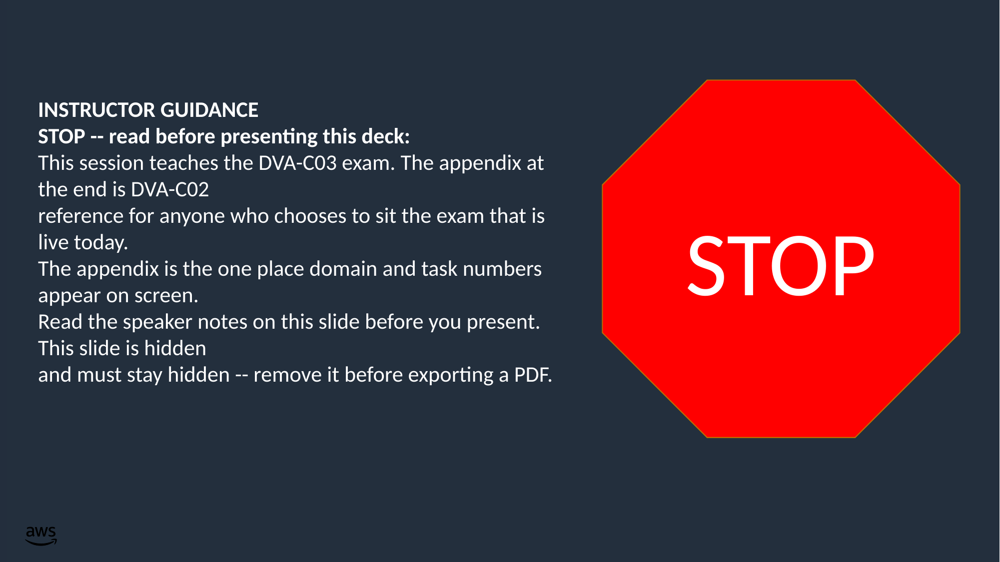

### Notes

WHY THIS SLIDE EXISTS: this session teaches toward the DVA-C03 version of the Developer Associate exam. The three appendix slides cover DVA-C02, the version live today, so anyone choosing to sit the current exam still has a reference. They are not this week's teaching content.

THE APPENDIX PRINTS DOMAIN AND TASK NUMBERS, AND THAT IS DELIBERATE. Nowhere else in the program do those numbers appear on screen. The appendix compares one exam version against another, so the identifiers are its subject -- a candidate needs them to find the matching rows in their own exam guide.

THE COURSE NAMES ON THE WEEK-FIVE SLIDE ARE VERBATIM FROM SKILL BUILDER. Two are missing a space before a dash, and one names DVA-C02 because that is the actual course title. Do not tidy them up out loud -- an attendee types these to search the catalog.

IF SOMEONE ASKS WHICH EXAM TO SIT: show them the appendix and let them decide. Say what each version covers and leave the choice with them rather than recommending one.

This slide is hidden on purpose and must stay hidden. Confirm it is still hidden, or delete it, before you export a PDF or share this file with a partner.

---

## Slide 3 — Content Review — Session 4

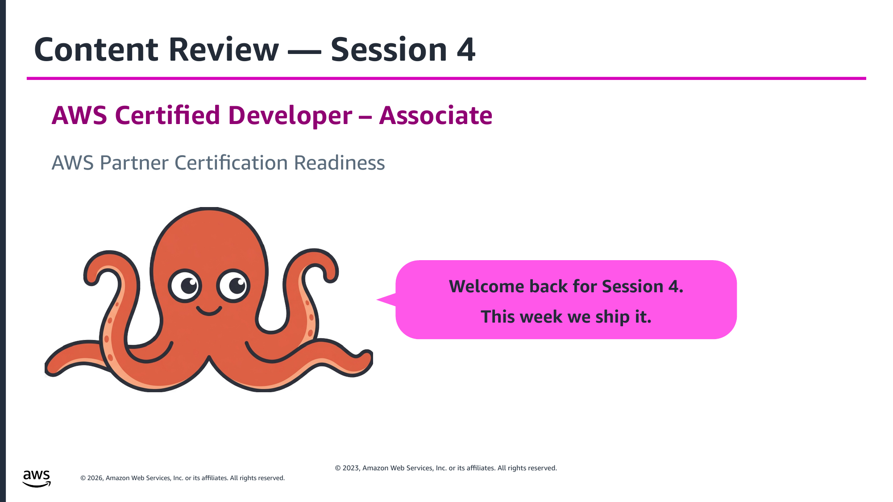

### Notes

FACILITATOR: The opening slide for the fourth content-review session. Welcome the room back and set the frame: the last three weeks built an application, and this week is about getting it out the door and knowing it still works -- testing it, describing it as code, and deploying it safely.

Say what the next two hours look like -- roughly half is a fast re-grounding in the week-four services, and half is exam-strategy practice on live questions.

One framing worth saying out loud: this domain is broader than it used to be. It now covers testing as well as deployment, so expect questions that ask how you would verify a release, not only how you would ship it.

---

## Slide 4 — Event check-in

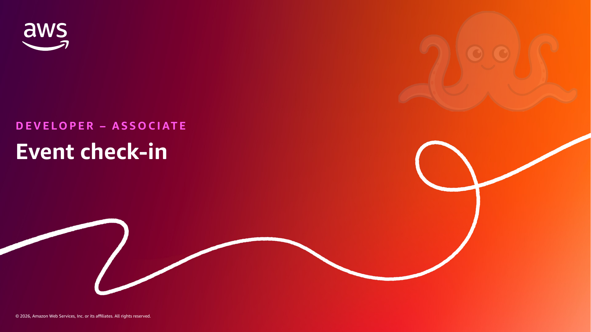

### Notes

FACILITATOR: A quick pulse check before the content starts. Ask how week three landed -- who finished the digital training, who feels behind, and what got in the way.

Some people will have fallen behind, and that is normal. Be encouraging and share a little of your own study experience so the room relaxes and talks.

Keep it to two or three minutes, then move into the week-four curriculum.

---

## Slide 5 — Week 4 digital training

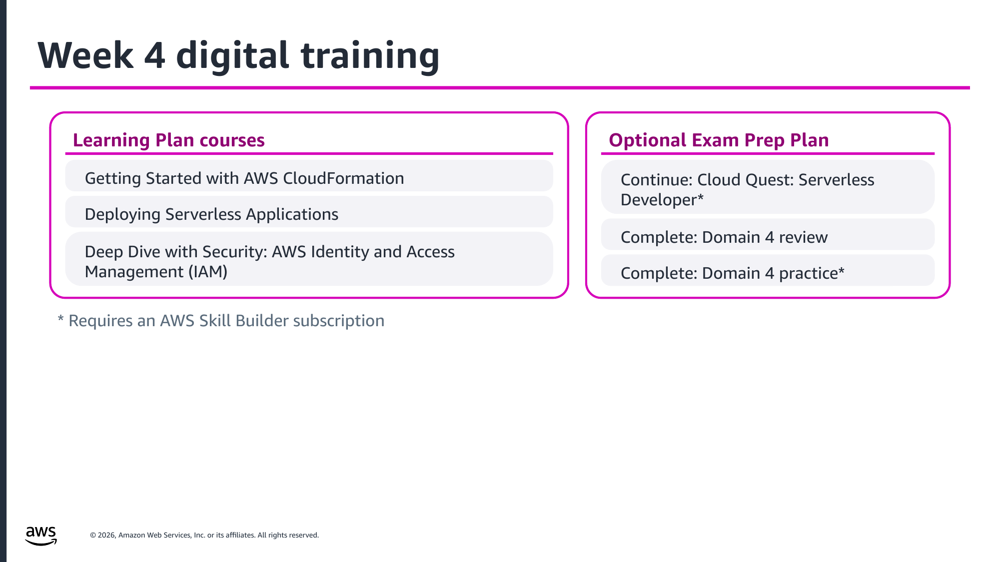

### Notes

WHAT'S HERE: This week's training checklist. The left card is the free Learning Plan; the right card is the optional Exam Prep Plan a subscriber can add.

FACILITATOR: Use this as a check-in. Ask how people are doing and relate it to your own experience studying for the exam -- which modules stood out, what your key takeaways were. The CloudFormation and serverless-deployment courses map directly onto today's infrastructure-as-code and deployment blocks, so anyone who has done them will recognize the material.

Remind the room of the value of Cloud Quest -- the lab practice in particular -- and check whether anyone has tried the labs yet.

Note: the item names beginning "Domain 4" are the actual Exam Prep Plan module names in Skill Builder, so learners can find them; they are navigation, not exam-coverage claims. Keep any talk of exam weighting off this slide.

---

## Slide 6 — Today's focus: Testing and Deployment

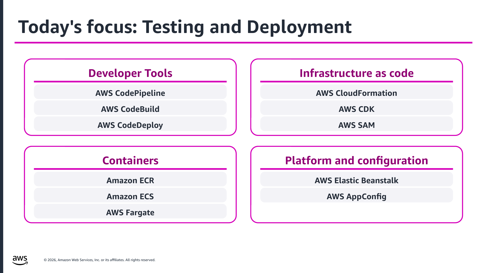

### Notes

WHAT'S HERE: The services this session works through, grouped by the job they do. The developer tools are the pipeline itself; infrastructure as code is how the environment is described and versioned; the container services are where a packaged image actually runs; and Elastic Beanstalk and AppConfig cover the managed-platform and runtime-configuration cases.

FACILITATOR: Use this as a one-slide map of the session. Point out that the container services will look familiar -- the room met them in session one.

But today the question is different. Session one asked what they are; today asks how you get a build onto them, and how you change it safely while it is serving traffic.

AWS CodeArtifact is the other developer tool in this family, and it is worth naming out loud even though it is not on the slide: it stores and shares the packages a build depends on. Amazon EKS is not repeated here either, since it was covered in session one.

Two things are new this week and worth naming: the domain now covers testing as well as deployment, and AWS has tooling that will generate tests and help with pipeline work. Both show up later in the session.

Then move into the first section, the release pipeline.

---

## Slide 7 — Your five weeks at a glance

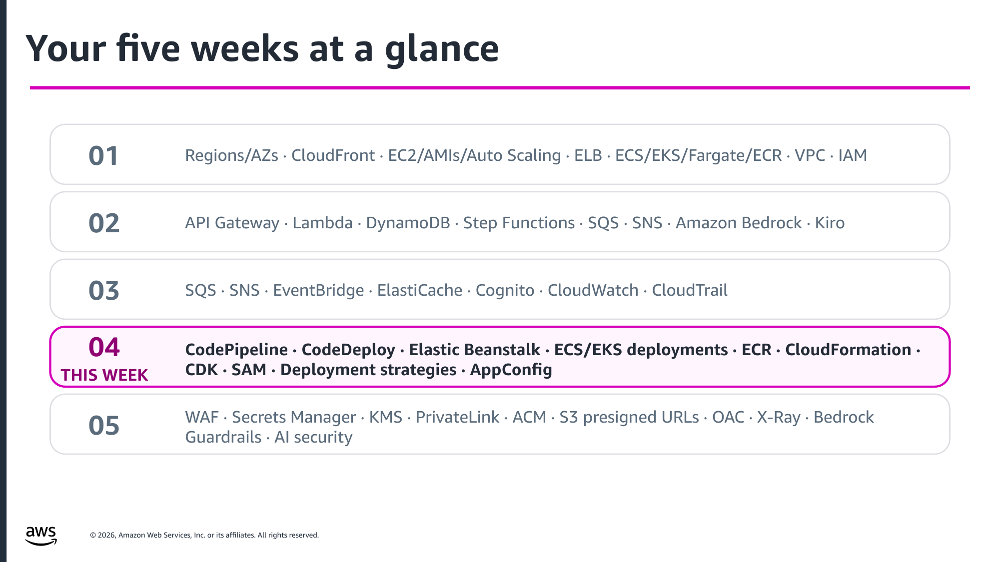

### Notes

WHAT'S HERE: A map of the whole five-week event, one row per week, with this week highlighted. Use it near the top of the session so the room can see where week 4 sits in the arc and what is still to come.

FACILITATOR: Point at the highlighted row. Week 4 is the testing and deployment week -- pipelines, the deployment services, and infrastructure as code. It builds on week 1's container services and week 2's applications, and sets up next week's security work.

Keep it brief -- this is orientation, not content. The same map appears in every session with the current week moving, so returning attendees will recognize it at a glance. Then move into today's focus.

---

## Slide 8 — A pipeline promotes a build through environments

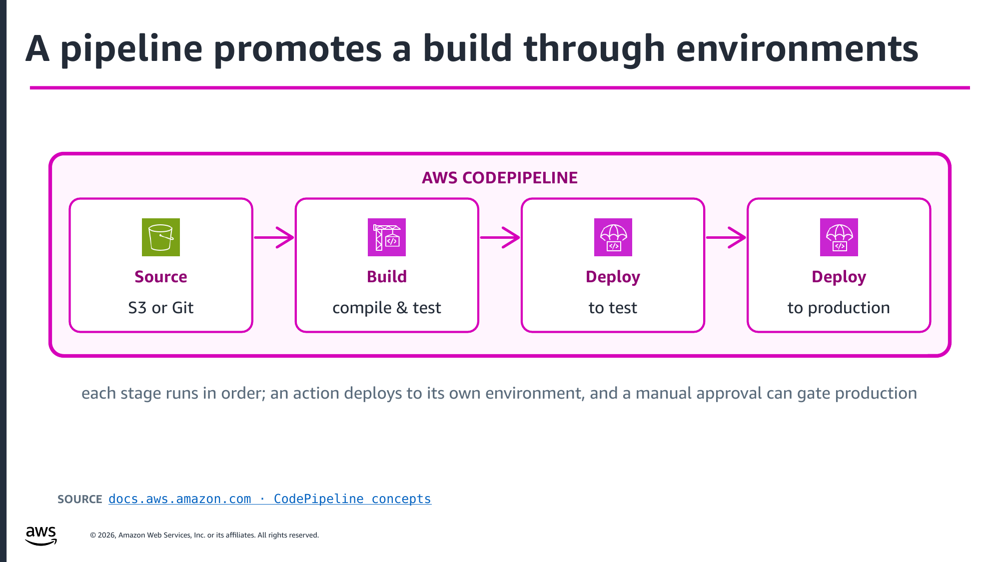

### Notes

Point at the container first. Everything inside this box is one pipeline, and

the four cards are its stages, running in the order they are drawn.

The distinction the exam tests is stage versus action versus environment. A stage is a phase of

the pipeline; an action is the work inside it; the environment is where that work lands. Two

deploy stages here target different environments from one build artifact.

Say the promotion out loud: the same artifact that passed test is what reaches production. It is

not rebuilt. A manual approval action can sit before the production stage when a human has to

sign off.

Note the source is S3 or a Git provider. If a partner asks about CodeCommit, it is closed to new

customers, so point them at a Git provider or S3 instead.

Before you walk it, ask the room which stage they would put a manual approval in front of. Most say production, which is right, and it gets them thinking about the pipeline as a sequence of gates rather than one deploy button.

Verified against docs.aws.amazon.com CodePipeline concepts.

---

## Slide 9 — Keep the database outside a Beanstalk environment

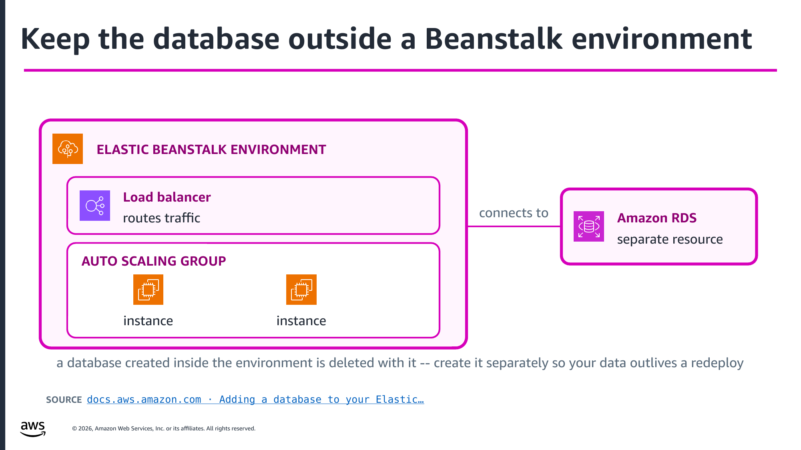

### Notes

The boundary is the whole slide. Everything inside the environment is created

and destroyed with it; the database is deliberately drawn outside.

This is the most commonly confused item in the topic. A database created as part of an Elastic

Beanstalk environment shares that environment's lifecycle, so terminating the environment takes

the data with it. A database created separately and referenced by configuration survives.

Ask the room which one they would want in production. The answer is obvious once the picture

separates them, and that is the whole reason to draw it rather than say it.

For a partner running blue-green, the same rule decides whether a swap is safe: state that lives

inside the environment cannot survive a swap that replaces the environment.

Verified against docs.aws.amazon.com Elastic Beanstalk managing databases.

---

## Slide 10 — CodeDeploy deploys to a deployment group

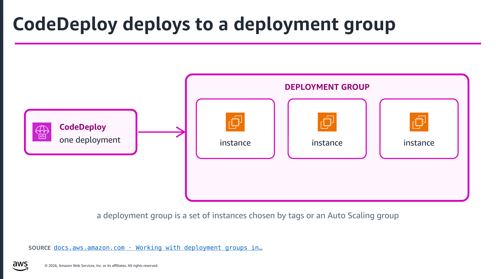

### Notes

Point at the group, not the arrows. CodeDeploy does not deploy to instances one

by one; it deploys to a deployment group, and the group defines the target set.

Three nouns get confused and the exam uses that. The application is the name you deploy under,

the deployment group is what you deploy to, and the deployment configuration is how fast the

rollout proceeds. A question naming a rollout percentage is asking about the configuration.

The grouping is what makes a rollback meaningful. Because the group is the unit, a failed

deployment can be reverted for the whole target set rather than per host.

A partner with separate test and production fleets uses one application and two deployment

groups, which is exactly the shape drawn here.

Ask the room to predict: if a new instance joins this group next week, what has to change in CodeDeploy? Nothing is the answer worth landing, and it is the reason the group exists -- the deployment targets the group, so membership can change underneath it.

Verified against docs.aws.amazon.com CodeDeploy deployment groups.

---

## Slide 11 — Four ways to ship a change, ordered by blast radius

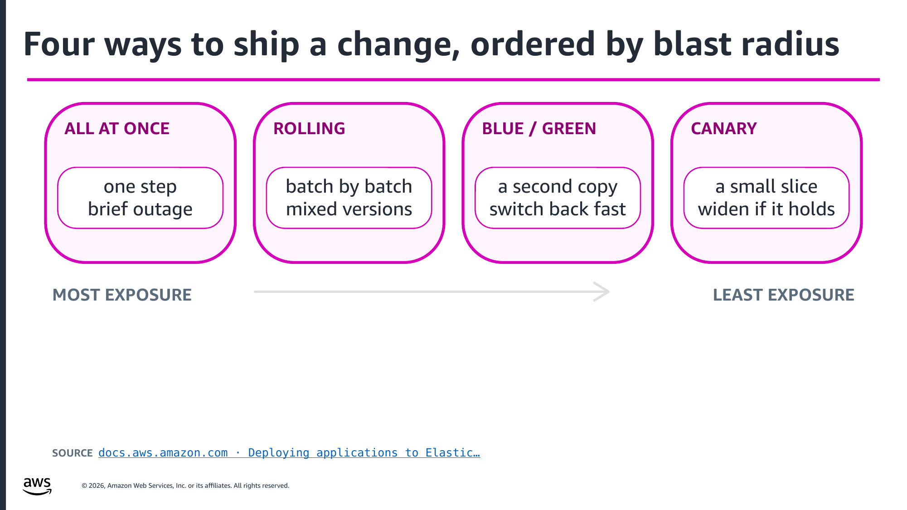

### Notes

Read the row left to right and name the trade being made. Every one of these ships the same code; they differ only in how many users meet it at once.

All at once is the only one with a gap in service, and it is the reason the others exist. Rolling keeps the service up but runs two versions side by side for a while, which matters if a schema changed.

Blue/green keeps a whole second environment, so going back is a switch rather than another deployment. Canary is the same idea applied to a slice of traffic instead of the whole fleet.

Ask the room which of the four they would pick for a payment service, before you say anything. The answer people reach for is blue/green, and the useful follow-up is what it costs -- you are paying for two environments.

A partner running a booking platform can afford rolling for the web tier and wants blue/green for checkout, and that split is a normal, defensible answer rather than an inconsistency.

Verified against docs.aws.amazon.com Elastic Beanstalk deployment policies. CodeDeploy provides the canary and linear shapes for Lambda, and ECS provides blue/green -- both cited on the next two slides.

EXAM MAPPING: Domain 3.

---

## Slide 12 — Blue/green swaps environments; canary splits traffic

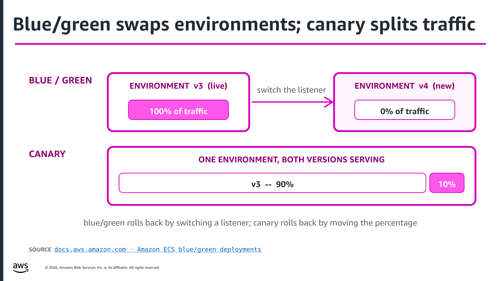

### Notes

These two get answered interchangeably and they are not the same shape. Point at the top row first.

Blue/green duplicates the environment. Both versions are fully deployed, and the change is which one the listener points at, so a rollback is the same switch in reverse.

Canary never duplicates anything. One environment serves both versions at once and the dial is the percentage, so going back means moving the dial rather than swapping a target.

The cost is the tell. Blue/green needs capacity for two environments; canary needs only the extra tasks in the slice.

Ask the room which one can roll back without launching anything, and let them reason about it before you confirm blue/green -- the second environment is already running, which is exactly what you paid for.

A partner with a fixed compute budget usually ends up on canary for that reason, and it is worth naming that the decision was financial rather than technical.

Verified against docs.aws.amazon.com Amazon ECS blue/green deployments.

EXAM MAPPING: Domain 3.

---

## Slide 13 — A canary holds a split; linear keeps moving

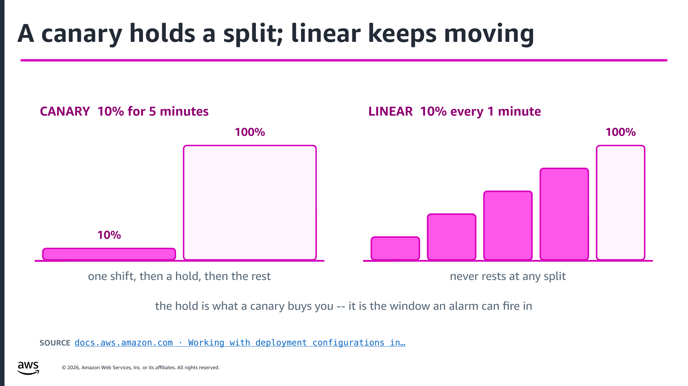

### Notes

Both of these move ten percent at a time, and that is exactly why they are confused. The difference is whether the traffic ever stops moving.

A canary shifts once, then waits. The wait is the point -- it is a bake window, and an alarm during that window is what triggers the rollback.

A linear configuration never holds. It moves the same increment on a fixed interval until it reaches a hundred percent, so no single split lasts long enough to observe.

The names carry the numbers, and reading one aloud is worth more than memorising a list. Canary ten percent five minutes means one shift of ten, a five minute hold, then the remainder.

Ask the room what a linear ten percent every one minute finishes in, before you answer. Ten minutes is the arithmetic, and it makes the difference in exposure obvious.

A partner who wants a human to look at a dashboard before the rest of the traffic moves needs a canary, because a linear rollout will have finished before anyone opens the dashboard.

Verified against docs.aws.amazon.com CodeDeploy deployment configurations.

EXAM MAPPING: Domain 3.

---

## Slide 14 — The circuit breaker reverts a failed deployment

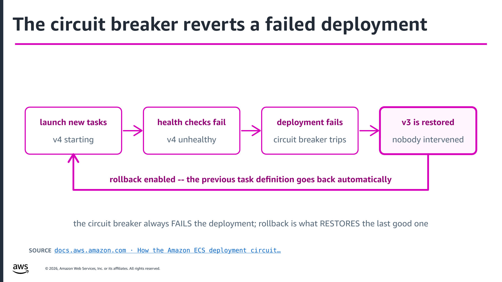

### Notes

This is the slide that answers "least manual intervention". Walk the row left to right and stop on the third box.

The service launches the new tasks and watches them. If they cannot reach a healthy state, the circuit breaker marks the deployment failed on its own, with nobody watching a console.

With rollback enabled it does the second half too -- it puts the previous task definition back. That is what turns a failed deployment into a non-event.

The distinction worth landing is between failing and reverting. The circuit breaker always fails the deployment; it only restores the previous version when rollback is switched on.

Ask the room what happens with the circuit breaker on and rollback off. The deployment stops and the service sits on a broken revision, which is why the pair is usually configured together.

A partner running payments cannot take a maintenance window and cannot staff a release watch, so this is the configuration they want by default.

Verified against docs.aws.amazon.com how the Amazon ECS deployment circuit breaker detects failures.

EXAM MAPPING: Domain 3.

---

## Slide 15 — Build, push, and tag an image, then pull to run

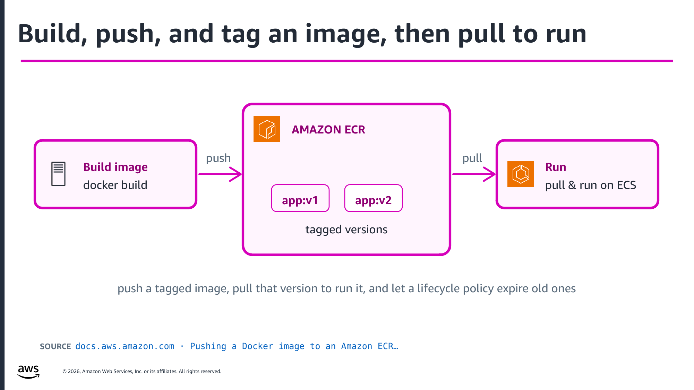

### Notes

This is a lifecycle, so read it left to right. Build produces an image, push

sends it to the registry, the tag names it, pull retrieves it, run starts it.

Session one already covered what a container is, so the subject here is the registry workflow

rather than containers. Two things carry exam weight: a push needs an authentication step

first, and tags are how a deployment names the exact image it wants.

Lifecycle policies are the part people forget. Untagged and superseded images accumulate and

cost money, so a policy expires them on a rule you define rather than by hand.

For a partner, the useful question is whether their deployment references a moving tag or an

immutable one, because a moving tag makes two deployments of the same name different.

Ask the room what happens on the second push of the same tag before you answer it. That is the question a lifecycle policy and tag immutability both exist to settle, and it lands better as a prediction than as a statement.

Verified against docs.aws.amazon.com pushing an image to Amazon ECR.

---

## Slide 16 — One template makes a stack; split stacks by layer

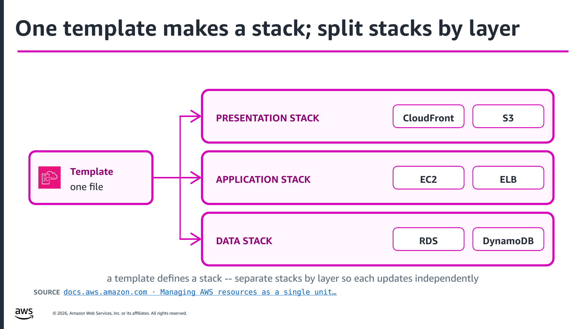

### Notes

One template produces one stack. The containment is the lesson, and the split

across layers is the recommendation.

The exam angle is blast radius. A single stack holding network, data and application means every

change risks all three, and one failed update rolls back everything. Splitting by layer lets the

application deploy without touching the network.

The seam between stacks is the part to name. One stack publishes a value and another consumes

it, which creates a dependency that has to be deleted in order.

A partner asking why they cannot delete a stack usually has exactly that dependency: something

else is still importing a value it exports.

Ask which of the three stacks they expect to change most often before you move on. Application is the answer, and it is the whole argument for the split: a weekly application release should not require touching the network stack at all.

Verified against docs.aws.amazon.com CloudFormation working with stacks.

---

## Slide 17 — A change set previews changes before you execute

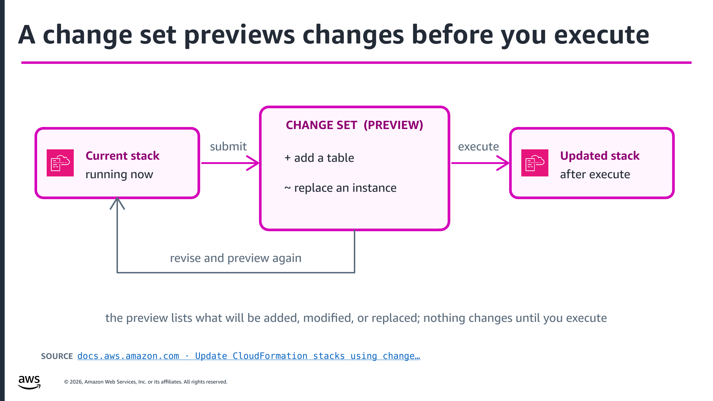

### Notes

The point of this picture is that preview and execute are two separate

steps, and the loop back means you can preview as many times as you like.

A change set answers what would happen without doing it, and specifically whether a resource

would be replaced rather than updated. Replacement is the answer the exam is usually after,

because a replaced resource gets a new identifier and loses its state.

Nothing changes until the change set is executed. That is the sentence to say out loud, because

creating one is safe and reviewing one costs nothing.

For a partner with a change-controlled environment, the change set is the artifact a reviewer

approves before anyone touches production.

Ask the room what single word they are scanning this preview for, before you tell them. Replace is the one that matters, and letting them arrive at it is what makes the preview feel useful rather than procedural.

Verified against docs.aws.amazon.com updating stacks using change sets.

---

## Slide 18 — Run a task definition as tasks behind an ALB

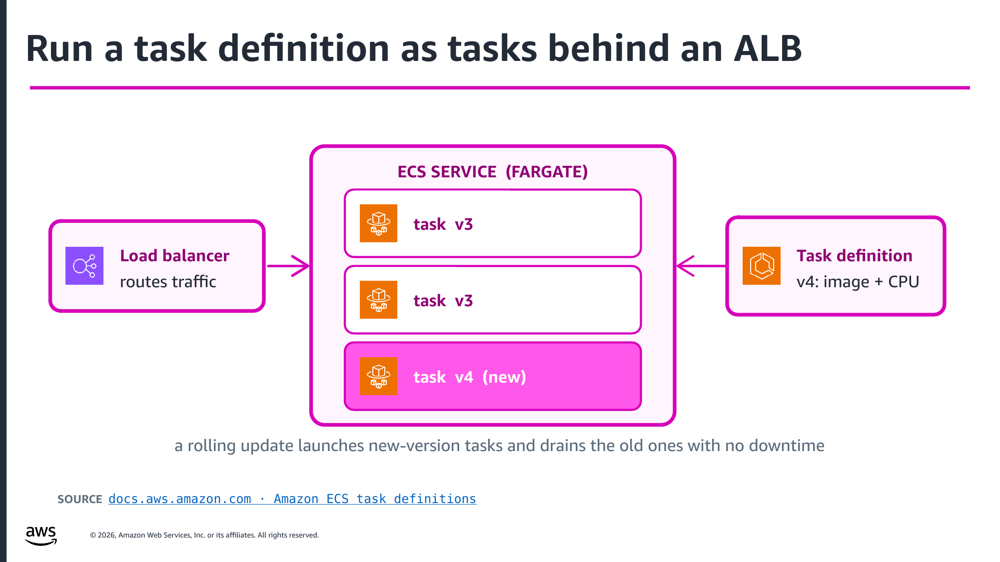

### Notes

Read the task definition as a template and the tasks as its instances. One

definition, several identical tasks, all behind one load balancer.

The relationship is what gets tested. A task definition is versioned, so updating it creates a

new revision and the service is told to use that revision. The rolling update replaces tasks

gradually, which is why the drawing shows more than one.

Session one already covered what Fargate is, so the subject here is deploying to it. The point

worth making is that you describe the task and the platform places it, with no instance to

manage.

A partner asking how to deploy without downtime is asking about this: a new revision plus a

rolling update, with the load balancer draining connections from the tasks being replaced.

Ask which of the three tasks the load balancer stops sending traffic to first. The answer is whichever the rolling update is replacing, and reasoning it out is what makes the draining step stick rather than being a word on a slide.

Verified against docs.aws.amazon.com Amazon ECS task definitions.

---

## Slide 19 — Declaring a queue in a CloudFormation template

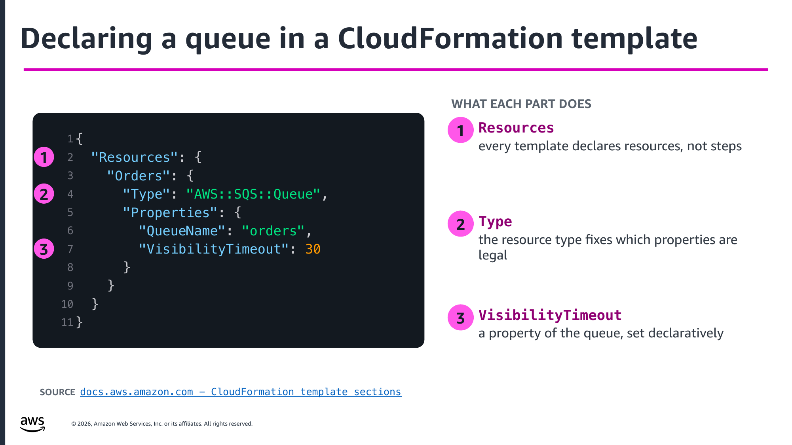

### Notes

Point at Resources first. It is the only required section of a template, and

everything else on this slide sits inside it.

Read the shape out loud: this declares WHAT should exist, not the steps to create it. The

logical name Orders is yours; the Type is what fixes which properties are legal.

The exam angle is that a template is desired state. Submitting it twice does not create two

queues -- CloudFormation compares the template with the stack and changes only the difference.

For a partner moving from scripts, that is the whole shift: a script says how, a template says

what, and the service works out the how.

Ask the room which line here decides what is allowed to appear beneath it. The Type does, and it is worth letting them hunt for it, because that is the line turning a logical name you invented into a real AWS resource.

Verified against docs.aws.amazon.com CloudFormation template sections.

Verified against: https://docs.aws.amazon.com/AWSCloudFormation/latest/UserGuide/template-anatomy.html

---

## Slide 20 — Declaring the same queue in a CDK stack

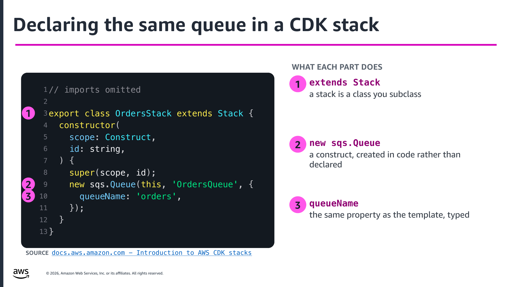

### Notes

This is the previous slide's queue, written as code. Same resource, same

property name, a different authoring surface.

A CDK stack is a class you subclass, and the constructs you create inside it become the

resources. Say out loud that the imports are omitted here for room -- Stack comes from the

aws-cdk-lib package, Construct from constructs, and the queue from the aws-sqs module.

The exam-relevant idea is that this SYNTHESIZES to a CloudFormation template. CDK is not a

different deployment engine; it generates the declarative document and CloudFormation still

does the work.

So ask a partner which surface their team maintains better. A team that already writes

TypeScript gains type checking and loops; a team that does not gains a compiler to learn.

Worth asking out loud: if this synthesizes to the previous slide's template, what does the team gain? The useful answers are type checking, loops over a list of queues, and reusing a construct rather than copying a block of JSON.

Verified against docs.aws.amazon.com Introduction to AWS CDK stacks.

Verified against: https://docs.aws.amazon.com/cdk/v2/guide/stacks.html

---

## Slide 21 — Declaring a function in a SAM template

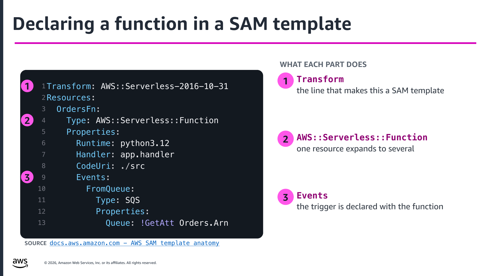

### Notes

Start with the Transform line. That single line is what makes this a SAM

template rather than an ordinary CloudFormation one, and without it none of the serverless

types below are recognized.

The payoff is the expansion. One Serverless Function resource becomes a function, an execution

role, and the event source mapping -- so a SAM template is shorter than the CloudFormation it

turns into.

The exam angle is that SAM IS CloudFormation. The transform runs server side and the result is

a normal stack, which is why you can mix plain CloudFormation resources into the same file.

Note the Events block: the trigger is declared alongside the function rather than wired up

afterwards, which is the difference a partner feels first.

Ask what they think happens if the Transform line is deleted. Everything below it stops being valid, which is the fastest way to show that Transform is not a style choice -- it is what makes the file a SAM template at all.

Verified against docs.aws.amazon.com AWS SAM template anatomy.

Verified against: https://docs.aws.amazon.com/serverless-application-model/latest/developerguide/sam-specification-template-anatomy.html

---

## Slide 22 — Configuration belongs outside the package

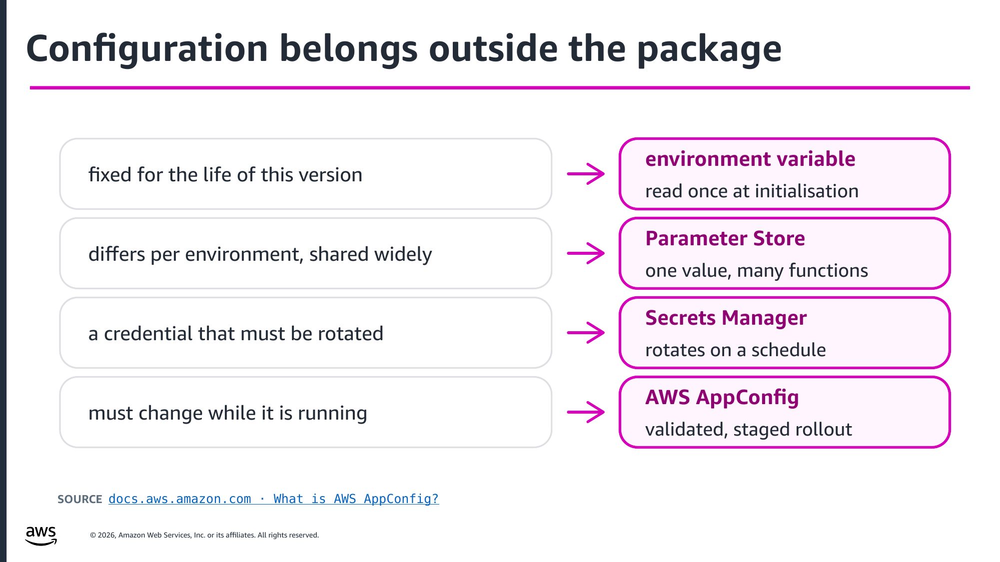

### Notes

Start with the failure this prevents. If a value lives in the package, then changing it means building and deploying again, and the same artifact can no longer be promoted unchanged from test to production.

Read the rows as a lookup. What differs is not the value, it is what the value needs from the platform -- somewhere to live, encryption and rotation, or a controlled change at runtime.

An environment variable is the cheapest option and the right one for something that is fixed for the life of the version. It is read at initialisation, so changing it is a new version.

Parameter Store and Secrets Manager both hold values outside the artifact. The next slide separates them, because that separation is a common question.

AppConfig is the one people miss. It exists so a value can change while the function is running, with a validator and a staged rollout, which is a different job from simply storing the value.

A partner promoting one build through three environments should be able to ship the identical artifact to all three, and every row here is a way of making that true.

Verified against docs.aws.amazon.com What is AWS AppConfig. Parameter Store and Secrets Manager are cited on the next slide; the environment-variable row is the Lambda configuration model taught in session two.

EXAM MAPPING: Domain 3.

---

## Slide 23 — Parameter Store holds it; Secrets Manager rotates it

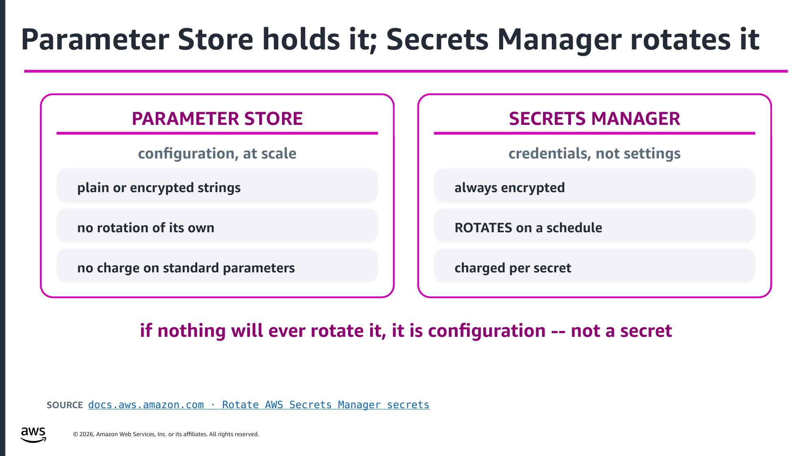

### Notes

Both of these store a value outside your package, both encrypt it, and both are read with an API call. Say that first, because the overlap is real and pretending otherwise makes the distinction harder to remember.

The difference that decides a question is rotation. Secrets Manager rotates a credential on a schedule and coordinates the change with the service that owns it. Parameter Store does not rotate anything.

So the test is not how secret the value is. A database password in Parameter Store as a secure string is encrypted perfectly well; what it does not get is rotation.

The second difference is cost, and it points the same way. Parameter Store standard parameters carry no per-parameter charge, which is why bulk configuration lands there.

Ask the room where an API key for a third party belongs, and make them justify it. Either answer can be defended, and the justification is the learning -- if nobody will rotate it, you are paying for a feature you are not using.

A partner with hundreds of configuration values and a handful of credentials normally ends up using both, which is the answer worth normalising.

Verified against docs.aws.amazon.com Rotate AWS Secrets Manager secrets and AWS Systems Manager Parameter Store.

EXAM MAPPING: Domain 3.

---

## Slide 24 — A test event is a JSON payload you replay

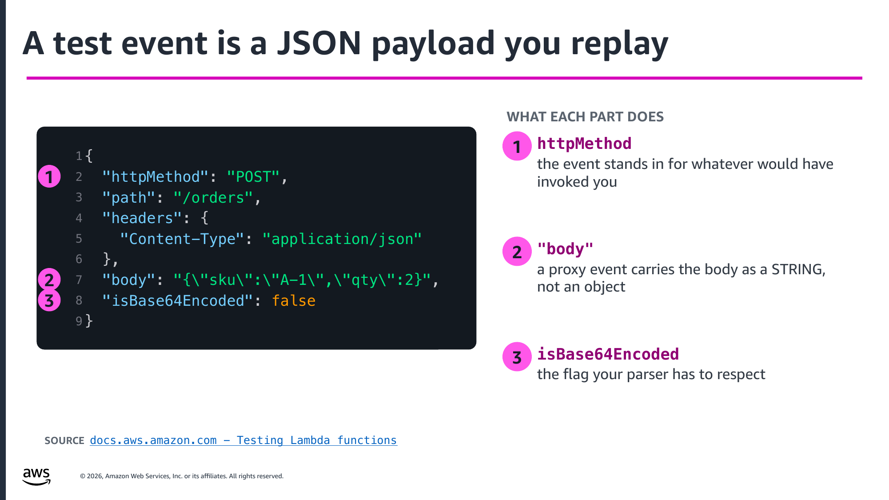

### Notes

A test event is not a testing framework. It is a saved JSON document that stands in for whatever would normally have invoked the function.

Point at the shape rather than the values. This one is the event an API Gateway proxy integration delivers, so the function under test cannot tell the difference between this and a real request.

The body is a string, not an object, and that trips people. A proxy event carries the request body as text, so the function has to parse it -- and a test event that nests an object here passes while production fails.

Because the event is just a document, it can be saved beside the code and replayed. That is what makes it a regression test rather than a one-off console click.

Ask the room what they would change to test the failure path, before moving on. Sending a body that will not parse is the answer, and it is the case most teams never write.

A partner whose function only breaks on malformed input can keep one saved event per failure they have seen, which turns an incident into a permanent test.

Verified against docs.aws.amazon.com Testing Lambda functions in the console.

EXAM MAPPING: Domain 3.

Verified against: https://docs.aws.amazon.com/lambda/latest/dg/testing-functions.html

---

## Slide 25 — An alias is a pointer, so traffic moves with no deploy

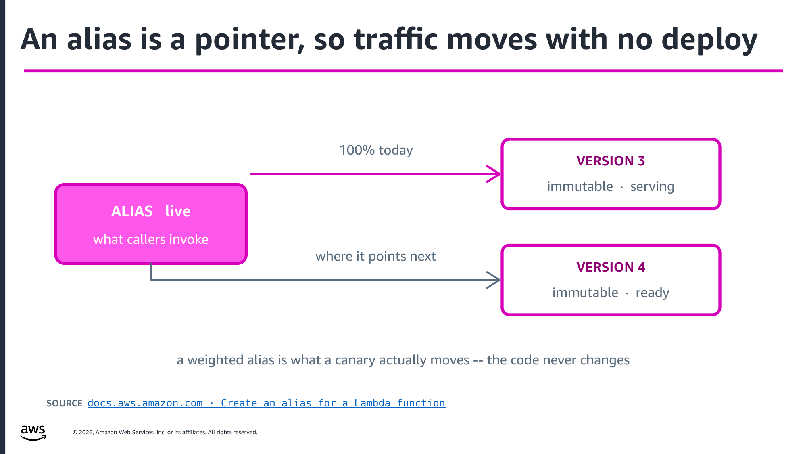

### Notes

This is the indirection that makes every traffic-shifting deployment possible, and it is worth drawing before the strategies get used in anger.

A published version is immutable. Its code and configuration are fixed, and it has its own number, so nothing about it can drift after the fact.

An alias is a named pointer. Callers invoke the alias, so moving the pointer changes what runs without touching a caller and without deploying anything.

The lighter second line is the part to emphasise. An alias can point at two versions at once with a weight, and that weighted pointer is precisely what CodeDeploy moves during a canary.

Ask the room what a rollback costs here. Repointing the alias is the whole operation, which is why a Lambda rollback can be effectively instant.

A partner integrating with a client system that hard-codes a function name gets stability from the alias and freedom to release behind it, which is usually the argument that sells the practice.

Verified against docs.aws.amazon.com Create an alias for a Lambda function.

EXAM MAPPING: Domain 3.

---

## Slide 26 — Package a function three ways; a layer is shared

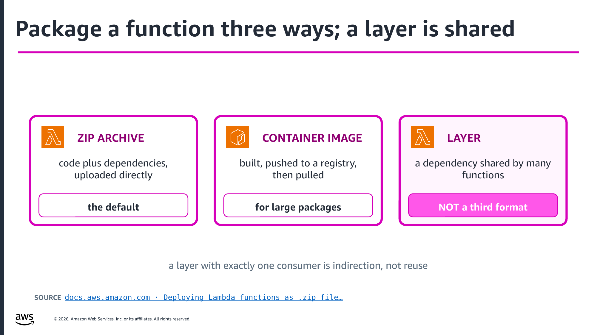

### Notes

Three packaging choices, and the honest summary is that the first one is right until something forces your hand.

A zip archive is the default. You upload the code and its dependencies, and there is a size ceiling on what you can send directly.

A container image is the answer when the package gets large or when the team already builds images for everything else. It goes to a registry first and the function pulls it, which is the same lifecycle the registry slide covered.

A layer is not a third way to ship a function. It is a way to stop shipping the same dependency in every function, and it is the option most often misread.

Ask the room when a layer stops paying off, before you answer. One function is the honest answer -- a layer is shared plumbing, and with a single consumer it is only indirection.

A partner with a dozen functions that all use the same client library gets a smaller artifact and one place to update, which is the case layers were built for.

Verified against docs.aws.amazon.com Deploying Lambda functions as zip file archives and Managing Lambda dependencies with layers.

EXAM MAPPING: Domain 3.

---

## Slide 27 — A hook fires on an event, not when you remember

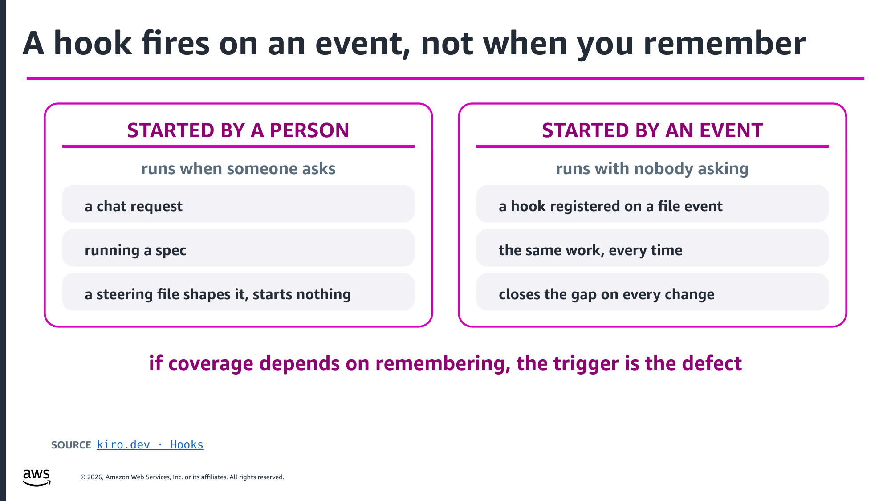

### Notes

This is the distinction the practice questions lean on, and it is a distinction about triggers rather than about capability.

A prompt is something a person starts. It can do exactly the same work, and it does it when somebody remembers to ask, which means the work that gets skipped is the work nobody remembered.

A hook is registered against an event. Nothing has to be remembered, because the event is what starts it, and that is why a hook can keep unit tests generated for every changed file rather than for the ones somebody thought of.

The steering file belongs in the left column and is worth naming explicitly. It shapes what gets generated, but it is not a trigger, so on its own it never causes anything to run.

Ask the room which of these would still work at two in the morning with nobody at a keyboard. Only the hook, and that framing tends to stick better than the definitions.

A partner whose test coverage falls behind on every release is describing a trigger problem, not a tooling problem, and this is the slide that names it.

Verified against kiro.dev Hooks.

EXAM MAPPING: Domain 3.

---

## Slide 28 — Headless mode makes the agent a build step

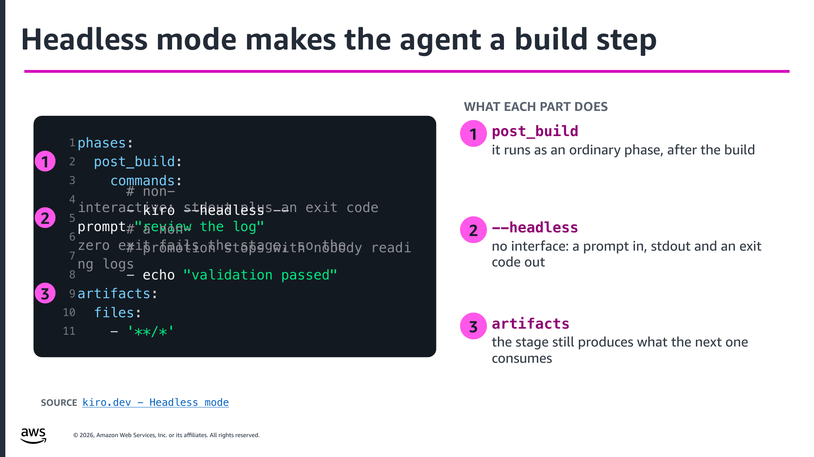

### Notes

This is the slide that turns the previous one into something a pipeline can use. Point at the exit code, not the command.

Headless mode runs the agent without an interface. It takes a prompt, writes to standard output, and finishes with an exit code, which is exactly the contract a build step already has.

That contract is the whole point. A pipeline stage does not need to understand what the agent did; it only needs to know whether to continue, and a non-zero exit is how any build tool says no.

Contrast it with a manual approval, because the questions do. An approval waits for a person and cannot fail on the content of a check. This stops the promotion on the check itself.

Ask the room what happens to the promotion if this command exits non-zero, before you say it. The stage fails and the build never reaches production, with nobody reading a log.

A partner who currently has an engineer skim logs before every release can move that judgement into the pipeline and keep the audit trail, which is usually the outcome they actually wanted.

Verified against kiro.dev Headless mode.

EXAM MAPPING: Domain 3.

Verified against: https://kiro.dev/docs/cli/headless/

---

## Slide 29 — Which deployment service does the wording name? _(hidden)_

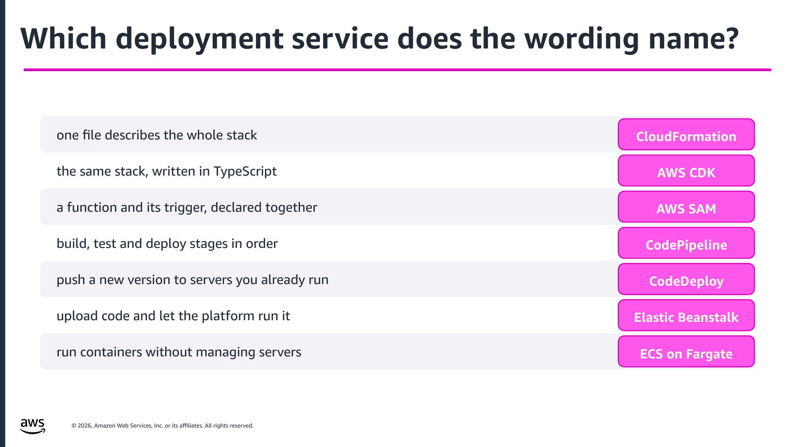

### Notes

This is the closer for the whole session, so do not read it out. Ask the room to

answer each row before you reveal the right-hand column.

The rows are ordered by what the question gives you. The top three are authoring surfaces --

one template, the same template as code, or a function declared with its trigger. The next two

are release mechanics, and the last two are where the code actually runs.

The exam angle is that these are trigger phrases rather than definitions. Wording like

describes the whole stack points at CloudFormation however the scenario is dressed up, and

without managing servers is the Fargate tell.

The distinction people lose is CodePipeline against CodeDeploy. The pipeline ORCHESTRATES the

stages; CodeDeploy is one action inside it that puts a version onto instances. A question about

stage order is the pipeline, a question about rollout is CodeDeploy.

PROVENANCE: the grid is ours -- no AWS page publishes this selection table. Each row's claim,

though, comes from a page already title-validated for this deck.

Those pages are CloudFormation template sections, Introduction to AWS CDK stacks,

AWS SAM template anatomy, CodePipeline concepts, CodeDeploy deployment groups,

Elastic Beanstalk managing databases, and Amazon ECS task definitions for containers.

---

## Slide 30 — Which deployment service does the wording name?

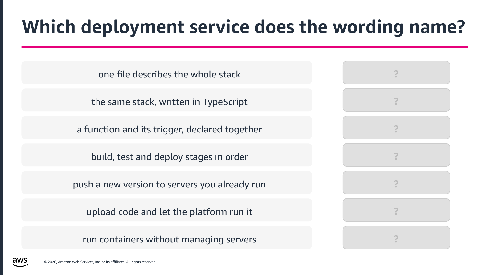

### Notes

This is the closer for the whole session, so do not read it out. Ask the room to

answer each row before you reveal the right-hand column.

The rows are ordered by what the question gives you. The top three are authoring surfaces --

one template, the same template as code, or a function declared with its trigger. The next two

are release mechanics, and the last two are where the code actually runs.

The exam angle is that these are trigger phrases rather than definitions. Wording like

describes the whole stack points at CloudFormation however the scenario is dressed up, and

without managing servers is the Fargate tell.

The distinction people lose is CodePipeline against CodeDeploy. The pipeline ORCHESTRATES the

stages; CodeDeploy is one action inside it that puts a version onto instances. A question about

stage order is the pipeline, a question about rollout is CodeDeploy.

PROVENANCE: the grid is ours -- no AWS page publishes this selection table. Each row's claim,

though, comes from a page already title-validated for this deck.

Those pages are CloudFormation template sections, Introduction to AWS CDK stacks,

AWS SAM template anatomy, CodePipeline concepts, CodeDeploy deployment groups,

Elastic Beanstalk managing databases, and Amazon ECS task definitions for containers.

---

## Slide 31 — one file describes the whole stack

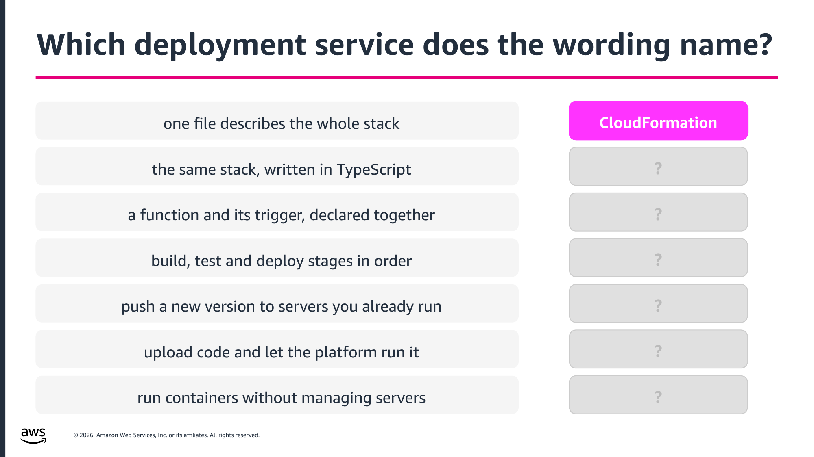

### Notes

This is the closer for the whole session, so do not read it out. Ask the room to

answer each row before you reveal the right-hand column.

The rows are ordered by what the question gives you. The top three are authoring surfaces --

one template, the same template as code, or a function declared with its trigger. The next two

are release mechanics, and the last two are where the code actually runs.

The exam angle is that these are trigger phrases rather than definitions. Wording like

describes the whole stack points at CloudFormation however the scenario is dressed up, and

without managing servers is the Fargate tell.

The distinction people lose is CodePipeline against CodeDeploy. The pipeline ORCHESTRATES the

stages; CodeDeploy is one action inside it that puts a version onto instances. A question about

stage order is the pipeline, a question about rollout is CodeDeploy.

PROVENANCE: the grid is ours -- no AWS page publishes this selection table. Each row's claim,

though, comes from a page already title-validated for this deck.

Those pages are CloudFormation template sections, Introduction to AWS CDK stacks,

AWS SAM template anatomy, CodePipeline concepts, CodeDeploy deployment groups,

Elastic Beanstalk managing databases, and Amazon ECS task definitions for containers.

---

## Slide 32 — one file describes the whole stack

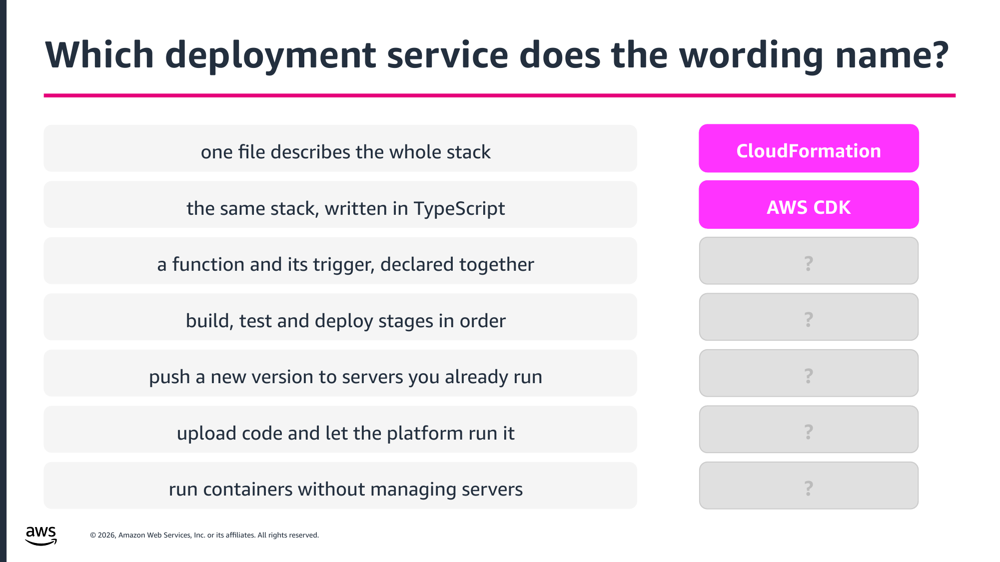

### Notes

This is the closer for the whole session, so do not read it out. Ask the room to

answer each row before you reveal the right-hand column.

The rows are ordered by what the question gives you. The top three are authoring surfaces --

one template, the same template as code, or a function declared with its trigger. The next two

are release mechanics, and the last two are where the code actually runs.

The exam angle is that these are trigger phrases rather than definitions. Wording like

describes the whole stack points at CloudFormation however the scenario is dressed up, and

without managing servers is the Fargate tell.

The distinction people lose is CodePipeline against CodeDeploy. The pipeline ORCHESTRATES the

stages; CodeDeploy is one action inside it that puts a version onto instances. A question about

stage order is the pipeline, a question about rollout is CodeDeploy.

PROVENANCE: the grid is ours -- no AWS page publishes this selection table. Each row's claim,

though, comes from a page already title-validated for this deck.

Those pages are CloudFormation template sections, Introduction to AWS CDK stacks,

AWS SAM template anatomy, CodePipeline concepts, CodeDeploy deployment groups,

Elastic Beanstalk managing databases, and Amazon ECS task definitions for containers.

---

## Slide 33 — one file describes the whole stack

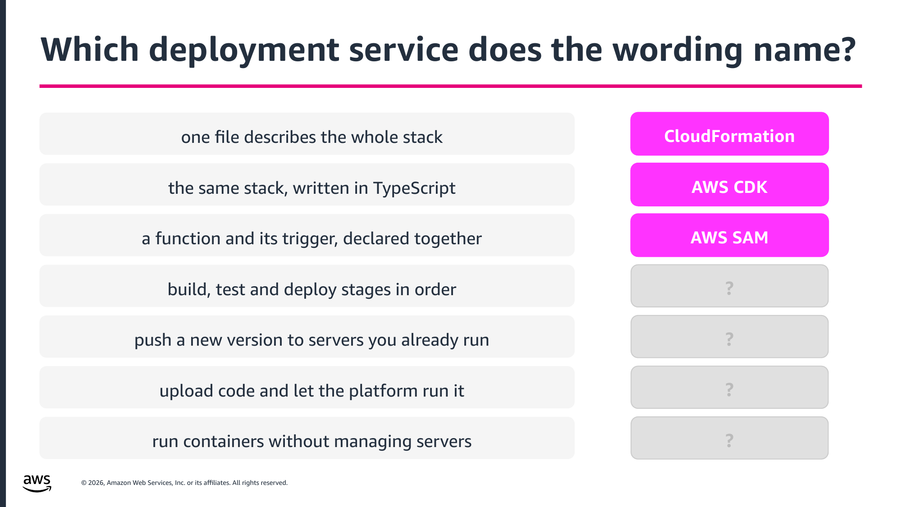

### Notes

This is the closer for the whole session, so do not read it out. Ask the room to

answer each row before you reveal the right-hand column.

The rows are ordered by what the question gives you. The top three are authoring surfaces --

one template, the same template as code, or a function declared with its trigger. The next two

are release mechanics, and the last two are where the code actually runs.

The exam angle is that these are trigger phrases rather than definitions. Wording like

describes the whole stack points at CloudFormation however the scenario is dressed up, and

without managing servers is the Fargate tell.

The distinction people lose is CodePipeline against CodeDeploy. The pipeline ORCHESTRATES the

stages; CodeDeploy is one action inside it that puts a version onto instances. A question about

stage order is the pipeline, a question about rollout is CodeDeploy.

PROVENANCE: the grid is ours -- no AWS page publishes this selection table. Each row's claim,

though, comes from a page already title-validated for this deck.

Those pages are CloudFormation template sections, Introduction to AWS CDK stacks,

AWS SAM template anatomy, CodePipeline concepts, CodeDeploy deployment groups,

Elastic Beanstalk managing databases, and Amazon ECS task definitions for containers.

---

## Slide 34 — one file describes the whole stack

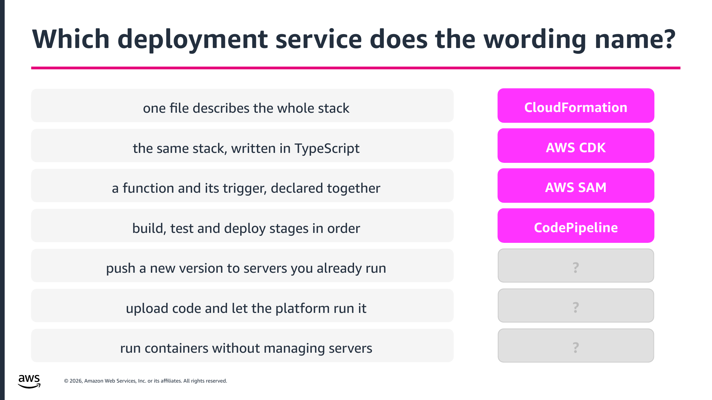

### Notes

This is the closer for the whole session, so do not read it out. Ask the room to

answer each row before you reveal the right-hand column.

The rows are ordered by what the question gives you. The top three are authoring surfaces --

one template, the same template as code, or a function declared with its trigger. The next two

are release mechanics, and the last two are where the code actually runs.

The exam angle is that these are trigger phrases rather than definitions. Wording like

describes the whole stack points at CloudFormation however the scenario is dressed up, and

without managing servers is the Fargate tell.

The distinction people lose is CodePipeline against CodeDeploy. The pipeline ORCHESTRATES the

stages; CodeDeploy is one action inside it that puts a version onto instances. A question about

stage order is the pipeline, a question about rollout is CodeDeploy.

PROVENANCE: the grid is ours -- no AWS page publishes this selection table. Each row's claim,

though, comes from a page already title-validated for this deck.

Those pages are CloudFormation template sections, Introduction to AWS CDK stacks,

AWS SAM template anatomy, CodePipeline concepts, CodeDeploy deployment groups,

Elastic Beanstalk managing databases, and Amazon ECS task definitions for containers.

---

## Slide 35 — one file describes the whole stack

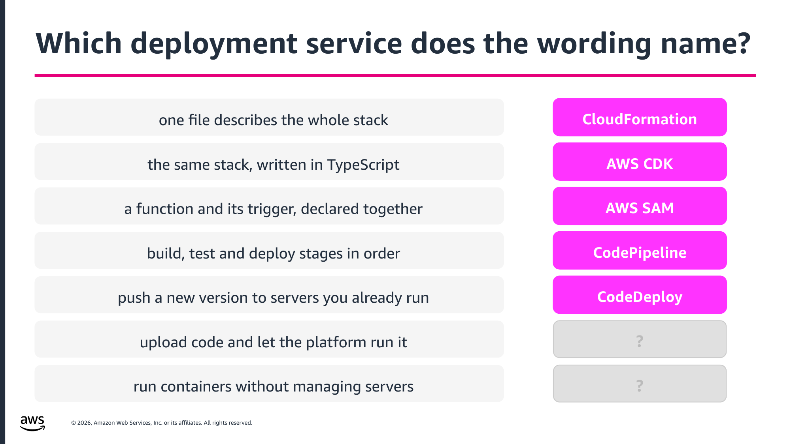

### Notes

This is the closer for the whole session, so do not read it out. Ask the room to

answer each row before you reveal the right-hand column.

The rows are ordered by what the question gives you. The top three are authoring surfaces --

one template, the same template as code, or a function declared with its trigger. The next two

are release mechanics, and the last two are where the code actually runs.

The exam angle is that these are trigger phrases rather than definitions. Wording like

describes the whole stack points at CloudFormation however the scenario is dressed up, and

without managing servers is the Fargate tell.

The distinction people lose is CodePipeline against CodeDeploy. The pipeline ORCHESTRATES the

stages; CodeDeploy is one action inside it that puts a version onto instances. A question about

stage order is the pipeline, a question about rollout is CodeDeploy.

PROVENANCE: the grid is ours -- no AWS page publishes this selection table. Each row's claim,

though, comes from a page already title-validated for this deck.

Those pages are CloudFormation template sections, Introduction to AWS CDK stacks,

AWS SAM template anatomy, CodePipeline concepts, CodeDeploy deployment groups,

Elastic Beanstalk managing databases, and Amazon ECS task definitions for containers.

---

## Slide 36 — one file describes the whole stack

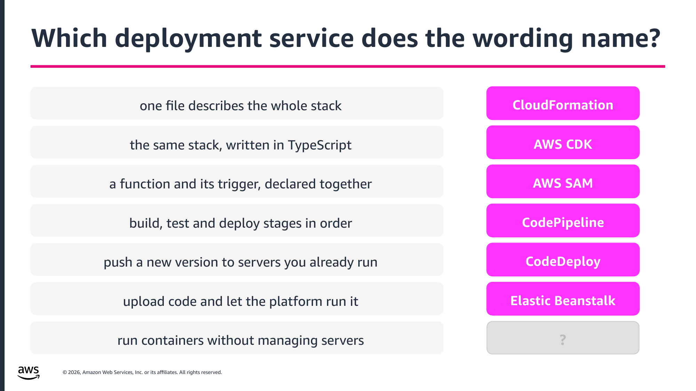

### Notes

This is the closer for the whole session, so do not read it out. Ask the room to

answer each row before you reveal the right-hand column.

The rows are ordered by what the question gives you. The top three are authoring surfaces --

one template, the same template as code, or a function declared with its trigger. The next two

are release mechanics, and the last two are where the code actually runs.

The exam angle is that these are trigger phrases rather than definitions. Wording like

describes the whole stack points at CloudFormation however the scenario is dressed up, and

without managing servers is the Fargate tell.

The distinction people lose is CodePipeline against CodeDeploy. The pipeline ORCHESTRATES the

stages; CodeDeploy is one action inside it that puts a version onto instances. A question about

stage order is the pipeline, a question about rollout is CodeDeploy.

PROVENANCE: the grid is ours -- no AWS page publishes this selection table. Each row's claim,

though, comes from a page already title-validated for this deck.

Those pages are CloudFormation template sections, Introduction to AWS CDK stacks,

AWS SAM template anatomy, CodePipeline concepts, CodeDeploy deployment groups,

Elastic Beanstalk managing databases, and Amazon ECS task definitions for containers.

---

## Slide 37 — one file describes the whole stack

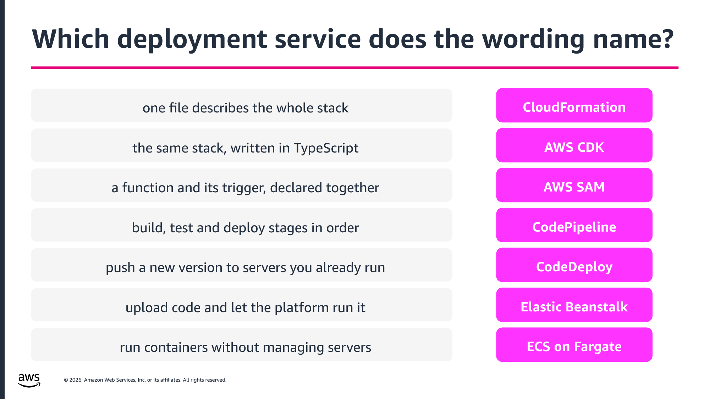

### Notes

This is the closer for the whole session, so do not read it out. Ask the room to

answer each row before you reveal the right-hand column.

The rows are ordered by what the question gives you. The top three are authoring surfaces --

one template, the same template as code, or a function declared with its trigger. The next two

are release mechanics, and the last two are where the code actually runs.

The exam angle is that these are trigger phrases rather than definitions. Wording like

describes the whole stack points at CloudFormation however the scenario is dressed up, and

without managing servers is the Fargate tell.

The distinction people lose is CodePipeline against CodeDeploy. The pipeline ORCHESTRATES the

stages; CodeDeploy is one action inside it that puts a version onto instances. A question about

stage order is the pipeline, a question about rollout is CodeDeploy.

PROVENANCE: the grid is ours -- no AWS page publishes this selection table. Each row's claim,

though, comes from a page already title-validated for this deck.

Those pages are CloudFormation template sections, Introduction to AWS CDK stacks,

AWS SAM template anatomy, CodePipeline concepts, CodeDeploy deployment groups,

Elastic Beanstalk managing databases, and Amazon ECS task definitions for containers.

---

## Slide 38 — Put the deployment tools to work

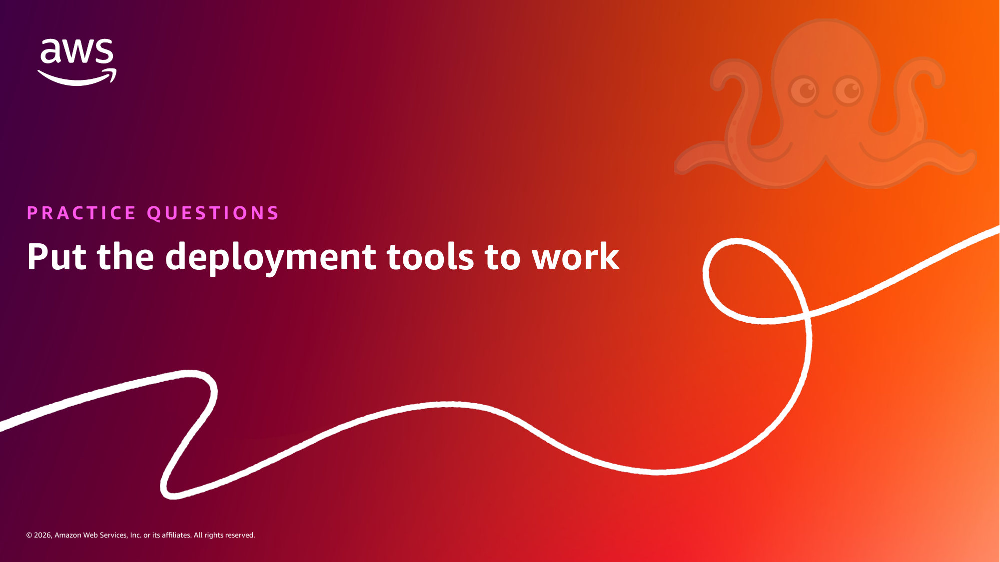

### Notes

FACILITATOR: This marks the shift from teaching to practice. The next questions apply this week's testing and deployment material -- pipelines, deployment strategies, infrastructure as code, and the AI-assisted development tooling -- to scenario-style problems.

Frame it as a low-stakes checkpoint. The aim is to surface which services still feel unclear, not to score anyone. Ask the room to read each stem carefully and note the key phrases before looking at the choices.

Remind everyone that the four-beat rhythm -- read the scenario, find the key phrases, reveal the answer, then walk through why each wrong choice loses -- is a study technique they can reuse on their own practice sets. The fourth beat is where the learning is: being able to rule out a wrong choice for a named reason is the skill the room needs under time pressure.

---

## Slide 39 — Question 1: keeping a registry from growing forever

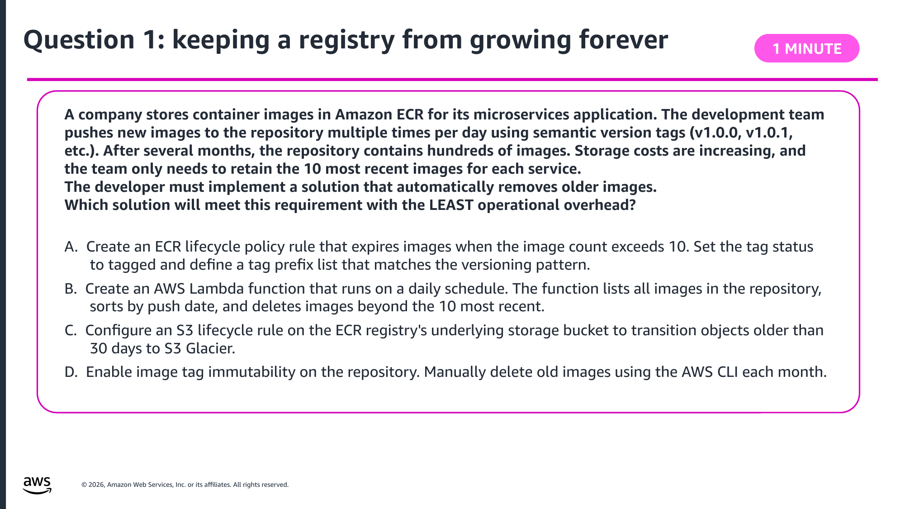

### Question

A company stores container images in Amazon ECR for its microservices application. The development team pushes new images to the repository multiple times per day using semantic version tags (v1.0.0, v1.0.1, etc.). After several months, the repository contains hundreds of images. Storage costs are increasing, and the team only needs to retain the 10 most recent images for each service.
The developer must implement a solution that automatically removes older images.
Which solution will meet this requirement with the LEAST operational overhead?

A.  Create an ECR lifecycle policy rule that expires images when the image count exceeds 10. Set the tag status to tagged and define a tag prefix list that matches the versioning pattern.
B.  Create an AWS Lambda function that runs on a daily schedule. The function lists all images in the repository, sorts by push date, and deletes images beyond the 10 most recent.
C.  Configure an S3 lifecycle rule on the ECR registry's underlying storage bucket to transition objects older than 30 days to S3 Glacier.
D.  Enable image tag immutability on the repository. Manually delete old images using the AWS CLI each month.

### Notes

WHAT'S HERE: put question 1 on screen and give the room about 90 seconds to read it in silence and commit to an answer before anyone speaks aloud. That is close to the pace the exam demands, so this rehearses timing as much as content.

Do not reveal or hint at the answer on this beat. The silent read is what makes the key-phrases beat and the reveal land -- if you talk through it now, both lose their effect.

EXAM RELEVANCE: Domain 3: Testing and Deployment. Difficulty: Medium. Watch the room: if most people have answered by 90 seconds, move on; if they are still reading, give another 20 seconds rather than rushing the discussion that follows.

PARTNER CONTEXT: A partner's registry grows by several pushes a day and nobody notices until the storage line on the bill does. A lifecycle policy set to expire tagged images beyond a count keeps the newest builds and removes the rest on its own schedule. The point worth making is that the alternatives all work -- a scheduled function can delete images too -- but they add code the customer then has to own, and the requirement asked for the least operational overhead.

EXAM MAPPING: Domain 3: Testing and Deployment.

---

## Slide 40 — Question 1: keeping a registry from growing forever

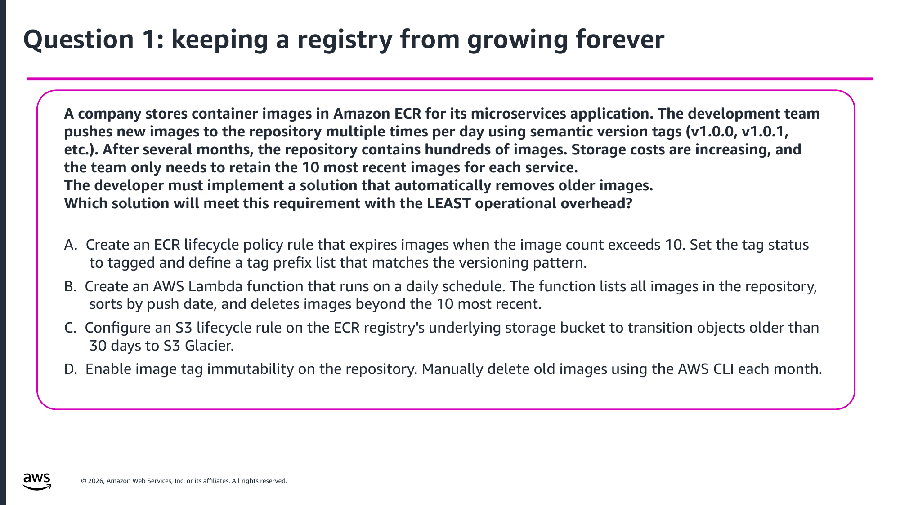

### Question

A company stores container images in Amazon ECR for its microservices application. The development team pushes new images to the repository multiple times per day using semantic version tags (v1.0.0, v1.0.1, etc.). After several months, the repository contains hundreds of images. Storage costs are increasing, and the team only needs to retain the 10 most recent images for each service.
The developer must implement a solution that automatically removes older images.
Which solution will meet this requirement with the LEAST operational overhead?

A.  Create an ECR lifecycle policy rule that expires images when the image count exceeds 10. Set the tag status to tagged and define a tag prefix list that matches the versioning pattern.
B.  Create an AWS Lambda function that runs on a daily schedule. The function lists all images in the repository, sorts by push date, and deletes images beyond the 10 most recent.
C.  Configure an S3 lifecycle rule on the ECR registry's underlying storage bucket to transition objects older than 30 days to S3 Glacier.
D.  Enable image tag immutability on the repository. Manually delete old images using the AWS CLI each month.

### Notes

KEY PHRASES: walk the question, do not answer it yet. The phrase that decides it is “the team only needs to retain the 10 most recent images for each service”, and it tells you: A retention count with no operational work points to an ECR lifecycle policy.

WHAT'S HERE: the same question with the timer removed. This beat teaches HOW to read a scenario question -- find the requirement, then find the words that separate options that all look plausible on a first pass.

EXAM RELEVANCE: Domain 3: Testing and Deployment. Difficulty: Medium. Ask the room which words they underlined before you show them the tell, so they practise finding it rather than being handed it.

PARTNER CONTEXT: A partner's registry grows by several pushes a day and nobody notices until the storage line on the bill does. A lifecycle policy set to expire tagged images beyond a count keeps the newest builds and removes the rest on its own schedule. The point worth making is that the alternatives all work -- a scheduled function can delete images too -- but they add code the customer then has to own, and the requirement asked for the least operational overhead.

EXAM MAPPING: Domain 3: Testing and Deployment.

---

## Slide 41 — Question 1: keeping a registry from growing forever

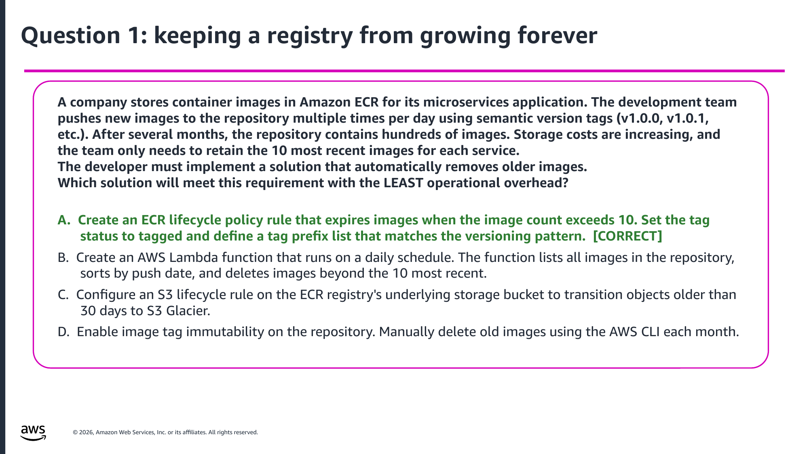

### Question

A company stores container images in Amazon ECR for its microservices application. The development team pushes new images to the repository multiple times per day using semantic version tags (v1.0.0, v1.0.1, etc.). After several months, the repository contains hundreds of images. Storage costs are increasing, and the team only needs to retain the 10 most recent images for each service.
The developer must implement a solution that automatically removes older images.
Which solution will meet this requirement with the LEAST operational overhead?

A.  Create an ECR lifecycle policy rule that expires images when the image count exceeds 10. Set the tag status to tagged and define a tag prefix list that matches the versioning pattern.  [CORRECT]
B.  Create an AWS Lambda function that runs on a daily schedule. The function lists all images in the repository, sorts by push date, and deletes images beyond the 10 most recent.
C.  Configure an S3 lifecycle rule on the ECR registry's underlying storage bucket to transition objects older than 30 days to S3 Glacier.
D.  Enable image tag immutability on the repository. Manually delete old images using the AWS CLI each month.

### Notes

ANSWER OVERVIEW: the answer is A. A lifecycle rule expires by image count, with no code to run.

A. Create an ECR lifecycle policy rule that expires images when the image count exceeds 10. Set the tag status to tagged and define a tag prefix list that matches the versioning pattern. — Correct — ECR lifecycle policies automatically expire images based on defined rules. A rule with countType set to imageCountMoreThan and countNumber set to 10 retains only the 10 most recent images matching the tag pattern. The policy runs automatically and requires no manual intervention or external scheduling.

B. Create an AWS Lambda function that runs on a daily schedule. The function lists all images in the repository, sorts by push date, and deletes images beyond the 10 most recent. — Incorrect — A Lambda function with a schedule can achieve the same result. However, this requires writing and maintaining custom code, configuring a schedule, and managing IAM permissions for the function. ECR lifecycle policies provide this functionality natively with no custom code or scheduling required.

C. Configure an S3 lifecycle rule on the ECR registry's underlying storage bucket to transition objects older than 30 days to S3 Glacier. — Incorrect — ECR manages its own storage infrastructure. Customers do not have direct access to the underlying S3 buckets where ECR stores image layers. S3 lifecycle rules cannot be applied to ECR's internal storage. ECR provides its own lifecycle policy mechanism for image management.

D. Enable image tag immutability on the repository. Manually delete old images using the AWS CLI each month. — Incorrect — Image tag immutability prevents existing tags from being overwritten. It does not manage image retention or automatically delete old images. Manual CLI deletion each month adds operational overhead and risks human error. This does not meet the requirement for automatic removal.

EXAM RELEVANCE: Domain 3: Testing and Deployment. Difficulty: Medium.

SOURCE: https://docs.aws.amazon.com/AmazonECR/latest/userguide/LifecyclePolicies.html

---

## Slide 42 — Question 1: keeping a registry from growing forever

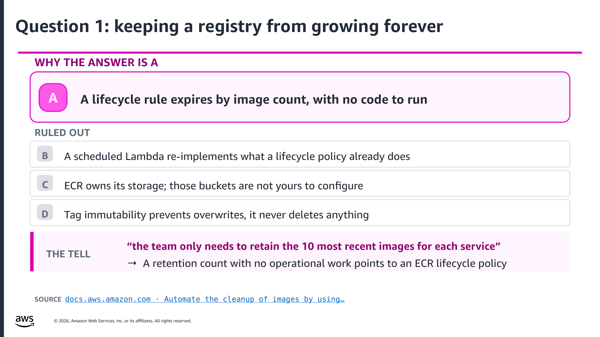

### Notes

WHAT'S HERE: the elimination, made visible. A win because a lifecycle rule expires by image count, with no code to run. The others are ruled out for one reason each: B — A scheduled Lambda re-implements what a lifecycle policy already does; C — ECR owns its storage; those buckets are not yours to configure; D — Tag immutability prevents overwrites, it never deletes anything. Read the tell strip aloud -- pairing a phrase with what it signals is the transferable skill, not memorizing the service name.

EXAM RELEVANCE: Domain 3: Testing and Deployment. Difficulty: Medium. The pattern to teach: a scenario question rarely offers three absurd options. It offers ones that match a nearby requirement and one (or two) that match the requirement exactly. Here the discriminator is “the team only needs to retain the 10 most recent images for each service”, which points at A retention count with no operational work points to an ECR lifecycle policy. Encourage the room to name the phrase before naming the service.

PARTNER CONTEXT: A partner's registry grows by several pushes a day and nobody notices until the storage line on the bill does. A lifecycle policy set to expire tagged images beyond a count keeps the newest builds and removes the rest on its own schedule. The point worth making is that the alternatives all work -- a scheduled function can delete images too -- but they add code the customer then has to own, and the requirement asked for the least operational overhead.

SOURCE: https://docs.aws.amazon.com/AmazonECR/latest/userguide/LifecyclePolicies.html

---

## Slide 43 — Question 2: a rolling update that must not drop capacity

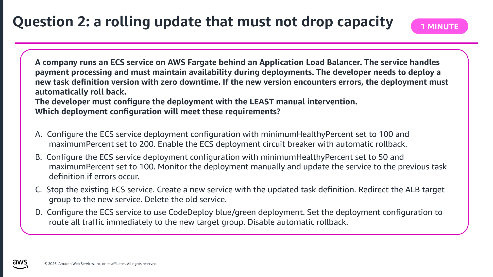

### Question

A company runs an ECS service on AWS Fargate behind an Application Load Balancer. The service handles payment processing and must maintain availability during deployments. The developer needs to deploy a new task definition version with zero downtime. If the new version encounters errors, the deployment must automatically roll back.
The developer must configure the deployment with the LEAST manual intervention.
Which deployment configuration will meet these requirements?

A.  Configure the ECS service deployment configuration with minimumHealthyPercent set to 100 and maximumPercent set to 200. Enable the ECS deployment circuit breaker with automatic rollback.
B.  Configure the ECS service deployment configuration with minimumHealthyPercent set to 50 and maximumPercent set to 100. Monitor the deployment manually and update the service to the previous task definition if errors occur.
C.  Stop the existing ECS service. Create a new service with the updated task definition. Redirect the ALB target group to the new service. Delete the old service.
D.  Configure the ECS service to use CodeDeploy blue/green deployment. Set the deployment configuration to route all traffic immediately to the new target group. Disable automatic rollback.

### Notes

WHAT'S HERE: put question 2 on screen and give the room about 90 seconds to read it in silence and commit to an answer before anyone speaks aloud. That is close to the pace the exam demands, so this rehearses timing as much as content.

Do not reveal or hint at the answer on this beat. The silent read is what makes the key-phrases beat and the reveal land -- if you talk through it now, both lose their effect.

EXAM RELEVANCE: Domain 3: Testing and Deployment. Difficulty: Hard. Watch the room: if most people have answered by 90 seconds, move on; if they are still reading, give another 20 seconds rather than rushing the discussion that follows.

PARTNER CONTEXT: A partner running payments on Fargate cannot take a maintenance window, and a bad task definition must undo itself rather than wait for someone to notice. Holding minimum healthy capacity at 100 percent while allowing 200 percent lets ECS start the new tasks before draining the old, and the circuit breaker watches task health and rolls back without a person in the loop.

EXAM MAPPING: Domain 3: Testing and Deployment.

---

## Slide 44 — Question 2: a rolling update that must not drop capacity

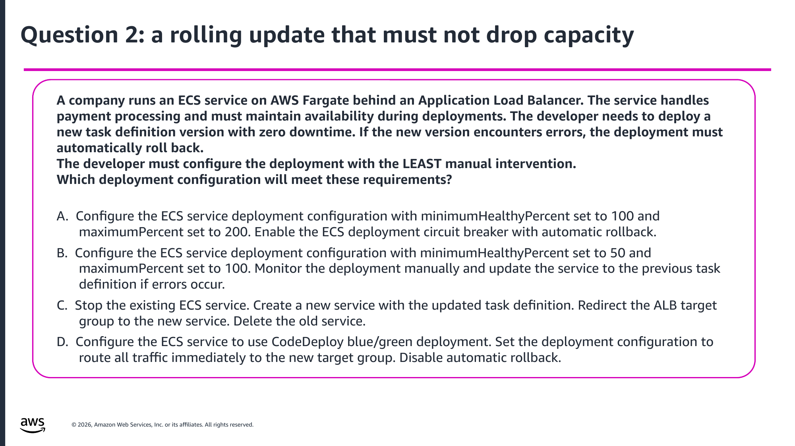

### Question

A company runs an ECS service on AWS Fargate behind an Application Load Balancer. The service handles payment processing and must maintain availability during deployments. The developer needs to deploy a new task definition version with zero downtime. If the new version encounters errors, the deployment must automatically roll back.
The developer must configure the deployment with the LEAST manual intervention.
Which deployment configuration will meet these requirements?

A.  Configure the ECS service deployment configuration with minimumHealthyPercent set to 100 and maximumPercent set to 200. Enable the ECS deployment circuit breaker with automatic rollback.
B.  Configure the ECS service deployment configuration with minimumHealthyPercent set to 50 and maximumPercent set to 100. Monitor the deployment manually and update the service to the previous task definition if errors occur.
C.  Stop the existing ECS service. Create a new service with the updated task definition. Redirect the ALB target group to the new service. Delete the old service.
D.  Configure the ECS service to use CodeDeploy blue/green deployment. Set the deployment configuration to route all traffic immediately to the new target group. Disable automatic rollback.

### Notes

KEY PHRASES: walk the question, do not answer it yet. The phrase that decides it is “zero downtime”, and it tells you: Holding capacity and reverting on failure is the ECS circuit breaker.

WHAT'S HERE: the same question with the timer removed. This beat teaches HOW to read a scenario question -- find the requirement, then find the words that separate options that all look plausible on a first pass.

EXAM RELEVANCE: Domain 3: Testing and Deployment. Difficulty: Hard. Ask the room which words they underlined before you show them the tell, so they practise finding it rather than being handed it.

PARTNER CONTEXT: A partner running payments on Fargate cannot take a maintenance window, and a bad task definition must undo itself rather than wait for someone to notice. Holding minimum healthy capacity at 100 percent while allowing 200 percent lets ECS start the new tasks before draining the old, and the circuit breaker watches task health and rolls back without a person in the loop.

EXAM MAPPING: Domain 3: Testing and Deployment.

---

## Slide 45 — Question 2: a rolling update that must not drop capacity

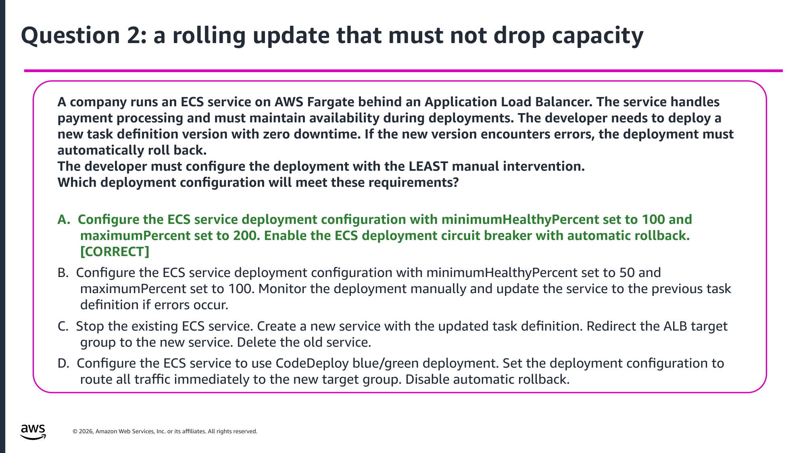

### Question

A company runs an ECS service on AWS Fargate behind an Application Load Balancer. The service handles payment processing and must maintain availability during deployments. The developer needs to deploy a new task definition version with zero downtime. If the new version encounters errors, the deployment must automatically roll back.
The developer must configure the deployment with the LEAST manual intervention.
Which deployment configuration will meet these requirements?

A.  Configure the ECS service deployment configuration with minimumHealthyPercent set to 100 and maximumPercent set to 200. Enable the ECS deployment circuit breaker with automatic rollback.  [CORRECT]
B.  Configure the ECS service deployment configuration with minimumHealthyPercent set to 50 and maximumPercent set to 100. Monitor the deployment manually and update the service to the previous task definition if errors occur.
C.  Stop the existing ECS service. Create a new service with the updated task definition. Redirect the ALB target group to the new service. Delete the old service.
D.  Configure the ECS service to use CodeDeploy blue/green deployment. Set the deployment configuration to route all traffic immediately to the new target group. Disable automatic rollback.

### Notes

ANSWER OVERVIEW: the answer is A. Keep every healthy task, add new ones, let the circuit breaker revert.

A. Configure the ECS service deployment configuration with minimumHealthyPercent set to 100 and maximumPercent set to 200. Enable the ECS deployment circuit breaker with automatic rollback. — Correct — Setting minimumHealthyPercent to 100 ensures the current number of healthy tasks is maintained during deployment. Setting maximumPercent to 200 allows ECS to launch new tasks before draining old ones. The deployment circuit breaker monitors task health and automatically rolls back if the new tasks fail to stabilize, requiring no manual intervention.

B. Configure the ECS service deployment configuration with minimumHealthyPercent set to 50 and maximumPercent set to 100. Monitor the deployment manually and update the service to the previous task definition if errors occur. — Incorrect — Setting minimumHealthyPercent to 50 allows ECS to terminate half of the running tasks before launching new ones. This reduces capacity during deployment and may cause downtime for a payment processing service. Manual monitoring and rollback does not meet the requirement for least manual intervention.

C. Stop the existing ECS service. Create a new service with the updated task definition. Redirect the ALB target group to the new service. Delete the old service. — Incorrect — Stopping the existing service causes downtime while the new service launches and registers with the load balancer. This does not meet the zero-downtime requirement. Additionally, this approach requires manual steps to redirect traffic and delete the old service.

D. Configure the ECS service to use CodeDeploy blue/green deployment. Set the deployment configuration to route all traffic immediately to the new target group. Disable automatic rollback. — Incorrect — Routing all traffic immediately to the new target group without canary or linear shifting risks exposing all users to a faulty deployment simultaneously. Disabling automatic rollback contradicts the requirement for automatic rollback on errors. This configuration requires manual intervention to roll back.

EXAM RELEVANCE: Domain 3: Testing and Deployment. Difficulty: Hard.

SOURCE: https://docs.aws.amazon.com/AmazonECS/latest/developerguide/deployment-circuit-breaker.html

---

## Slide 46 — Question 2: a rolling update that must not drop capacity

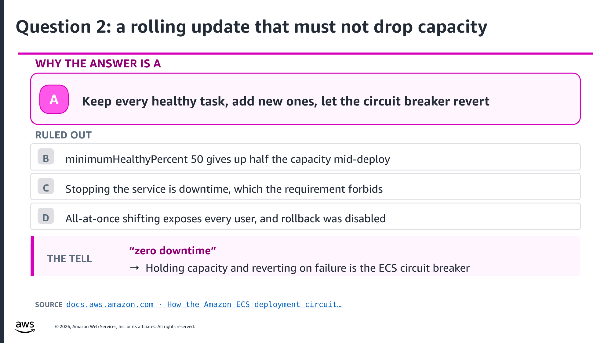

### Notes

WHAT'S HERE: the elimination, made visible. A win because keep every healthy task, add new ones, let the circuit breaker revert. The others are ruled out for one reason each: B — minimumHealthyPercent 50 gives up half the capacity mid-deploy; C — Stopping the service is downtime, which the requirement forbids; D — All-at-once shifting exposes every user, and rollback was disabled. Read the tell strip aloud -- pairing a phrase with what it signals is the transferable skill, not memorizing the service name.

EXAM RELEVANCE: Domain 3: Testing and Deployment. Difficulty: Hard. The pattern to teach: a scenario question rarely offers three absurd options. It offers ones that match a nearby requirement and one (or two) that match the requirement exactly. Here the discriminator is “zero downtime”, which points at Holding capacity and reverting on failure is the ECS circuit breaker. Encourage the room to name the phrase before naming the service.

PARTNER CONTEXT: A partner running payments on Fargate cannot take a maintenance window, and a bad task definition must undo itself rather than wait for someone to notice. Holding minimum healthy capacity at 100 percent while allowing 200 percent lets ECS start the new tasks before draining the old, and the circuit breaker watches task health and rolls back without a person in the loop.

SOURCE: https://docs.aws.amazon.com/AmazonECS/latest/developerguide/deployment-circuit-breaker.html

---

## Slide 47 — Question 3: where a manual approval belongs

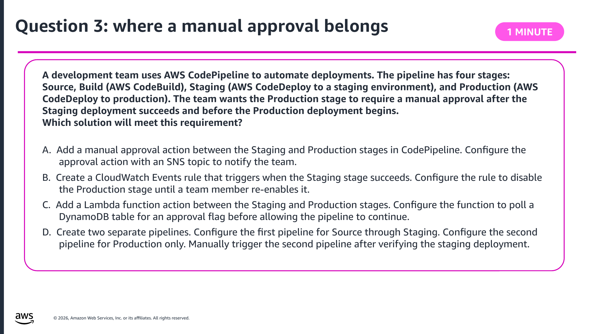

### Question

A development team uses AWS CodePipeline to automate deployments. The pipeline has four stages: Source, Build (AWS CodeBuild), Staging (AWS CodeDeploy to a staging environment), and Production (AWS CodeDeploy to production). The team wants the Production stage to require a manual approval after the Staging deployment succeeds and before the Production deployment begins.
Which solution will meet this requirement?

A.  Add a manual approval action between the Staging and Production stages in CodePipeline. Configure the approval action with an SNS topic to notify the team.
B.  Create a CloudWatch Events rule that triggers when the Staging stage succeeds. Configure the rule to disable the Production stage until a team member re-enables it.
C.  Add a Lambda function action between the Staging and Production stages. Configure the function to poll a DynamoDB table for an approval flag before allowing the pipeline to continue.
D.  Create two separate pipelines. Configure the first pipeline for Source through Staging. Configure the second pipeline for Production only. Manually trigger the second pipeline after verifying the staging deployment.

### Notes

WHAT'S HERE: put question 3 on screen and give the room about 90 seconds to read it in silence and commit to an answer before anyone speaks aloud. That is close to the pace the exam demands, so this rehearses timing as much as content.

Do not reveal or hint at the answer on this beat. The silent read is what makes the key-phrases beat and the reveal land -- if you talk through it now, both lose their effect.

EXAM RELEVANCE: Domain 3: Testing and Deployment. Difficulty: Medium. Watch the room: if most people have answered by 90 seconds, move on; if they are still reading, give another 20 seconds rather than rushing the discussion that follows.

PARTNER CONTEXT: A partner with a change-control process needs a named person to sign off before production, and wants that sign-off recorded where the release is. A manual approval action with a notification topic pauses the pipeline and tells the team it is waiting, so the gate lives in the pipeline rather than in a separate ticketing step nobody links back to the build.

EXAM MAPPING: Domain 3: Testing and Deployment.

---

## Slide 48 — Question 3: where a manual approval belongs

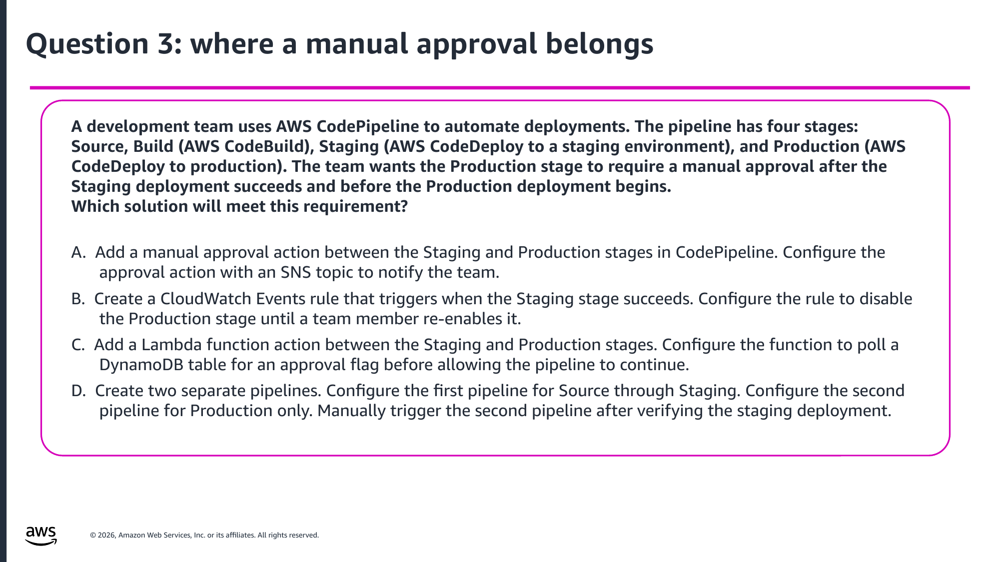

### Question

A development team uses AWS CodePipeline to automate deployments. The pipeline has four stages: Source, Build (AWS CodeBuild), Staging (AWS CodeDeploy to a staging environment), and Production (AWS CodeDeploy to production). The team wants the Production stage to require a manual approval after the Staging deployment succeeds and before the Production deployment begins.
Which solution will meet this requirement?

A.  Add a manual approval action between the Staging and Production stages in CodePipeline. Configure the approval action with an SNS topic to notify the team.
B.  Create a CloudWatch Events rule that triggers when the Staging stage succeeds. Configure the rule to disable the Production stage until a team member re-enables it.
C.  Add a Lambda function action between the Staging and Production stages. Configure the function to poll a DynamoDB table for an approval flag before allowing the pipeline to continue.
D.  Create two separate pipelines. Configure the first pipeline for Source through Staging. Configure the second pipeline for Production only. Manually trigger the second pipeline after verifying the staging deployment.

### Notes

KEY PHRASES: walk the question, do not answer it yet. The phrase that decides it is “require a manual approval after the Staging deployment succeeds”, and it tells you: A human gate between two stages is a CodePipeline manual approval action.

WHAT'S HERE: the same question with the timer removed. This beat teaches HOW to read a scenario question -- find the requirement, then find the words that separate options that all look plausible on a first pass.

EXAM RELEVANCE: Domain 3: Testing and Deployment. Difficulty: Medium. Ask the room which words they underlined before you show them the tell, so they practise finding it rather than being handed it.

PARTNER CONTEXT: A partner with a change-control process needs a named person to sign off before production, and wants that sign-off recorded where the release is. A manual approval action with a notification topic pauses the pipeline and tells the team it is waiting, so the gate lives in the pipeline rather than in a separate ticketing step nobody links back to the build.

EXAM MAPPING: Domain 3: Testing and Deployment.

---

## Slide 49 — Question 3: where a manual approval belongs

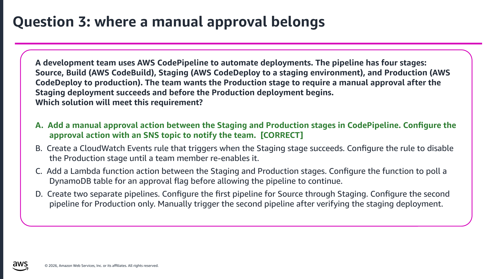

### Question

A development team uses AWS CodePipeline to automate deployments. The pipeline has four stages: Source, Build (AWS CodeBuild), Staging (AWS CodeDeploy to a staging environment), and Production (AWS CodeDeploy to production). The team wants the Production stage to require a manual approval after the Staging deployment succeeds and before the Production deployment begins.
Which solution will meet this requirement?

A.  Add a manual approval action between the Staging and Production stages in CodePipeline. Configure the approval action with an SNS topic to notify the team.  [CORRECT]
B.  Create a CloudWatch Events rule that triggers when the Staging stage succeeds. Configure the rule to disable the Production stage until a team member re-enables it.
C.  Add a Lambda function action between the Staging and Production stages. Configure the function to poll a DynamoDB table for an approval flag before allowing the pipeline to continue.
D.  Create two separate pipelines. Configure the first pipeline for Source through Staging. Configure the second pipeline for Production only. Manually trigger the second pipeline after verifying the staging deployment.

### Notes

ANSWER OVERVIEW: the answer is A. A manual approval action pauses the pipeline until someone approves.

A. Add a manual approval action between the Staging and Production stages in CodePipeline. Configure the approval action with an SNS topic to notify the team. — Correct — CodePipeline supports manual approval actions as a stage transition gate. The approval action pauses the pipeline until an authorized user approves or rejects the action. Configuring an SNS topic sends a notification to the team when approval is pending. The pipeline proceeds to Production only after approval.

B. Create a CloudWatch Events rule that triggers when the Staging stage succeeds. Configure the rule to disable the Production stage until a team member re-enables it. — Incorrect — CloudWatch Events (EventBridge) can detect pipeline stage changes. However, CodePipeline stages cannot be independently enabled or disabled. Pipeline execution flows through stages based on the pipeline definition and transition states. The native manual approval action is the intended mechanism for this use case.

C. Add a Lambda function action between the Staging and Production stages. Configure the function to poll a DynamoDB table for an approval flag before allowing the pipeline to continue. — Incorrect — A Lambda action can implement custom logic in a pipeline. However, CodePipeline has a built-in manual approval action that provides this capability natively. Using a Lambda function with DynamoDB polling adds complexity, requires custom code maintenance, and introduces potential reliability issues.

D. Create two separate pipelines. Configure the first pipeline for Source through Staging. Configure the second pipeline for Production only. Manually trigger the second pipeline after verifying the staging deployment. — Incorrect — Splitting into two pipelines breaks the end-to-end traceability of a single deployment. Manual triggering does not integrate with CodePipeline's native approval workflow and loses the connection between source revision and production deployment. A single pipeline with an approval action maintains the full deployment chain.

EXAM RELEVANCE: Domain 3: Testing and Deployment. Difficulty: Medium.

SOURCE: https://docs.aws.amazon.com/codepipeline/latest/userguide/approvals.html

---

## Slide 50 — Question 3: where a manual approval belongs

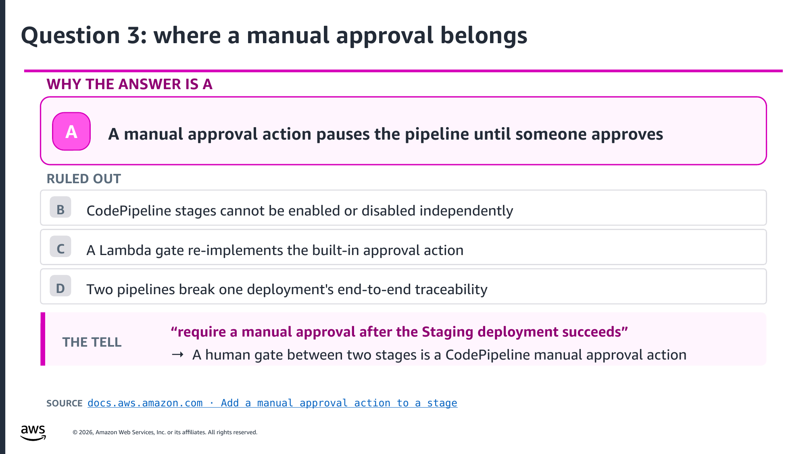

### Notes

WHAT'S HERE: the elimination, made visible. A win because a manual approval action pauses the pipeline until someone approves. The others are ruled out for one reason each: B — CodePipeline stages cannot be enabled or disabled independently; C — A Lambda gate re-implements the built-in approval action; D — Two pipelines break one deployment's end-to-end traceability. Read the tell strip aloud -- pairing a phrase with what it signals is the transferable skill, not memorizing the service name.

EXAM RELEVANCE: Domain 3: Testing and Deployment. Difficulty: Medium. The pattern to teach: a scenario question rarely offers three absurd options. It offers ones that match a nearby requirement and one (or two) that match the requirement exactly. Here the discriminator is “require a manual approval after the Staging deployment succeeds”, which points at A human gate between two stages is a CodePipeline manual approval action. Encourage the room to name the phrase before naming the service.

PARTNER CONTEXT: A partner with a change-control process needs a named person to sign off before production, and wants that sign-off recorded where the release is. A manual approval action with a notification topic pauses the pipeline and tells the team it is waiting, so the gate lives in the pipeline rather than in a separate ticketing step nobody links back to the build.

SOURCE: https://docs.aws.amazon.com/codepipeline/latest/userguide/approvals.html

---

## Slide 51 — Question 4: what a SAM deployment actually creates

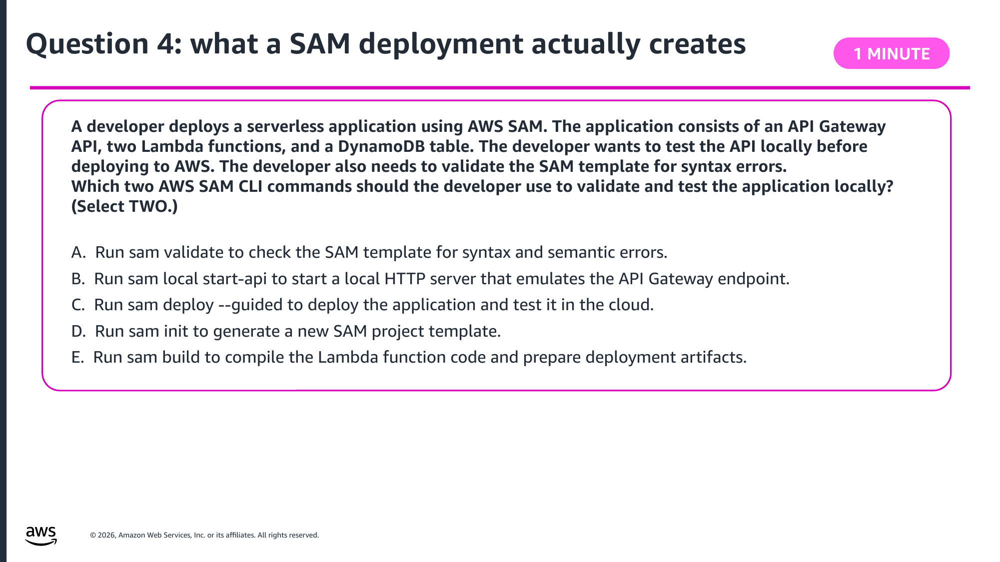

### Question

A developer deploys a serverless application using AWS SAM. The application consists of an API Gateway API, two Lambda functions, and a DynamoDB table. The developer wants to test the API locally before deploying to AWS. The developer also needs to validate the SAM template for syntax errors.
Which two AWS SAM CLI commands should the developer use to validate and test the application locally? (Select TWO.)

A.  Run sam validate to check the SAM template for syntax and semantic errors.
B.  Run sam local start-api to start a local HTTP server that emulates the API Gateway endpoint.
C.  Run sam deploy --guided to deploy the application and test it in the cloud.
D.  Run sam init to generate a new SAM project template.
E.  Run sam build to compile the Lambda function code and prepare deployment artifacts.

### Notes

WHAT'S HERE: put question 4 on screen and give the room about 90 seconds to read it in silence and commit to an answer before anyone speaks aloud. Note this is a select-two question, so tell the room to expect more than one answer. That is close to the pace the exam demands, so this rehearses timing as much as content.

Do not reveal or hint at the answer on this beat. The silent read is what makes the key-phrases beat and the reveal land -- if you talk through it now, both lose their effect.

EXAM RELEVANCE: Domain 3: Testing and Deployment. Difficulty: Medium. Watch the room: if most people have answered by 90 seconds, move on; if they are still reading, give another 20 seconds rather than rushing the discussion that follows.

PARTNER CONTEXT: A partner iterating on a serverless API wants the feedback loop off the cloud. Validating the template catches a malformed resource before any deploy, and a local API server lets them exercise the function over HTTP on their own machine. Worth saying out loud that this is a select-two question because the two needs in the stem -- validate, and test locally -- are answered by different commands.

EXAM MAPPING: Domain 3: Testing and Deployment.

---

## Slide 52 — Question 4: what a SAM deployment actually creates

### Question

A developer deploys a serverless application using AWS SAM. The application consists of an API Gateway API, two Lambda functions, and a DynamoDB table. The developer wants to test the API locally before deploying to AWS. The developer also needs to validate the SAM template for syntax errors.
Which two AWS SAM CLI commands should the developer use to validate and test the application locally? (Select TWO.)

A.  Run sam validate to check the SAM template for syntax and semantic errors.
B.  Run sam local start-api to start a local HTTP server that emulates the API Gateway endpoint.
C.  Run sam deploy --guided to deploy the application and test it in the cloud.
D.  Run sam init to generate a new SAM project template.
E.  Run sam build to compile the Lambda function code and prepare deployment artifacts.

### Notes

KEY PHRASES: walk the question, do not answer it yet. The phrase that decides it is “test the API locally before deploying”, and it tells you: Local testing plus template checking is two separate SAM CLI commands, not one.

WHAT'S HERE: the same question with the timer removed. This beat teaches HOW to read a scenario question -- find the requirement, then find the words that separate options that all look plausible on a first pass.

EXAM RELEVANCE: Domain 3: Testing and Deployment. Difficulty: Medium. Ask the room which words they underlined before you show them the tell, so they practise finding it rather than being handed it.

PARTNER CONTEXT: A partner iterating on a serverless API wants the feedback loop off the cloud. Validating the template catches a malformed resource before any deploy, and a local API server lets them exercise the function over HTTP on their own machine. Worth saying out loud that this is a select-two question because the two needs in the stem -- validate, and test locally -- are answered by different commands.

EXAM MAPPING: Domain 3: Testing and Deployment.

---

## Slide 53 — Question 4: what a SAM deployment actually creates

### Question

A developer deploys a serverless application using AWS SAM. The application consists of an API Gateway API, two Lambda functions, and a DynamoDB table. The developer wants to test the API locally before deploying to AWS. The developer also needs to validate the SAM template for syntax errors.
Which two AWS SAM CLI commands should the developer use to validate and test the application locally? (Select TWO.)

A.  Run sam validate to check the SAM template for syntax and semantic errors.  [CORRECT]
B.  Run sam local start-api to start a local HTTP server that emulates the API Gateway endpoint.  [CORRECT]
C.  Run sam deploy --guided to deploy the application and test it in the cloud.
D.  Run sam init to generate a new SAM project template.
E.  Run sam build to compile the Lambda function code and prepare deployment artifacts.

### Notes

ANSWER OVERVIEW: the answer is A and B. One command validates the template, another serves the API locally.

A. Run sam validate to check the SAM template for syntax and semantic errors. — Correct — The sam validate command checks the SAM template for correctness. It validates the template against the SAM specification and reports syntax errors, missing required properties, and invalid resource configurations before deployment.

B. Run sam local start-api to start a local HTTP server that emulates the API Gateway endpoint. — Correct — The sam local start-api command starts a local HTTP server that hosts all API Gateway endpoints defined in the SAM template. The developer can send HTTP requests to localhost to test the Lambda function integration locally without deploying to AWS.

C. Run sam deploy --guided to deploy the application and test it in the cloud. — Incorrect — The sam deploy command deploys the application to AWS. The requirement is to test locally before deploying. Deploying to test contradicts the requirement for local testing and incurs AWS resource costs.

D. Run sam init to generate a new SAM project template. — Incorrect — The sam init command creates a new SAM project from a template. The developer already has an existing application. Running sam init would create a new project rather than testing the existing one.

E. Run sam build to compile the Lambda function code and prepare deployment artifacts. — Incorrect — The sam build command processes your Lambda source code and builds deployment artifacts. While building is a prerequisite for local testing and deployment, it does not validate the template syntax or start a local API server. It does not address either of the two stated requirements directly.

EXAM RELEVANCE: Domain 3: Testing and Deployment. Difficulty: Medium.

SOURCE: https://docs.aws.amazon.com/serverless-application-model/latest/developerguide/sam-cli-command-reference-sam-local-start-api.html

---

## Slide 54 — Question 4: what a SAM deployment actually creates

### Notes

WHAT'S HERE: the elimination, made visible. A and B are both required: one command validates the template, another serves the API locally. The others are ruled out for one reason each: C — Deploying in order to test contradicts testing locally first; D — sam init starts a new project; this application already exists; E — sam build prepares artifacts but validates nothing. Read the tell strip aloud -- pairing a phrase with what it signals is the transferable skill, not memorizing the service name.

EXAM RELEVANCE: Domain 3: Testing and Deployment. Difficulty: Medium. The pattern to teach: a scenario question rarely offers three absurd options. It offers ones that match a nearby requirement and one (or two) that match the requirement exactly. Here the discriminator is “test the API locally before deploying”, which points at Local testing plus template checking is two separate SAM CLI commands, not one. Encourage the room to name the phrase before naming the service.

PARTNER CONTEXT: A partner iterating on a serverless API wants the feedback loop off the cloud. Validating the template catches a malformed resource before any deploy, and a local API server lets them exercise the function over HTTP on their own machine. Worth saying out loud that this is a select-two question because the two needs in the stem -- validate, and test locally -- are answered by different commands.

SOURCE: https://docs.aws.amazon.com/serverless-application-model/latest/developerguide/sam-cli-command-reference-sam-local-start-api.html

Also verified against: https://docs.aws.amazon.com/serverless-application-model/latest/developerguide/sam-cli-command-reference-sam-validate.html  -- this question needs TWO commands, so it has two carrying pages; the slide cites the one holding the tell.

---

## Slide 55 — Question 5: shifting traffic to a new function version

### Question

A company deploys an order processing function on AWS Lambda through AWS CodeDeploy. For each release, the team must send 10 percent of production traffic to the new function version, hold that split for 5 minutes, and then shift all remaining traffic. The deployment must roll back automatically if an Amazon CloudWatch alarm enters the ALARM state during the shift.
Which CodeDeploy deployment configuration will meet these requirements?

A.  CodeDeployDefault.LambdaCanary10Percent15Minutes
B.  CodeDeployDefault.LambdaCanary10Percent5Minutes
C.  CodeDeployDefault.LambdaLinear10PercentEvery1Minute
D.  CodeDeployDefault.LambdaLinear10PercentEvery3Minutes

### Notes

WHAT'S HERE: put question 5 on screen and give the room about 90 seconds to read it in silence and commit to an answer before anyone speaks aloud. That is close to the pace the exam demands, so this rehearses timing as much as content.

Do not reveal or hint at the answer on this beat. The silent read is what makes the key-phrases beat and the reveal land -- if you talk through it now, both lose their effect.

EXAM RELEVANCE: Domain 3: Testing and Deployment. Difficulty: Medium. Watch the room: if most people have answered by 90 seconds, move on; if they are still reading, give another 20 seconds rather than rushing the discussion that follows.

PARTNER CONTEXT: A partner releasing an order function wants a small slice of real traffic on the new version before committing, and an automatic reversal if an alarm fires during the shift. The configuration name itself carries the two numbers, which is the fastest way to read these options: a canary holds one step, a linear shift moves in equal increments, and all-at-once does neither.

EXAM MAPPING: Domain 3: Testing and Deployment.

---

## Slide 56 — Question 5: shifting traffic to a new function version

### Question

A company deploys an order processing function on AWS Lambda through AWS CodeDeploy. For each release, the team must send 10 percent of production traffic to the new function version, hold that split for 5 minutes, and then shift all remaining traffic. The deployment must roll back automatically if an Amazon CloudWatch alarm enters the ALARM state during the shift.
Which CodeDeploy deployment configuration will meet these requirements?

A.  CodeDeployDefault.LambdaCanary10Percent15Minutes
B.  CodeDeployDefault.LambdaCanary10Percent5Minutes
C.  CodeDeployDefault.LambdaLinear10PercentEvery1Minute
D.  CodeDeployDefault.LambdaLinear10PercentEvery3Minutes

### Notes

KEY PHRASES: walk the question, do not answer it yet. The phrase that decides it is “hold that split for 5 minutes”, and it tells you: A fixed percentage held for a fixed interval is a canary, not a linear shift.

WHAT'S HERE: the same question with the timer removed. This beat teaches HOW to read a scenario question -- find the requirement, then find the words that separate options that all look plausible on a first pass.

EXAM RELEVANCE: Domain 3: Testing and Deployment. Difficulty: Medium. Ask the room which words they underlined before you show them the tell, so they practise finding it rather than being handed it.

PARTNER CONTEXT: A partner releasing an order function wants a small slice of real traffic on the new version before committing, and an automatic reversal if an alarm fires during the shift. The configuration name itself carries the two numbers, which is the fastest way to read these options: a canary holds one step, a linear shift moves in equal increments, and all-at-once does neither.

EXAM MAPPING: Domain 3: Testing and Deployment.

---

## Slide 57 — Question 5: shifting traffic to a new function version

### Question

A company deploys an order processing function on AWS Lambda through AWS CodeDeploy. For each release, the team must send 10 percent of production traffic to the new function version, hold that split for 5 minutes, and then shift all remaining traffic. The deployment must roll back automatically if an Amazon CloudWatch alarm enters the ALARM state during the shift.
Which CodeDeploy deployment configuration will meet these requirements?

A.  CodeDeployDefault.LambdaCanary10Percent15Minutes
B.  CodeDeployDefault.LambdaCanary10Percent5Minutes  [CORRECT]
C.  CodeDeployDefault.LambdaLinear10PercentEvery1Minute
D.  CodeDeployDefault.LambdaLinear10PercentEvery3Minutes

### Notes

ANSWER OVERVIEW: the answer is B. The canary configuration names both the percentage and the interval.

A. CodeDeployDefault.LambdaCanary10Percent15Minutes — Incorrect — This configuration shifts 10 percent of traffic and then waits 15 minutes before shifting the remainder. The traffic split matches the requirement but the interval does not, so each release would hold the canary 10 minutes longer than specified.

B. CodeDeployDefault.LambdaCanary10Percent5Minutes — Correct — A canary configuration shifts a fixed percentage of traffic, holds it for a set interval, and then shifts everything that remains. This configuration sends 10 percent of traffic to the new version for 5 minutes and then completes the shift, which matches the requirement. CodeDeploy rolls the deployment back automatically when a configured CloudWatch alarm enters the ALARM state. Percentage-based traffic shifting is available on the Lambda and Amazon ECS compute platforms.

C. CodeDeployDefault.LambdaLinear10PercentEvery1Minute — Incorrect — A linear configuration moves traffic in equal increments instead of holding a single canary split. This shifts 10 percent every minute across ten steps, so traffic never rests at 10 percent for 5 minutes before the full shift.

D. CodeDeployDefault.LambdaLinear10PercentEvery3Minutes — Incorrect — This configuration also moves traffic in equal 10 percent increments, three minutes apart. It produces a gradual rollout across thirty minutes rather than the 10 percent canary followed by a single full shift that the requirement describes.

EXAM RELEVANCE: Domain 3: Testing and Deployment. Difficulty: Medium.

SOURCE: https://docs.aws.amazon.com/codedeploy/latest/userguide/deployment-configurations.html

---

## Slide 58 — Question 5: shifting traffic to a new function version

### Notes

WHAT'S HERE: the elimination, made visible. B win because the canary configuration names both the percentage and the interval. The others are ruled out for one reason each: A — The right canary split, but it waits fifteen minutes not five; C — Linear shifts in steps, so traffic never holds at 10 percent; D — Also linear -- a gradual ramp rather than a canary that holds. Read the tell strip aloud -- pairing a phrase with what it signals is the transferable skill, not memorizing the service name.

EXAM RELEVANCE: Domain 3: Testing and Deployment. Difficulty: Medium. The pattern to teach: a scenario question rarely offers three absurd options. It offers ones that match a nearby requirement and one (or two) that match the requirement exactly. Here the discriminator is “hold that split for 5 minutes”, which points at A fixed percentage held for a fixed interval is a canary, not a linear shift. Encourage the room to name the phrase before naming the service.

PARTNER CONTEXT: A partner releasing an order function wants a small slice of real traffic on the new version before committing, and an automatic reversal if an alarm fires during the shift. The configuration name itself carries the two numbers, which is the fastest way to read these options: a canary holds one step, a linear shift moves in equal increments, and all-at-once does neither.

SOURCE: https://docs.aws.amazon.com/codedeploy/latest/userguide/deployment-configurations.html

---

## Slide 59 — Question 6: tests that a large team keeps skipping

### Question

A company maintains a service that a large team changes frequently. Developers often add functions without matching unit tests, and test coverage has declined over several releases. The company wants unit tests to be generated for a source file every time a developer saves that file, without requiring the developer to start the task.
Which solution will meet these requirements?

A.  Configure a steering file that directs the agent to generate unit tests for every function.
B.  Ask the agent in a chat session to generate unit tests for the changed files each day.
C.  Create a spec with a task for unit test generation and run the spec before each code review.
D.  Configure a hook that triggers on file save and runs an agent task to generate the unit tests.

### Notes

WHAT'S HERE: put question 6 on screen and give the room about 90 seconds to read it in silence and commit to an answer before anyone speaks aloud. That is close to the pace the exam demands, so this rehearses timing as much as content.

Do not reveal or hint at the answer on this beat. The silent read is what makes the key-phrases beat and the reveal land -- if you talk through it now, both lose their effect.

EXAM RELEVANCE: Domain 3: Testing and Deployment. Difficulty: Medium. Watch the room: if most people have answered by 90 seconds, move on; if they are still reading, give another 20 seconds rather than rushing the discussion that follows.

PARTNER CONTEXT: A partner's team adds functions faster than it adds tests, and asking people to remember a step has already failed. A hook attaches the work to the event, so the tests follow the change rather than depending on anyone starting a task. That is the distinction to draw against a spec or a steering file, which describe how work should be done but do not fire on their own.

EXAM MAPPING: Domain 3: Testing and Deployment.

---

## Slide 60 — Question 6: tests that a large team keeps skipping

### Question

A company maintains a service that a large team changes frequently. Developers often add functions without matching unit tests, and test coverage has declined over several releases. The company wants unit tests to be generated for a source file every time a developer saves that file, without requiring the developer to start the task.
Which solution will meet these requirements?

A.  Configure a steering file that directs the agent to generate unit tests for every function.
B.  Ask the agent in a chat session to generate unit tests for the changed files each day.
C.  Create a spec with a task for unit test generation and run the spec before each code review.
D.  Configure a hook that triggers on file save and runs an agent task to generate the unit tests.

### Notes

KEY PHRASES: walk the question, do not answer it yet. The phrase that decides it is “without requiring the developer to start the task”, and it tells you: Work that must start on an event rather than a prompt points at a hook.

WHAT'S HERE: the same question with the timer removed. This beat teaches HOW to read a scenario question -- find the requirement, then find the words that separate options that all look plausible on a first pass.

EXAM RELEVANCE: Domain 3: Testing and Deployment. Difficulty: Medium. Ask the room which words they underlined before you show them the tell, so they practise finding it rather than being handed it.

PARTNER CONTEXT: A partner's team adds functions faster than it adds tests, and asking people to remember a step has already failed. A hook attaches the work to the event, so the tests follow the change rather than depending on anyone starting a task. That is the distinction to draw against a spec or a steering file, which describe how work should be done but do not fire on their own.

EXAM MAPPING: Domain 3: Testing and Deployment.

---

## Slide 61 — Question 6: tests that a large team keeps skipping

### Question

A company maintains a service that a large team changes frequently. Developers often add functions without matching unit tests, and test coverage has declined over several releases. The company wants unit tests to be generated for a source file every time a developer saves that file, without requiring the developer to start the task.
Which solution will meet these requirements?

A.  Configure a steering file that directs the agent to generate unit tests for every function.
B.  Ask the agent in a chat session to generate unit tests for the changed files each day.
C.  Create a spec with a task for unit test generation and run the spec before each code review.
D.  Configure a hook that triggers on file save and runs an agent task to generate the unit tests.  [CORRECT]

### Notes

ANSWER OVERVIEW: the answer is D. A hook runs an agent task automatically on a file-save event.

A. Configure a steering file that directs the agent to generate unit tests for every function. — Incorrect — A steering file records conventions that shape generated output, but it does not run on an event. Nothing would generate the tests when a developer saves a file, so coverage would still depend on someone asking for the tests.

B. Ask the agent in a chat session to generate unit tests for the changed files each day. — Incorrect — A chat request is started by a developer, so it is the manual step the company wants to remove. Work that is saved between requests stays untested until someone remembers to ask.

C. Create a spec with a task for unit test generation and run the spec before each code review. — Incorrect — A spec organizes planned work into requirements, design, and tasks, and a developer runs it. It is not triggered by a file save, so tests would be generated only at review time rather than on every change.

D. Configure a hook that triggers on file save and runs an agent task to generate the unit tests. — Correct — Hooks run an agent task automatically when a chosen event occurs, and a file save is one of the supported triggers. Generating the unit tests from the save event meets both requirements, because the tests follow every change and the developer does not start the task.

EXAM RELEVANCE: Domain 3: Testing and Deployment. Difficulty: Medium.

SOURCE: https://kiro.dev/docs/hooks/

---

## Slide 62 — Question 6: tests that a large team keeps skipping

### Notes

WHAT'S HERE: the elimination, made visible. D win because a hook runs an agent task automatically on a file-save event. The others are ruled out for one reason each: A — A steering file shapes generated output but runs on no event; B — A chat request is the manual step being removed; C — A developer runs a spec; a file save does not. Read the tell strip aloud -- pairing a phrase with what it signals is the transferable skill, not memorizing the service name.

EXAM RELEVANCE: Domain 3: Testing and Deployment. Difficulty: Medium. The pattern to teach: a scenario question rarely offers three absurd options. It offers ones that match a nearby requirement and one (or two) that match the requirement exactly. Here the discriminator is “without requiring the developer to start the task”, which points at Work that must start on an event rather than a prompt points at a hook. Encourage the room to name the phrase before naming the service.

PARTNER CONTEXT: A partner's team adds functions faster than it adds tests, and asking people to remember a step has already failed. A hook attaches the work to the event, so the tests follow the change rather than depending on anyone starting a task. That is the distinction to draw against a spec or a steering file, which describe how work should be done but do not fire on their own.

SOURCE: https://kiro.dev/docs/hooks/

---

## Slide 63 — Question 7: promoting one build from test to production

### Question

A company deploys an application through a pipeline that promotes builds to a test environment and then to production. After each deployment to the test environment, a developer reviews application logs by hand and confirms a set of validation checks before promoting the build. The company must run this post-deployment validation inside the pipeline and stop the promotion automatically when a check does not pass.
Which solution will meet these requirements?

A.  Add a manual approval action to the pipeline so that a developer confirms the checks first.
B.  Add a pipeline stage that runs the agent in headless mode and returns a non-zero exit code on failure.
C.  Install the agent's integrated development environment on the build host and script its interface.
D.  Add a pipeline stage that publishes the application logs to a notification topic for review.

### Notes

WHAT'S HERE: put question 7 on screen and give the room about 90 seconds to read it in silence and commit to an answer before anyone speaks aloud. That is close to the pace the exam demands, so this rehearses timing as much as content.

Do not reveal or hint at the answer on this beat. The silent read is what makes the key-phrases beat and the reveal land -- if you talk through it now, both lose their effect.

EXAM RELEVANCE: Domain 3: Testing and Deployment. Difficulty: Medium. Watch the room: if most people have answered by 90 seconds, move on; if they are still reading, give another 20 seconds rather than rushing the discussion that follows.

PARTNER CONTEXT: A partner promotes to production after someone reads the logs by hand, which makes the release wait on a person and go unrecorded. Running the agent non-interactively inside a pipeline stage performs the same checks and returns an exit code, so a failure stops the promotion by itself. The pipeline, not a reviewer, becomes the thing that holds the release.

EXAM MAPPING: Domain 3: Testing and Deployment.

---

## Slide 64 — Question 7: promoting one build from test to production

### Question

A company deploys an application through a pipeline that promotes builds to a test environment and then to production. After each deployment to the test environment, a developer reviews application logs by hand and confirms a set of validation checks before promoting the build. The company must run this post-deployment validation inside the pipeline and stop the promotion automatically when a check does not pass.
Which solution will meet these requirements?

A.  Add a manual approval action to the pipeline so that a developer confirms the checks first.
B.  Add a pipeline stage that runs the agent in headless mode and returns a non-zero exit code on failure.
C.  Install the agent's integrated development environment on the build host and script its interface.
D.  Add a pipeline stage that publishes the application logs to a notification topic for review.

### Notes

KEY PHRASES: walk the question, do not answer it yet. The phrase that decides it is “stop the promotion automatically when a check does not pass”, and it tells you: Automated validation inside a pipeline needs a non-interactive run and an exit code.

WHAT'S HERE: the same question with the timer removed. This beat teaches HOW to read a scenario question -- find the requirement, then find the words that separate options that all look plausible on a first pass.

EXAM RELEVANCE: Domain 3: Testing and Deployment. Difficulty: Medium. Ask the room which words they underlined before you show them the tell, so they practise finding it rather than being handed it.

PARTNER CONTEXT: A partner promotes to production after someone reads the logs by hand, which makes the release wait on a person and go unrecorded. Running the agent non-interactively inside a pipeline stage performs the same checks and returns an exit code, so a failure stops the promotion by itself. The pipeline, not a reviewer, becomes the thing that holds the release.

EXAM MAPPING: Domain 3: Testing and Deployment.

---

## Slide 65 — Question 7: promoting one build from test to production

### Question

A company deploys an application through a pipeline that promotes builds to a test environment and then to production. After each deployment to the test environment, a developer reviews application logs by hand and confirms a set of validation checks before promoting the build. The company must run this post-deployment validation inside the pipeline and stop the promotion automatically when a check does not pass.
Which solution will meet these requirements?

A.  Add a manual approval action to the pipeline so that a developer confirms the checks first.
B.  Add a pipeline stage that runs the agent in headless mode and returns a non-zero exit code on failure.  [CORRECT]
C.  Install the agent's integrated development environment on the build host and script its interface.
D.  Add a pipeline stage that publishes the application logs to a notification topic for review.

### Notes

ANSWER OVERVIEW: the answer is B. Headless mode runs with no session and fails the stage on a non-zero exit.

A. Add a manual approval action to the pipeline so that a developer confirms the checks first. — Incorrect — A manual approval action still depends on a person reviewing the logs and deciding, which is the work the company is automating. It also cannot fail the pipeline based on the outcome of a check.

B. Add a pipeline stage that runs the agent in headless mode and returns a non-zero exit code on failure. — Correct — Headless mode runs the agent from the command line with no interactive session, which is the supported way to use it inside a pipeline. The stage performs the validation checks and returns an exit code, and a non-zero code fails the stage so the promotion stops without a person reviewing the logs.

C. Install the agent's integrated development environment on the build host and script its interface. — Incorrect — The integrated development environment is built for interactive use and is not intended to be driven by a script on a build host. Headless mode exists for automated environments, so this adds fragility without meeting the requirement.

D. Add a pipeline stage that publishes the application logs to a notification topic for review. — Incorrect — Publishing the logs to a notification topic delivers them to subscribers but performs no validation. A person still evaluates the checks, and the pipeline cannot stop the promotion on a failed check.

EXAM RELEVANCE: Domain 3: Testing and Deployment. Difficulty: Medium.

SOURCE: https://kiro.dev/docs/cli/headless/

---

## Slide 66 — Question 7: promoting one build from test to production

### Notes

WHAT'S HERE: the elimination, made visible. B win because headless mode runs with no session and fails the stage on a non-zero exit. The others are ruled out for one reason each: A — Manual approval keeps the person the company is automating away; C — The IDE is interactive; headless mode exists for build hosts; D — Publishing logs notifies people but validates nothing. Read the tell strip aloud -- pairing a phrase with what it signals is the transferable skill, not memorizing the service name.

EXAM RELEVANCE: Domain 3: Testing and Deployment. Difficulty: Medium. The pattern to teach: a scenario question rarely offers three absurd options. It offers ones that match a nearby requirement and one (or two) that match the requirement exactly. Here the discriminator is “stop the promotion automatically when a check does not pass”, which points at Automated validation inside a pipeline needs a non-interactive run and an exit code. Encourage the room to name the phrase before naming the service.

PARTNER CONTEXT: A partner promotes to production after someone reads the logs by hand, which makes the release wait on a person and go unrecorded. Running the agent non-interactively inside a pipeline stage performs the same checks and returns an exit code, so a failure stops the promotion by itself. The pipeline, not a reviewer, becomes the thing that holds the release.

SOURCE: https://kiro.dev/docs/cli/headless/

---

## Slide 67 — Coming up: Week 5 digital training

### Notes

WHAT'S HERE: A preview of next week's training so people can get a head start whenever they are ready. The left card is the free Learning Plan; the right card is the optional Exam Prep Plan a subscriber can add.

FACILITATOR: Keep this light -- it is a look ahead, not an assignment for today. Week 5 is the final week of digital training, and its shape is different from this one: four of the seven courses are troubleshooting titles, which is where the C03 weighting rose the most.

Point out that the practice question set and the practice exam both sit in week 5, so anyone pacing themselves should leave room for them rather than saving them for the last evening.

Note: these are the course titles as they appear in Skill Builder, including the one that still says DVA-C02, because that is the live exam. The appendix at the end of this deck explains the C02 to C03 difference for anyone who needs it.

---

## Slide 68 — Q&A time

### Notes

FACILITATOR: Open the floor. This is the natural place for the deployment questions people have been holding, and the ones worth drawing out are about choosing between the services rather than about any one of them.

If the room is quiet, the how-to-choose slide is the best prompt -- ask which row they would have got wrong before today.

Two questions come up most often in this session. The first is whether CDK replaces CloudFormation, and the answer is that it synthesizes to it. The second is whether a database belongs inside an Elastic Beanstalk environment, and the answer is no, because it shares the environment's lifecycle.

If a question needs a source rather than an answer, the appendix and the citation rows on each slide are where to send them.

---

## Slide 69 — Thank you

### Notes

FACILITATOR: Close by naming what the session covered and what comes next, so the arc is explicit rather than implied.

This week was testing and deployment: the pipeline services, the infrastructure as code surfaces, and deploying to containers. Week 5 is the final week, and it turns to troubleshooting and optimization.

Remind the room that the week-5 digital training is previewed two slides back, and that the practice exam sits in it.

Thank them for the questions specifically, not just for attending -- the discussion is what makes the live session worth more than the recording.

---

## Slide 70 — Appendix -- DVA-C02 reference

### Notes

APPENDIX: divider. This block is self-study reference for anyone who plans to sit DVA-C02 rather than C03. It is not taught in the session -- point the room at it and move on. The three appendix slides sit together at the end of the deck by design.

WHAT'S HERE: The session decks are built for DVA-C03. This appendix collects what a C02 candidate needs that the C03 body does not spell out: how the exam guide's weightings shifted, and what changed for this week's topics.

EXAM RELEVANCE: Week 4 is the week where the domain itself is renamed. C02 calls this domain Deployment; C03 calls it Testing and Deployment, and the testing skills consolidate. So a C02 candidate reading a C03 deck needs to know the domain boundary moved, not just the percentages.

REFERENCE: The C02 figures come from the DVA-C02 exam guide; the C03 figures come from the September 2026 certification updates blog. Both are linked from the delta slides that follow. EXAM MAPPING: DVA-C02 to DVA-C03 comparison.

---

## Slide 71 — How C02 and C03 differ for this week

### Notes

APPENDIX: week-4 delta table. Walk the left column first: the four domain weightings barely move. Development eases from 32% to 30%, Security holds at 26%, Testing and Deployment eases from 24% to 22%, and Troubleshooting and Optimization rises from 18% to 22% -- the largest single shift.

WHAT'S HERE: The right column is week 4's story, and the rename is the headline. C02 called this domain Deployment; C03 calls it Testing and Deployment. The testing skills consolidate hard: C02 spread eleven skills across two tasks -- test applications and automate testing -- and C03 folds both into a single task of five.

Nothing else about week 4 is documented publicly.

EXAM RELEVANCE: The services taught this week are on both exams. What changes is the domain's name, the testing granularity, and the arrival of container orchestration deployment as an explicit skill. A C02 candidate should read the domain as Deployment and expect testing to be examined across two tasks rather than one.

REFERENCE: C02 weightings and domains are from the DVA-C02 exam guide at docs.aws.amazon.com/aws-certification/latest/developer-associate-02/; the C03 rename and consolidation are quoted from the September 2026 certification updates blog, linked on this slide. EXAM MAPPING: Domain 3 rename and testing consolidation.

---

## Slide 72 — What a DVA-C02 candidate needs here

### Notes

APPENDIX: C02 reference. For a candidate sitting C02 rather than C03, the left column is what this session covers that their exam does not. Unlike week 3, that column is not empty -- week 4 is where C03 adds real skills.

WHAT'S HERE: Three skills are C03-only. Two of them are the AI additions: using AWS AI tools to generate tests, and using them to support CI/CD workflows. The third is deploying containerized applications through the container orchestration services, which C02 did not examine as a deployment skill.

The right column is the larger part, and it is the reassuring one. Everything a C02 candidate needs from this week's body is on both exams -- the pipeline services, the infrastructure as code templates, the deployment strategies, and the container image tags used for integration testing.

FACILITATOR: If someone asks whether to sit C02 or C03, this is the slide to point at rather than answering from memory. The domains are named here on purpose, because AWS has published the C03 additions by domain and not yet by task.

REFERENCE: The C02 task list is from the DVA-C02 exam guide linked on this slide; the three C03-only additions are from the September 2026 certification updates blog, which states them by domain rather than by task. EXAM MAPPING: Domain 3 additions.

---
