# APCR-DVA — Content Review Session 5

_AWS Certified Developer – Associate · AWS Partner Certification Readiness_

Converted from `06 - APCR-DVA - Content Review Session 5.pptx`. Each slide is shown as a rendered image followed by its speaker notes.

---

## Slide 1 — Reminders: _(hidden)_

### Notes

FACILITATOR: This slide is hidden on purpose. Confirm it stays hidden, or delete it, before you export a PDF or share the deck with a partner.

The content is APCR-team owned and is licensed only for delivery inside an authorized event. If a partner asks for the deck, point them to the official event materials rather than forwarding this file.

Nothing here is presented to the room. Advance straight past it into the title slide.

---

## Slide 2 — INSTRUCTOR GUIDANCE _(hidden)_

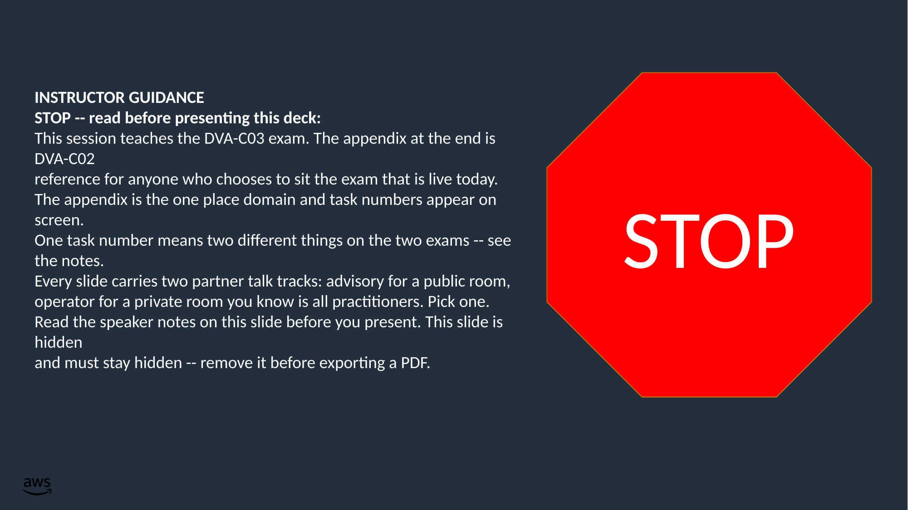

### Notes

DUAL-LENS TALK TRACKS -- READ THIS FIRST. This deck is written from a systems-integrator, advisory point of view by default: the partner is advising someone else who owns the decision. That is the voice of the ADVISORY track.

Remind the room early that the customer and an internal stakeholder are interchangeable. A consulting partner advises a client; a technology partner or ISV is often advising their own product team, security reviewer or account owner. The advice does not change when the other party sits inside your own company.

SO EVERY TEACHING SLIDE AND EVERY QUESTION EXPLAINER CARRIES TWO PARTNER PARAGRAPHS, and you use exactly one of them.

Use PARTNER CONTEXT · ADVISORY for a public delivery or any mixed room -- it frames the partner as guiding a customer's decision. Use PARTNER CONTEXT · OPERATOR for a private delivery where you know the whole room runs the system themselves.

If you are unsure which room you are in, use ADVISORY. It is the default, it is the voice the rest of the program is written in, and it still lands with an operator because the reminder above tells them the other party can be internal.

WHY THIS SLIDE EXISTS: this session teaches toward the DVA-C03 version of the Developer Associate exam. The three appendix slides cover DVA-C02, the version live today, so anyone choosing to sit the current exam still has a reference. They are not this week's teaching content.

THE APPENDIX PRINTS DOMAIN AND TASK NUMBERS, AND THAT IS DELIBERATE. Nowhere else in the program do those numbers appear on screen. The appendix compares one exam version against another, so the identifiers are its subject -- a candidate needs them to find the matching rows in their own exam guide.

⚠ THE ONE TRAP UNIQUE TO THIS WEEK: the task number 2.3 exists on both exams and means two different things. On DVA-C02 it is sensitive data. On DVA-C03 it is a brand-new task for the security of using and integrating AI services.

If anyone in the room is sitting C02 and taking notes by task number, say that out loud -- nothing about the number itself warns them.

⚠ AWS APPSYNC IS ABSENT FROM THIS DECK ON PURPOSE. It is in the published DVA-C02 in-scope list, and this deck targets C03, so a C02 candidate needs to study it separately.

The body targets C03, so AppSync is not taught. The appendix names it so a C02 candidate does not conclude it has been dropped from their exam too.

THE COURSE NAMES ON THE WEEK-5 TRAINING SLIDE ARE VERBATIM FROM SKILL BUILDER. Two are missing a space before a dash, and the practice-question set names DVA-C02 because that is the actual course title. Do not tidy them up out loud -- an attendee types these to search the catalog.

⚠ BEFORE THE QUESTION BLOCK: one question's keyed answer does not match what this deck teaches about Bedrock model access. The deck teaches the current documented behavior, which is that access is enabled by default with the right Marketplace permissions.

The keyed answer describes requesting access per Region instead. That question's own explainer notes carry the full detail -- read them before you reveal it, and present the answer as the best of the four offered rather than reconciling it live.

IF SOMEONE ASKS WHICH EXAM TO SIT: show them the appendix and let them decide. Say what each version covers and leave the choice with them rather than recommending one.

This slide is hidden on purpose and must stay hidden. Confirm it is still hidden, or delete it, before you export a PDF or share this file with a partner.

---

## Slide 3 — Content Review — Session 5

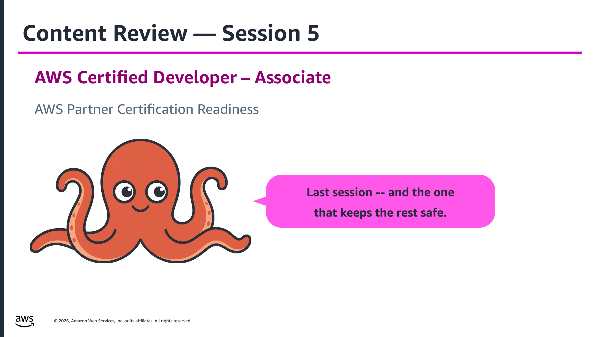

### Notes

Open by naming where the room is. This is the last content review, and the shape of the hour is different from the previous four.

The first four sessions built things. This one protects what was built and then makes it observable, which is why the agenda runs security first and tracing last.

Say plainly that exam registration comes up today rather than being deferred. Several people will not have booked, and the end of this session is the last scheduled moment the group is together.

Keep the welcome short. The security content is dense and the room's attention is better spent there.

---

## Slide 4 — Event check-in

### Notes

Use the check-in to find out who has booked an exam and who has not, because that changes what the closing slides need to do.

Ask two questions and wait for the answers. Who has worked through this week's troubleshooting courses, and who has a date booked. The second matters more.

If most of the room has not booked, plan to spend the closing minutes on registration mechanics rather than on the demonstration slide.

Keep it to a few minutes. This is a temperature check, not a status meeting.

---

## Slide 5 — Week 5 digital training

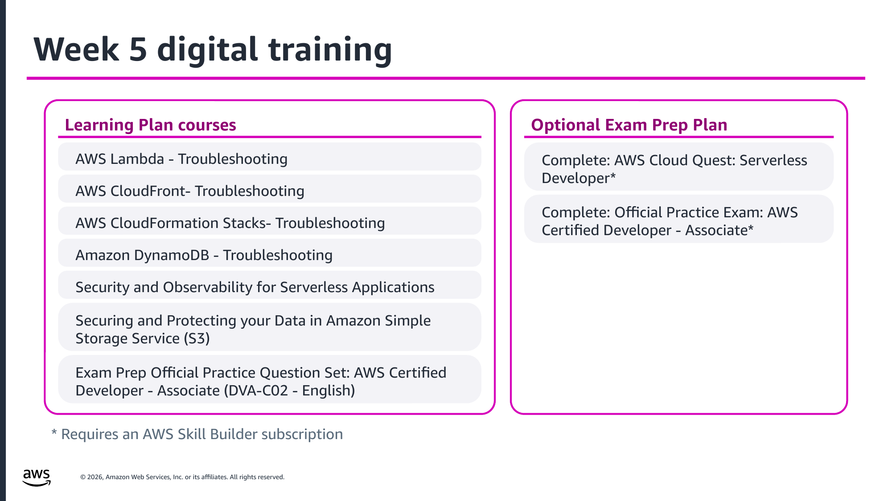

### Notes

Point out that this week's courses look like they belong to a different session than today's agenda, then explain why they do not.

The four troubleshooting courses are the week's own practice, and attendees work through those independently. Today's live hour covers security, which the two security courses on this list support directly.

So the two halves divide the week rather than repeat it. Say that out loud, because a room that spots the apparent mismatch will otherwise assume the schedule is wrong.

The practice question set and the official practice exam are the two items worth pushing hardest. Anyone within a fortnight of their exam gains more from timed questions than from another course.

Note that the practice question set names the C02 exam. That is the course's real title and C02 is the currently live exam, so it is correct as written.

Verified against the week-5 learning plan as published in the program's own curriculum.

---

## Slide 6 — Today's focus: Security and observability

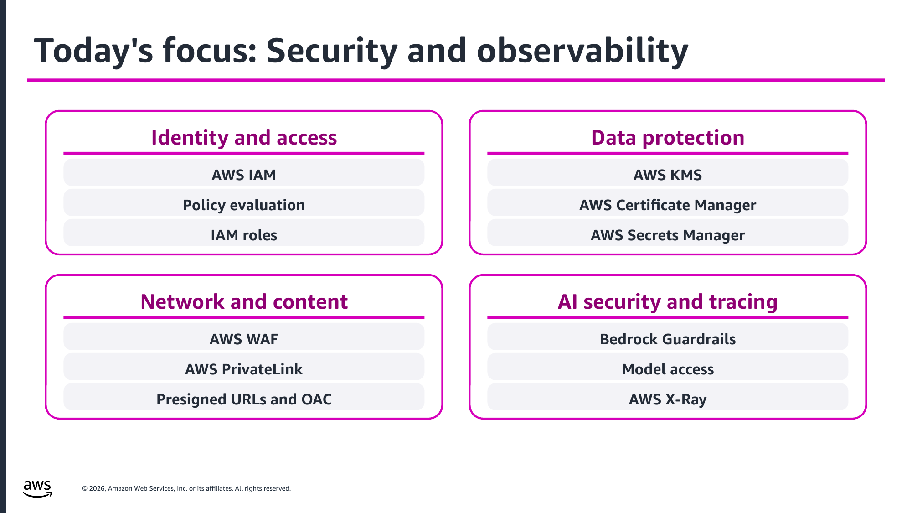

### Notes

Use this as the map for the hour, and point at the last two groups first, because they are the ones people do not expect.

Identity and data protection are the bulk of the session. Most of the room has met IAM already, so today goes to reading a policy rather than to what IAM is.

Network and content access are the two places where a misconfiguration is silently public rather than loudly broken, which is why they get their own slides.

AI security is new. Guardrails and model access are week-5 topics in their own right and nothing in the previous four sessions covers them.

Observability closes the hour. X-Ray is the one service here that answers a question rather than preventing a problem, which is why it comes last.

---

## Slide 7 — Your five weeks at a glance

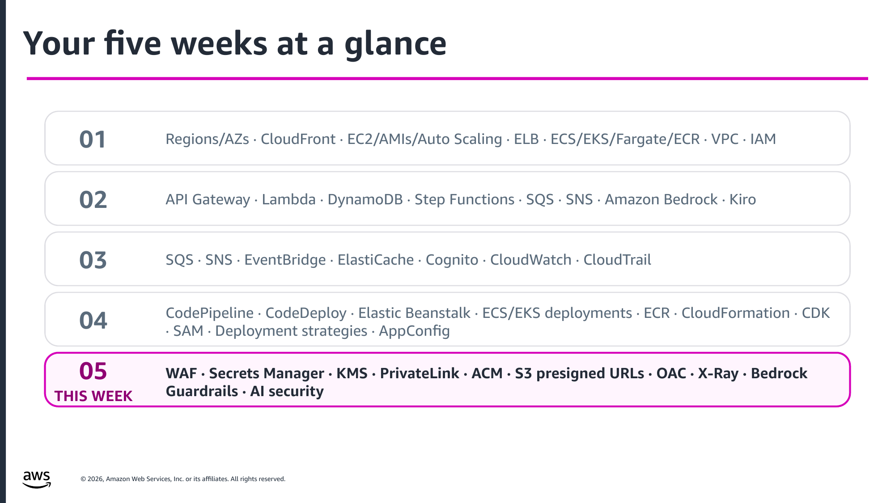

### Notes

WHAT'S HERE: A map of the whole five-week event, one row per week, with this week highlighted. Use it near the top of the session so the room can see where week 5 sits in the arc and what is still to come.

FACILITATOR: Point at the highlighted row. Week 5 is the security and troubleshooting week -- protecting data in transit and at rest, private connectivity, tracing, and guardrails for generative AI. It closes the arc the earlier weeks opened.

Keep it brief -- this is orientation, not content. The same map appears in every session with the current week moving, so returning attendees will recognize it at a glance. Then move into today's focus.

---

## Slide 8 — How do you protect traffic and data?

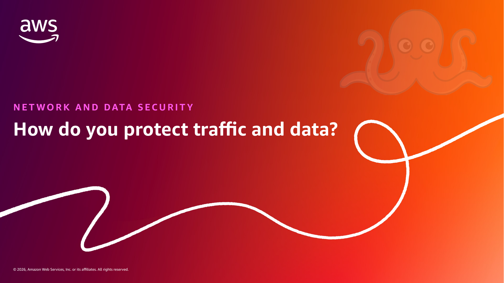

### Notes

WHAT'S HERE: The first security block of week 5 -- what sits in front of the application, and what protects the data behind it. WAF, KMS envelope encryption, VPC interface endpoints, presigned URLs, CloudFront origin access control and ACM.

FACILITATOR: These six are usually met one at a time and never compared, so the block is sequenced from the edge inward: filter the request, then keep the traffic private, then protect the object, then place the certificate.

Ask the room where they would put a control to stop a bad request, before you show the first slide. Most answers name the application, and the point of the block is that the useful controls sit earlier than that.

---

## Slide 9 — WAF inspects a request before your app sees it

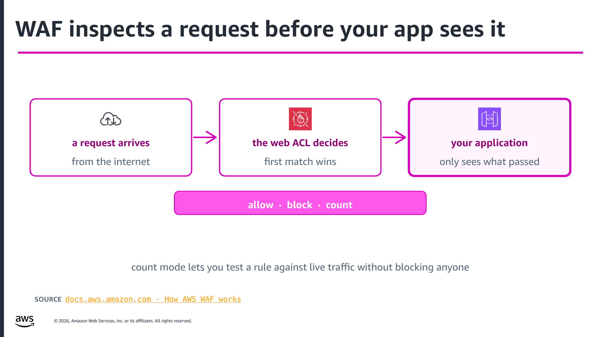

### Notes

Walk the row left to right and stop on the middle card, because that is where the decision happens.

A request reaches the web ACL before it reaches anything you wrote. The rules are evaluated in order and the first one that matches decides the outcome, so rule order is part of the configuration rather than a detail.

The three outcomes worth naming are allow, block and count. Count is the one people forget, and it is how you test a rule against real traffic without breaking anyone.

The point to land is that this is not application code. Nothing in the function changes to add or remove a rule, which is exactly why it can be updated during an incident.

Ask the room where they would put a rate limit for a login endpoint, before you say anything. Naming the endpoint rather than the whole site is the answer worth drawing out.

PARTNER CONTEXT · ADVISORY: A customer who has just been scraped or credential-stuffed asks what to put in front of the application. Proposing a managed rule group plus a rate-based rule on the login path is a first iteration you can stand up in a day.

PARTNER CONTEXT · OPERATOR: A partner protecting a customer-facing form gets a managed rule group on day one and a rate-based rule for the login path, which is usually the whole of a first iteration.

REFERENCE: docs.aws.amazon.com How AWS WAF works.

EXAM MAPPING: Domain 2.

---

## Slide 10 — Working backwards: bots locked real customers out

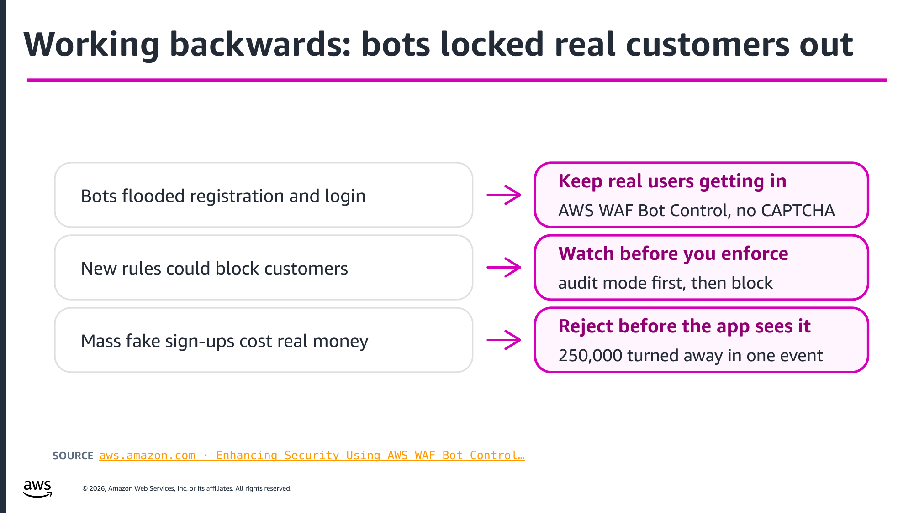

### Notes

WHAT'S HERE: A published AWS case study, so every figure on this slide is OLX's and AWS's rather than ours. OLX runs online classifieds across nine countries, and its login service handles 11 million customers a month across 13 platforms.

Read the rows left to right and you are working backwards from their problem. It was not a breach: bots flooding registration with random emails and phone numbers stopped legitimate people signing in at all, and it cost real money in messaging fees for the fake sign-ups.

⚠ THE ROW WORTH SLOWING DOWN ON is the middle one, because it is the beat the previous slide says people forget.

OLX ran AWS WAF Bot Control in AUDIT mode first. Two real bot events happened while they were still only watching, and only then did they switch to BLOCK. That is exactly what count mode is for -- you find out what a rule would have done before it can turn a customer away.

The numbers make the scale concrete: on an ordinary day they process about 2 million requests and reject around 13,000. During the second event they processed 2.1 million and rejected 250,000.

Ask the room what they would have set the rate limit to before you show the numbers, then read out the 13,000-a-day baseline. The gap is the point.

Point out that the implementation took two weeks, because that is the number a partner will be asked for.

PARTNER CONTEXT · ADVISORY: A customer who has just been credential-stuffed usually asks for the strongest setting immediately. This story is the argument for starting in count mode instead -- it costs nothing and it is far easier to defend than an outage caused by your own rule.

PARTNER CONTEXT · OPERATOR: A partner protecting their own sign-up flow gets the whole sequence here: managed rules plus a rate-based rule on the login path, run in count mode until the data says the thresholds are right.

REFERENCE: aws.amazon.com Enhancing Security Using AWS WAF Bot Control with OLX.

EXAM MAPPING: Domain 2.

---

## Slide 11 — A data key encrypts the data; KMS wraps the key

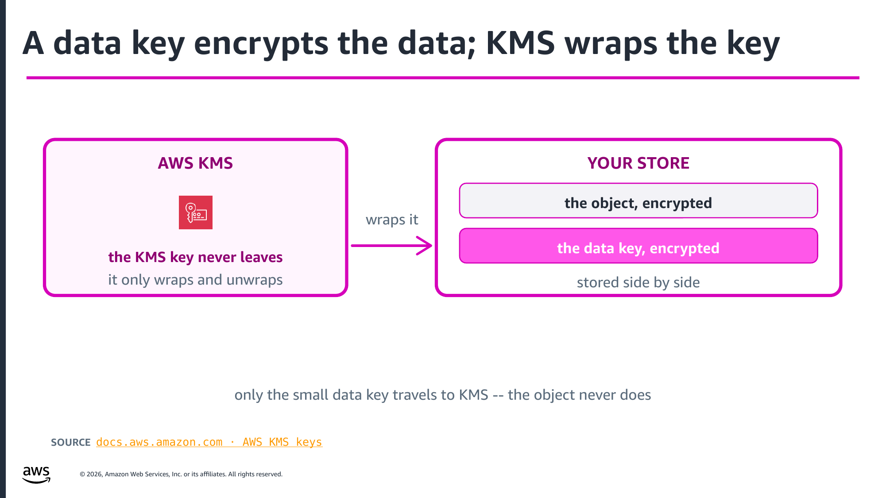

### Notes

This is the slide that makes the rest of KMS make sense, so spend time on it rather than on key policies.

Two keys are in play and only one of them ever leaves KMS. The data key encrypts your object, and the KMS key encrypts the data key.

That is why a large object does not have to travel to KMS. Only the small data key is sent for encryption, and the encrypted copy is stored next to the ciphertext.

So a decrypt is two steps: ask KMS to decrypt the data key, then use the plaintext data key locally. Every audited call in CloudTrail is about the data key, never about your object.

Ask the room what an attacker who copies the encrypted object and the encrypted data key still needs. Permission to call KMS decrypt is the answer, and it reframes the whole model as an access-control problem.

PARTNER CONTEXT · ADVISORY: A customer asking how their documents are encrypted at rest gets the same answer whichever store you are discussing, which is what makes this the one diagram worth drawing on a whiteboard in front of them.

PARTNER CONTEXT · OPERATOR: A partner storing customer documents gets the same picture whether the store is S3, EBS or a database, which is worth saying because the diagram transfers.

REFERENCE: docs.aws.amazon.com AWS KMS keys.

EXAM MAPPING: Domain 2.

---

## Slide 12 — An interface endpoint keeps traffic inside your VPC

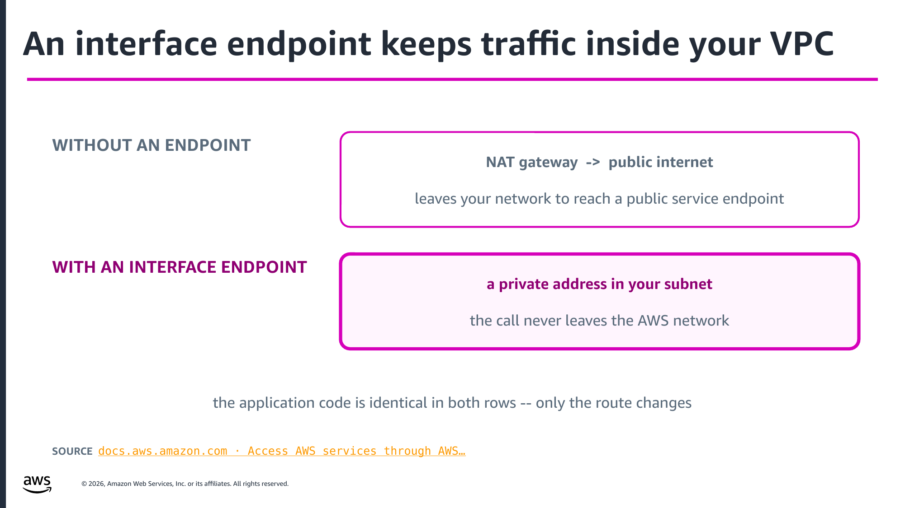

### Notes

The subject of this slide is the PATH, so point at the two lines rather than at the boxes.

Without an endpoint, a call from a private subnet to an AWS service leaves through a NAT gateway and traverses the public network to reach a public service endpoint.

With an interface endpoint, the service gets an address inside your subnet. The call resolves to that private address and the traffic stays on the AWS network.

So this is not primarily a performance feature. It is how you reach a service without granting the subnet a route to the internet at all, which is the requirement that usually drives it.

Ask the room what has to change in the application code to use the endpoint. Nothing is the answer, and it is the reason this is an infrastructure decision rather than a development one.

PARTNER CONTEXT · ADVISORY: When a customer's security team writes no internet egress from the data tier into a requirements document, they have already chosen this. Your job is to price it and confirm which services need endpoints, not to reopen the requirement.

PARTNER CONTEXT · OPERATOR: A partner whose customer forbids internet egress from the data tier gets this configuration as a hard requirement, not an optimization.

REFERENCE: docs.aws.amazon.com Access AWS services through AWS PrivateLink.

EXAM MAPPING: Domain 2.

---

## Slide 13 — A presigned URL carries the signer's permissions

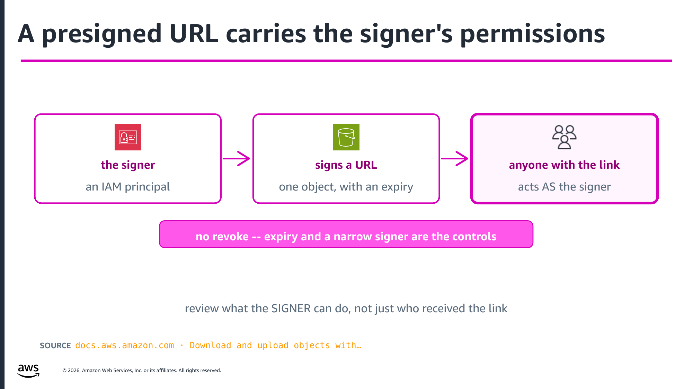

### Notes

The room has met presigned URLs already, so skip the definition and go straight to the part that is commonly gotten wrong.

The link does not carry the recipient's permissions. It carries the permissions of whoever signed it, which means the same URL grants exactly what the signer could have done.

So a URL signed by an over-privileged role is an over-privileged URL. Reviewing what the signing principal can do matters more than reviewing who received the link.

Expiry is the second half. The link stops working when it expires, and it keeps working until then even if the recipient was never supposed to have it.

Ask the room how you revoke a presigned URL that has leaked, before you answer. There is no revoke button, which is why short expiry times and a narrowly-scoped signer are the actual controls.

PARTNER CONTEXT · ADVISORY: A customer who wants download links has usually not considered whose permissions the link carries. Raising that before implementation is worth more than any review afterwards, because a leaked link reaches whatever the signing role reaches.

PARTNER CONTEXT · OPERATOR: A partner generating download links from a shared service role should sign with a role scoped to the one prefix, because the blast radius of a leaked link is whatever that role can reach.

REFERENCE: docs.aws.amazon.com Download and upload objects with presigned URLs.

EXAM MAPPING: Domain 2.

---

## Slide 14 — Only CloudFront can read the bucket behind an OAC

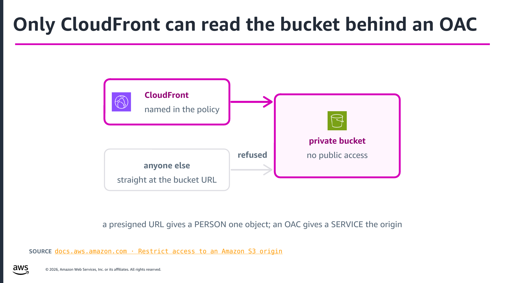

### Notes

This is the other half of the private-content story, and the two are worth contrasting explicitly.

A presigned URL grants a person time-limited access to one object. Origin access control grants a SERVICE permanent access to a whole origin, and denies everyone else.

The bucket has no public access. Its policy names the distribution, so a request that arrives directly at the bucket URL is refused while the same object served through CloudFront succeeds.

That is what makes the edge the only front door. Caching, WAF and the certificate all attach at CloudFront, and none of them can be bypassed by going straight to the origin.

Ask the room what happens if someone finds the bucket name, before you tell them. Nothing happens, and that is the whole point of the arrangement.

PARTNER CONTEXT · ADVISORY: A customer serving media asks whether the bucket has to be public. It never does, and being able to say that in one sentence with a picture is the kind of answer that settles a security review early.

PARTNER CONTEXT · OPERATOR: A partner serving customer media gets this by default: private bucket, one distribution, a policy that names it, and no object ever public.

REFERENCE: docs.aws.amazon.com Restrict access to an Amazon S3 origin.

EXAM MAPPING: Domain 2.

---

## Slide 15 — Where the certificate lands picks the ACM path

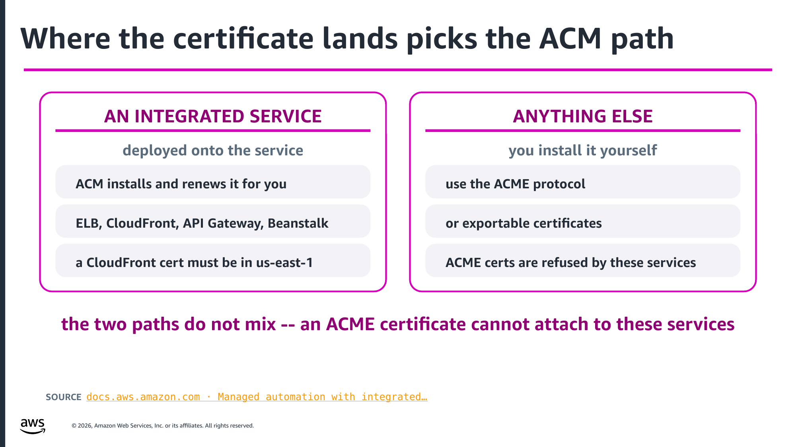

### Notes

Start by naming what ACM actually does, because most people describe it as a place to keep certificates and that is the smaller half.

ACM issues the certificate and then deploys it onto the service that terminates TLS. Elastic Load Balancing, CloudFront, API Gateway, Elastic Beanstalk and App Runner are all on that list, and ACM renews the certificate in place.

So for anything in that column nobody handles a certificate file. That is the whole value: no copying, no expiry surprise, no restart to pick up a renewal.

The right column is the newer half and it changes an old assumption. For workloads outside those services, EC2 among them, you can use the ACME protocol or exportable certificates. The old belief that ACM only ever works with the integrated services is out of date.

But the two paths do not mix. A certificate whose key pair origin is ACME cannot be used with the integrated services, so choosing the path is a real decision rather than a preference.

Then the constraint worth memorizing, and read it out loud: to use an ACM certificate with CloudFront you must request or import it in the US East, North Virginia Region. A certificate in any other Region simply will not attach.

Ask the room why a distribution in Sydney still needs its certificate in North Virginia, before you answer. CloudFront is global and its control plane lives in that Region, so the certificate follows the service rather than the traffic.

PARTNER CONTEXT · ADVISORY: A customer planning an edge-cached site needs the Region rule before they request anything, because discovering it after the certificate exists means requesting a second one. A short conversation that saves a rework cycle.

PARTNER CONTEXT · OPERATOR: A partner running an edge-cached site gets one certificate in North Virginia and never thinks about it again, provided somebody knew the rule on day one.

REFERENCE: docs.aws.amazon.com Managed automation with integrated services.

EXAM MAPPING: Domain 2.

---

## Slide 16 — Who is allowed to do what?

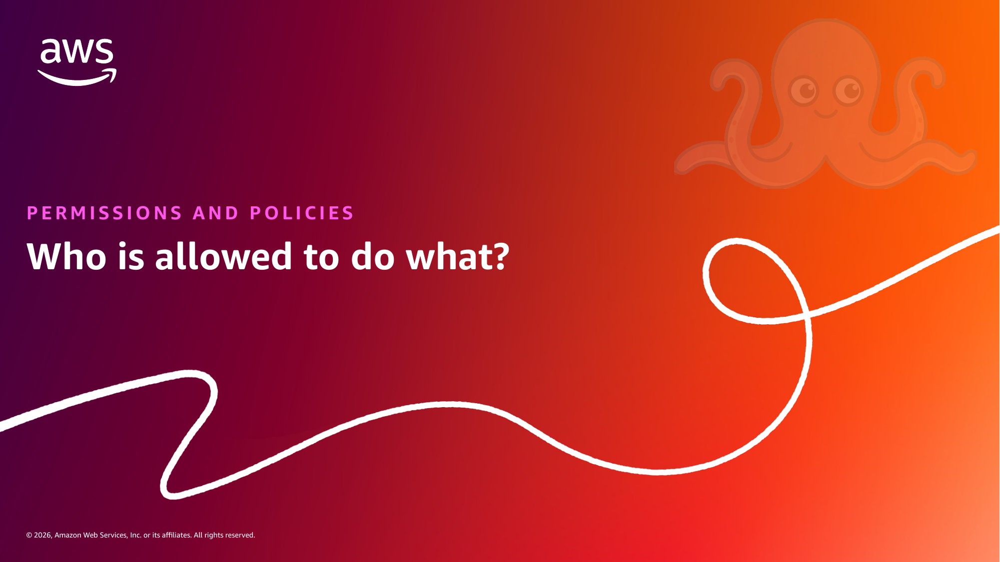

### Notes

WHAT'S HERE: Reading IAM, rather than writing it. Policy evaluation order, a bucket policy that requires TLS, a policy that requires matching tags on both sides, and the split between identity policies and resource policies.

FACILITATOR: This block is the one where the exam rewards slow reading, so the two policy slides are on screen as real JSON with the key lines numbered and explained beside them. Work them line by line and resist summarizing.

Ask whether an Allow can ever beat a Deny before the first slide answers it. The confident wrong answer is common enough to be worth surfacing out loud.

---

## Slide 17 — An explicit Deny always wins

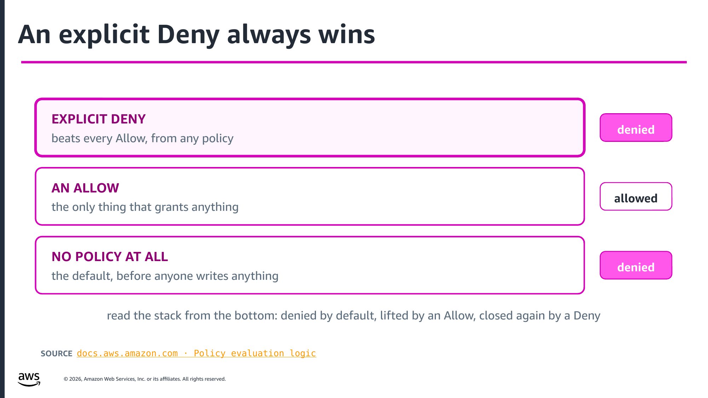

### Notes

Build this from the bottom up, because that is the order the evaluation actually happens in.

Start at the bottom band. With no policy at all, a request is denied. Nothing is granted by default, so every permission that exists had to be written by somebody.

An Allow lifts a request out of that default. This is the band most people picture when they think about permissions, and it is the only one that grants anything.

Then the top band, which is the one that decides arguments. An explicit Deny beats any Allow, no matter how specific the Allow is or which policy it came from.

Ask the room whether a more specific Allow can override a broad Deny, before you answer. It cannot, and getting that wrong is what makes people rewrite a policy that was never going to work.

PARTNER CONTEXT · ADVISORY: A customer insisting their policy is correct is usually right about the Allow and unaware of a Deny above it. Asking for the service control policies and the bucket policy first will save you both an afternoon.

PARTNER CONTEXT · OPERATOR: A partner troubleshooting a permission that looks correct should read for a Deny before re-reading the Allow, because the Allow is usually fine.

REFERENCE: docs.aws.amazon.com Policy evaluation logic.

EXAM MAPPING: Domain 2.

---

## Slide 18 — Reading a bucket policy that requires TLS

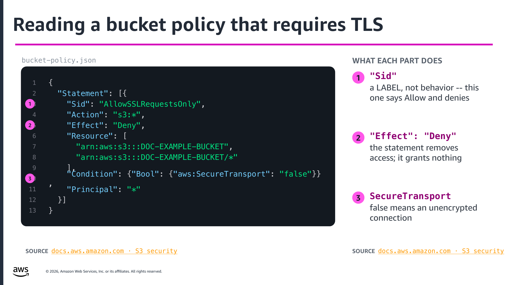

### Notes

Read the Sid aloud, then read the Effect, and let the room notice the mismatch before you name it.

The statement is called AllowSSLRequestsOnly and its Effect is Deny. That is AWS's own naming in AWS's own example, and it is the clearest possible demonstration that a Sid is a label rather than behavior.

What the policy actually does is refuse everything when the connection is not encrypted. The condition is the whole statement: without it this would deny all access to the bucket permanently.

Both resource lines matter. The bucket ARN covers operations on the bucket itself and the slash-star ARN covers the objects inside it, and a policy with only one of them leaves a gap.

Ask the room what happens to a plain HTTP request here, and then what happens to an HTTPS request. Nothing in the policy allows the second one, which is the point worth landing: this statement removes access rather than granting it.

PARTNER CONTEXT · ADVISORY: A customer handed an encryption-in-transit requirement often tries to satisfy it with a setting rather than a policy. Showing them the statement, and that it grants nothing on its own, prevents the follow-up outage.

PARTNER CONTEXT · OPERATOR: A partner meeting an encryption-in-transit requirement gets exactly this statement, paired with a separate policy that grants the access they actually want.

The Id and Version keys are omitted here so the statement fits at the deck's code size. Nothing else was changed.

REFERENCE: docs.aws.amazon.com Security best practices for Amazon S3.

EXAM MAPPING: Domain 2.

Verified against: https://docs.aws.amazon.com/AmazonS3/latest/userguide/security-best-practices.html

---

## Slide 19 — Reading a policy that requires tags on both sides

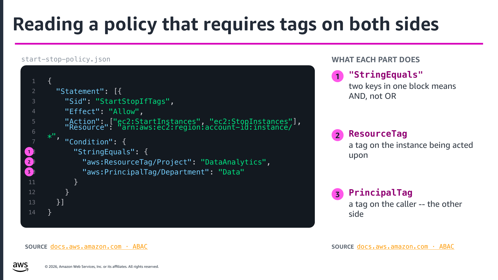

### Notes

This is the same reading exercise one level harder, and the thing to slow down on is the condition block.

Two keys sit inside one StringEquals, and that means AND rather than OR. Both have to be true, so a request that satisfies only one of them is not allowed.

The two keys look alike and describe opposite sides. ResourceTag is a tag on the instance being acted upon; PrincipalTag is a tag on the user or role making the call.

So permission depends on the pair matching, which is what attribute-based access control means in practice. Nobody is named in this policy, and it keeps working as instances and people are added, provided the tags are right.

Ask the room what happens when an instance loses its Project tag. The permission disappears for everyone, which is the operational cost of this approach and worth saying out loud.

PARTNER CONTEXT · ADVISORY: A customer with several project teams in one account wants fewer policies, and this is how they get there. Be explicit that the cost is tag governance, or you have sold them a maintenance problem.

PARTNER CONTEXT · OPERATOR: A partner running one account for several project teams gets one policy instead of one per team, and pays for it by having to govern tagging.

REFERENCE: docs.aws.amazon.com ABAC authorization.

EXAM MAPPING: Domain 2.

Verified against: https://docs.aws.amazon.com/IAM/latest/UserGuide/introduction_attribute-based-access-control.html

---

## Slide 20 — Identity policies attach to who; resource to what

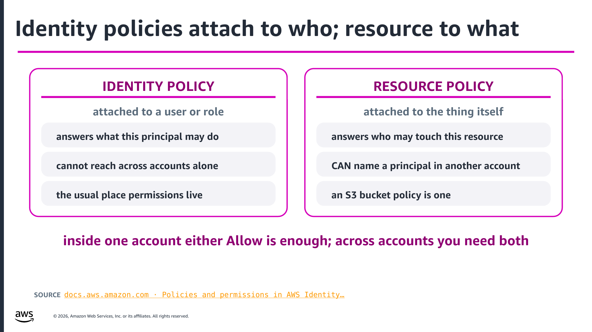

### Notes

The source covers this in prose and it is worth a slide, because the two policy types answer different questions and questions exploit that.

An identity policy is attached to a principal and answers what this user or role may do. A resource policy is attached to the thing itself and answers who may touch this resource.

The consequence that matters is cross-account. A resource policy can name a principal in another account, which an identity policy in your account cannot do on its own.

Both are evaluated for the same request. For a call inside one account an Allow in either is enough; across accounts you need an Allow on both sides.

Ask the room which type an S3 bucket policy is, and then which type a role's permissions are. Naming them correctly is most of what a question on this needs.

PARTNER CONTEXT · ADVISORY: A customer asking you to grant another account access to one bucket is asking for a resource policy, whether or not they use that phrase. Naming the distinction stops the request being routed to the wrong team.

PARTNER CONTEXT · OPERATOR: A partner granting a client's account read access to one bucket writes a resource policy, because there is no identity in their own account to attach anything to.

REFERENCE: docs.aws.amazon.com Policies and permissions in AWS Identity and Access Management.

EXAM MAPPING: Domain 2.

---

## Slide 21 — How do you secure a model in use?

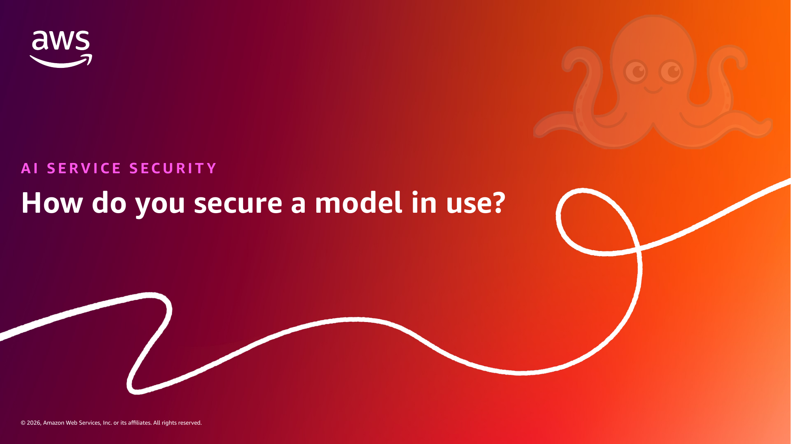

### Notes

WHAT'S HERE: Securing a generative AI application. Guardrails on both the prompt and the response, blocking versus masking sensitive data, the filter's documented blind spot around tool calls, model access in a new account, and invocation logging.

FACILITATOR: This is the newest material on the exam and the block most likely to be unfamiliar, so it is paced slower than the others and each slide names the specific control rather than the general idea.

Ask the room what they think a guardrail actually inspects. Answers usually name the prompt only, and the response half is where the surprises live.

---

## Slide 22 — A guardrail checks the prompt and the response

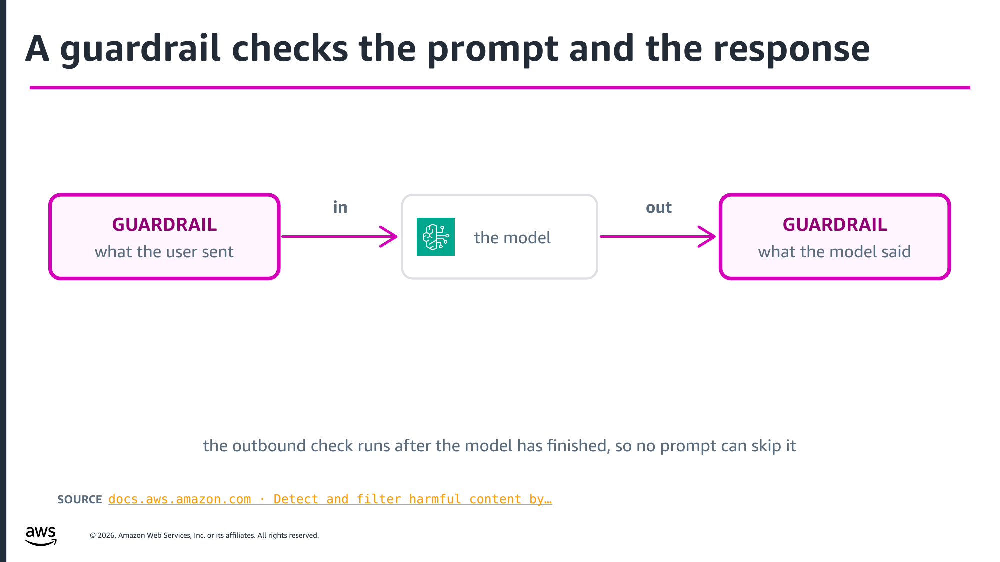

### Notes

Point at the two checks rather than at the model, because the model is not what changed.

A guardrail evaluates the input prompt on the way in and the model's response on the way out. Both directions, independently, against the same configured policy.

That is why it is a safeguard rather than a prompt technique. Nothing in the prompt can talk the guardrail out of the outbound check, because the outbound check happens after the model has finished.

The same guardrail can be attached to different models, which is what makes the behavior consistent when a team changes model.

Ask the room which side catches a model that produces something harmful from a perfectly innocent question. The response side, and it is the half people forget when they think of this as input validation.

PARTNER CONTEXT · ADVISORY: A customer who asks whether you can stop it saying something embarrassing is describing the outbound check only. Pointing out that the inbound check is a separate configuration is usually new information, and it changes their design.

PARTNER CONTEXT · OPERATOR: A partner running a customer-facing assistant needs both: the inbound check for what users type, the outbound check for what the model says back on their behalf.

One documented exclusion is worth knowing: reasoning content blocks are not evaluated.

REFERENCE: docs.aws.amazon.com Detect and filter harmful content by using Amazon Bedrock Guardrails.

EXAM MAPPING: Domain 2.

---

## Slide 23 — Working backwards: data protection came first

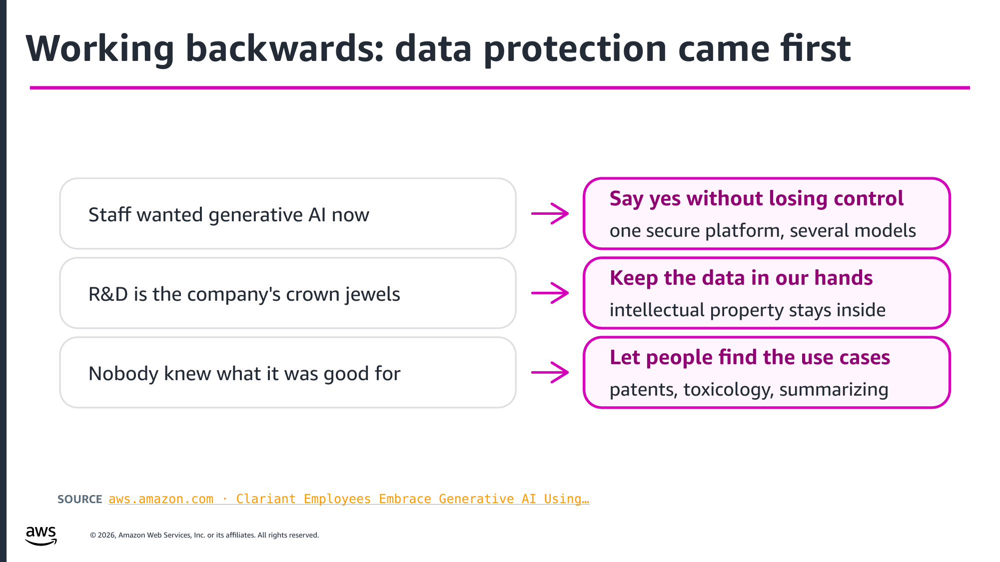

### Notes

WHAT'S HERE: A published AWS case study, so the framing here is Clariant's own. Clariant is a Swiss specialty chemicals company whose technology sits in hundreds of everyday products, and it built an internal generative AI assistant called Clarita on Amazon Bedrock.

⚠ THE SENTENCE THIS SLIDE EXISTS FOR, and it is theirs: the first hurdle was data protection. Not model quality, not cost, not skills. They wanted to give employees generative AI and they had to be sure intellectual property stayed in a secure environment first.

Their head of IT put it as wanting to run generative AI in an environment that keeps their data in their hands and confidential. That is the business reason the whole security block you have just worked through exists.

The third row is the payoff and it is worth naming: once the security question was settled, employees found the uses themselves -- summarizing documents, synthesizing patents, toxicology work. The controls did not slow adoption down, they were what allowed it to start.

Ask the room which of the controls from this session they would have needed to answer that first hurdle, before you move on.

PARTNER CONTEXT · ADVISORY: A customer whose legal or R&D function has blocked a generative AI pilot is almost always asking Clariant's question rather than a technical one. Being able to name a company in a patent-heavy industry that resolved it, and how, moves the conversation faster than a feature list.

PARTNER CONTEXT · OPERATOR: A partner running an internal assistant on their own corporate data faces this in the same order -- settle where the data lives and what leaves the account, then let the use cases arrive.

REFERENCE: aws.amazon.com Clariant Employees Embrace Generative AI Using Amazon Bedrock.

EXAM MAPPING: Domain 2, task 2.3.

---

## Slide 24 — Block removes the message; mask replaces the PII

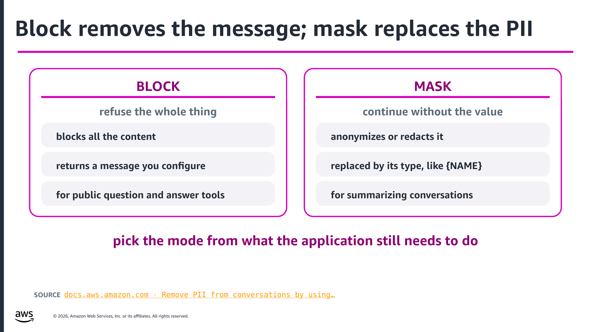

### Notes

Two modes, and the choice between them is a product decision rather than a security one.

Block refuses the whole thing. If sensitive information is detected the guardrail blocks all the content and returns a message you configure, so the user gets your wording rather than a model response.

Mask lets the exchange continue with the sensitive part removed. The guardrail replaces the detected value with its type, so the text comes back reading brace NAME or brace EMAIL.

That difference decides which one suits an application. A public question-and-answer tool wants block; a tool summarizing support conversations wants mask, because the summary is still useful without the customer's name in it.

Ask the room which mode a call-center summarizer needs, and make them say why. Wanting the summary is the reason, and it is a better route to the answer than remembering a list.

PARTNER CONTEXT · ADVISORY: A customer in a regulated industry rarely arrives knowing these are two different actions. Walking them through block on the way in and mask on the way out gives them a decision they can take to their compliance reviewer.

PARTNER CONTEXT · OPERATOR: A partner handling regulated data usually wants block on the inbound side and mask on the outbound, and there is no rule against configuring them differently.

Detection is a machine learning solution and context-dependent, so it is not a guarantee. Custom regular expressions are available where a pattern is known exactly.

REFERENCE: docs.aws.amazon.com Remove PII from conversations by using sensitive information filters.

EXAM MAPPING: Domain 2.

---

## Slide 25 — The filter does not see PII inside a tool call

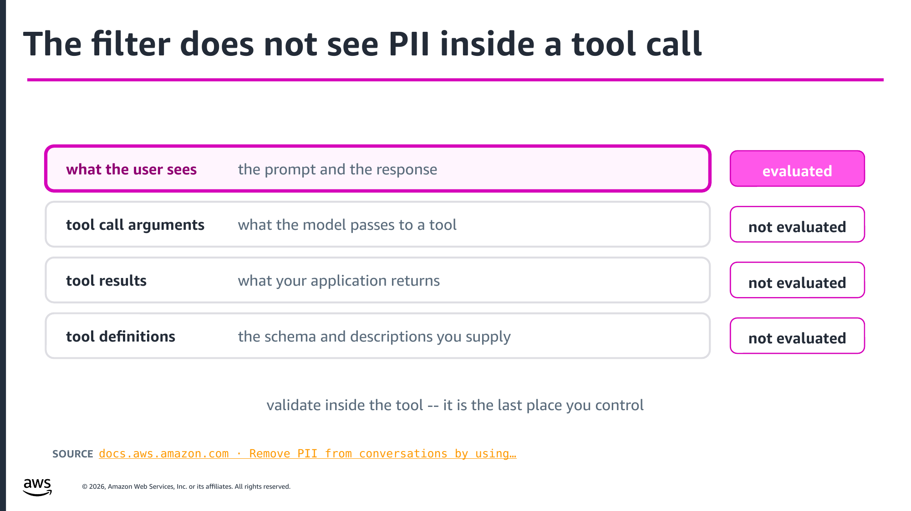

### Notes

This is the slide to slow down on, because it is a documented limitation rather than a configuration mistake and almost nobody expects it.

The sensitive information filter evaluates text content only. In tool use workloads it does not evaluate what the model writes into tool call arguments, what your application returns in tool results, or the tool definitions you supply.

So the documented example is worth reading out: if the model passes a customer's email address to a tool that writes a file, that address is not masked.

That matters because the tool path is exactly where data leaves the conversation and reaches something durable. The guardrail protects what the user sees, not what the tool receives.

Ask the room where they would put the check instead, before you answer. Inside the tool, on the way in, is the answer worth landing, because the tool is the last place you control.

PARTNER CONTEXT · ADVISORY: A customer who has attached a guardrail believes the problem is solved. Telling them the filter does not read tool-call arguments is the most valuable thing on this slide, and it is far better said in design than in an incident.

PARTNER CONTEXT · OPERATOR: A partner building an agent that writes to a ticketing system has to validate in its own handler. Attaching a guardrail is necessary and it is not sufficient.

Detection does work across code as well as prose, including comments, string literals and variable names, so this gap is specifically about the tool fields rather than about code in general.

REFERENCE: docs.aws.amazon.com Remove PII from conversations by using sensitive information filters.

EXAM MAPPING: Domain 2.

---

## Slide 26 — A new account fails on its first model call

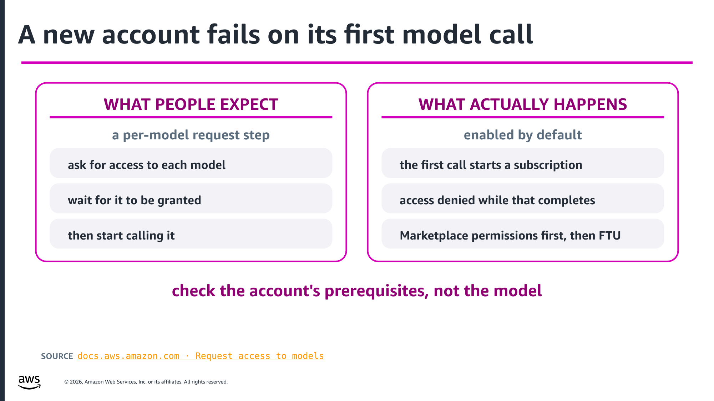

### Notes

Correct an assumption before you explain anything, because most of the room will hold it.

Access to the foundation models is enabled by default, provided the account has the right AWS Marketplace permissions. There is no per-model request step to work through first.

What happens instead is that the first invocation starts a subscription in the background. While that completes, calls can return an access denied error, and if a prerequisite is missing they keep returning it.

So three prerequisites are the actual answer to a new account failing. Marketplace permissions on the calling role, a valid payment method on the account, and for Anthropic models a first-time-use form submitted once.

Ask the room what they would check first when a brand new account gets access denied, before you list these. Reaching for the model rather than the account is the common instinct and it is the wrong one.

PARTNER CONTEXT · ADVISORY: A customer whose first model call fails will report it as your policy being wrong. Knowing the three prerequisites lets you rule that out in one message rather than a day of back-and-forth.

PARTNER CONTEXT · OPERATOR: A partner standing up a fresh account for a customer should verify all three before the first production call, because the error looks identical to a permissions bug in their own policy.

The form submitted at an organization's management account is inherited by other accounts in that organization.

REFERENCE: docs.aws.amazon.com Request access to models.

EXAM MAPPING: Domain 2.

---

## Slide 27 — Invocation logging is off until you turn it on

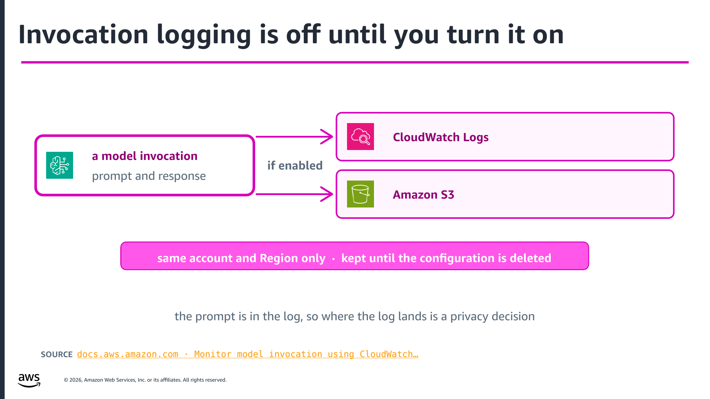

### Notes

This is the slide that connects an AI feature to an ordinary compliance question, so keep it concrete.

Model invocation logging collects the invocation logs, the model input data and the model output data for calls in your account in a Region. The prompt is in there, which is the part that matters.

It is disabled by default. Nothing is being recorded until somebody enables it, and once enabled the logs are kept until the logging configuration is deleted.

The destination is either CloudWatch Logs or Amazon S3, and only destinations in the same account and Region are supported. So a central logging account is not something this feature does on its own.

Ask the room what the privacy implication is for an application whose users type sensitive information, before you say it. The prompt is stored where the log lands, which turns a model feature into a data-retention decision.

PARTNER CONTEXT · ADVISORY: A customer asking for an audit trail of prompts is usually also asking for PII to be masked, and those two requests conflict unless the masking runs first. Surface the ordering while it is still a design conversation.

PARTNER CONTEXT · OPERATOR: A partner in a regulated industry usually needs this on for auditability and needs a guardrail masking the prompt on the way in, and those two requirements pull in opposite directions unless the masking happens first.

REFERENCE: docs.aws.amazon.com Monitor model invocation using CloudWatch Logs and Amazon S3.

EXAM MAPPING: Domain 4.

---

## Slide 28 — Where is the time actually going?

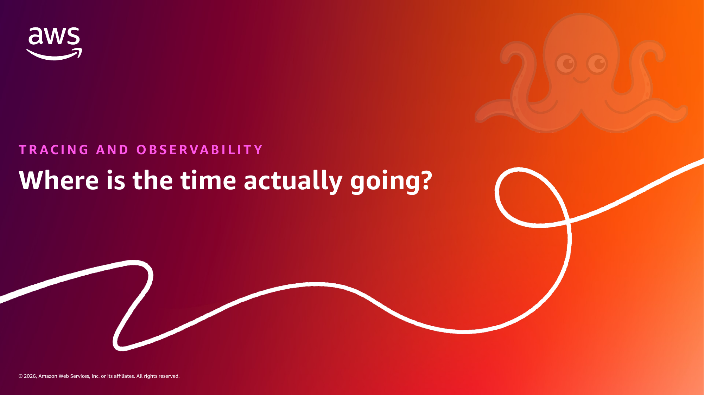

### Notes

WHAT'S HERE: Reading a trace. Segments, traces and the service graph, how X-Ray classifies an error against a fault against a throttle, and what a subsegment really measures.

FACILITATOR: Keep the block concrete -- every slide here answers a question someone asks during an incident rather than defining a term. The last slide is the one worth the most time.

Ask what a wide bar on a downstream service tells you. The answer most rooms give is "that service is slow", and correcting it is the whole point of the block.

---

## Slide 29 — A segment is one service; a trace is one request

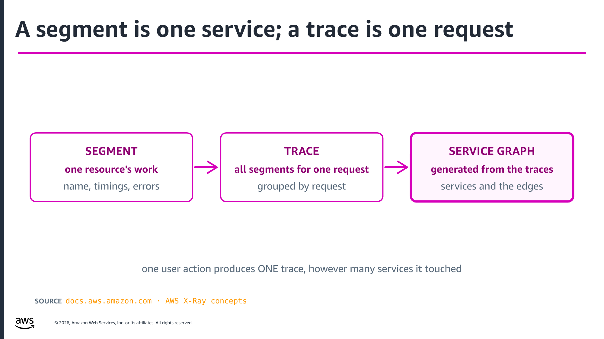

### Notes

Three words get used interchangeably and they are three different things. Build the row left to right.

A segment is what one compute resource sends about the work it did. It carries the resource name, the request details, start and end times, and any errors.

A trace is every segment that shares one request. So a single user action produces one trace containing as many segments as there were services involved.

The service graph is generated from those traces. Each resource that sends data appears as a service, and edges connect the services that work together to serve requests.

Ask the room how many traces a single user action produces, before you answer. One is the answer, and hearing people guess several is the fastest way to find out the word has not landed.

PARTNER CONTEXT · ADVISORY: A customer reporting that something is intermittently slow cannot usually tell you which service is at fault. This is the vocabulary you need so that the answer comes from a trace rather than from a guess.

PARTNER CONTEXT · OPERATOR: A partner debugging an intermittent failure searches traces to find the one bad request, then reads its segments to find which service was responsible.

The console renders the service graph as a service map, so the two names describe the same thing.

REFERENCE: docs.aws.amazon.com AWS X-Ray concepts.

EXAM MAPPING: Domain 4.

---

## Slide 30 — Error is 4xx, fault is 5xx, throttle is 429

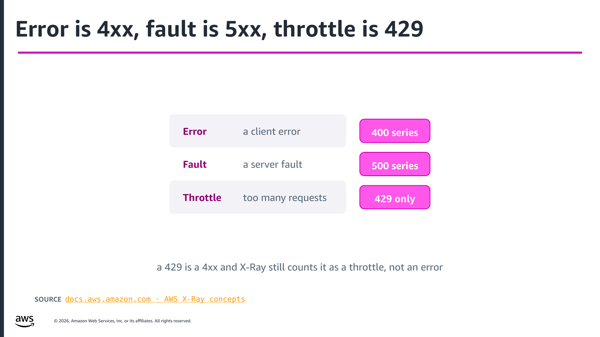

### Notes

Three categories, and the third one is why this needs a slide rather than a bullet.

Error means a client error, the 400 series. Fault means a server fault, the 500 series. Throttle means specifically a 429, too many requests.

Notice the overlap. A 429 is arithmetically a 400-series response, and X-Ray still counts it as a throttle rather than an error, so the two numbers are not the same thing.

That matters when reading a service map. A node showing throttles is being rate limited, which is a capacity or quota conversation. A node showing errors is being sent bad requests, which is a caller conversation.

Ask the room which category a 404 falls into and then which a 429 falls into, before you confirm. Getting the second one right is the whole point of the slide.

PARTNER CONTEXT · ADVISORY: A customer says we are seeing errors and means all three of these at once. Separating them before you promise a fix is what stops a capacity problem being investigated as a code problem.

PARTNER CONTEXT · OPERATOR: A partner investigating a spike should read the categories separately, because a rise in throttles and a rise in faults lead to completely different fixes.

Exceptions are recorded separately again, with the stack trace where one is available, and are visible under segment details.

REFERENCE: docs.aws.amazon.com AWS X-Ray concepts.

EXAM MAPPING: Domain 4.

---

## Slide 31 — A subsegment is your view of a downstream call

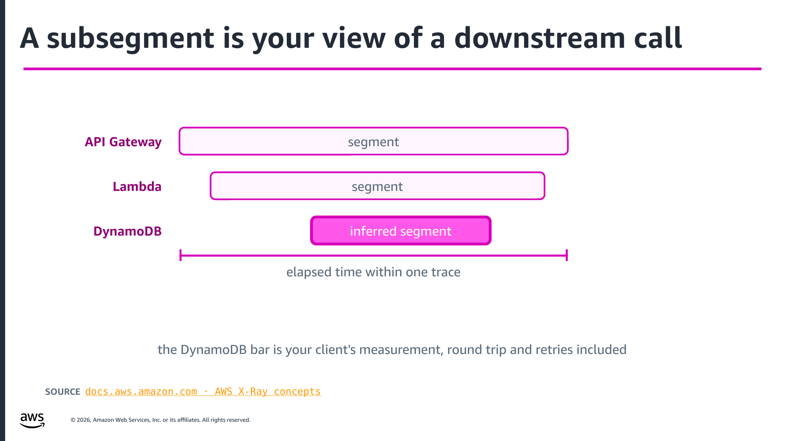

### Notes

This is the slide that makes a latency investigation honest, so give it the most time.

A subsegment is your application's view of a downstream call, as the client. It carries the more granular timing for that call, and you can add your own around any function you want to measure.

Now the part that changes how you read a trace. Services that do not send their own segments, DynamoDB among them, get an inferred segment that X-Ray generates from your subsegment.

So the DynamoDB bar in a trace was measured by your own SDK client. It includes the network round trip and any client-side retry, which means it is your view of DynamoDB rather than DynamoDB's report of itself.

When the downstream service IS instrumented, its own segment replaces the inferred one, and the node then carries that service's timing while the edge still carries yours.

Ask the room what a wide DynamoDB bar could mean other than a slow table, before you answer. A retry inside the SDK client is the answer worth landing.

PARTNER CONTEXT · ADVISORY: A customer pointing at a DynamoDB bar and concluding the database is slow has misread the trace. Correcting that is genuinely useful advice, and it changes where they spend the next week.

PARTNER CONTEXT · OPERATOR: A partner chasing latency in an API Gateway to Lambda to DynamoDB path should read the subsegment as an upper bound on the database's own time, never as its exact cost.

REFERENCE: docs.aws.amazon.com AWS X-Ray concepts.

EXAM MAPPING: Domain 4.

---

## Slide 32 — Put the security controls to work

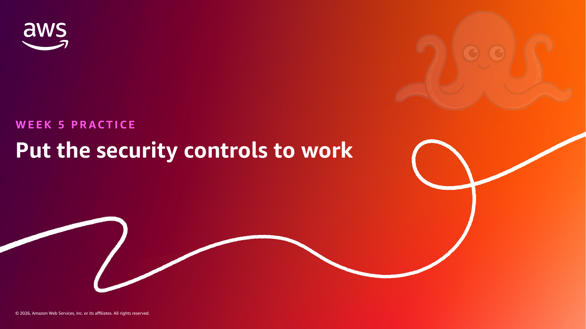

### Notes

WHAT'S HERE: The practice block for week 5. Seven questions, each in four beats -- read the stem, name the key phrase, reveal the answer, then the explainer.

FACILITATOR: Tell the room the rhythm before the first question so nobody is waiting for a discussion during the read beat. They read silently, commit to an answer, then you reveal.

Six of the seven key on A. That is an artifact of the question set rather than a pattern worth learning, so if someone notices it out loud, say so plainly -- otherwise they will start answering the letter instead of the question.

⚠ Question 6's keyed answer and what this deck teaches about Bedrock model access do not agree. Its explainer notes carry the detail. Read them before you reveal it.

---

## Slide 33 — Question 1: a download link that expires in 15 minutes

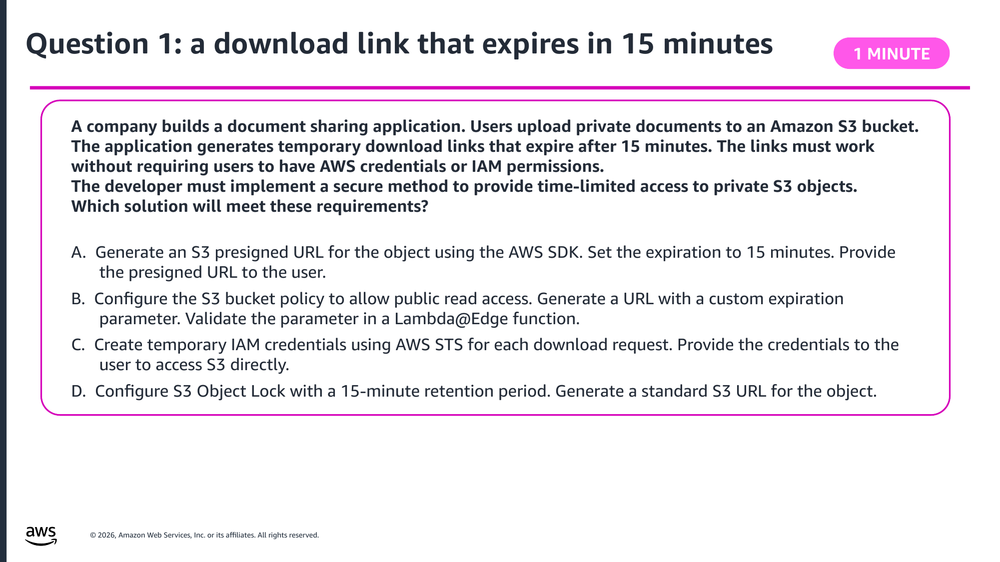

### Question

A company builds a document sharing application. Users upload private documents to an Amazon S3 bucket. The application generates temporary download links that expire after 15 minutes. The links must work without requiring users to have AWS credentials or IAM permissions.
The developer must implement a secure method to provide time-limited access to private S3 objects.
Which solution will meet these requirements?

A.  Generate an S3 presigned URL for the object using the AWS SDK. Set the expiration to 15 minutes. Provide the presigned URL to the user.
B.  Configure the S3 bucket policy to allow public read access. Generate a URL with a custom expiration parameter. Validate the parameter in a Lambda@Edge function.
C.  Create temporary IAM credentials using AWS STS for each download request. Provide the credentials to the user to access S3 directly.
D.  Configure S3 Object Lock with a 15-minute retention period. Generate a standard S3 URL for the object.

### Notes

WHAT'S HERE: Put question 1 on screen and give the room about 90 seconds to read it in silence and commit to an answer before anyone speaks aloud. That is close to the pace the exam demands, so this rehearses timing as much as content.

Do not reveal or hint at the answer on this beat. The silent read is what makes the key-phrases beat and the reveal land -- if you talk through it now, both lose their effect.

EXAM RELEVANCE: Domain 2: Security. Difficulty: Medium. Watch the room: if most people have answered by 90 seconds, move on; if they are still reading, give another 20 seconds rather than rushing the discussion that follows.

PARTNER CONTEXT · ADVISORY: A customer wanting to share documents with people who have no AWS account usually proposes making the bucket public and keeping the URL quiet. Redirecting that to a presigned URL is a straightforward win, but tell them the expiry IS the security control and that a link cannot be recalled early.

PARTNER CONTEXT · OPERATOR: A partner is sharing private documents with people who will never have an AWS account, and the instinct is to open the bucket and guard the URL instead. A presigned URL inverts that: the object stays private and the link carries a signature plus an expiry. The point worth making is the one this deck taught earlier -- the link inherits the SIGNER's permissions, so whichever role generates it decides what the link can do, and it cannot be revoked before it expires. Fifteen minutes is a security decision, not a convenience one.

EXAM MAPPING: Domain 2: Security.

---

## Slide 34 — Question 1: a download link that expires in 15 minutes

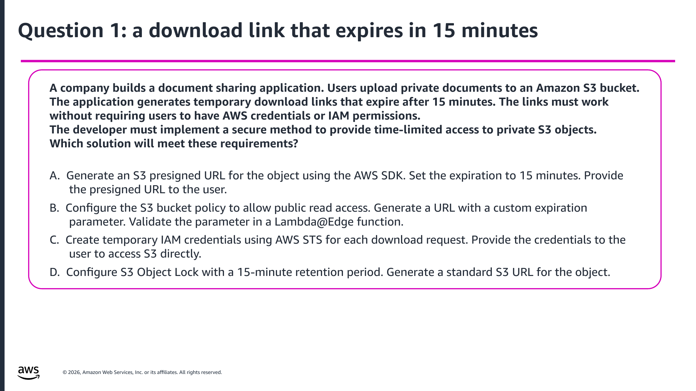

### Question

A company builds a document sharing application. Users upload private documents to an Amazon S3 bucket. The application generates temporary download links that expire after 15 minutes. The links must work without requiring users to have AWS credentials or IAM permissions.
The developer must implement a secure method to provide time-limited access to private S3 objects.
Which solution will meet these requirements?

A.  Generate an S3 presigned URL for the object using the AWS SDK. Set the expiration to 15 minutes. Provide the presigned URL to the user.
B.  Configure the S3 bucket policy to allow public read access. Generate a URL with a custom expiration parameter. Validate the parameter in a Lambda@Edge function.
C.  Create temporary IAM credentials using AWS STS for each download request. Provide the credentials to the user to access S3 directly.
D.  Configure S3 Object Lock with a 15-minute retention period. Generate a standard S3 URL for the object.

### Notes

KEY PHRASES: Walk the question, do not answer it yet. The phrase that decides it is “without requiring users to have AWS credentials”, and it tells you: Time-limited access for someone with no AWS identity is a presigned URL.

WHAT'S HERE: The same question with the timer removed. This beat teaches HOW to read a scenario question -- find the requirement, then find the words that separate options that all look plausible on a first pass.

EXAM RELEVANCE: Domain 2: Security. Difficulty: Medium. Ask the room which words they underlined before you show them the tell, so they practise finding it rather than being handed it.

PARTNER CONTEXT · ADVISORY: A customer wanting to share documents with people who have no AWS account usually proposes making the bucket public and keeping the URL quiet. Redirecting that to a presigned URL is a straightforward win, but tell them the expiry IS the security control and that a link cannot be recalled early.

PARTNER CONTEXT · OPERATOR: A partner is sharing private documents with people who will never have an AWS account, and the instinct is to open the bucket and guard the URL instead. A presigned URL inverts that: the object stays private and the link carries a signature plus an expiry. The point worth making is the one this deck taught earlier -- the link inherits the SIGNER's permissions, so whichever role generates it decides what the link can do, and it cannot be revoked before it expires. Fifteen minutes is a security decision, not a convenience one.

EXAM MAPPING: Domain 2: Security.

---

## Slide 35 — Question 1: a download link that expires in 15 minutes

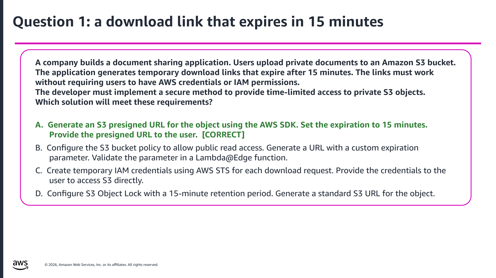

### Question

A company builds a document sharing application. Users upload private documents to an Amazon S3 bucket. The application generates temporary download links that expire after 15 minutes. The links must work without requiring users to have AWS credentials or IAM permissions.
The developer must implement a secure method to provide time-limited access to private S3 objects.
Which solution will meet these requirements?

A.  Generate an S3 presigned URL for the object using the AWS SDK. Set the expiration to 15 minutes. Provide the presigned URL to the user.  [CORRECT]
B.  Configure the S3 bucket policy to allow public read access. Generate a URL with a custom expiration parameter. Validate the parameter in a Lambda@Edge function.
C.  Create temporary IAM credentials using AWS STS for each download request. Provide the credentials to the user to access S3 directly.
D.  Configure S3 Object Lock with a 15-minute retention period. Generate a standard S3 URL for the object.

### Notes

ANSWER OVERVIEW: The answer is A. The signature carries the access, so the recipient needs no identity.

A. Generate an S3 presigned URL for the object using the AWS SDK. Set the expiration to 15 minutes. Provide the presigned URL to the user. — Correct — S3 presigned URLs grant temporary access to private objects without requiring the requester to have AWS credentials. The URL includes a signature and expiration time. After expiration the URL is no longer valid. The SDK generates the URL using the credentials of the IAM principal making the request.

B. Configure the S3 bucket policy to allow public read access. Generate a URL with a custom expiration parameter. Validate the parameter in a Lambda@Edge function. — Incorrect — Making the bucket publicly readable exposes all documents to anyone with the URL, regardless of expiration. Custom expiration parameters in URLs are not natively enforced by S3. A Lambda@Edge function adds complexity and does not provide the same security as built-in presigned URL enforcement.

C. Create temporary IAM credentials using AWS STS for each download request. Provide the credentials to the user to access S3 directly. — Incorrect — Issuing temporary IAM credentials to end users requires them to make authenticated AWS API calls. This adds complexity to the client application and requires the user to understand AWS authentication. Presigned URLs are simpler because they work as standard HTTP GET requests.

D. Configure S3 Object Lock with a 15-minute retention period. Generate a standard S3 URL for the object. — Incorrect — S3 Object Lock prevents objects from being deleted or overwritten for a specified retention period. It does not control read access or provide time-limited download links. Object Lock is a data protection feature, not an access control mechanism for temporary sharing.

EXAM RELEVANCE: Domain 2: Security. Difficulty: Medium.

REFERENCE: https://docs.aws.amazon.com/AmazonS3/latest/userguide/using-presigned-url.html

---

## Slide 36 — Question 1: a download link that expires in 15 minutes

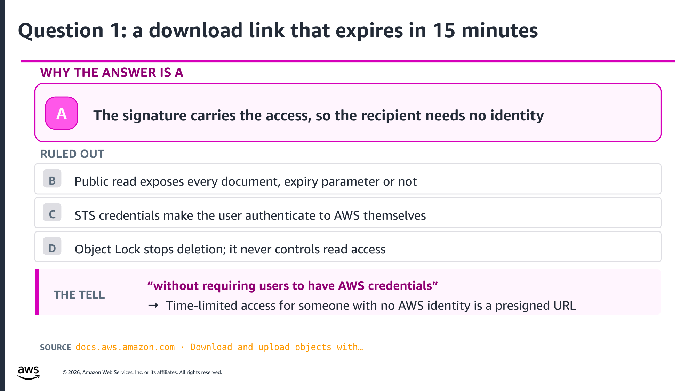

### Notes

WHAT'S HERE: The elimination, made visible. A win because the signature carries the access, so the recipient needs no identity. The others are ruled out for one reason each: B — Public read exposes every document, expiry parameter or not; C — STS credentials make the user authenticate to AWS themselves; D — Object Lock stops deletion; it never controls read access. Read the tell strip aloud -- pairing a phrase with what it signals is the transferable skill, not memorizing the service name.

EXAM RELEVANCE: Domain 2: Security. Difficulty: Medium. The pattern to teach: a scenario question rarely offers three absurd options. It offers ones that match a nearby requirement and one (or two) that match the requirement exactly. Here the discriminator is “without requiring users to have AWS credentials”, which points at Time-limited access for someone with no AWS identity is a presigned URL. Encourage the room to name the phrase before naming the service.

PARTNER CONTEXT · ADVISORY: A customer wanting to share documents with people who have no AWS account usually proposes making the bucket public and keeping the URL quiet. Redirecting that to a presigned URL is a straightforward win, but tell them the expiry IS the security control and that a link cannot be recalled early.

PARTNER CONTEXT · OPERATOR: A partner is sharing private documents with people who will never have an AWS account, and the instinct is to open the bucket and guard the URL instead. A presigned URL inverts that: the object stays private and the link carries a signature plus an expiry. The point worth making is the one this deck taught earlier -- the link inherits the SIGNER's permissions, so whichever role generates it decides what the link can do, and it cannot be revoked before it expires. Fifteen minutes is a security decision, not a convenience one.

REFERENCE: https://docs.aws.amazon.com/AmazonS3/latest/userguide/using-presigned-url.html

REFERENCE: https://docs.aws.amazon.com/sdk-for-java/latest/developer-guide/examples-s3-presign.html  -- the CSV supplies a second verified page for this question.

---

## Slide 37 — Question 2: keeping account numbers out of an answer

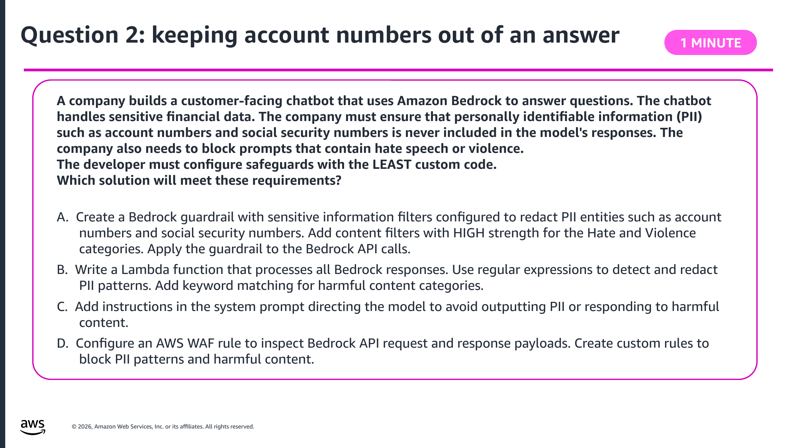

### Question

A company builds a customer-facing chatbot that uses Amazon Bedrock to answer questions. The chatbot handles sensitive financial data. The company must ensure that personally identifiable information (PII) such as account numbers and social security numbers is never included in the model's responses. The company also needs to block prompts that contain hate speech or violence.
The developer must configure safeguards with the LEAST custom code.
Which solution will meet these requirements?

A.  Create a Bedrock guardrail with sensitive information filters configured to redact PII entities such as account numbers and social security numbers. Add content filters with HIGH strength for the Hate and Violence categories. Apply the guardrail to the Bedrock API calls.
B.  Write a Lambda function that processes all Bedrock responses. Use regular expressions to detect and redact PII patterns. Add keyword matching for harmful content categories.
C.  Add instructions in the system prompt directing the model to avoid outputting PII or responding to harmful content.
D.  Configure an AWS WAF rule to inspect Bedrock API request and response payloads. Create custom rules to block PII patterns and harmful content.

### Notes

WHAT'S HERE: Put question 2 on screen and give the room about 90 seconds to read it in silence and commit to an answer before anyone speaks aloud. That is close to the pace the exam demands, so this rehearses timing as much as content.

Do not reveal or hint at the answer on this beat. The silent read is what makes the key-phrases beat and the reveal land -- if you talk through it now, both lose their effect.

EXAM RELEVANCE: Domain 2: Security. Difficulty: Medium. Watch the room: if most people have answered by 90 seconds, move on; if they are still reading, give another 20 seconds rather than rushing the discussion that follows.

PARTNER CONTEXT · ADVISORY: A customer planning to scrub responses with their own code is volunteering to maintain a pattern library forever. Recommending a guardrail is the easy half; the part they need from you is the tool-call gap, because that decides whether their design is actually complete.

PARTNER CONTEXT · OPERATOR: A partner's chatbot handles financial data, and the tempting build is a Lambda that regex-scrubs responses on the way out. That is a pattern library somebody then maintains forever, and it only sees the output. A guardrail is configured rather than coded, and it evaluates the prompt AND the response. Worth naming the limit this deck taught: the sensitive-information filter evaluates text, so PII the model writes into a TOOL CALL is not masked. That is the gap to design around, not a reason to hand-roll the filter.

EXAM MAPPING: Domain 2: Security.

---

## Slide 38 — Question 2: keeping account numbers out of an answer

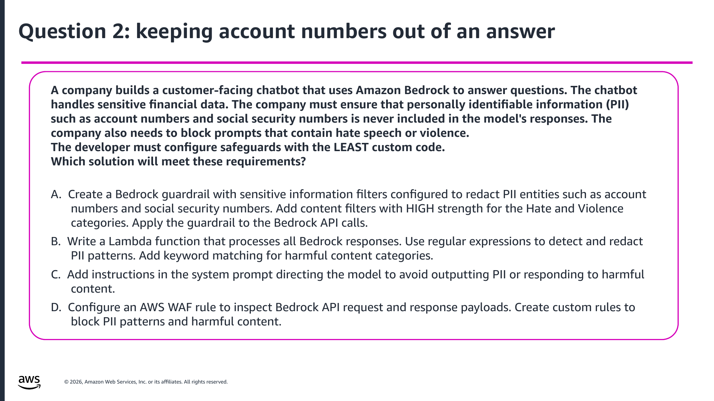

### Question

A company builds a customer-facing chatbot that uses Amazon Bedrock to answer questions. The chatbot handles sensitive financial data. The company must ensure that personally identifiable information (PII) such as account numbers and social security numbers is never included in the model's responses. The company also needs to block prompts that contain hate speech or violence.
The developer must configure safeguards with the LEAST custom code.
Which solution will meet these requirements?

A.  Create a Bedrock guardrail with sensitive information filters configured to redact PII entities such as account numbers and social security numbers. Add content filters with HIGH strength for the Hate and Violence categories. Apply the guardrail to the Bedrock API calls.
B.  Write a Lambda function that processes all Bedrock responses. Use regular expressions to detect and redact PII patterns. Add keyword matching for harmful content categories.
C.  Add instructions in the system prompt directing the model to avoid outputting PII or responding to harmful content.
D.  Configure an AWS WAF rule to inspect Bedrock API request and response payloads. Create custom rules to block PII patterns and harmful content.

### Notes

KEY PHRASES: Walk the question, do not answer it yet. The phrase that decides it is “with the LEAST custom code”, and it tells you: Least custom code over a model's input and output points at a guardrail.

WHAT'S HERE: The same question with the timer removed. This beat teaches HOW to read a scenario question -- find the requirement, then find the words that separate options that all look plausible on a first pass.

EXAM RELEVANCE: Domain 2: Security. Difficulty: Medium. Ask the room which words they underlined before you show them the tell, so they practise finding it rather than being handed it.

PARTNER CONTEXT · ADVISORY: A customer planning to scrub responses with their own code is volunteering to maintain a pattern library forever. Recommending a guardrail is the easy half; the part they need from you is the tool-call gap, because that decides whether their design is actually complete.

PARTNER CONTEXT · OPERATOR: A partner's chatbot handles financial data, and the tempting build is a Lambda that regex-scrubs responses on the way out. That is a pattern library somebody then maintains forever, and it only sees the output. A guardrail is configured rather than coded, and it evaluates the prompt AND the response. Worth naming the limit this deck taught: the sensitive-information filter evaluates text, so PII the model writes into a TOOL CALL is not masked. That is the gap to design around, not a reason to hand-roll the filter.

EXAM MAPPING: Domain 2: Security.

---

## Slide 39 — Question 2: keeping account numbers out of an answer

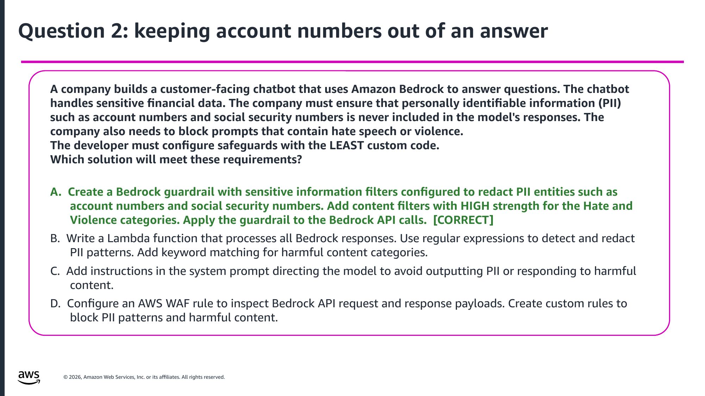

### Question

A company builds a customer-facing chatbot that uses Amazon Bedrock to answer questions. The chatbot handles sensitive financial data. The company must ensure that personally identifiable information (PII) such as account numbers and social security numbers is never included in the model's responses. The company also needs to block prompts that contain hate speech or violence.
The developer must configure safeguards with the LEAST custom code.
Which solution will meet these requirements?

A.  Create a Bedrock guardrail with sensitive information filters configured to redact PII entities such as account numbers and social security numbers. Add content filters with HIGH strength for the Hate and Violence categories. Apply the guardrail to the Bedrock API calls.  [CORRECT]
B.  Write a Lambda function that processes all Bedrock responses. Use regular expressions to detect and redact PII patterns. Add keyword matching for harmful content categories.
C.  Add instructions in the system prompt directing the model to avoid outputting PII or responding to harmful content.
D.  Configure an AWS WAF rule to inspect Bedrock API request and response payloads. Create custom rules to block PII patterns and harmful content.

### Notes

ANSWER OVERVIEW: The answer is A. One guardrail covers both the PII filter and the content categories.

A. Create a Bedrock guardrail with sensitive information filters configured to redact PII entities such as account numbers and social security numbers. Add content filters with HIGH strength for the Hate and Violence categories. Apply the guardrail to the Bedrock API calls. — Correct — Amazon Bedrock Guardrails provides built-in sensitive information filters that detect and redact PII in both inputs and outputs. Content filters evaluate text against predefined categories including Hate and Violence with configurable strength levels. A single guardrail configuration handles both requirements without custom code.

B. Write a Lambda function that processes all Bedrock responses. Use regular expressions to detect and redact PII patterns. Add keyword matching for harmful content categories. — Incorrect — Writing custom regex patterns for PII detection requires maintaining complex pattern libraries and handling edge cases. Regex-based content filtering for hate speech and violence is unreliable compared to ML-based classifiers. Amazon Bedrock Guardrails provides these capabilities as a managed service without custom code.

C. Add instructions in the system prompt directing the model to avoid outputting PII or responding to harmful content. — Incorrect — System prompt instructions are not a reliable security control. Models can be manipulated through prompt injection to ignore system prompt restrictions. PII may still appear in responses despite instructions. Bedrock Guardrails provides deterministic enforcement that cannot be bypassed by prompt manipulation.

D. Configure an AWS WAF rule to inspect Bedrock API request and response payloads. Create custom rules to block PII patterns and harmful content. — Incorrect — AWS WAF inspects HTTP request and response headers and bodies for web applications. WAF is designed for web application protection at the edge and is not integrated with Amazon Bedrock API calls. WAF cannot inspect the content of Bedrock model invocations or filter LLM responses.

EXAM RELEVANCE: Domain 2: Security. Difficulty: Medium.

REFERENCE: https://docs.aws.amazon.com/bedrock/latest/userguide/guardrails-sensitive-filters.html

---

## Slide 40 — Question 2: keeping account numbers out of an answer

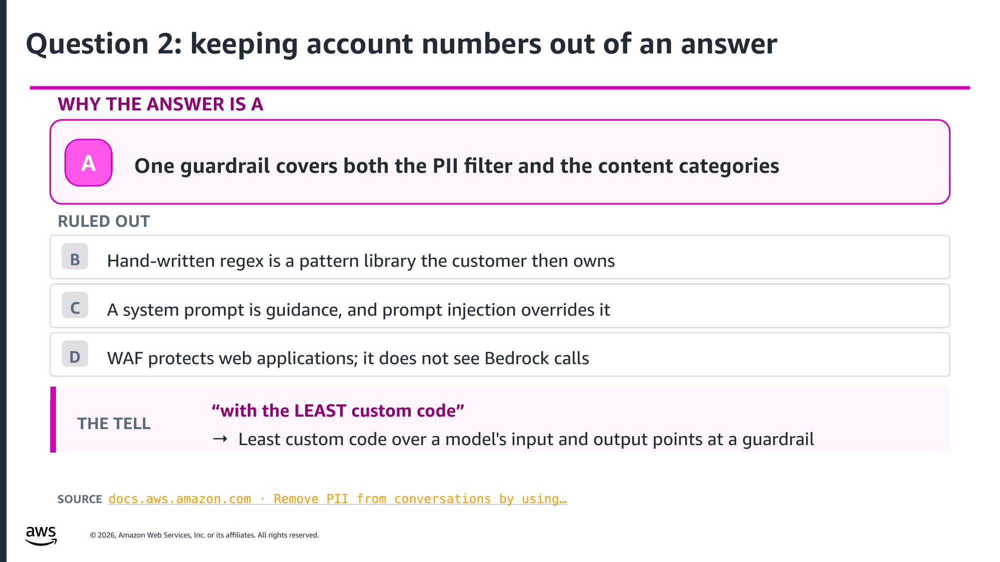

### Notes

WHAT'S HERE: The elimination, made visible. A win because one guardrail covers both the PII filter and the content categories. The others are ruled out for one reason each: B — Hand-written regex is a pattern library the customer then owns; C — A system prompt is guidance, and prompt injection overrides it; D — WAF protects web applications; it does not see Bedrock calls. Read the tell strip aloud -- pairing a phrase with what it signals is the transferable skill, not memorizing the service name.

EXAM RELEVANCE: Domain 2: Security. Difficulty: Medium. The pattern to teach: a scenario question rarely offers three absurd options. It offers ones that match a nearby requirement and one (or two) that match the requirement exactly. Here the discriminator is “with the LEAST custom code”, which points at Least custom code over a model's input and output points at a guardrail. Encourage the room to name the phrase before naming the service.

PARTNER CONTEXT · ADVISORY: A customer planning to scrub responses with their own code is volunteering to maintain a pattern library forever. Recommending a guardrail is the easy half; the part they need from you is the tool-call gap, because that decides whether their design is actually complete.

PARTNER CONTEXT · OPERATOR: A partner's chatbot handles financial data, and the tempting build is a Lambda that regex-scrubs responses on the way out. That is a pattern library somebody then maintains forever, and it only sees the output. A guardrail is configured rather than coded, and it evaluates the prompt AND the response. Worth naming the limit this deck taught: the sensitive-information filter evaluates text, so PII the model writes into a TOOL CALL is not masked. That is the gap to design around, not a reason to hand-roll the filter.

REFERENCE: https://docs.aws.amazon.com/bedrock/latest/userguide/guardrails-sensitive-filters.html

REFERENCE: https://docs.aws.amazon.com/bedrock/latest/userguide/guardrails.html  -- the CSV supplies a second verified page for this question.

---

## Slide 41 — Question 3: calling a model without touching the internet

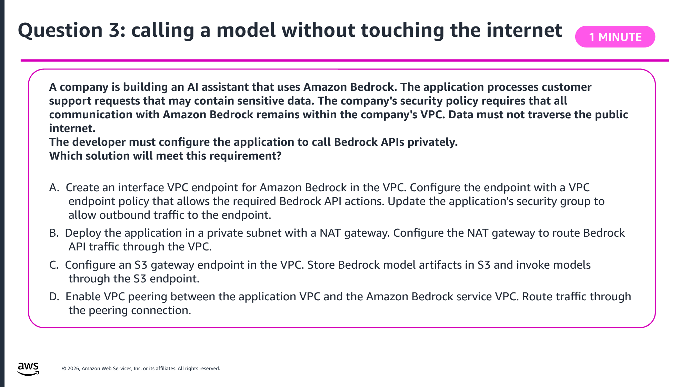

### Question

A company is building an AI assistant that uses Amazon Bedrock. The application processes customer support requests that may contain sensitive data. The company's security policy requires that all communication with Amazon Bedrock remains within the company's VPC. Data must not traverse the public internet.
The developer must configure the application to call Bedrock APIs privately.
Which solution will meet this requirement?

A.  Create an interface VPC endpoint for Amazon Bedrock in the VPC. Configure the endpoint with a VPC endpoint policy that allows the required Bedrock API actions. Update the application's security group to allow outbound traffic to the endpoint.
B.  Deploy the application in a private subnet with a NAT gateway. Configure the NAT gateway to route Bedrock API traffic through the VPC.
C.  Configure an S3 gateway endpoint in the VPC. Store Bedrock model artifacts in S3 and invoke models through the S3 endpoint.
D.  Enable VPC peering between the application VPC and the Amazon Bedrock service VPC. Route traffic through the peering connection.

### Notes

WHAT'S HERE: Put question 3 on screen and give the room about 90 seconds to read it in silence and commit to an answer before anyone speaks aloud. That is close to the pace the exam demands, so this rehearses timing as much as content.

Do not reveal or hint at the answer on this beat. The silent read is what makes the key-phrases beat and the reveal land -- if you talk through it now, both lose their effect.

EXAM RELEVANCE: Domain 2: Security. Difficulty: Medium. Watch the room: if most people have answered by 90 seconds, move on; if they are still reading, give another 20 seconds rather than rushing the discussion that follows.

PARTNER CONTEXT · ADVISORY: A customer who says the workload is in a private subnet often believes that settles egress. Separating private subnet from private path is one of the more valuable corrections you can make in a design review, and the endpoint policy is the follow-on their security team will ask for.

PARTNER CONTEXT · OPERATOR: A partner whose customer has mandated no internet egress from the data tier meets this exact question in a design review. This is the question that separates private SUBNET from private PATH. A partner hears 'private subnet with a NAT gateway' and reads it as private, but the NAT gateway's whole job is to reach the internet -- the traffic leaves. An interface endpoint gives the service an address inside the VPC, so the request never leaves the AWS network. The endpoint POLICY is the part worth showing: it constrains which Bedrock actions may pass, which is a second control the security team usually wants once they understand the first.

EXAM MAPPING: Domain 2: Security.

---

## Slide 42 — Question 3: calling a model without touching the internet

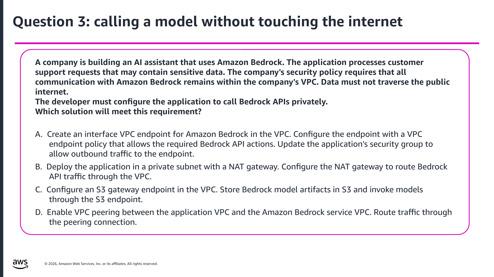

### Question

A company is building an AI assistant that uses Amazon Bedrock. The application processes customer support requests that may contain sensitive data. The company's security policy requires that all communication with Amazon Bedrock remains within the company's VPC. Data must not traverse the public internet.
The developer must configure the application to call Bedrock APIs privately.
Which solution will meet this requirement?

A.  Create an interface VPC endpoint for Amazon Bedrock in the VPC. Configure the endpoint with a VPC endpoint policy that allows the required Bedrock API actions. Update the application's security group to allow outbound traffic to the endpoint.
B.  Deploy the application in a private subnet with a NAT gateway. Configure the NAT gateway to route Bedrock API traffic through the VPC.
C.  Configure an S3 gateway endpoint in the VPC. Store Bedrock model artifacts in S3 and invoke models through the S3 endpoint.
D.  Enable VPC peering between the application VPC and the Amazon Bedrock service VPC. Route traffic through the peering connection.

### Notes

KEY PHRASES: Walk the question, do not answer it yet. The phrase that decides it is “must not traverse the public internet”, and it tells you: Private reach to an AWS API means an interface endpoint over PrivateLink.

WHAT'S HERE: The same question with the timer removed. This beat teaches HOW to read a scenario question -- find the requirement, then find the words that separate options that all look plausible on a first pass.

EXAM RELEVANCE: Domain 2: Security. Difficulty: Medium. Ask the room which words they underlined before you show them the tell, so they practise finding it rather than being handed it.

PARTNER CONTEXT · ADVISORY: A customer who says the workload is in a private subnet often believes that settles egress. Separating private subnet from private path is one of the more valuable corrections you can make in a design review, and the endpoint policy is the follow-on their security team will ask for.

PARTNER CONTEXT · OPERATOR: A partner whose customer has mandated no internet egress from the data tier meets this exact question in a design review. This is the question that separates private SUBNET from private PATH. A partner hears 'private subnet with a NAT gateway' and reads it as private, but the NAT gateway's whole job is to reach the internet -- the traffic leaves. An interface endpoint gives the service an address inside the VPC, so the request never leaves the AWS network. The endpoint POLICY is the part worth showing: it constrains which Bedrock actions may pass, which is a second control the security team usually wants once they understand the first.

EXAM MAPPING: Domain 2: Security.

---

## Slide 43 — Question 3: calling a model without touching the internet

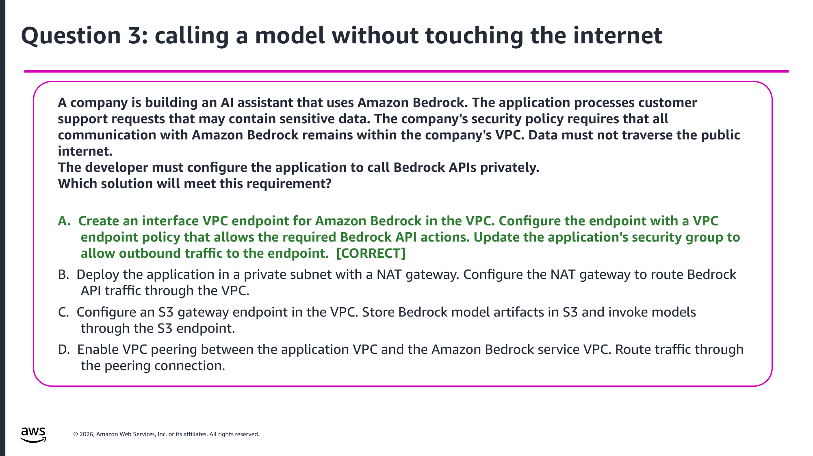

### Question

A company is building an AI assistant that uses Amazon Bedrock. The application processes customer support requests that may contain sensitive data. The company's security policy requires that all communication with Amazon Bedrock remains within the company's VPC. Data must not traverse the public internet.
The developer must configure the application to call Bedrock APIs privately.
Which solution will meet this requirement?

A.  Create an interface VPC endpoint for Amazon Bedrock in the VPC. Configure the endpoint with a VPC endpoint policy that allows the required Bedrock API actions. Update the application's security group to allow outbound traffic to the endpoint.  [CORRECT]
B.  Deploy the application in a private subnet with a NAT gateway. Configure the NAT gateway to route Bedrock API traffic through the VPC.
C.  Configure an S3 gateway endpoint in the VPC. Store Bedrock model artifacts in S3 and invoke models through the S3 endpoint.
D.  Enable VPC peering between the application VPC and the Amazon Bedrock service VPC. Route traffic through the peering connection.

### Notes

ANSWER OVERVIEW: The answer is A. An interface endpoint puts the Bedrock API inside the VPC itself.

A. Create an interface VPC endpoint for Amazon Bedrock in the VPC. Configure the endpoint with a VPC endpoint policy that allows the required Bedrock API actions. Update the application's security group to allow outbound traffic to the endpoint. — Correct — An interface VPC endpoint powered by AWS PrivateLink creates a private connection between the VPC and Amazon Bedrock. Traffic between the VPC and Bedrock stays within the AWS network and does not traverse the public internet. A VPC endpoint policy controls which Bedrock actions are permitted through the endpoint.

B. Deploy the application in a private subnet with a NAT gateway. Configure the NAT gateway to route Bedrock API traffic through the VPC. — Incorrect — A NAT gateway allows resources in private subnets to access the internet for outbound connections. Traffic through a NAT gateway still traverses the public internet to reach AWS service endpoints. This does not meet the requirement for traffic to remain within the VPC.

C. Configure an S3 gateway endpoint in the VPC. Store Bedrock model artifacts in S3 and invoke models through the S3 endpoint. — Incorrect — S3 gateway endpoints provide private access to Amazon S3 only. Amazon Bedrock is a separate service with its own API endpoints. You cannot invoke Bedrock models through an S3 endpoint. Bedrock requires an interface VPC endpoint (PrivateLink) for private connectivity.

D. Enable VPC peering between the application VPC and the Amazon Bedrock service VPC. Route traffic through the peering connection. — Incorrect — VPC peering connects two VPCs directly but is used between customer VPCs or between accounts. Amazon Bedrock does not expose a customer-peerable VPC. AWS PrivateLink (interface VPC endpoints) is the mechanism for private connectivity to AWS managed services like Bedrock.

EXAM RELEVANCE: Domain 2: Security. Difficulty: Medium.

REFERENCE: https://docs.aws.amazon.com/bedrock/latest/userguide/vpc-interface-endpoints.html

---

## Slide 44 — Question 3: calling a model without touching the internet

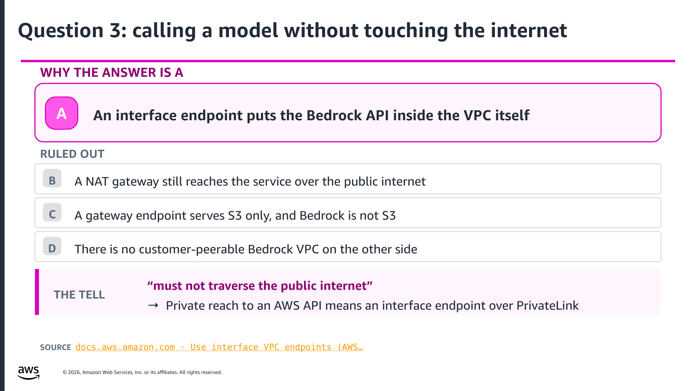

### Notes

WHAT'S HERE: The elimination, made visible. A win because an interface endpoint puts the Bedrock API inside the VPC itself. The others are ruled out for one reason each: B — A NAT gateway still reaches the service over the public internet; C — A gateway endpoint serves S3 only, and Bedrock is not S3; D — There is no customer-peerable Bedrock VPC on the other side. Read the tell strip aloud -- pairing a phrase with what it signals is the transferable skill, not memorizing the service name.

EXAM RELEVANCE: Domain 2: Security. Difficulty: Medium. The pattern to teach: a scenario question rarely offers three absurd options. It offers ones that match a nearby requirement and one (or two) that match the requirement exactly. Here the discriminator is “must not traverse the public internet”, which points at Private reach to an AWS API means an interface endpoint over PrivateLink. Encourage the room to name the phrase before naming the service.

PARTNER CONTEXT · ADVISORY: A customer who says the workload is in a private subnet often believes that settles egress. Separating private subnet from private path is one of the more valuable corrections you can make in a design review, and the endpoint policy is the follow-on their security team will ask for.

PARTNER CONTEXT · OPERATOR: A partner whose customer has mandated no internet egress from the data tier meets this exact question in a design review. This is the question that separates private SUBNET from private PATH. A partner hears 'private subnet with a NAT gateway' and reads it as private, but the NAT gateway's whole job is to reach the internet -- the traffic leaves. An interface endpoint gives the service an address inside the VPC, so the request never leaves the AWS network. The endpoint POLICY is the part worth showing: it constrains which Bedrock actions may pass, which is a second control the security team usually wants once they understand the first.

REFERENCE: https://docs.aws.amazon.com/bedrock/latest/userguide/vpc-interface-endpoints.html

---

## Slide 45 — Question 4: finding which hop is costing the time

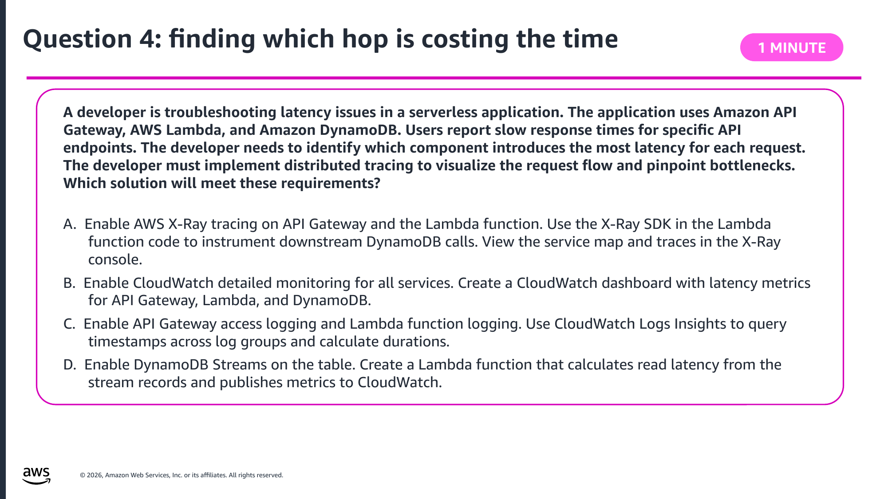

### Question

A developer is troubleshooting latency issues in a serverless application. The application uses Amazon API Gateway, AWS Lambda, and Amazon DynamoDB. Users report slow response times for specific API endpoints. The developer needs to identify which component introduces the most latency for each request.
The developer must implement distributed tracing to visualize the request flow and pinpoint bottlenecks.
Which solution will meet these requirements?

A.  Enable AWS X-Ray tracing on API Gateway and the Lambda function. Use the X-Ray SDK in the Lambda function code to instrument downstream DynamoDB calls. View the service map and traces in the X-Ray console.
B.  Enable CloudWatch detailed monitoring for all services. Create a CloudWatch dashboard with latency metrics for API Gateway, Lambda, and DynamoDB.
C.  Enable API Gateway access logging and Lambda function logging. Use CloudWatch Logs Insights to query timestamps across log groups and calculate durations.
D.  Enable DynamoDB Streams on the table. Create a Lambda function that calculates read latency from the stream records and publishes metrics to CloudWatch.

### Notes

WHAT'S HERE: Put question 4 on screen and give the room about 90 seconds to read it in silence and commit to an answer before anyone speaks aloud. That is close to the pace the exam demands, so this rehearses timing as much as content.

Do not reveal or hint at the answer on this beat. The silent read is what makes the key-phrases beat and the reveal land -- if you talk through it now, both lose their effect.

EXAM RELEVANCE: Domain 4: Troubleshooting and Optimization. Difficulty: Medium. Watch the room: if most people have answered by 90 seconds, move on; if they are still reading, give another 20 seconds rather than rushing the discussion that follows.

PARTNER CONTEXT · ADVISORY: A customer with a dashboard showing a bad p99 has aggregate data and wants a cause. Explaining that a trace answers which call, and that the DynamoDB bar is an upper bound rather than the table's own time, keeps them from optimizing the wrong component.

PARTNER CONTEXT · OPERATOR: A partner chasing an intermittent latency complaint across three services is the case this question models. The distinction to hold onto is aggregate versus individual. CloudWatch will tell a partner that this endpoint's p99 is bad; only a trace tells them WHICH call inside a specific slow request took the time. The caveat this deck taught belongs here too: DynamoDB does not send its own segments, so the DynamoDB bar is an INFERRED segment measured by the Lambda function's own SDK client. It includes the round trip and any client-side retry, which makes it an upper bound on the table's time rather than the table's own number.

EXAM MAPPING: Domain 4: Troubleshooting and Optimization.

---

## Slide 46 — Question 4: finding which hop is costing the time

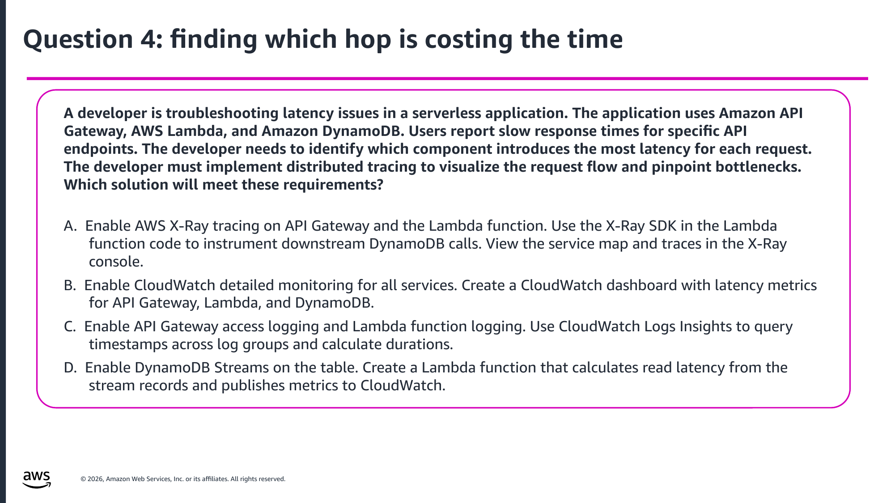

### Question

A developer is troubleshooting latency issues in a serverless application. The application uses Amazon API Gateway, AWS Lambda, and Amazon DynamoDB. Users report slow response times for specific API endpoints. The developer needs to identify which component introduces the most latency for each request.
The developer must implement distributed tracing to visualize the request flow and pinpoint bottlenecks.
Which solution will meet these requirements?

A.  Enable AWS X-Ray tracing on API Gateway and the Lambda function. Use the X-Ray SDK in the Lambda function code to instrument downstream DynamoDB calls. View the service map and traces in the X-Ray console.
B.  Enable CloudWatch detailed monitoring for all services. Create a CloudWatch dashboard with latency metrics for API Gateway, Lambda, and DynamoDB.
C.  Enable API Gateway access logging and Lambda function logging. Use CloudWatch Logs Insights to query timestamps across log groups and calculate durations.
D.  Enable DynamoDB Streams on the table. Create a Lambda function that calculates read latency from the stream records and publishes metrics to CloudWatch.

### Notes

KEY PHRASES: Walk the question, do not answer it yet. The phrase that decides it is “which component introduces the most latency”, and it tells you: Per-request attribution across services is distributed tracing, so X-Ray.

WHAT'S HERE: The same question with the timer removed. This beat teaches HOW to read a scenario question -- find the requirement, then find the words that separate options that all look plausible on a first pass.

EXAM RELEVANCE: Domain 4: Troubleshooting and Optimization. Difficulty: Medium. Ask the room which words they underlined before you show them the tell, so they practise finding it rather than being handed it.

PARTNER CONTEXT · ADVISORY: A customer with a dashboard showing a bad p99 has aggregate data and wants a cause. Explaining that a trace answers which call, and that the DynamoDB bar is an upper bound rather than the table's own time, keeps them from optimizing the wrong component.

PARTNER CONTEXT · OPERATOR: A partner chasing an intermittent latency complaint across three services is the case this question models. The distinction to hold onto is aggregate versus individual. CloudWatch will tell a partner that this endpoint's p99 is bad; only a trace tells them WHICH call inside a specific slow request took the time. The caveat this deck taught belongs here too: DynamoDB does not send its own segments, so the DynamoDB bar is an INFERRED segment measured by the Lambda function's own SDK client. It includes the round trip and any client-side retry, which makes it an upper bound on the table's time rather than the table's own number.

EXAM MAPPING: Domain 4: Troubleshooting and Optimization.

---

## Slide 47 — Question 4: finding which hop is costing the time

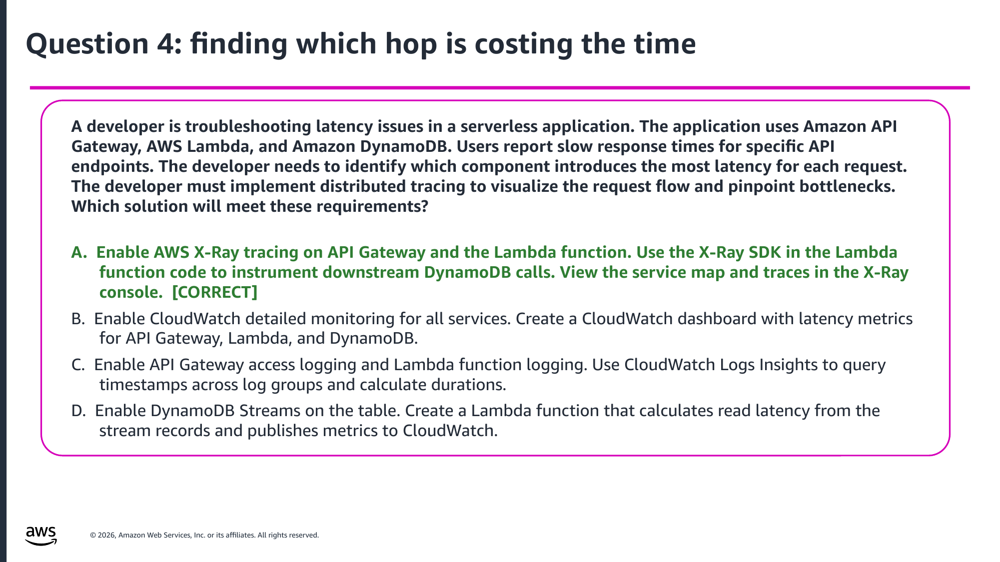

### Question

A developer is troubleshooting latency issues in a serverless application. The application uses Amazon API Gateway, AWS Lambda, and Amazon DynamoDB. Users report slow response times for specific API endpoints. The developer needs to identify which component introduces the most latency for each request.
The developer must implement distributed tracing to visualize the request flow and pinpoint bottlenecks.
Which solution will meet these requirements?

A.  Enable AWS X-Ray tracing on API Gateway and the Lambda function. Use the X-Ray SDK in the Lambda function code to instrument downstream DynamoDB calls. View the service map and traces in the X-Ray console.  [CORRECT]
B.  Enable CloudWatch detailed monitoring for all services. Create a CloudWatch dashboard with latency metrics for API Gateway, Lambda, and DynamoDB.
C.  Enable API Gateway access logging and Lambda function logging. Use CloudWatch Logs Insights to query timestamps across log groups and calculate durations.
D.  Enable DynamoDB Streams on the table. Create a Lambda function that calculates read latency from the stream records and publishes metrics to CloudWatch.

### Notes

ANSWER OVERVIEW: The answer is A. A trace attributes time hop by hop for one request, not per service.

A. Enable AWS X-Ray tracing on API Gateway and the Lambda function. Use the X-Ray SDK in the Lambda function code to instrument downstream DynamoDB calls. View the service map and traces in the X-Ray console. — Correct — X-Ray provides end-to-end tracing across API Gateway, Lambda, and DynamoDB. Enabling X-Ray on API Gateway and Lambda captures the time spent at each service. Instrumenting DynamoDB calls with the X-Ray SDK creates subsegments showing individual call latency. The service map visualizes the request flow and identifies bottlenecks.

B. Enable CloudWatch detailed monitoring for all services. Create a CloudWatch dashboard with latency metrics for API Gateway, Lambda, and DynamoDB. — Incorrect — CloudWatch metrics show aggregate latency per service but do not trace individual requests through the system. A dashboard shows averages and percentiles but cannot correlate a single slow API request to a specific slow DynamoDB call within that request. Distributed tracing requires X-Ray.

C. Enable API Gateway access logging and Lambda function logging. Use CloudWatch Logs Insights to query timestamps across log groups and calculate durations. — Incorrect — Access logs and function logs record timestamps that can be correlated manually. However, this requires writing complex queries and manually calculating durations between components. This approach does not provide a visual service map or automatic trace correlation. X-Ray provides this functionality natively with minimal effort.

D. Enable DynamoDB Streams on the table. Create a Lambda function that calculates read latency from the stream records and publishes metrics to CloudWatch. — Incorrect — DynamoDB Streams capture data modification events (inserts, updates, deletes). They do not record read operations or their latency. Streams cannot help identify which DynamoDB reads are slow. Additionally, this approach only monitors DynamoDB and does not provide end-to-end request tracing.

EXAM RELEVANCE: Domain 4: Troubleshooting and Optimization. Difficulty: Medium.

REFERENCE: https://docs.aws.amazon.com/xray/latest/devguide/aws-xray.html

---

## Slide 48 — Question 4: finding which hop is costing the time

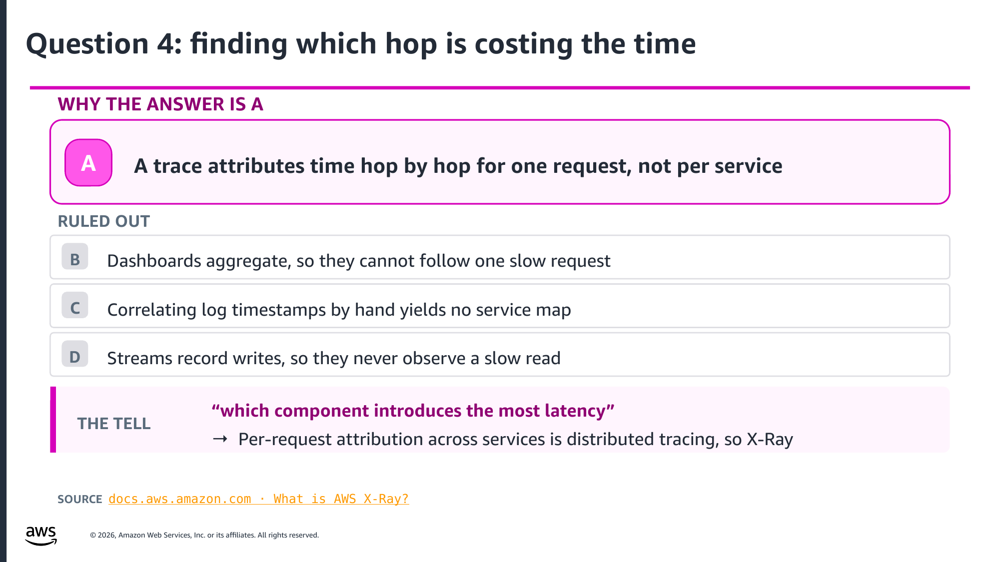

### Notes

WHAT'S HERE: The elimination, made visible. A win because a trace attributes time hop by hop for one request, not per service. The others are ruled out for one reason each: B — Dashboards aggregate, so they cannot follow one slow request; C — Correlating log timestamps by hand yields no service map; D — Streams record writes, so they never observe a slow read. Read the tell strip aloud -- pairing a phrase with what it signals is the transferable skill, not memorizing the service name.

EXAM RELEVANCE: Domain 4: Troubleshooting and Optimization. Difficulty: Medium. The pattern to teach: a scenario question rarely offers three absurd options. It offers ones that match a nearby requirement and one (or two) that match the requirement exactly. Here the discriminator is “which component introduces the most latency”, which points at Per-request attribution across services is distributed tracing, so X-Ray. Encourage the room to name the phrase before naming the service.

PARTNER CONTEXT · ADVISORY: A customer with a dashboard showing a bad p99 has aggregate data and wants a cause. Explaining that a trace answers which call, and that the DynamoDB bar is an upper bound rather than the table's own time, keeps them from optimizing the wrong component.

PARTNER CONTEXT · OPERATOR: A partner chasing an intermittent latency complaint across three services is the case this question models. The distinction to hold onto is aggregate versus individual. CloudWatch will tell a partner that this endpoint's p99 is bad; only a trace tells them WHICH call inside a specific slow request took the time. The caveat this deck taught belongs here too: DynamoDB does not send its own segments, so the DynamoDB bar is an INFERRED segment measured by the Lambda function's own SDK client. It includes the round trip and any client-side retry, which makes it an upper bound on the table's time rather than the table's own number.

REFERENCE: https://docs.aws.amazon.com/xray/latest/devguide/aws-xray.html

REFERENCE: https://docs.aws.amazon.com/lambda/latest/dg/services-xray.html  -- the CSV supplies a second verified page for this question.

---

## Slide 49 — Question 5: an agent that can move money

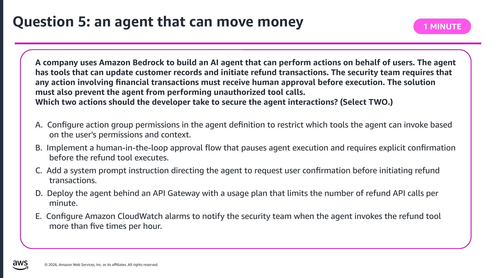

### Question

A company uses Amazon Bedrock to build an AI agent that can perform actions on behalf of users. The agent has tools that can update customer records and initiate refund transactions. The security team requires that any action involving financial transactions must receive human approval before execution. The solution must also prevent the agent from performing unauthorized tool calls.
Which two actions should the developer take to secure the agent interactions? (Select TWO.)

A.  Configure action group permissions in the agent definition to restrict which tools the agent can invoke based on the user's permissions and context.
B.  Implement a human-in-the-loop approval flow that pauses agent execution and requires explicit confirmation before the refund tool executes.
C.  Add a system prompt instruction directing the agent to request user confirmation before initiating refund transactions.
D.  Deploy the agent behind an API Gateway with a usage plan that limits the number of refund API calls per minute.
E.  Configure Amazon CloudWatch alarms to notify the security team when the agent invokes the refund tool more than five times per hour.

### Notes

WHAT'S HERE: Put question 5 on screen and give the room about 90 seconds to read it in silence and commit to an answer before anyone speaks aloud. Note this is a select-two question, so tell the room to expect more than one answer. That is close to the pace the exam demands, so this rehearses timing as much as content.

Do not reveal or hint at the answer on this beat. The silent read is what makes the key-phrases beat and the reveal land -- if you talk through it now, both lose their effect.

EXAM RELEVANCE: Domain 2: Security. Difficulty: Hard. Watch the room: if most people have answered by 90 seconds, move on; if they are still reading, give another 20 seconds rather than rushing the discussion that follows.

PARTNER CONTEXT · ADVISORY: A customer asking how to stop an agent taking an action it should not will reach for rate limits and alarms first. Naming user confirmation, and framing it as prompt injection defense, moves the conversation from volume control to authorization.

PARTNER CONTEXT · OPERATOR: A partner adding an agent that can move money is the situation this question is really about. This is the strongest security question in the set because three of the five choices are real controls that do not meet the requirement. Rate limiting and alarms are both defensible engineering; they simply act on volume and after the fact. The documented feature is user confirmation, and AWS frames it as a defense against PROMPT INJECTION -- the agent may be told by returned data to call something it should not, so the human sits between the decision and the transaction. That framing is also why choice C loses: the attack being defended against is precisely an instruction the model chooses to follow.

EXAM MAPPING: Domain 2: Security.

---

## Slide 50 — Question 5: an agent that can move money

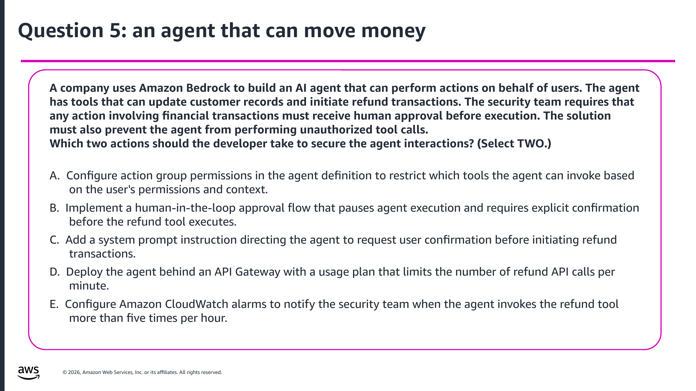

### Question

A company uses Amazon Bedrock to build an AI agent that can perform actions on behalf of users. The agent has tools that can update customer records and initiate refund transactions. The security team requires that any action involving financial transactions must receive human approval before execution. The solution must also prevent the agent from performing unauthorized tool calls.
Which two actions should the developer take to secure the agent interactions? (Select TWO.)

A.  Configure action group permissions in the agent definition to restrict which tools the agent can invoke based on the user's permissions and context.
B.  Implement a human-in-the-loop approval flow that pauses agent execution and requires explicit confirmation before the refund tool executes.
C.  Add a system prompt instruction directing the agent to request user confirmation before initiating refund transactions.
D.  Deploy the agent behind an API Gateway with a usage plan that limits the number of refund API calls per minute.
E.  Configure Amazon CloudWatch alarms to notify the security team when the agent invokes the refund tool more than five times per hour.

### Notes

KEY PHRASES: Walk the question, do not answer it yet. The phrase that decides it is “must receive human approval before execution”, and it tells you: Approval before an action needs a preventive control, not a detective one.

WHAT'S HERE: The same question with the timer removed. This beat teaches HOW to read a scenario question -- find the requirement, then find the words that separate options that all look plausible on a first pass.

EXAM RELEVANCE: Domain 2: Security. Difficulty: Hard. Ask the room which words they underlined before you show them the tell, so they practise finding it rather than being handed it.

PARTNER CONTEXT · ADVISORY: A customer asking how to stop an agent taking an action it should not will reach for rate limits and alarms first. Naming user confirmation, and framing it as prompt injection defense, moves the conversation from volume control to authorization.

PARTNER CONTEXT · OPERATOR: A partner adding an agent that can move money is the situation this question is really about. This is the strongest security question in the set because three of the five choices are real controls that do not meet the requirement. Rate limiting and alarms are both defensible engineering; they simply act on volume and after the fact. The documented feature is user confirmation, and AWS frames it as a defense against PROMPT INJECTION -- the agent may be told by returned data to call something it should not, so the human sits between the decision and the transaction. That framing is also why choice C loses: the attack being defended against is precisely an instruction the model chooses to follow.

EXAM MAPPING: Domain 2: Security.

---

## Slide 51 — Question 5: an agent that can move money

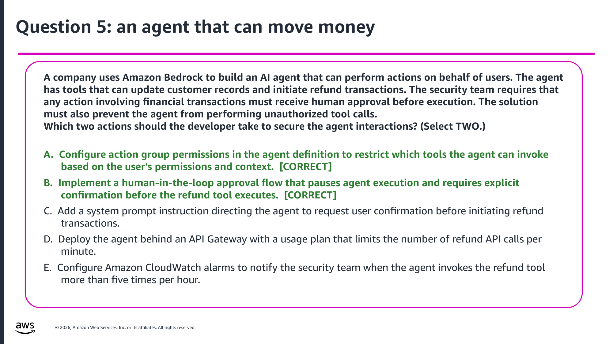

### Question

A company uses Amazon Bedrock to build an AI agent that can perform actions on behalf of users. The agent has tools that can update customer records and initiate refund transactions. The security team requires that any action involving financial transactions must receive human approval before execution. The solution must also prevent the agent from performing unauthorized tool calls.
Which two actions should the developer take to secure the agent interactions? (Select TWO.)

A.  Configure action group permissions in the agent definition to restrict which tools the agent can invoke based on the user's permissions and context.  [CORRECT]
B.  Implement a human-in-the-loop approval flow that pauses agent execution and requires explicit confirmation before the refund tool executes.  [CORRECT]
C.  Add a system prompt instruction directing the agent to request user confirmation before initiating refund transactions.
D.  Deploy the agent behind an API Gateway with a usage plan that limits the number of refund API calls per minute.
E.  Configure Amazon CloudWatch alarms to notify the security team when the agent invokes the refund tool more than five times per hour.

### Notes

ANSWER OVERVIEW: The answer is A and B. One control narrows what the agent may call, the other gates when it fires.

A. Configure action group permissions in the agent definition to restrict which tools the agent can invoke based on the user's permissions and context. — Correct — Action group permissions controls which tools an agent can call and under what conditions. By restricting tool access based on user permissions, the developer ensures the agent cannot perform unauthorized actions. This enforces least privilege at the agent-tool boundary.

B. Implement a human-in-the-loop approval flow that pauses agent execution and requires explicit confirmation before the refund tool executes. — Correct — A human-in-the-loop approval flow intercepts sensitive actions before they execute. When the agent attempts to call the refund tool, execution pauses until a human reviewer approves or rejects the action. This meets the requirement for human approval on financial transactions.

C. Add a system prompt instruction directing the agent to request user confirmation before initiating refund transactions. — Incorrect — System prompt instructions can be overridden through prompt injection or manipulation. Relying on prompt instructions for security controls is not reliable because the model may not consistently follow them. Deterministic approval flows provide stronger security guarantees than prompt-based controls.

D. Deploy the agent behind an API Gateway with a usage plan that limits the number of refund API calls per minute. — Incorrect — Rate limiting through API Gateway usage plans controls the volume of requests but does not provide human approval for individual transactions. A rate limit of one refund per minute still allows unauthorized refunds to execute without human review. Rate limiting is a throttling control, not an authorization control.

E. Configure Amazon CloudWatch alarms to notify the security team when the agent invokes the refund tool more than five times per hour. — Incorrect — CloudWatch alarms provide monitoring and alerting after actions have already occurred. They do not prevent or require approval before an action executes. By the time the alarm triggers, the unauthorized refund has already been processed. This is a detective control, not a preventive control.

EXAM RELEVANCE: Domain 2: Security. Difficulty: Hard.

REFERENCE: https://docs.aws.amazon.com/bedrock/latest/userguide/agents-userconfirmation.html

---

## Slide 52 — Question 5: an agent that can move money

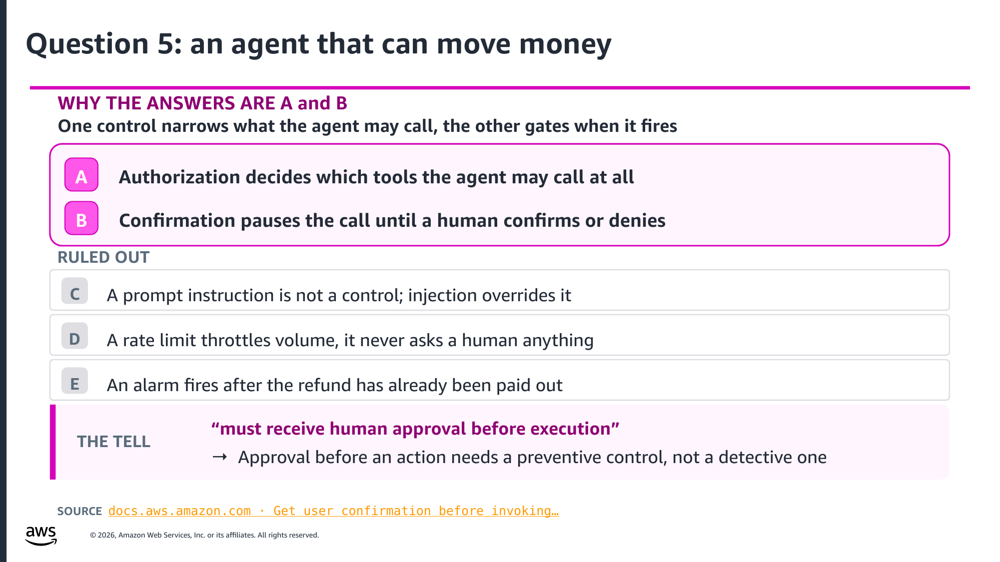

### Notes

WHAT'S HERE: The elimination, made visible. A and B are both required: one control narrows what the agent may call, the other gates when it fires. The others are ruled out for one reason each: C — A prompt instruction is not a control; injection overrides it; D — A rate limit throttles volume, it never asks a human anything; E — An alarm fires after the refund has already been paid out. Read the tell strip aloud -- pairing a phrase with what it signals is the transferable skill, not memorizing the service name.

EXAM RELEVANCE: Domain 2: Security. Difficulty: Hard. The pattern to teach: a scenario question rarely offers three absurd options. It offers ones that match a nearby requirement and one (or two) that match the requirement exactly. Here the discriminator is “must receive human approval before execution”, which points at Approval before an action needs a preventive control, not a detective one. Encourage the room to name the phrase before naming the service.

PARTNER CONTEXT · ADVISORY: A customer asking how to stop an agent taking an action it should not will reach for rate limits and alarms first. Naming user confirmation, and framing it as prompt injection defense, moves the conversation from volume control to authorization.

PARTNER CONTEXT · OPERATOR: A partner adding an agent that can move money is the situation this question is really about. This is the strongest security question in the set because three of the five choices are real controls that do not meet the requirement. Rate limiting and alarms are both defensible engineering; they simply act on volume and after the fact. The documented feature is user confirmation, and AWS frames it as a defense against PROMPT INJECTION -- the agent may be told by returned data to call something it should not, so the human sits between the decision and the transaction. That framing is also why choice C loses: the attack being defended against is precisely an instruction the model chooses to follow.

REFERENCE: https://docs.aws.amazon.com/bedrock/latest/userguide/agents-userconfirmation.html

REFERENCE: https://docs.aws.amazon.com/bedrock/latest/userguide/action-handle.html  -- this question needs two commands, so it has two carrying pages; the slide cites the one holding the tell.

⚠ BEFORE YOU PRESENT THIS ONE: Q25 is answerable as written, but its subject sits on Amazon Bedrock Agents, and the action-group pages now open with 'Amazon Bedrock Agents (now Amazon Bedrock Agents Classic) is no longer open to new customers', directing new work to Amazon Bedrock AgentCore -- which is the service the DVA-C03 guide lists in scope. The two controls the question turns on are real and documented, so nothing on the slide is wrong; the question-set review may still want the stem pointed at AgentCore.

---

## Slide 53 — Question 6: a model call that fails in a new account

### Question

A development team builds an application that calls a specific foundation model in Amazon Bedrock. The team deploys the application in a new AWS account. Calls to the model fail, although the IAM role that the application assumes allows the bedrock:InvokeModel action for that model. The team must enable the application to call the model.
Which action will meet this requirement?

A.  Attach a resource-based policy to the foundation model that grants the role permission to call it.
B.  Request access to the foundation model in Amazon Bedrock for the Region that the application uses.
C.  Purchase provisioned throughput for the foundation model so that the application can call it.
D.  Add the bedrock:ListFoundationModels action to the role so that the role can call the model.

### Notes

WHAT'S HERE: Put question 6 on screen and give the room about 90 seconds to read it in silence and commit to an answer before anyone speaks aloud. That is close to the pace the exam demands, so this rehearses timing as much as content.

Do not reveal or hint at the answer on this beat. The silent read is what makes the key-phrases beat and the reveal land -- if you talk through it now, both lose their effect.

EXAM RELEVANCE: Domain 2: Security. Difficulty: Easy. Watch the room: if most people have answered by 90 seconds, move on; if they are still reading, give another 20 seconds rather than rushing the discussion that follows.

PARTNER CONTEXT · ADVISORY: A customer whose first Bedrock call fails will ask you to fix their IAM policy. Being able to say the grant is not in IAM, and to name the account-level prerequisites, saves a support cycle and lands better than a per-Region request step.

PARTNER CONTEXT · OPERATOR: A partner whose developer is stuck on an access-denied error on their first Bedrock call hits this on day one. The teaching point survives the wording problem noted below: an IAM policy that allows bedrock:InvokeModel is necessary and not sufficient, so a developer reading only the IAM error goes looking in the wrong place. Access to a model is settled at the ACCOUNT level, and the documented prerequisites are AWS Marketplace permissions on the calling role, a valid payment method, and for Anthropic models a first-time-use form. Present it as 'the grant is not in IAM' rather than as a per-model request step, which is what the slide taught and what the page now says.

EXAM MAPPING: Domain 2: Security.

---

## Slide 54 — Question 6: a model call that fails in a new account

### Question

A development team builds an application that calls a specific foundation model in Amazon Bedrock. The team deploys the application in a new AWS account. Calls to the model fail, although the IAM role that the application assumes allows the bedrock:InvokeModel action for that model. The team must enable the application to call the model.
Which action will meet this requirement?

A.  Attach a resource-based policy to the foundation model that grants the role permission to call it.
B.  Request access to the foundation model in Amazon Bedrock for the Region that the application uses.
C.  Purchase provisioned throughput for the foundation model so that the application can call it.
D.  Add the bedrock:ListFoundationModels action to the role so that the role can call the model.

### Notes

KEY PHRASES: Walk the question, do not answer it yet. The phrase that decides it is “allows the bedrock:InvokeModel action for that model”, and it tells you: IAM allowing the call and the call still failing points outside IAM.

WHAT'S HERE: The same question with the timer removed. This beat teaches HOW to read a scenario question -- find the requirement, then find the words that separate options that all look plausible on a first pass.

EXAM RELEVANCE: Domain 2: Security. Difficulty: Easy. Ask the room which words they underlined before you show them the tell, so they practise finding it rather than being handed it.

PARTNER CONTEXT · ADVISORY: A customer whose first Bedrock call fails will ask you to fix their IAM policy. Being able to say the grant is not in IAM, and to name the account-level prerequisites, saves a support cycle and lands better than a per-Region request step.

PARTNER CONTEXT · OPERATOR: A partner whose developer is stuck on an access-denied error on their first Bedrock call hits this on day one. The teaching point survives the wording problem noted below: an IAM policy that allows bedrock:InvokeModel is necessary and not sufficient, so a developer reading only the IAM error goes looking in the wrong place. Access to a model is settled at the ACCOUNT level, and the documented prerequisites are AWS Marketplace permissions on the calling role, a valid payment method, and for Anthropic models a first-time-use form. Present it as 'the grant is not in IAM' rather than as a per-model request step, which is what the slide taught and what the page now says.

EXAM MAPPING: Domain 2: Security.

---

## Slide 55 — Question 6: a model call that fails in a new account

### Question

A development team builds an application that calls a specific foundation model in Amazon Bedrock. The team deploys the application in a new AWS account. Calls to the model fail, although the IAM role that the application assumes allows the bedrock:InvokeModel action for that model. The team must enable the application to call the model.
Which action will meet this requirement?

A.  Attach a resource-based policy to the foundation model that grants the role permission to call it.
B.  Request access to the foundation model in Amazon Bedrock for the Region that the application uses.  [CORRECT]
C.  Purchase provisioned throughput for the foundation model so that the application can call it.
D.  Add the bedrock:ListFoundationModels action to the role so that the role can call the model.

### Notes

ANSWER OVERVIEW: The answer is B. Model access is an account-level grant, separate from the IAM action.

A. Attach a resource-based policy to the foundation model that grants the role permission to call it. — Incorrect — Foundation models in Amazon Bedrock do not take resource-based policies, so there is nothing to attach. Access is controlled by the model access grant together with IAM identity-based permissions.

B. Request access to the foundation model in Amazon Bedrock for the Region that the application uses. — Correct — Access to a foundation model must be requested in Amazon Bedrock before the model can be invoked, and the grant applies per account and per Region. IAM permission alone is not sufficient, which is why the calls fail while the role allows the action.

C. Purchase provisioned throughput for the foundation model so that the application can call it. — Incorrect — Provisioned throughput reserves capacity for a model to support a required request rate. It is a capacity option for a model the account can already use, and it does not grant access.

D. Add the bedrock:ListFoundationModels action to the role so that the role can call the model. — Incorrect — The bedrock:ListFoundationModels action permits listing the available models. It does not permit invoking one, and the role already allows bedrock:InvokeModel, so this changes nothing.

EXAM RELEVANCE: Domain 2: Security. Difficulty: Easy.

REFERENCE: https://docs.aws.amazon.com/bedrock/latest/userguide/model-access.html

---

## Slide 56 — Question 6: a model call that fails in a new account

### Notes

WHAT'S HERE: The elimination, made visible. B win because model access is an account-level grant, separate from the IAM action. The others are ruled out for one reason each: A — A foundation model takes no resource-based policy to attach; C — Provisioned throughput buys capacity for a model you can use; D — Listing models is not invoking one, and InvokeModel is allowed. Read the tell strip aloud -- pairing a phrase with what it signals is the transferable skill, not memorizing the service name.

EXAM RELEVANCE: Domain 2: Security. Difficulty: Easy. The pattern to teach: a scenario question rarely offers three absurd options. It offers ones that match a nearby requirement and one (or two) that match the requirement exactly. Here the discriminator is “allows the bedrock:InvokeModel action for that model”, which points at IAM allowing the call and the call still failing points outside IAM. Encourage the room to name the phrase before naming the service.

PARTNER CONTEXT · ADVISORY: A customer whose first Bedrock call fails will ask you to fix their IAM policy. Being able to say the grant is not in IAM, and to name the account-level prerequisites, saves a support cycle and lands better than a per-Region request step.

PARTNER CONTEXT · OPERATOR: A partner whose developer is stuck on an access-denied error on their first Bedrock call hits this on day one. The teaching point survives the wording problem noted below: an IAM policy that allows bedrock:InvokeModel is necessary and not sufficient, so a developer reading only the IAM error goes looking in the wrong place. Access to a model is settled at the ACCOUNT level, and the documented prerequisites are AWS Marketplace permissions on the calling role, a valid payment method, and for Anthropic models a first-time-use form. Present it as 'the grant is not in IAM' rather than as a per-model request step, which is what the slide taught and what the page now says.

REFERENCE: https://docs.aws.amazon.com/bedrock/latest/userguide/model-access.html

⚠ BEFORE YOU PRESENT THIS ONE: Q31's keyed answer B reads 'Request access to the foundation model in Amazon Bedrock for the Region that the application uses', and its explanation adds that 'the grant applies per account and per Region'. The current page says the opposite twice over: 'Access to all Amazon Bedrock foundation models is enabled by default with the correct AWS Marketplace permissions in all commercial AWS Regions', and 'If an identity has already subscribed to a model in one AWS Region, the model becomes available for the identity to request access in all AWS Regions in which the model is available'. B remains the best of the four -- A, C and D are each definitively wrong -- and the underlying idea is right: the grant is not in IAM. But the per-Region request framing is out of date, and THIS DECK TEACHES THE CURRENT BEHAVIOR at the model-access slide, so a presenter who teaches the slide and then reveals B contradicts themselves inside the same hour.

---

## Slide 57 — Question 7: personal data reaching the invocation log

### Question

A company enables model invocation logging for an application that calls Amazon Bedrock. A compliance review finds that the prompts the application sends can contain customer personal data, and that this data is now written to the invocation logs. The company must ensure that the personal data is not stored in the invocation logs, and invocation logging must remain enabled.
Which solution will meet these requirements?

A.  Remove the personal data from the prompt in the application before the prompt is sent to the model.
B.  Encrypt the log destination with an AWS KMS customer managed key and restrict access to the key.
C.  Change the invocation logging destination from Amazon CloudWatch Logs to an Amazon S3 bucket.
D.  Apply a policy to the log destination that grants read access only to the compliance team role.

### Notes

WHAT'S HERE: Put question 7 on screen and give the room about 90 seconds to read it in silence and commit to an answer before anyone speaks aloud. That is close to the pace the exam demands, so this rehearses timing as much as content.

Do not reveal or hint at the answer on this beat. The silent read is what makes the key-phrases beat and the reveal land -- if you talk through it now, both lose their effect.

EXAM RELEVANCE: Domain 2: Security. Difficulty: Medium. Watch the room: if most people have answered by 90 seconds, move on; if they are still reading, give another 20 seconds rather than rushing the discussion that follows.

PARTNER CONTEXT · ADVISORY: A customer who wants prompt logging for audit AND personal data kept out of the logs is asking for two things that pull against each other. Surfacing that trade-off, and that the only fix sits upstream of the call, is advice worth giving before they build.

PARTNER CONTEXT · OPERATOR: A partner turning on invocation logging for auditability runs into this trade-off immediately. Three of the four choices are things a security team would genuinely ask for, and none of them satisfies the requirement as written. Encrypting the destination, moving it, and restricting who reads it all protect data that is still recorded. Invocation logging captures the request and response as sent, so the only place to stop personal data reaching the log is BEFORE the call. The wider lesson for a partner is that observability and data minimization pull against each other, and logging the prompt is exactly where that shows up.

EXAM MAPPING: Domain 2: Security.

---

## Slide 58 — Question 7: personal data reaching the invocation log

### Question

A company enables model invocation logging for an application that calls Amazon Bedrock. A compliance review finds that the prompts the application sends can contain customer personal data, and that this data is now written to the invocation logs. The company must ensure that the personal data is not stored in the invocation logs, and invocation logging must remain enabled.
Which solution will meet these requirements?

A.  Remove the personal data from the prompt in the application before the prompt is sent to the model.
B.  Encrypt the log destination with an AWS KMS customer managed key and restrict access to the key.
C.  Change the invocation logging destination from Amazon CloudWatch Logs to an Amazon S3 bucket.
D.  Apply a policy to the log destination that grants read access only to the compliance team role.

### Notes

KEY PHRASES: Walk the question, do not answer it yet. The phrase that decides it is “invocation logging must remain enabled”, and it tells you: Data that must not be stored has to be removed before it is sent.

WHAT'S HERE: The same question with the timer removed. This beat teaches HOW to read a scenario question -- find the requirement, then find the words that separate options that all look plausible on a first pass.

EXAM RELEVANCE: Domain 2: Security. Difficulty: Medium. Ask the room which words they underlined before you show them the tell, so they practise finding it rather than being handed it.

PARTNER CONTEXT · ADVISORY: A customer who wants prompt logging for audit AND personal data kept out of the logs is asking for two things that pull against each other. Surfacing that trade-off, and that the only fix sits upstream of the call, is advice worth giving before they build.

PARTNER CONTEXT · OPERATOR: A partner turning on invocation logging for auditability runs into this trade-off immediately. Three of the four choices are things a security team would genuinely ask for, and none of them satisfies the requirement as written. Encrypting the destination, moving it, and restricting who reads it all protect data that is still recorded. Invocation logging captures the request and response as sent, so the only place to stop personal data reaching the log is BEFORE the call. The wider lesson for a partner is that observability and data minimization pull against each other, and logging the prompt is exactly where that shows up.

EXAM MAPPING: Domain 2: Security.

---

## Slide 59 — Question 7: personal data reaching the invocation log

### Question

A company enables model invocation logging for an application that calls Amazon Bedrock. A compliance review finds that the prompts the application sends can contain customer personal data, and that this data is now written to the invocation logs. The company must ensure that the personal data is not stored in the invocation logs, and invocation logging must remain enabled.
Which solution will meet these requirements?

A.  Remove the personal data from the prompt in the application before the prompt is sent to the model.  [CORRECT]
B.  Encrypt the log destination with an AWS KMS customer managed key and restrict access to the key.
C.  Change the invocation logging destination from Amazon CloudWatch Logs to an Amazon S3 bucket.
D.  Apply a policy to the log destination that grants read access only to the compliance team role.

### Notes

ANSWER OVERVIEW: The answer is A. Only the prompt never containing the data keeps it out of the log.

A. Remove the personal data from the prompt in the application before the prompt is sent to the model. — Correct — Model invocation logging records the request and response data that passes through the service, so any personal data in a prompt is captured. Removing or masking the data in the application before the call means it is never sent and therefore never written to the logs, and logging stays enabled.

B. Encrypt the log destination with an AWS KMS customer managed key and restrict access to the key. — Incorrect — Encrypting the destination protects the logs at rest and limits who can read them. The personal data is still recorded in the log content, so the requirement that it not be stored is not met.

C. Change the invocation logging destination from Amazon CloudWatch Logs to an Amazon S3 bucket. — Incorrect — The destination determines where the log data is delivered, not what the log data contains. The same prompt content, including the personal data, is written to either destination.

D. Apply a policy to the log destination that grants read access only to the compliance team role. — Incorrect — Restricting read access controls who can view the logs. The personal data remains stored in them, so this addresses access rather than the requirement that the data not be stored.

EXAM RELEVANCE: Domain 2: Security. Difficulty: Medium.

REFERENCE: https://docs.aws.amazon.com/bedrock/latest/userguide/model-invocation-logging.html

---

## Slide 60 — Question 7: personal data reaching the invocation log

### Notes

WHAT'S HERE: The elimination, made visible. A win because only the prompt never containing the data keeps it out of the log. The others are ruled out for one reason each: B — Encryption protects the log; the personal data is still in it; C — The destination changes where it lands, not what it contains; D — Restricting readers is access control, not removal. Read the tell strip aloud -- pairing a phrase with what it signals is the transferable skill, not memorizing the service name.

EXAM RELEVANCE: Domain 2: Security. Difficulty: Medium. The pattern to teach: a scenario question rarely offers three absurd options. It offers ones that match a nearby requirement and one (or two) that match the requirement exactly. Here the discriminator is “invocation logging must remain enabled”, which points at Data that must not be stored has to be removed before it is sent. Encourage the room to name the phrase before naming the service.

PARTNER CONTEXT · ADVISORY: A customer who wants prompt logging for audit AND personal data kept out of the logs is asking for two things that pull against each other. Surfacing that trade-off, and that the only fix sits upstream of the call, is advice worth giving before they build.

PARTNER CONTEXT · OPERATOR: A partner turning on invocation logging for auditability runs into this trade-off immediately. Three of the four choices are things a security team would genuinely ask for, and none of them satisfies the requirement as written. Encrypting the destination, moving it, and restricting who reads it all protect data that is still recorded. Invocation logging captures the request and response as sent, so the only place to stop personal data reaching the log is BEFORE the call. The wider lesson for a partner is that observability and data minimization pull against each other, and logging the prompt is exactly where that shows up.

REFERENCE: https://docs.aws.amazon.com/bedrock/latest/userguide/model-invocation-logging.html

---

## Slide 61 — Q&A time

### Notes

FACILITATOR: Open the floor. This is the last live session, so expect two kinds of question: the security specifics from today, and logistics about sitting the exam.

The security questions worth drawing out are the ones where two controls both sound right. Private subnet versus private path is the strongest of those, and the interface endpoint slide is the fastest way back to it.

If someone asks about Bedrock model access, use the notes on that question rather than answering from memory -- the wording of the keyed answer and the current documented behavior do not match, and that is flagged for you.

For anything needing a source rather than an answer, the citation row on each slide and the appendix at the end are where to send them.

---

## Slide 62 — After the exam, prove it in a live AWS account

### Notes

WHAT'S HERE: The one thing to do after the certification exam. The exam validates what you know about the serverless domain; this exam lab asks you to go and fix it in a real account. Same domain, the other half of the evidence.

FACILITATOR: Land the contrast before the detail, because it is the whole reason the slide exists. A certification is role-based and tests breadth through multiple choice. A microcredential is topic-based and tests depth by putting the candidate in a provisioned AWS environment to diagnose issues and implement solutions.

Then make it concrete with the service list in the caption. Amazon Cognito, Amazon API Gateway and AWS WAF are all on it, and WAF and API Gateway are both on today's slides -- so this is not a general recommendation, it is the lab that grades what the room just covered.

The mechanics, all from the official description: once you begin you have 90 minutes for all challenges, and the lab gives guidance but not step-by-step solutions. Passing issues a Credly digital badge that appears under Credentials on the Skill Builder Skills Profile.

Say the access point plainly, because it changed and people assume otherwise: microcredentials have been freely accessible to all learners since April 2026 and need no Skill Builder subscription. Learners find them under Explore, then Validate your skills, then Earn a microcredential.

Share the enrollment page on screen rather than reading the URL aloud, and frame it as further practice rather than exam preparation -- the exam is behind them at this point.

Recommend the order out loud: sit the certification exam first, then attempt the lab. Saying it stops someone taking the hardest artifact first and reading a bad result as a verdict on their readiness.

---

## Slide 63 — Good luck on your exam!

### Notes

FACILITATOR: Close by naming the whole arc, not just today, because this is the last time the group is together.

Five weeks: the platform and its storage, then compute and data, then observability and troubleshooting, then testing and deployment, and today security and the security of using AI services.

Remind them the week-5 digital training is still available after the session, that the practice exam sits inside it, and that the appendix at the end of this deck covers the C02 to C03 difference for anyone choosing to sit the exam that is live today.

Thank them for the questions specifically rather than for attending -- the discussion is what made the live sessions worth more than the recordings.

---

## Slide 64 — Appendix -- DVA-C02 reference

### Notes

APPENDIX: Divider. This block is self-study reference for anyone who plans to sit DVA-C02 rather than C03. It is not taught in the session -- point the room at it and move on. The three appendix slides sit together at the end of the deck by design.

WHAT'S HERE: The session decks are built for DVA-C03. This appendix collects what a C02 candidate needs that the C03 body does not spell out: how the exam guide's weightings shifted, and what changed for this week's topics.

EXAM RELEVANCE: Week 5 carries the largest delta of the five weeks. C03 adds an entirely new task for AI service security, and C02's separate encryption and sensitive-data tasks merge into one.

A C02 candidate reading a C03 deck needs to know that a whole task here does not exist on their exam.

FACILITATOR: There is one trap on the next two slides worth naming out loud if anyone is sitting C02. The task NUMBER 2.3 exists on both exams and means two different things. Do not let someone walk away planning to revise "Task 2.3" without checking which guide they are holding.

REFERENCE: The C02 figures come from the DVA-C02 exam guide; the C03 figures come from the September 2026 certification updates blog. Both are linked from the delta slides that follow. EXAM MAPPING: DVA-C02 to DVA-C03 comparison.

---

## Slide 65 — How C02 and C03 differ for this week

### Notes

APPENDIX: Week-5 delta table. Walk the left column first: the four domain weightings barely move. Development eases from 32% to 30%, Security holds at 26%, Testing and Deployment eases from 24% to 22%, and Troubleshooting and Optimization rises from 18% to 22% -- the largest single shift.

WHAT'S HERE: The right column is week 5's story, and it is the biggest change in the program. C03 adds an entirely new task, 2.3, for the security of using and integrating AI services.

That task covers access management, data privacy controls, filtering model inputs and outputs, securing agent interactions, and protecting sensitive content in logs. None of it exists on C02.

Three more changes sit under it. AWS PrivateLink joins the in-scope service list at C03. C02 examined encryption and sensitive data as two separate tasks totalling thirteen skills; C03 folds them into a single task of seven.

AWS AppSync is in the published DVA-C02 in-scope list and is not taught in this C03-targeted body, so a C02 candidate studies it separately.

⚠ THE TASK NUMBER 2.3 MEANS TWO DIFFERENT THINGS. On C02 it is sensitive data. On C03 it is the new AI-service-security task. Same identifier, different subject -- so do not map one onto the other, and say so if a C02 candidate is taking notes by task number.

REFERENCE: C02 weightings, domains and the AppSync in-scope entry are from the DVA-C02 exam guide at docs.aws.amazon.com/aws-certification/latest/developer-associate-02/; the new Task 2.3, the AWS PrivateLink addition and the consolidation are quoted from the September 2026 certification updates blog, linked on this slide. EXAM MAPPING: Domain 2 Task 2.3 addition and the Domain 2 consolidation.

---

## Slide 66 — What a DVA-C02 candidate needs here

### Notes

APPENDIX: C02 reference. For a candidate sitting C02 rather than C03, the left column is what this session covers that their exam does not. Week 5's left column is the longest in the program -- four entries, and one of them is an entire task.

WHAT'S HERE: Task 2.3 is C03-only in its entirety, so every Bedrock Guardrails slide, the model-access slide and the invocation-logging slide sit outside a C02 candidate's syllabus. AWS PrivateLink is newly in scope at C03 as well, so the interface-endpoint slide and Question 3 sit outside it too.

The two Domain 4 additions are the AI troubleshooting and optimization skills. That is why this week's X-Ray block matters to both exams while the AI tooling around it does not.

The right column is the reassuring part, and it is most of the session. The protective services, certificate management, content access and tracing are all on both exams. A C02 candidate loses the AI block and the private-connectivity slide, and keeps everything else.

⚠ AWS APPSYNC IS ON THE C02 EXAM AND IS NOT TAUGHT HERE, which reverses the columns above -- a C02 candidate needs it and this C03-targeted body does not cover it.

It is deliberately not taught in this deck's body, because the body targets C03. A C02 candidate should not conclude from that absence that they can skip it.

FACILITATOR: If someone asks whether to sit C02 or C03, point at this slide rather than answering from memory. The domains are named here on purpose, because AWS has published the C03 additions by domain rather than by task.

Remind them that 2.3 is the one number that does not mean the same thing in both guides.

REFERENCE: The C02 task list and the AppSync in-scope entry are from the DVA-C02 exam guide linked on this slide; the four C03-only additions are from the September 2026 certification updates blog, which names AWS PrivateLink among the new in-scope services and states the Domain 4 items by domain rather than by task. EXAM MAPPING: Domain 2 Task 2.3, plus the Domain 4 additions.

---
